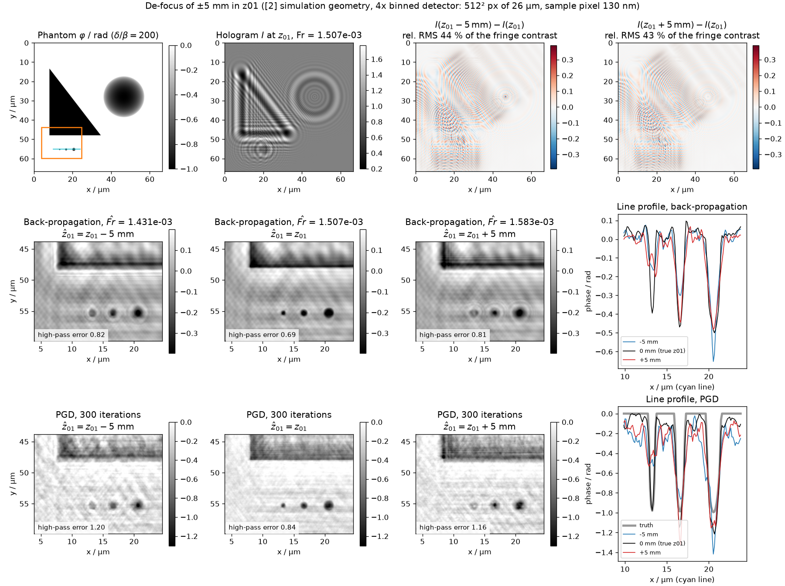
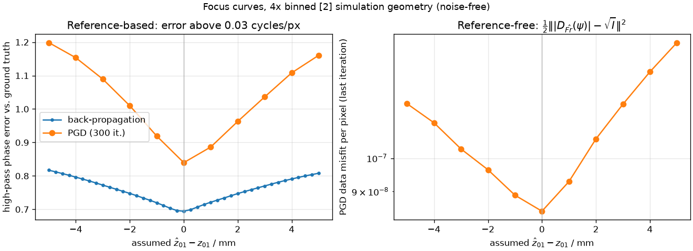
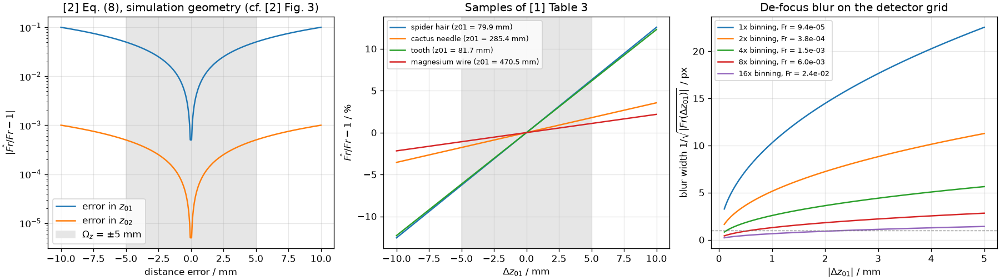
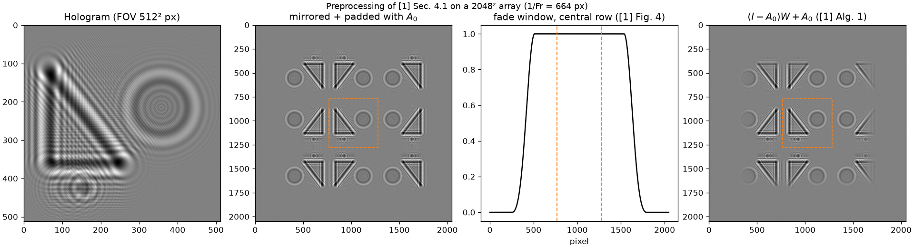
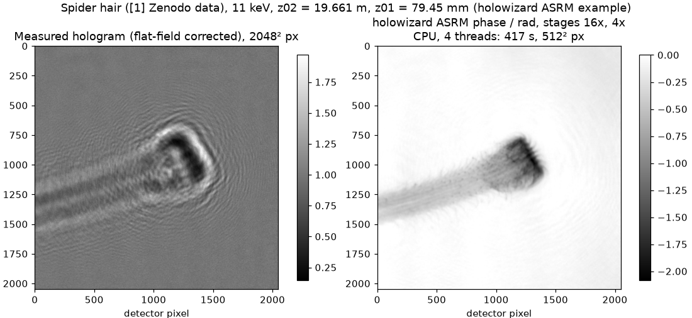

# Laborbuch 01 – Etappe 1: Physik-Kern und Projektgerüst

| | |
|---|---|
| Datum | 20.10.2026 |
| Branch | `cursor/stage1-physics-core-1091` |
| Code | `src/holofocus/` (Paket `holofocus`), `tests/`, `scripts/make_stage1_figures.py` |
| Abbildungen | `docs/laborbuch/figures/stage1-*.png`, Zahlen in `stage1-metrics.json` |
| Quellen | [1] Dora et al., Opt. Express 32(7), 10801 (2024); [2] Dora et al., Opt. Express 33(4), 6641 (2025) |

## 1 Ziel

Ein physikalisch korrekter, getesteter Kern für Simulation und Rekonstruktion im
Kegelstrahl-Setup von [1] und [2], auf dem die weiteren Etappen aufbauen:

- Geometrie: Wellenlänge aus der Energie, Abstände `z01`, `z12`, `z02`, Vergrößerung,
  Fresnel scaling theorem, Fresnel-Zahl ([1] Eq. (8)–(9), [2] Eq. (4)–(7)).
- Vorwärtsmodell: projizierter Brechungsindex $\tilde O = \varphi + i\mu$, Austrittswelle
  $\exp(i\tilde O)$ bei konstanter Beleuchtung, Fresnel-Propagator $D_{Fr}$ im Fourierraum,
  Intensität $|\cdot|^2$; Padding nach [1] Sec. 4.1.
- Projektgerüst: Python-Paket, Tests, CI.
- Erste Abbildung zum Defokus von ±5 mm in `z01`.
- Prüfen, ob der Code von [1] installierbar ist und ASRM enthält.

## 2 Ausgangslage

Der erste Commit des Repos (`3579d34`) war ein ungeprüfter Entwurf, den der Student mit
DeepSeek erstellt hatte: phase-only Kugeln, Parallelstrahl, festes $\lambda = 1{,}1\cdot10^{-10}$ m,
Regression eines Abstands um 1 m. Kegelstrahl, `Fr`, Preprocessing und Absorption fehlen. Der
Entwurf ist **keine Referenz** und wurde aus dem Arbeitsbaum entfernt. Er bleibt in der
Git-Historie erhalten (`git show 3579d34 --stat`, Dateien z. B. mit
`git show 3579d34:src/data/generator.py`).

Außerdem liegen auf GitHub sechs offene Entwurfs-PRs (#1–#6, Branches `cursor/*-6175`) eines
früheren Agentenlaufs vom 1./2. Oktober 2026. Sie bauen auf holowizard und dem alten Layout auf.
Ich habe sie weder geprüft noch als Grundlage verwendet. Nach dem Merge dieser Etappe stehen sie
im Konflikt mit `main`.

## 3 Was gemacht wurde

### 3.1 Projektgerüst

- Paket `holofocus` im src-Layout, `pyproject.toml` (Abhängigkeiten numpy, torch, matplotlib,
  pyyaml; Entwicklung: pytest, ruff), `.gitignore` für Daten und Ausgaben.
- GitHub Actions (`.github/workflows/tests.yml`): CPU-PyTorch, Python 3.10 und 3.12, `ruff`,
  `pytest`, Abbildungsskript im Schnellmodus.
- Englische Bedienungsdoku: `README.md`, `docs/usage.md`.

### 3.2 Module

| Modul | Inhalt | Quelle |
|---|---|---|
| `geometry.py` | $\lambda = hc/E$, `ConeBeamGeometry` (M, effektiver Pixel, effektive Distanz, `Fr`), `fresnel_number_at(z)`, `defocused(dz)`, `binned(b)`, `min_grid_size()`, Inversion `Fr → z01`, Fehlermaß ERR | [1] Eq. (7)–(9), [2] Eq. (4)–(10) |
| `propagation.py` | `FresnelPropagator` (separabler Kern, Batch, Rückpropagation mit `−Fr`), Abtastbedingung $N \ge 1/\lvert Fr\rvert$ | [1] Eq. (5), Sec. 3.2.2; [2] Eq. (3) |
| `forward.py` | $\tilde O$ aus $\int\delta\,dz$, $\int\beta\,dz$; Einzelmaterial mit festem $\delta/\beta$; Austrittswelle; Hologramm mit Freiraum-Padding | [1] Eq. (3)–(6), [2] Eq. (1)–(2) |
| `preprocessing.py` | Flat-Field, Spiegeln, Padding mit $A_0$, modifiziertes Blackman-Fenster | [1] Sec. 4.1, Alg. 1, Eq. (10), (17), Fig. 3–4 |
| `constraints.py` | Projektionen $\Omega_P$ für Objekt und Wellenfeld | [1] Eq. (19), [2] Eq. (12) |
| `reconstruction.py` | Rückpropagation, Gradient der Datentreue, projizierter (Nesterov-)Gradientenabstieg | [1] Eq. (18)–(23) |
| `phantoms.py` | Dreieck, Ellipse, Kugel, Rasterung mit Subpixel-Mittelung | [2] Sec. 3.5, Fig. 5 |
| `device.py`, `arrays.py` | Geräte-/Dtype-Helfer, Zuschneiden, Padding, Binning | – |

Umfang: knapp 900 Zeilen inklusive Docstrings, 51 Tests.

### 3.3 Physik in Formeln (so implementiert)

Alle Abstände werden vom Fokus der Optik gemessen ([1] Fig. 1): `z01` Fokus–Probe, `z12`
Probe–Detektor, `z02 = z01 + z12` Fokus–Detektor.

$$\lambda = \frac{hc}{E},\qquad M = \frac{z_{02}}{z_{01}},\qquad
\Delta x_\text{eff} = \frac{\Delta x}{M},\qquad z_\text{eff} = \frac{z_{12}}{M} = \frac{z_{01}z_{12}}{z_{02}}$$

$$Fr = \frac{\Delta x_\text{eff}^2}{\lambda z_\text{eff}} = \frac{\Delta x^2}{\lambda M z_{12}}
\quad\text{([1] Eq. (9))},\qquad
Fr(z) = \frac{(\Delta x/M_1)^2}{\lambda z / M_2},\; M_1 = \frac{z_{02}}{z_{01}},\; M_2 = \frac{z_{01}+z}{z_{01}}
\quad\text{([2] Eq. (5)–(7))}$$

Vorwärtsmodell ([1] Eq. (3)–(6)):

$$\tilde O = -k\int(\delta - i\beta)\,dz = \varphi + i\mu,\qquad
\psi_\text{exit} = A_0 e^{i\varphi_0}\exp(i\tilde O),\qquad
I = \lvert D_{Fr}(\psi_\text{exit})\rvert^2$$

$$D_{Fr}(\psi) = \mathcal F^{-1}\!\left[\exp\!\left(-i\pi\frac{k_x^2+k_y^2}{Fr}\right)\mathcal F[\psi]\right],
\qquad k \text{ in Zyklen pro Pixel}$$

Defokus ([2] Eq. (9)–(10)): angenommene Geometrie $\hat z_{01} = z_{01} + \Delta z_{01}$,
$\hat z_{12} = z_{12} - \Delta z_{01}$, `z02` fest. Die Tests bestätigen die exakte Zerlegung

$$\frac{1}{Fr(z_{12})} = \frac{1}{Fr(\Delta z_{01})} + \frac{1}{\hat{Fr}(\hat z_{12})}.$$

Folgerung: Wer ein Hologramm mit der falschen Geometrie zurückpropagiert, erhält **exakt** die
um $\Delta z_{01}$ propagierte Austrittswelle, also das defokussierte Feld von [2] Eq. (11).
Die Unschärfe hat die Breite der ersten Fresnel-Zone, $\approx\sqrt{\lambda\lvert\Delta z_{01}\rvert}$
in der Probenebene: 0,75 µm bei 5 mm und 11 keV. In Pixeln ist das $1/\sqrt{\lvert Fr(\Delta z_{01})\rvert}$.

### 3.4 Preprocessing ([1] Sec. 4.1, Alg. 1)

$I_\text{corr} = I_\text{raw}/I_\text{flat}$, dann das Hologramm in alle Richtungen spiegeln
(höchstens `Größe − 1` Pixel je Seite, `MIRROR_ALL` im Papiercode), mit $A_0$ auf die Zielgröße
auffüllen und die Spiegelkopien mit den Hälften eines Blackman-Fensters
($0{,}42 - 0{,}5\cos(2\pi x/(w-1)) + 0{,}08\cos(4\pi x/(w-1))$, [1] Eq. (17)) nach $A_0$ blenden:
$(I - A_0)W + A_0$. Das Sichtfeld bleibt bitgenau unverändert (Test). Für Simulationen wird
das Objekt dagegen in freien Raum ($\tilde O = 0$) eingebettet. Das Spiegeln ist eine Maßnahme
für Messdaten, deren Umgebung unbekannt ist.

### 3.5 Einfache Rekonstruktionen (nur zur Veranschaulichung)

- Holographische Rückpropagation $D_{-\hat{Fr}}(\sqrt I)$ mit Nullphase (enthält das Zwillingsbild).
- Projizierter Gradientenabstieg (PGD) auf $\tilde O$ mit Nesterov-Momentum und der Projektion
  $\Omega_P$: $\operatorname{Re} \le 0$, $\operatorname{Im} \ge -\log A_0$ ([1] Eq. (19)).
  Gradient nach [1] Eq. (22):
  $\nabla f = -i\,\overline{\exp(i\tilde O)}\,D_{Fr}^{-1}\!\big(D_{Fr}(\psi) - \sqrt I\,\operatorname{sgn}(D_{Fr}(\psi))\big)$.
  Der Querstrich (komplex konjugiert) steht im gedruckten PDF, fehlt aber im Textlayer. Ein
  Test vergleicht mit Autograd (relativ $10^{-9}$).

Das ist der Kern von refAP ([1] Alg. 2) ohne Gauß-Filter, **nicht** ASRM ([1] Alg. 5). ASRM
ist die innere Rekonstruktion der Baseline von [2] und gehört zu Etappe 3.

### 3.6 Tests (51, davon 1 nur mit CUDA)

| Datei | Prüft |
|---|---|
| `test_geometry.py` | Wellenlängen (11 keV: $1{,}127129\cdot10^{-10}$ m), [1] Table 3, [2] Table 2, Vergrößerung und äquivalenter Parallelstrahl, [2] Eq. (5) = [1] Eq. (9) bei $z = z_{12}$, Defokus-Zerlegung (rel. $10^{-12}$), Inversion `Fr → z01`, [2] Fig. 3, Binning |
| `test_propagation.py` | Kern = Formel; Hin- und Rückweg (complex128: $10^{-12}$); Unitarität/Energieerhaltung; reines Phasenobjekt hält mittlere Intensität 1; Hintereinanderausführung; Gauß-Strahl gegen analytische Fresnel-Lösung ($10^{-12}$); Abtastwarnung; Batch; CPU = CUDA |
| `test_forward.py` | Vorzeichen von $\tilde O$; $\delta/\beta$-Kopplung; leeres Objekt → flaches Hologramm; mittlere Intensität = Transmission; schwaches Phasenobjekt folgt der CTF $1 + 2\mathcal F^{-1}[\sin(\pi k^2/Fr)\hat\varphi]$; Freiraum-Padding |
| `test_preprocessing.py` | Blackman-Formel, Fensterlage, Flat-Field, Sichtfeld unverändert, Spiegelwerte, Padding mit $A_0$ |
| `test_reconstruction.py` | Gradient = Autograd; Rückpropagation und PGD am schärfsten bei $\Delta z_{01} = 0$; Hologramm über die Defokus-Ebene identisch ([2] Eq. (11)) |

## 4 Entscheidungen und Begründung

**E1 – Eigener schlanker Kern statt Papiercode als Abhängigkeit.** Der Code von [1] enthält
ASRM und läuft in der aktuellen Version auf der CPU (Abschnitt 6). Als Abhängigkeit dieses
Repos eignet er sich trotzdem nicht: holowizard 3.0.6 verlangt genau Python 3.11 und zieht 162
Pakete (u. a. torch 2.10, cupy-cuda12x, PySide2, astra-toolbox, selenium; 8,7 GB). Die zitierte
Zenodo-Version läuft ohne GPU gar nicht. Für Etappe 2 brauche ich volle Kontrolle über Labels
(`Δz01`, `Fr`), Seeds, Rauschmodell und Speicherformat. Der HoloForge-Generator in holowizard
speichert außerdem $\lvert\psi\rvert$ statt $\lvert\psi\rvert^2$ als „hologram“ und nutzt
Mehrmaterial-Phantome statt eines festen $\delta/\beta$ ([2] Sec. 3.5). Der eigene Kern ist klein
und gegen holowizard abgeglichen (Abschnitt 5.4). holowizard bleibt die Referenz für ASRM und
`find_focus` in Etappe 3, in eigener Umgebung oder als Portierung (MIT-Lizenz).

**E2 – PyTorch, geräteunabhängig.** Alle Tensoren entstehen auf dem Gerät der Eingabe,
`get_device("auto")` wählt CUDA, wenn vorhanden. Damit läuft derselbe Code jetzt auf der CPU
und später auf der GPU der Uni. Standard ist complex64. Die Kernphase $\pi k^2/Fr$ erreicht
beim vollen Detektor $\approx 8\cdot10^3$ rad. Sie wird deshalb in float64 berechnet, modulo
$2\pi$ reduziert und erst dann gecastet.

**E3 – $hc$ nach CODATA (SI 2019, exakt): 1,239842 keV nm.** Der Papiercode v1.0.0 nutzt
1,2389 keV nm (−0,076 %), holowizard 3.x 1,2398 keV nm (−0,0034 %). Damit sind die kleinen
Abweichungen zu [1] Table 3 erklärt (Abschnitt 5.1).

**E4 – Einheiten und Bezug.** Meter, keV, Radiant. `Fr` ist dimensionslos und bezieht sich
auf das Detektor-Pixelraster (Fresnel scaling theorem). Binning um `b` multipliziert die
Pixelgröße mit `b` und `Fr` mit `b²`.

**E5 – Simulation mit Freiraum, Rekonstruktion mit Spiegeln.** Simuliert wird das Objekt in
einem größeren Array mit $\tilde O = 0$ (kein periodischer Überlauf der FFT). Danach wird auf
das Detektor-Sichtfeld beschnitten. Fringes außerhalb des Detektors gehen verloren, wie im
Experiment. Rekonstruiert wird mit dem Preprocessing von [1] Sec. 4.1, wie bei Messdaten.

**E6 – Rekonstruktion in Etappe 1 bewusst einfach.** Rückpropagation und unregularisierter
PGD reichen, um den Defokus zu zeigen. Sie zeigen aber auch das bekannte Problem der niedrigen
Raumfrequenzen: Kanten scharf, das Innere großer Objekte schwach („weak reconstruction“, [1]
Sec. 1–2). Im Bild bleibt von der großen Kugel nur ein Ring. Genau dagegen ist ASRM gebaut
(L2 auf $\operatorname{Im}\tilde O$, frequenzgefiltertes Momentum, Multigrid). Den Defokus
sieht man an Kanten und kleinen Strukturen.

**E7 – Geometrie der Abbildungen.** Simulationszeile von [2] Table 2 (11 keV,
`z01 = 100 mm`, `z02 = 20 m`), P05-Detektor 4× gebinnt: 512² Pixel à 26 µm, Probenpixel
130 nm, $Fr = 1{,}507\cdot10^{-3}$, $1/Fr = 664$ Pixel. Simulation auf 2048², Rekonstruktion auf
1024². Begründung: Auf der CPU dauern 300 PGD-Iterationen damit etwa 6 s. Die Unschärfe bei
5 mm beträgt 5,6 Pixel und ist gut sichtbar (16×: nur 1,4 Pixel). Sichtfeld (66,6 µm) und
Fresnel-Zahl des ganzen Sichtfelds ($N^2 Fr \approx 395$) sind wie beim vollen Detektor.
Binning entfernt nur feine Fringes (Tiefpass). Diese Wahl wird in Etappe 2 begründet
festgelegt.

**E8 – Phantom der Abbildung.** Dreieck, große Kugel und drei kleine Kugeln (Radius 3–7 Pixel),
$\varphi_\text{max} = -1$ rad, $\delta/\beta = 200$ wie [2]. Der Bereich von [2] Fig. 5 reicht bis
−2 rad. Mit −1 rad bleibt der einfache PGD stabil. Bei −2 rad driftet er ohne Regularisierung
bis etwa −8 rad.

## 5 Ergebnisse

### 5.1 Fresnel-Zahlen aus [1] Table 3

Pixel 6,5 µm. Die Arraygrößen stammen aus [1] Table 1.

| Probe | E / keV | z01 / mm | z02 / m | Fr [1] | Fr (CODATA) | Abw. | Abw. mit hc = 1,2389 | $\lceil 1/Fr\rceil$ | Array in [1] |
|---|---|---|---|---|---|---|---|---|---|
| Spinnenhaar | 11,0 | 79,950 | 19,661 | 7,790e-5 | 7,7845e-5 | −0,071 % | +0,005 % | 12847 | 14336 |
| Kaktusnadel | 17,0 | 285,410 | 19,652 | 4,347e-4 | 4,3443e-4 | −0,062 % | +0,014 % | 2302 | 14336 |
| Zahn | 17,0 | 81,708 | 19,652 | 1,231e-4 | 1,2307e-4 | −0,020 % | +0,056 % | 8126 | 8192 |
| Magnesiumdraht | 11,0 | 470,510 | 19,661 | 4,678e-4 | 4,6744e-4 | −0,076 % | +0,000 % | 2140 | 8192 |

Mit der Konstante des Papiercodes stimmt die Tabelle auf Rundungsniveau. Die Energien sind
nur dreistellig angegeben. Alle Arrays in [1] erfüllen $N \ge 1/Fr$.

### 5.2 [2] Table 2 – Unstimmigkeiten

| Objekt | z01 / mm | Fr [2] | Fr nach [1] Eq. (9) | Abw. |
|---|---|---|---|---|
| Spinnenhaar | 79,4 | 7,790e-5 | 7,7307e-5 | −0,76 % |
| Kaktusnadel | 284,1 | 4,347e-4 | 4,3241e-4 | −0,53 % |
| Zahn | 81,0 | 1,231e-4 | 1,2200e-4 | −0,89 % |
| Mg-Draht | 470,8 | 4,678e-4 | 4,6774e-4 | −0,01 % |
| Draht in Flusszelle | 329,3 | 3,165e-4 | 3,1650e-4 | 0,00 % |
| Simulation | 100,0 | 9,331e-5 | 9,4182e-5 | +0,9 % |

Für Spinnenhaar, Kaktusnadel und Zahn wiederholt [2] die `Fr`-Werte aus [1], obwohl `z01`
verfeinert wurde. Zur Simulationszeile passt $9{,}331\cdot10^{-5}$ nur mit einem Pixel von
6,47 µm oder mit `z01 = 99,08 mm`. Ich verwende `Fr` stets aus Eq. (9). Diese Punkte sind
offen für Daniel/Johannes Dora (Abschnitt 7).

### 5.3 Empfindlichkeit von `Fr` (Abb. 3)

- Simulationsgeometrie: ±5 mm in `z01` ändern `Fr` um 5,03 %, ±5 mm in `z02` nur um 0,050 %.
  Das reproduziert [2] Fig. 3 und begründet, warum nur `z01` gesucht wird. Pro mm `z01`: 1,0 %.
- Die Proben von [1] zeigen: dieselbe Box ±5 mm entspricht 6,3 % (Spinnenhaar), 6,1 % (Zahn),
  1,8 % (Kaktusnadel) bzw. 1,1 % (Mg-Draht) in `Fr`, weil $\Delta Fr/Fr \approx \Delta z_{01}/z_{01}$.
  Die Schwierigkeit hängt also stark von `z01` ab. Das ist wichtig für die Wahl des Lernziels
  (absolutes `Δz01` oder relatives `Δz01/z01`).
- Unschärfebreite bei 5 mm: 22,5 / 11,3 / 5,6 / 2,8 / 1,4 Pixel für Binning 1 / 2 / 4 / 8 / 16.

### 5.4 Abgleich mit dem Papiercode (holowizard 3.0.6)

`scripts/crosscheck_holowizard.py`:

| Größe | Ergebnis |
|---|---|
| `Fr` der vier Proben aus [1] Table 3 | relative Differenz −3,39e-5, allein durch $hc$ = 1,2398 statt 1,239842 |
| Propagator, 256², Fr = 0,024, complex64 | max. Differenz 1,3e-6 |
| holofocus vorwärts, holowizard zurück | max. Differenz zum Eingang 1,4e-6 |

Vorzeichen, Frequenzachsen und Normierung stimmen also mit dem Papiercode überein.

### 5.5 Abbildungen

**Abb. 1 – Defokus ±5 mm** (`figures/stage1-defocus.png`)

Obere Reihe: Phantom, Hologramm bei `z01`, Änderung des Hologramms, wenn dasselbe Objekt mit
`z01 ∓ 5 mm` propagiert wird (nur `Fr` ändert sich). Die Änderung beträgt 43–44 % (RMS) des
Fringe-Kontrasts: Das Hologramm trägt die Information über `z01` deutlich. Mitte:
Rückpropagation des wahren Hologramms mit angenommenem $\hat z_{01}$. Unten: PGD, 300
Iterationen. Bei ±5 mm bekommen die kleinen Kugeln Fresnel-Ringe und verlieren Kontrast. Die
kleinste Kugel erreicht im PGD-Bild bei ±5 mm nur etwa die halbe Tiefe. Hochpassfehler
(> 0,03 Zyklen/Pixel) gegen die Wahrheit: Rückpropagation 0,82 / 0,69 / 0,81, PGD
1,20 / 0,84 / 1,16 für −5 / 0 / +5 mm.

**Abb. 2 – Fokuskurven** (`figures/stage1-focus-curve.png`)

Links der Fehler gegen die Wahrheit für Rückpropagation (0,25-mm-Schritte) und PGD (1-mm-Schritte),
rechts der Datenfehler des PGD nach 300 Iterationen ohne Referenz. Alle drei Kurven haben ihr
Minimum bei $\Delta z_{01} = 0$ und steigen nach beiden Seiten. Das ist eine Vorstufe des MFE
von [2]: Ohne Referenz zeigt die Datenkonsistenz unter $\Omega_P$ den Fokus an.

**Abb. 3 – Empfindlichkeit** (`figures/stage1-fresnel-sensitivity.png`)

**Abb. 4 – Preprocessing nach [1] Alg. 1** (`figures/stage1-preprocessing.png`)

Hologramm (512²), Spiegelung plus Padding auf 2048², Fensterprofil, Ergebnis
$(I - A_0)W + A_0$. Vergleiche [1] Fig. 3–4.

**Abb. 5 – ASRM des Papiercodes auf der CPU** (`figures/stage1-holowizard-asrm-cpu.png`)

Gemessenes Spinnenhaar-Hologramm aus dem Zenodo-Archiv von [1], rekonstruiert mit holowizard
3.0.6 (ASRM, Stufen 16× und 4× wie im Beispiel des Pakets). `z01 = 79,45 mm` stammt aus
`examples/asrm/spider_hair.py`. [1] Table 3 nennt 79,95 mm; das ist auch der Startwert von
`examples/find_focus/spider_hair.py`. [2] Table 1 findet per Nelder–Mead und visuell 79,4 mm
(Startsimplex 74,8/84,8 mm). Gegenüber [1] beträgt die Korrektur also etwa −0,5 mm und liegt
klar in der ±5-mm-Box. Das Ergebnis der 4×-Stufe
hat 512² Pixel; es ist zurückgedreht (Abschnitt 6) und auf die Detektorkoordinaten des
Hologramms skaliert. Der Phasenbereich bis etwa −2 rad entspricht [2] Fig. 6.

### 5.6 Laufzeiten (CPU, 4 Threads)

| Schritt | Zeit |
|---|---|
| Testsuite | ≈ 4 s |
| Hologramm 2048² simulieren | ≈ 0,1 s |
| PGD, 300 Iterationen auf 1024² | ≈ 6 s |
| alle Stage-1-Abbildungen | ≈ 80 s |
| holowizard ASRM, Stufe 16× (700 It.) | 27 s |
| holowizard ASRM, Stufen 16× + 4× (700 + 300 It.) | 392 s (Abb. 5: 417 s, CPU geteilt) |

Zum Vergleich [2] Table 1: 6 s bzw. 16 s pro innerer Rekonstruktion, 9–13 Rekonstruktionen
pro Autofokus. Die 4×-Stufe kostet auf dieser CPU etwa 1,2 s pro Iteration (Spinnenhaar,
3584²). Der volle Schedule von [2] Table 3 (700/300/500 Iterationen) braucht damit etwa
17 min pro Rekonstruktion. Eine Baseline-Auswertung würde auf der CPU 2,5–3,7 h pro Hologramm
dauern. Etappe 3 braucht deshalb die GPU oder stärker gebinnte Daten.

## 6 Befund: Papiercode von [1] und ASRM

- **Zitierte Version** (Zenodo 10.5281/zenodo.8349365): v1.0.0 vom 15.12.2023,
  `livereco_server`, MIT-Lizenz. Enthalten sind ASRM als Alg. 5 (Beispiele
  `Examples/alg5_combined/` für alle vier Proben), Alg. 2–4 und die vier gemessenen
  P05-Hologramme als TIFF (flat-field-korrigiert, 2048²). Umgebung: conda mit Python 3.8,
  CuPy und PyTorch-CUDA. `import livereco_server` setzt fest `cuda:0` und ruft
  `cupy.cuda.Device(0).use()` auf. **Ohne GPU läuft diese Version nicht**, ein Patch wäre nötig.
- **Nachfolger**: `livereco` 1.3.x (Zenodo 13928062, 14024980) und `holowizard` 3.x
  (PyPI, aktuell 3.0.6, MIT). holowizard 3.0.6 **installiert** (Python 3.11, `uv`,
  162 Pakete), **importiert auf der CPU** (Gerät `cpu`) und **rechnet ASRM auf der CPU**
  (Abb. 5). Enthalten sind außerdem:
  - `core/find_focus`: Autofokus von [2]. `scipy.optimize.minimize` mit Nelder–Mead über
    `z01`, Grenzen $\Omega_z$, Abbruch über `xatol = z01_tol`. Zielfunktion ist der letzte
    Datenfehler der mehrstufigen ASRM-Rekonstruktion. Die Bildkriterien VAR, SPEC, GRA, LAP,
    GoG liegen in `focus_loss_metrics.py`. Beispiele `examples/find_focus/` nutzen den Schedule
    700/300/500 bei 16×/4×/4× ([2] Table 3).
  - `forge` (HoloForge): Datengenerator mit Mehrmaterial-Phantomen (xraylib) und
    Flat-Field-Augmentierung aus echten TIFFs. Gespeichert wird $\lvert\psi\rvert$, obwohl der
    Docstring „squared magnitude“ sagt.
  - Achtung beim Vergleich: `process_image` dreht jedes Eingabebild mit `torch.rot90`. Das
    Ergebnis von `reconstruct()` ist daher gegenüber dem geladenen Array um 90° gedreht.
    `scripts/holowizard_asrm_cpu.py` dreht es für Abb. 5 zurück. Geprüft per Korrelation mit
    der eigenen Rückpropagation: 0,34 für die Drehung um −90°, < 0,1 für alle anderen
    Orientierungen.
- **Fazit**: ASRM und die Autofokus-Baseline existieren als öffentlicher Code und laufen auf
  der CPU. Wegen der schweren, festgenagelten Umgebung nutze ich sie als Referenz in eigener
  Umgebung, nicht als Abhängigkeit des Pakets.

## 7 Offene Punkte

1. **[2] Table 2:** Welche `Fr` gelten für Spinnenhaar, Kaktusnadel und Zahn (Werte aus [1]
   trotz verfeinertem `z01`)? Welches Pixel bzw. `z01` gehört zur Simulationszeile
   ($9{,}331\cdot10^{-5}$)? → Daniel / Johannes Dora.
2. **Lernziel bei verschiedenen `z01`:** Dieselben ±5 mm sind je nach Probe 1–6 % in `Fr`.
   Absolutes `Δz01` (wie [2]) oder relatives `Δz01/z01`? Für Etappe 2 wird `Δz01` gespeichert,
   `Fr` und `z01` als abgeleitete Labels.
3. **Auflösung:** Wie stark darf gebinnt werden, ohne die Genauigkeit zu verlieren, die [2]
   erreicht (Simplex-Länge 100 µm)? Das wird in Etappe 2/3 gemessen.
4. **$A_0$ und Flat-Field:** [1] stellt $A_0$ pro Hologramm von Hand ein (Table 4: 0,96–1,1).
   Für Simulationen gilt $A_0 = 1$. Wie realistisch müssen Beleuchtung und Flat-Field-Reste für
   ein Netz sein, das auf Messdaten laufen soll?
5. **Messdaten:** Die vier Zenodo-Hologramme sind frei verfügbar. Zugang zu weiteren
   P05-Datensätzen (auch Flusszelle aus [2]) klären.
6. **GPU:** Zugang über Uni/Daniel. Der Code ist dafür vorbereitet (CUDA-Test vorhanden, auf
   der CPU übersprungen).

## 8 Nächste Schritte

- **Etappe 2:** synthetischer Datensatz: Phantome im Sinne von [2] Sec. 3.5 (Dreieck,
  zellartig, Kugel) mit Zufallsvariation, Rauschmodell, `z01`-Stichprobe in ±5 mm um einen
  Schätzwert, Labels `Δz01` und `Fr`, YAML-Konfiguration, Seeds, HDF5.
- **Etappe 3:** Baseline von [2] (ASRM + MFE + Nelder–Mead) mit holowizard als Referenz.

## 9 Bezug zur Masterarbeit

- **Theorie** (Kap. Grundlagen): Abschnitt 3.3 enthält die Gleichungen mit Quellen, dazu
  Abb. 3 (Empfindlichkeit, vgl. [2] Fig. 3) und die Defokus-Zerlegung als Herleitung der
  Unschärfe.
- **Methoden** (Kap. Simulation): Abschnitte 3.2–3.4 und E1–E5 beschreiben den Simulator, die
  Validierung (Tabellen 5.1, 5.4) und die Entscheidung gegen den Papiercode als Abhängigkeit.
- **Motivation/Problemstellung:** Abb. 1 und 2 zeigen, warum Autofokus nötig ist und dass
  Datenkonsistenz den Fokus anzeigt.
