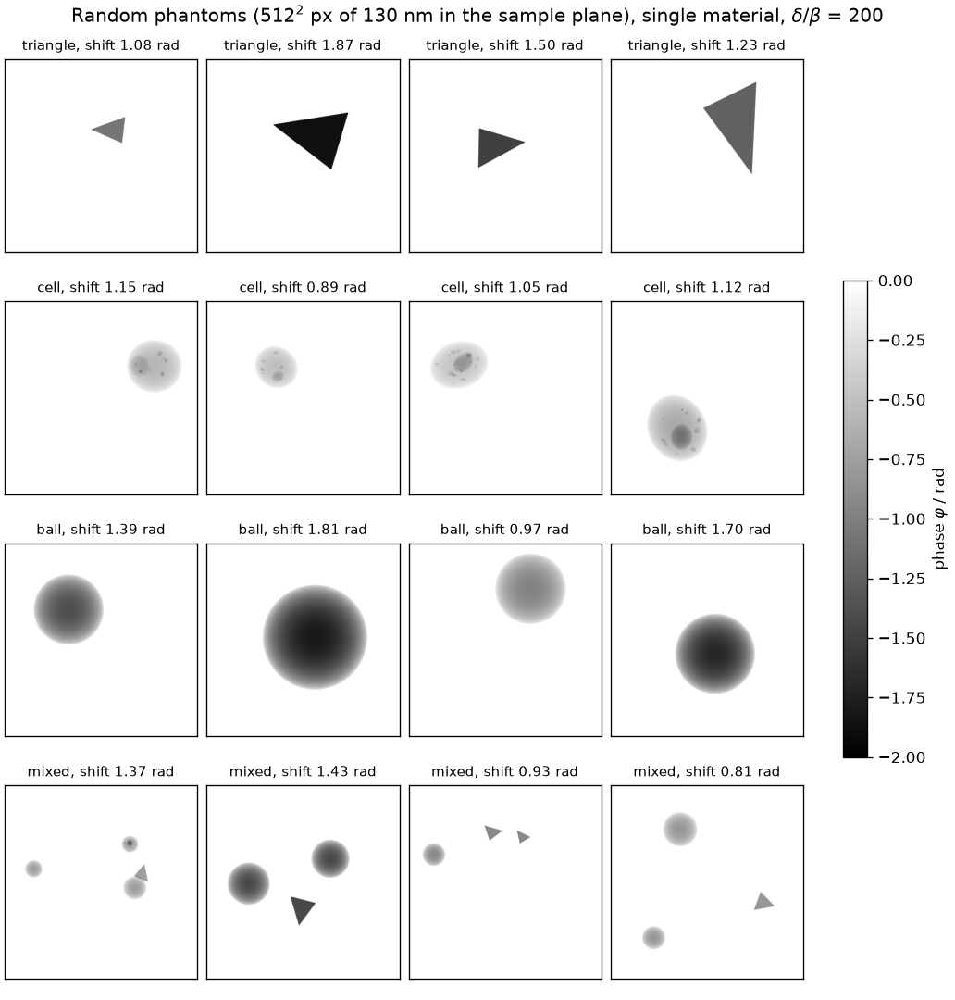
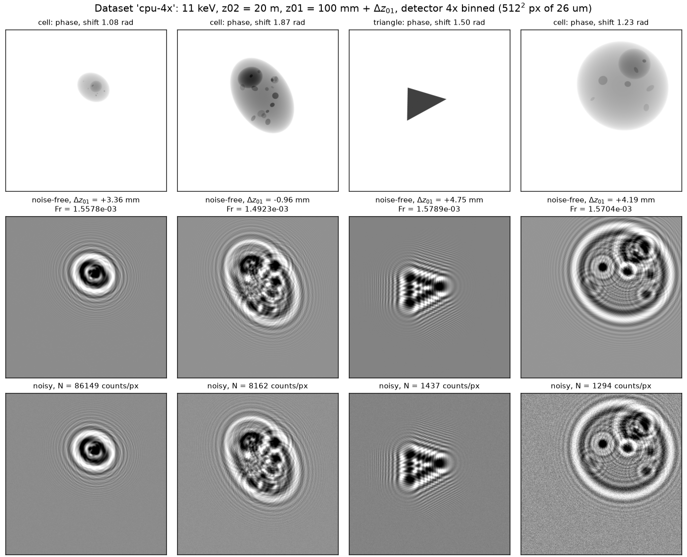
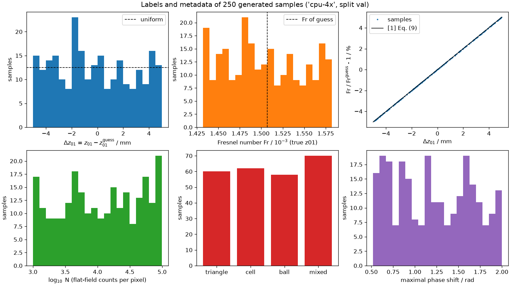
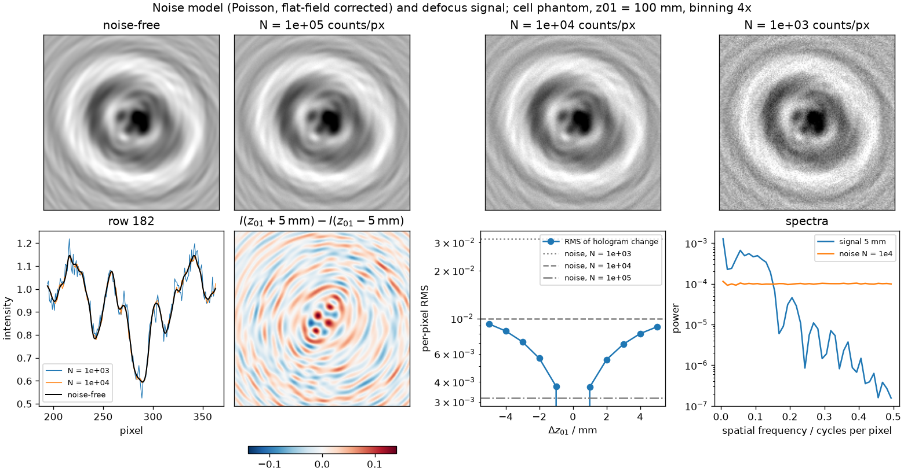
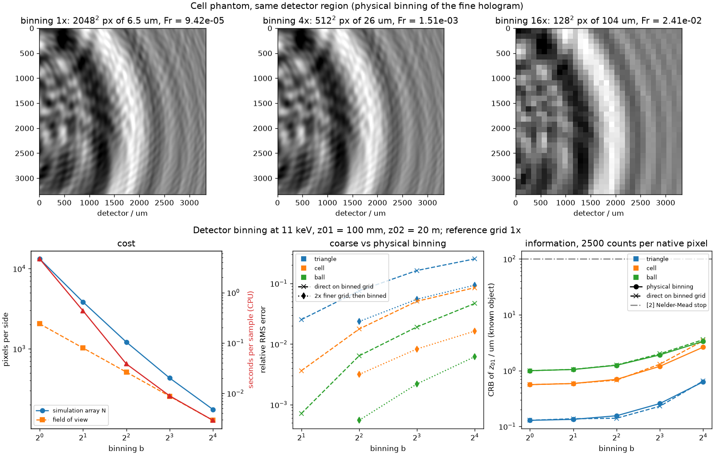
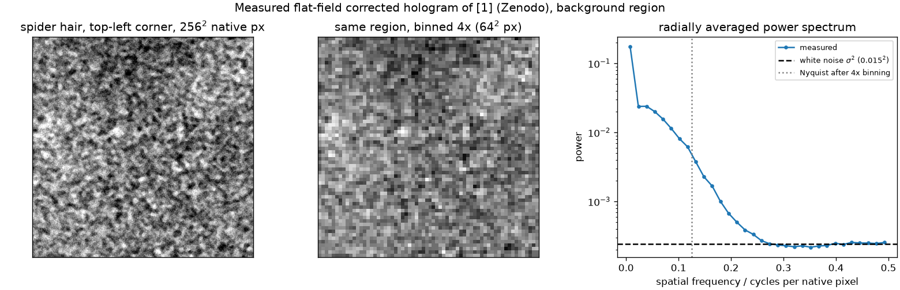

# Laborbuch 02 – Etappe 2: Synthetischer Datensatz

| | |
|---|---|
| Datum | 20.10.2026 |
| Branch | `cursor/stage2-dataset-generator-1091` |
| Code | `src/holofocus/phantoms.py`, `src/holofocus/noise.py`, `src/holofocus/dataset/`, `configs/dataset/`, `tests/`, `scripts/make_stage2_figures.py` |
| Abbildungen | `docs/laborbuch/figures/stage2-*.png`, Zahlen in `stage2-metrics.json` |
| Quellen | [1] Dora et al., Opt. Express 32(7), 10801 (2024); [2] Dora et al., Opt. Express 33(4), 6641 (2025) |

## 1 Ziel

Ein reproduzierbarer Generator für gelabelte Hologramme. Mit ihm soll in den nächsten Etappen
ein Netz lernen, `Δz01` aus einem einzelnen Hologramm zu schätzen:

- Phantome im Sinne von [2] Sec. 3.5 (ein Material, festes $\delta/\beta$; Dreieck, Zelle,
  Kugel) mit Zufallsvariation.
- Rauschmodell (Poisson/Gauß), als eigene Annahme dokumentiert.
- `z01` um einen Schätzwert in der ±5-mm-Box von [2] ziehen; Labels `Δz01` und `Fr`.
- Ein auf der CPU machbares Gitter, mit Begründung und Bezug zur echten Geometrie.
- YAML-Konfiguration, feste Seeds, HDF5, ein kleiner Demo-Datensatz in der CI, Tests.

## 2 Ausgangslage

Etappe 1 ist in `main` gemergt
([PR #7](https://github.com/AliTUHH/master_thesis_autofocus/pull/7), Merge-Commit `dfd7d34`,
CI grün). Sie liefert die Kegelstrahl-Geometrie ([1] Eq. (9), [2] Eq. (5)–(7)), den
Fresnel-Propagator und das Vorwärtsmodell $I = \lvert D_{Fr}(\exp(i\tilde O))\rvert^2$. Der
Generator baut darauf auf, die Physik wird nicht neu geschrieben. Die sechs alten
Entwurfs-PRs (#1–#6) sind weiterhin offen und unberührt (Laborbuch 01, Abschnitt 2).

## 3 Was gemacht wurde

### 3.1 Module

| Modul | Inhalt |
|---|---|
| `phantoms.py` | `random_phantom(rng, kind, shape)` mit den Klassen `triangle`, `cell`, `ball`, `mixed`; `render` mittelt über Subpixel, nur innerhalb der Bounding Box jedes Teilobjekts |
| `noise.py` | `add_detector_noise` mit den Modellen `none`, `poisson`, `poisson_gaussian` |
| `propagation.py` | neu: `next_fast_len` (kleinste Zahl $2^a3^b5^c7^d \ge n$, schnelle FFT) |
| `dataset/config.py` | `DatasetConfig` aus YAML: Geometrie, Stichprobe, Simulation, Phantome, Rauschen, Speicher, Splits; Validierung, unbekannte Schlüssel sind ein Fehler |
| `dataset/generator.py` | `HologramGenerator.sample(split, i)` liefert ein `Sample` (verrauschtes und rauschfreies Hologramm, Phase, Labels, Metadaten); `sample_seed` |
| `dataset/storage.py` | `write_split` (HDF5), `read_labels`, `read_config`, `target_values`, `HologramDataset` (PyTorch) |
| `dataset/cli.py` | Kommandos `holofocus-dataset generate` und `holofocus-dataset inspect` |
| `configs/dataset/` | `cpu-4x.yaml` (Hauptdatensatz), `cpu-4x-z01-range.yaml` (Schätzwert 80–300 mm), `ci.yaml` (16×, 48 Samples) |

### 3.2 Ablauf pro Sample

1. Eigener Zufallsstrom des Samples: `SeedSequence(seed, spawn_key=(crc32(split), i))` (E8).
2. In fester Reihenfolge ziehen: `z01_guess` (fest oder gleichverteilt im Bereich), `Δz01`
   gleichverteilt in [−5, 5] mm, Phantomklasse (nach Gewichten), maximale Phasenverschiebung
   $\lvert\varphi_\text{max}\rvert \in [0{,}5;\,2]$ rad, $A_0$, Photonenzahl $N$
   log-gleichverteilt in $[10^3, 10^5]$, dann das Phantom selbst und zuletzt das Rauschen.
3. Wahre Geometrie `z01 = z01_guess + Δz01` bei festem `z02`, `Fr` nach [1] Eq. (9) auf dem
   gebinnten Detektorraster.
4. Phantom als normierte Dicke $t \in [0, 1]$ auf dem `oversample`-fach feineren Raster,
   $\varphi = -\lvert\varphi_\text{max}\rvert\,t$ und $\mu = -\varphi/(\delta/\beta)$
   ([1] Eq. (3)).
5. Hologramm $I = \lvert D_{Fr/s^2}(\exp(i\tilde O))\rvert^2$ im Freiraum-Array (E7), auf das
   Sichtfeld beschneiden, dann $s\times s$-Blöcke mitteln (Pixelintegration). Die gespeicherte
   Phase wird genauso gemittelt.
6. Rauschen $(\text{Poisson}(N I) + \mathcal N(0, \sigma_r^2))/N$ mit $\sigma_r = 2$ Counts (E5).
7. Labels `dz01`, `z01`, `z01_guess`, `fresnel_number`, `fresnel_number_guess`; Metadaten
   `phantom_type`, `phase_shift`, `photons`, `a0`, `effective_pixel_size`.

### 3.3 Konfiguration und Bedienung

```bash
holofocus-dataset generate configs/dataset/cpu-4x.yaml --out data/cpu-4x     # alle Splits
holofocus-dataset generate configs/dataset/ci.yaml --out /tmp/demo --splits val --limit 8
holofocus-dataset inspect data/cpu-4x/*.h5
```

Eine YAML-Datei beschreibt alle Splits. Fehlende Schlüssel bekommen Standardwerte (Geometrie
wie `cpu-4x`, aber ohne Oversampling), unbekannte Schlüssel sind ein Fehler, damit Tippfehler
nicht still auf Standardwerte zurückfallen. PyYAML liest `1e5` nach YAML 1.1 als
Zeichenkette; der Loader wandelt Werte deshalb anhand der Feldtypen um (Test). `generate`
legt `config.yaml` neben die Dateien. Gibt es einen Split schon mit gleicher Konfiguration und
Größe, wird er übersprungen; weicht er ab, bricht der Befehl ab, außer mit `--overwrite`.
`--device cuda` rechnet auf der GPU.

### 3.4 HDF5-Layout (eine Datei pro Split)

| Datensatz | Form, Typ | Inhalt |
|---|---|---|
| `hologram` | (N, H, W) float32 | verrauscht, flat-field-korrigiert (1 = Freiraum) |
| `hologram_clean` | (N, H, W) float32 | rauschfrei (optional, `storage.store_clean`) |
| `phase` | (N, H, W) float32 | wahre Phase $\varphi$ in rad (optional, `storage.store_phase`) |
| `labels/<key>` | (N,) float64 | `dz01`, `z01`, `z01_guess`, `fresnel_number`, `fresnel_number_guess` |
| `meta/<key>` | (N,) | `phantom_type` (int8), `phase_shift`, `photons`, `a0`, `effective_pixel_size` |
| Attribute | – | YAML-Konfiguration, Seed-Regel, Label-Konvention, Paketversion, Git-Commit, Gerät, Laufzeit |

Ein Chunk ist ein Sample (1, H, W), komprimiert mit gzip (Stufe 4) und Shuffle-Filter.
Geschrieben wird in `*.h5.part`, umbenannt erst am Ende: Ein abgebrochener Lauf hinterlässt
keine halbe Datei. `HologramDataset(path, target=...)` liefert `(hologram, target)` mit
`hologram` der Form (1, H, W), mit `with_phase=True` zusätzlich die Phase. Jeder
DataLoader-Worker öffnet ein eigenes Datei-Handle (Test mit zwei Workern).

### 3.5 Tests (59 neu, insgesamt 110, davon 1 nur mit CUDA)

| Datei | Prüft |
|---|---|
| `test_phantoms.py` | `render` = `rasterize` der gewichteten Summe; Ellipsoid-Profil; jede Klasse: Werte in [0, 1], Maximum 1, Rand frei; reproduzierbar und seedabhängig; `size_range` steuert die Größe |
| `test_noise.py` | Mittelwert und Varianz $I/N + (\sigma_r/N)^2$ für drei Parametersätze; Reproduzierbarkeit; Validierung |
| `test_dataset_config.py` | alle Configs im Repo laden; YAML hin und zurück; `1e5` als Zahl; Standardwerte ($Fr = 1{,}5069\cdot10^{-3}$); `simulation_shape` deckt Kern und Rand; `next_fast_len`; 15 Validierungsfälle |
| `test_dataset_generator.py` | Formen und Schlüssel; reproduzierbar und unabhängig von der Reihenfolge; Labels konsistent (`Fr` aus `z01`, Box ±5 mm); rauschfreies Hologramm = Vorwärtsmodell der Labels; Modell `none` ist rauschfrei; Phantom unabhängig von `z01`; Schätzwertbereich; Oversampling = gebinnte feine Intensität |
| `test_dataset_storage.py` | Layout und Attribute, keine `.part`-Reste; gespeicherte Samples = Generator; Zielgrößen; `HologramDataset` für alle Ziele; Pickle und DataLoader mit zwei Workern |
| `test_dataset_cli.py` | erzeugen, überspringen, Konflikt, `--overwrite`; unbekannter Split; `inspect` |

Die CI (GitHub Actions, Python 3.10 und 3.12) führt Lint, Tests und beide Abbildungsskripte im
Schnellmodus aus. Sie erzeugt außerdem den Demo-Datensatz aus `configs/dataset/ci.yaml`
(48 Samples à 128², etwa 4 MB, wenige Sekunden), prüft ihn mit `inspect` und hebt ihn
30 Tage als Artefakt `demo-dataset-ci` auf.

## 4 Entscheidungen und Begründung

**E1 – Lernziel `Δz01 = z01 − z01_guess`, `Fr` abgeleitet.** Das ist die Vorgabe des
Studenten. `z02` gilt als bekannt; kleine Fehler in `z02` wirken sich laut [2] Sec. 2 (Fig. 3)
kaum auf `Fr` aus. `Fr` ist deshalb über [1] Eq. (9) eine feste Funktion von `z01` und kein
unabhängiges Label; es wird mitgespeichert und kann als Ziel gewählt werden. Vorzeichen:
gespeichert wird „wahr minus Schätzwert“. Die Netzausgabe ist dann direkt die Korrektur,
$z_{01} = z_{01}^\text{guess} + \Delta z_{01}$. [2] Eq. (9) schreibt
$\hat z_{01} = z_{01} + \Delta z_{01}$ (angenommen = wahr + Abweichung), also mit umgekehrtem
Vorzeichen. Die Konvention steht deshalb im Attribut `label_convention` jeder Datei.
`HologramDataset(target=...)` schaltet zwischen `dz01` (m), `dz01_mm`, `z01`,
`fresnel_number` und `fresnel_ratio` $= Fr/Fr^\text{guess} - 1 \approx \Delta z_{01}/z_{01}$ um.

**E2 – `Δz01` gleichverteilt in ±5 mm.** Das ist die Suchbox
$\Omega_z = [z_{01}^\text{est} - \Delta_M,\, z_{01}^\text{est} + \Delta_M]$ mit
$\Delta_M = 5$ mm aus [2] Eq. (17). Gleichverteilt, weil über einen Bias des manuellen
Schätzwerts nichts bekannt ist und eine zur Mitte konzentrierte Verteilung die Regression zur
Mitte hin verzerren würde. [2] tastet seine Fokuskurven auf $\pm 2\Delta_M$ ab (Sec. 3.5,
201 Werte). Ein Netz, das nur ±5 mm gesehen hat, extrapoliert nicht darüber hinaus (offener
Punkt 4).

**E3 – Phantome im Pixelraster des Detektors, nicht in Metern.** Mit `z01` ändern sich die
Vergrößerung $M = z_{02}/z_{01}$ und damit der Probenpixel $\Delta x/M$, hier um bis zu ±5 %.
Wäre die Objektgröße in Metern festgelegt, könnte ein Netz `z01` an der scheinbaren Größe
ablesen. Am Experiment ist die Objektgröße unbekannt, diesen Hinweis gibt es dort nicht. Die
Phantome werden deshalb in Pixeln gezogen; dieselbe Sample-Nummer liefert für jedes `z01`
dasselbe Objekt (Test). Die Information über `z01` steckt so nur in den Fringes, also in `Fr`.

**E4 – Phantomklassen und Variation.** Ein Material mit $\delta/\beta = 200$, wie in [2]
Fig. 5 ($\varphi \in [-2, 0]$ rad, $\mu \in [0, 1]\cdot10^{-2}$). Die drei Klassen aus [2]
Sec. 3.5 decken verschiedene Bildmerkmale ab: Dreieck (starke Kanten, glatte Fläche), Zelle
(viele kleine scharfe Strukturen), Kugel (breiter Gradientbereich). Zufällig sind Lage, Größe
(Durchmesser 15–60 % des Sichtfelds, 5 % Rand frei), Form (Dreiecksecken auf einem gestörten
Kreis; Zellkörper als Ellipsoid mit Kern und 6–20 Organellen) und
$\lvert\varphi_\text{max}\rvert \in [0{,}5;\,2]$ rad. Die vierte Klasse `mixed` kombiniert
zwei bis vier kleinere Objekte. Wo sie überlappen, addiert sich die Dicke wie bei einer
Projektion durch ein Material. Die Objekte berühren nie den Rand des Sichtfelds (offener
Punkt 5).

**E5 – Rauschmodell (eigene Annahme).** [2] simuliert ohne Rauschen: „For the MFE criterion,
we assumed a noise-free and flat-field correction artifact free hologram“ (Sec. 3.5). Ein Netz,
das später Messdaten sehen soll, muss Rauschen kennen. Modell: Photonenzählung mit
Poisson-Statistik um $N I$ pro gebinntem Pixel, gaußsches Ausleserauschen mit
$\sigma_r = 2$ Counts, danach Division durch $N$ (Flat-Field-Korrektur mit rauschfreiem Flat).
Die Varianz ist $I/N + (\sigma_r/N)^2$. $N$ wird pro Sample log-gleichverteilt aus
$[10^3, 10^5]$ gezogen, damit das Netz einen weiten Bereich an Belichtung sieht. Kalibriert ist
der Bereich an den vier gemessenen Hologrammen des Zenodo-Archivs von [1] (Abschnitt 5.4,
Abb. 6). Das weiße Rauschen pro nativem Pixel entspricht $N_1 \approx 1{,}7$–$4{,}5\cdot10^3$;
bei rein weißem Rauschen wären das $16 N_1 \approx 2{,}7$–$7{,}1\cdot10^4$ pro 4×-Pixel. Nach
4×-Binning dominiert aber ein räumlich korrelierter Untergrund (Flat-Field-Reste) mit 1,5–2 %
Standardabweichung, äquivalent zu $N_4 \approx 2$–$4\cdot10^3$. Der Bereich $[10^3, 10^5]$
umfasst beide Niveaus. Nicht modelliert sind der korrelierte Untergrund selbst, die
Detektor-PSF und Schwankungen von $A_0$ (`a0_range` ist vorbereitet, steht aber auf 1).

**E6 – Gitter: P05-Detektor 4× gebinnt, Simulation 2× feiner.** Die Papiere rechnen mit
Arrays von 8192² bis 14336² ([1] Table 1), weil $N \ge 1/Fr$ gelten muss und $Fr$ beim vollen
Detektor bei etwa $10^{-4}$ liegt. Für Tausende Samples ist das auf der CPU zu teuer. Gewählt
ist folgende Abbildung auf die echte Geometrie (Simulationszeile von [2] Table 2: 11 keV,
`z01 = 100 mm`, `z02 = 20 m`; P05-Detektor nach [1] Sec. 5.1):

| Größe | voller Detektor | `cpu-4x` |
|---|---|---|
| Detektorpixel | 2048² à 6,5 µm | 512² à 26 µm |
| Probenpixel bei 100 mm | 32,5 nm | 130 nm |
| `Fr` bei 100 mm (95–105 mm) | $9{,}42\cdot10^{-5}$ | $1{,}507\cdot10^{-3}$ ($1{,}431$–$1{,}583\cdot10^{-3}$) |
| $1/Fr$ | 10618 Pixel | 664 Pixel |
| Sichtfeld, $N^2 Fr$ | 66,6 µm, 395 | 66,6 µm, 395 |
| Simulationsarray | 13230² (1,4 GB pro complex64-Array) | 1024²-Sichtfeld in 3840², danach 2×2 gemittelt |
| Zeit pro Sample (CPU, 4 Threads) | 4,7 s ohne HDF5, 7,2 GB RAM | 0,39 s mit Phantom, Rauschen und HDF5 |

Begründung (Abb. 5):

- **Bezug zur echten Geometrie.** Binning ändert weder das Sichtfeld noch $N^2 Fr$. Es mittelt
  4×4 native Pixel und wirkt damit als Tiefpass auf die Fringes. Ein gemessenes Hologramm wird
  vor der Auswertung genauso gebinnt (4×4-Mittel); danach gilt [1] Eq. (9) mit 26-µm-Pixeln.
  [2] wertet die Nelder–Mead-Proben selbst auf einem 4× down-sampled Gitter aus (Table 1,
  Appendix Table 3). 4× ist also die Auflösung, auf der auch die Baseline den Fokus bestimmt.
- **Information.** Die Cramér–Rao-Schranke für `z01` (bekanntes Objekt, Poisson, gleiche Dosis
  von 2500 Counts pro nativem Pixel) steigt von 1× nach 4× nur um den Faktor 1,2: Dreieck
  0,13 → 0,16 µm, Zelle 0,56 → 0,70 µm, Kugel 1,00 → 1,25 µm. Bei 16× ist es der Faktor
  3,3–4,9. Alle Werte liegen weit unter der Abbruchschwelle von [2] (Simplex-Länge 100 µm,
  Table 1). Für das Lernproblem ist 4× also kein Engpass. Die Schranke setzt ein bekanntes
  Objekt voraus und ist deshalb optimistisch; sie dient nur dem Vergleich der Gitter.
- **Genauigkeit.** Direkt auf dem 4×-Gitter simuliert (Phase gemittelt, dann propagiert),
  weicht das Hologramm vom physikalisch gebinnten 1×-Hologramm um 0,6 % (Kugel), 1,8 % (Zelle)
  bzw. 7,5 % (Dreieck, scharfe Kanten) des Fringe-Kontrasts ab (RMS). Auf dem 2× feineren
  Gitter simuliert und danach gebinnt, sinkt der Fehler auf 0,06 %, 0,3 % bzw. 2,4 %. Deshalb
  `oversample: 2`.
- **Kosten.** 1× braucht 13230² pro Array, 4,7 s pro Sample und 7,2 GB Spitzen-RAM. `cpu-4x`
  mit Oversampling braucht 0,39 s (Faktor 12 schneller), direkt 4× gerechnet wären es 0,04 s
  (Faktor 120). Ein Datensatz mit 2500 Samples dauert damit etwa 16 min und belegt etwa
  1,8 GB.
- **CI.** `ci.yaml` bindet 16× (128² à 104 µm, $Fr = 0{,}024$, Array 175²). Die Physik ist
  dieselbe, nur gröber; 48 Samples dauern Sekundenbruchteile.

**E7 – Simulationsarray.** Simuliert wird im Freiraum ($\tilde O = 0$ außerhalb des Objekts,
Laborbuch 01, E5), nicht mit Spiegelpadding. Die Arraygröße ist
`next_fast_len(max(n·s + ⌈m/Fr_min⌉, ⌈1/Fr_min⌉))` mit Rand $m = 1$ (in Einheiten von
$1/Fr$), Oversampling $s$ und dem kleinsten `Fr` des Datensatzes (unteres Ende von `z01`, auf
dem feinen Gitter). Begründung: Der Propagator verteilt einen Punkt über etwa $1/Fr$ Pixel
(lokale Chirp-Frequenz $x\,Fr \le 1/2$ Zyklen pro Pixel). Mit diesem Rand laufen keine Fringes
periodisch ins Sichtfeld zurück, und $N \ge 1/Fr$ ([1] Sec. 3.2.2) ist erfüllt. `next_fast_len`
rundet auf eine schnelle FFT-Größe auf ($1024 + 2795 = 3819 \to 3840$). Ein festes Array für
alle Samples hält Laufzeit und Speicherbedarf konstant.

**E8 – Seeds und Reproduzierbarkeit.** Jedes Sample hat einen eigenen Zufallsstrom
`SeedSequence(seed, spawn_key=(crc32(split), i))` (NumPy). Ein Sample lässt sich einzeln neu
erzeugen, das Ergebnis hängt nicht von Reihenfolge oder Anzahl der Samples ab (Test), und
Train/Val/Test teilen keine Ströme. Die Ziehungsreihenfolge (Abschnitt 3.2) ist fest. Neue
Zufallsgrößen müssen ans Ende, hinter das Rauschen, sonst ändern sich bestehende Datensätze.
Labels und Phantome entstehen mit NumPy auf der CPU und sind auf jedem Gerät gleich. Das
rauschfreie Hologramm stimmt zwischen CPU und GPU bis auf float32-Rundung überein. Die
Rauschrealisierung ist nur auf demselben Gerät mit denselben Bibliotheksversionen bitgleich,
weil NumPys Poisson-Sampler je nach Eingangswert verschieden viele Zufallszahlen verbraucht.
Statistisch ist sie gleichwertig.

**E9 – HDF5 statt Zarr.** HDF5 (h5py) ist an Synchrotrons verbreitet (NeXus baut darauf auf).
Eine Datei pro Split ist leicht zu kopieren, und Chunks von einem Sample erlauben das Lesen
einzelner Samples im DataLoader. Zarr hätte Vorteile bei Cloud-Objektspeichern und beim
parallelen Schreiben aus vielen Prozessen; beides wird jetzt nicht gebraucht. Die Konfiguration
steckt als YAML in jeder Datei, dazu Git-Commit und Paketversion. Jede Datei beschreibt sich
damit selbst (`read_config`).

## 5 Ergebnisse

### 5.1 Datensätze

| Config | Gitter | `z01` | `Fr` | Splits (train/val/test) | Zeit (CPU) | Größe |
|---|---|---|---|---|---|---|
| `cpu-4x.yaml` | 512² à 26 µm, Oversampling 2, Array 3840² | 95–105 mm | $1{,}431$–$1{,}583\cdot10^{-3}$ | 2000/250/250 | ≈ 16 min | ≈ 1,8 GB |
| `cpu-4x-z01-range.yaml` | wie oben, Array 4608² | 75–305 mm | $1{,}129$–$4{,}644\cdot10^{-3}$ | 2000/250/250 | ≈ 23 min | ≈ 1,8 GB |
| `ci.yaml` | 128² à 104 µm, Array 175² | 95–105 mm | $2{,}290$–$2{,}532\cdot10^{-2}$ | 32/8/8 | < 1 s | ≈ 4 MB |

Zeiten und Größen der beiden CPU-Datensätze sind aus gemessenen Werten pro Sample hochgerechnet
(0,39 s und 0,73 MB pro Sample mit Phase, gemessen an 250 Samples; 0,52 s pro Sample ohne
HDF5 für die Variante mit Schätzwertbereich). Die vollen Datensätze habe ich noch nicht
erzeugt; sie gehören nicht ins Git-Repository. `cpu-4x-z01-range` deckt Spinnenhaar (79,4 mm),
Zahn (80,9 mm) und Kaktusnadel (284,2 mm) aus [2] Table 1 ab. Dort ändern dieselben 5 mm `Fr`
um etwa 6 % (Spinnenhaar, Zahn) bzw. 1,8 % (Kaktusnadel). Das ist der Testfall für den
Vergleich der Ziele `dz01` und `fresnel_ratio`.

### 5.2 Abbildungen

**Abb. 1 – Phantome** (`figures/stage2-phantoms.png`)



Vier zufällige Phantome je Klasse, Phase in rad, 512² Pixel à 130 nm in der Probenebene.
Dreieck mit scharfen Kanten und flacher Fläche, Zelle mit Kern und kleinen Organellen, Kugel
mit breitem Gradienten, `mixed` mit mehreren kleineren Objekten.

**Abb. 2 – Samples** (`figures/stage2-samples.png`)



Die ersten vier Samples des Splits `train` von `cpu-4x`: Phase, rauschfreies und verrauschtes
Hologramm mit ihren Labels. Kanten erzeugen viele feine Fringes, glatte Bereiche wenige breite.
Bei $N \approx 1300$ Counts pro Pixel gehen die äußeren, schwachen Fringes im Rauschen unter;
bei $N \approx 86000$ ist das Rauschen kaum sichtbar.

**Abb. 3 – Labels und Metadaten** (`figures/stage2-labels.png`)



250 Samples (Split `val`). `Δz01` füllt die Box gleichmäßig (Extremwerte −4,93 und
+4,97 mm), `Fr` liegt in $1{,}431$–$1{,}583\cdot10^{-3}$. Die relative Änderung von `Fr` folgt
exakt [1] Eq. (9) und ist fast linear (−5,02 % bis +5,03 % über die Box). $N$ ist
log-gleichverteilt, die Klassen kommen 60/62/58/70-mal vor, die Phasenverschiebung ist
gleichverteilt.

**Abb. 4 – Rauschen und Defokus-Signal** (`figures/stage2-noise.png`)



Zellphantom bei `z01 = 100 mm` mit $N = 10^5$, $10^4$ und $10^3$ Counts pro Pixel, ein
Zeilenprofil, die Differenz der Hologramme bei ±5 mm, die RMS-Änderung des Hologramms gegen
`Δz01` im Vergleich zum Rauschen pro Pixel und die radialen Spektren. 5 mm ändern das Hologramm
um 0,9 % pro Pixel (RMS), so viel wie das Rauschen bei $N = 10^4$; 1 mm ändert es um 0,37 %,
etwa das Rauschen bei $N = 10^5$. Pro Pixel ist das Signal also klein, die Information liegt
in der Summe über viele Pixel. Die Änderung wächst unterlinear mit $\lvert\Delta z_{01}\rvert$.
Eine plausible Erklärung: Die Propagatorphase $\pi k^2/Fr$ ändert sich bei 1 mm (1 % in `Fr`)
an der Nyquist-Grenze um etwa 5 rad, feine Fringes dekorrelieren also schon bei kleinem
Defokus; grobe Fringes ändern sich linear. Im Spektrum liegt das Signal bis etwa
0,15 Zyklen pro Pixel über dem Rauschen bei $N = 10^4$, darüber dominiert das Rauschen.

**Abb. 5 – Was Binning kostet und spart** (`figures/stage2-binning.png`)



Oben derselbe Detektorausschnitt bei 1×, 4× und 16× (physikalisch gebinnt). Bei 4× bleiben
die Fringes erhalten, bei 16× sind die feinen verloren. Unten links Arraygröße und Zeit pro
Sample, Mitte der Fehler der Simulation auf dem groben Gitter gegenüber physikalischem Binning
(gestrichelt direkt, gepunktet über das 2× feinere Gitter), rechts die Cramér–Rao-Schranke
(durchgezogen physikalisch gebinnt, gestrichelt direkt simuliert) mit der Abbruchschwelle von
[2]. Die Farbe kennzeichnet das Phantom. Zahlen in E6 und Abschnitt 5.3.

**Abb. 6 – Gemessenes Rauschen** (`figures/stage2-measured-noise.png`)



Hintergrundecke (256² native Pixel) des Spinnenhaar-Hologramms aus dem Zenodo-Archiv von [1],
nativ und 4× gebinnt, dazu das radiale Leistungsspektrum. Der weiße Rauschboden liegt bei
$\sigma = 1{,}55$ % pro nativem Pixel ($N_1 \approx 4100$). Darüber liegt bis etwa
0,25 Zyklen pro Pixel ein korrelierter Anteil, der unterhalb der Nyquist-Grenze des 4×-Gitters
(0,125 Zyklen pro nativem Pixel) das 10- bis über 100-Fache des weißen Bodens erreicht. Nach
dem Binning bleibt deshalb $\sigma \approx 1{,}5$ % statt 0,4 %.

### 5.3 Binning im Detail (Abb. 5, `stage2-metrics.json`)

| Binning | Pixel | `Fr` (100 mm) | Array | Zeit pro Sample | CRB Dreieck / Zelle / Kugel | Fehler direkt (Dreieck / Zelle / Kugel) |
|---|---|---|---|---|---|---|
| 1× | 2048² à 6,5 µm | $9{,}42\cdot10^{-5}$ | 13230² | 4,7 s | 0,13 / 0,56 / 1,00 µm | – |
| 2× | 1024² à 13 µm | $3{,}77\cdot10^{-4}$ | 3840² | 0,43 s | 0,13 / 0,59 / 1,05 µm | 2,5 / 0,4 / 0,07 % |
| 4× | 512² à 26 µm | $1{,}51\cdot10^{-3}$ | 1215² | 0,04 s | 0,16 / 0,70 / 1,25 µm | 7,5 / 1,8 / 0,6 % |
| 4×, Oversampling 2 | 512² à 26 µm | $1{,}51\cdot10^{-3}$ | 3840² | 0,39 s* | – | 2,4 / 0,3 / 0,06 % |
| 8× | 256² à 52 µm | $6{,}03\cdot10^{-3}$ | 432² | 0,009 s | 0,26 / 1,19 / 1,91 µm | 16 / 5,1 / 1,9 % |
| 16× | 128² à 104 µm | $2{,}41\cdot10^{-2}$ | 175² | 0,003 s | 0,63 / 2,63 / 3,34 µm | 25 / 8,5 / 4,7 % |

\* mit HDF5 (Datensatz `cpu-4x`); die übrigen Zeiten sind ganze Samples (Phantom, Simulation,
Rauschen) ohne HDF5. CRB: Cramér–Rao-Schranke für `z01` bei 2500 Counts pro nativem Pixel,
$\sigma_{z_{01}} = \big(N_b \sum (\partial I/\partial z_{01})^2 / I\big)^{-1/2}$, zentrale
Differenz mit 0,1 mm. Fehler: RMS-Abweichung vom physikalisch gebinnten 1×-Hologramm, relativ
zum Fringe-Kontrast. Phantome mit 45 % des Sichtfelds und 2 rad Phasenhub.

### 5.4 Rauschen der gemessenen Hologramme (Abb. 6)

Drei Hintergrundecken (256² native Pixel) je Hologramm. $\sigma$ aus der zweiten Differenz
entlang der Zeilen (robust, MAD), $N = \bar I/\sigma^2$.

| Hologramm | Mittelwert | $\sigma$ nativ | $N_1$ nativ | $16 N_1$ (falls weiß) | $\sigma$ 4× | $N_4$ gemessen |
|---|---|---|---|---|---|---|
| Spinnenhaar | 0,98–0,99 | 1,5–1,6 % | 4,1–4,5·10³ | 6,6–7,1·10⁴ | 1,5–1,8 % | 3,1–4,3·10³ |
| Kaktusnadel | 0,96–1,00 | 1,9–2,1 % | 2,2–2,7·10³ | 3,5–4,3·10⁴ | 1,6–2,1 % | 2,2–3,6·10³ |
| Zahn | 0,96–1,00 | 2,0–2,2 % | 2,1–2,4·10³ | 3,3–3,8·10⁴ | 1,6–2,1 % | 2,3–3,8·10³ |
| Magnesiumdraht | 1,06–1,52 | 2,5–2,6 % | 1,7–2,2·10³ | 2,7–3,5·10⁴ | 3,2–4,4 % | 0,8–1,2·10³ |

Beim Magnesiumdraht sind die Ecken nicht frei von Objekt oder Fringes (Mittelwert bis 1,52);
seine Werte sind obere Schranken für das Rauschen. Bei den anderen drei ist $\sigma$ nach dem
Binning fast so groß wie vorher: Der korrelierte Untergrund bestimmt das Rauschen auf dem
4×-Gitter.

### 5.5 Laufzeiten (CPU, 4 Threads)

| Schritt | Zeit |
|---|---|
| Testsuite (110 Tests) | ≈ 4 s |
| Sample `cpu-4x` (Oversampling 2, mit HDF5) | 0,39 s |
| Sample direkt 4× / 16× | 0,04 s / 0,003 s |
| Sample 1× (voller Detektor) | 4,7 s, 7,2 GB RAM |
| Demo-Datensatz `ci.yaml` (48 Samples) | ≈ 0,2 s Rechenzeit, ≈ 3 s mit Import |
| alle Stage-2-Abbildungen | ≈ 3 min |

## 6 Offene Punkte

1. **Korrelierter Untergrund (Flat-Field-Reste).** In den Messdaten dominiert nach dem Binning
   ein korrelierter Untergrund (Abb. 6), das Modell kennt nur weißes Rauschen. Möglich sind
   Augmentierung mit echten Flat-Field-Resten (so macht es HoloForge in holowizard mit echten
   TIFFs) oder ein an Abb. 6 angepasstes Spektrum. Dafür bräuchte ich Flat-Field-Serien von
   P05 → Daniel.
2. **Detektor-PSF.** Szintillator (10 µm Gadox, [1] Sec. 5.1) und Optik verschmieren das
   Hologramm; ohne PSF sind die simulierten Fringes schärfer als gemessene. Eine PSF nennen
   [1] und [2] nicht → Daniel, oder aus einem Kantenbild messen.
3. **Echte Photonenzahlen.** Die Kalibrierung aus Abb. 6 setzt flat-field-korrigierte,
   ungefilterte Hologramme voraus. Belichtungszeiten und Rohzählraten der vier Datensätze
   wären verlässlicher.
4. **Bereich von `Δz01` und Lernziel.** ±5 mm wie in [2]. Soll das Netz auch etwas außerhalb
   der Box robust sein (z. B. Training auf ±7,5 mm, Auswertung auf ±5 mm)? Absolutes `Δz01`
   oder relatives `Δz01/z01` (`fresnel_ratio`), wenn `z01` zwischen Proben stark variiert
   (Laborbuch 01, offener Punkt 2)? `cpu-4x-z01-range.yaml` ist für diesen Vergleich
   vorbereitet.
5. **Objekte, die das Sichtfeld schneiden.** Haar, Nadel und Draht laufen durch das ganze Bild;
   die Phantome liegen immer vollständig im Sichtfeld. Für die Übertragung auf Messdaten
   braucht es auch angeschnittene, lang gestreckte Objekte.
6. **Mehrere Materialien.** Ein Material wie in [2]. Beim Zahn und in der Flusszelle variiert
   $\delta/\beta$ im Bild.
7. **$A_0$.** [1] stellt $A_0$ pro Hologramm ein (Table 4: 0,96–1,1); `a0_range` ist
   vorbereitet, steht aber auf 1.
8. **Messdaten und GPU.** Wie in Laborbuch 01: Zugang zu weiteren P05-Datensätzen klären. Mit
   GPU wäre ein Kontrolldatensatz mit 2× oder 1× Binning machbar.

## 7 Nächste Schritte

- **Etappe 3 (Baseline):** ASRM + MFE + Nelder–Mead nach [2] auf den Test-Splits und den vier
  Zenodo-Hologrammen. Sie liefert Referenzgenauigkeit und Laufzeit, gegen die das Netz antritt.
- Danach ein erstes Netz (CNN-Regression auf `dz01_mm`) auf `cpu-4x`, Vergleich der Ziele
  `dz01` und `fresnel_ratio` mit `cpu-4x-z01-range` und ein Rauschmodell mit korreliertem
  Untergrund.

## 8 Bezug zur Masterarbeit

- **Methoden, Kapitel Datensatz/Simulation:** Abschnitte 3.2–3.4 und E1–E9; Abb. 1–3 zeigen
  Phantome, Samples und Verteilungen.
- **Begründung des Gitters** (Kapitel Simulation oder Anhang): E6 mit Abb. 5 und Tabelle 5.3.
  Kernargument: dieselbe Physik wie in [2], auf dessen eigenem 4×-Auswertegitter, mit
  nachweislich kleinem Informationsverlust.
- **Rauschmodell und Realitätsnähe** (Kapitel Simulation, Diskussion): E5, Abb. 4 und 6,
  Tabelle 5.4. Das Modell ist eine Annahme mit Kalibrierung und einer bekannten Lücke, dem
  korrelierten Untergrund.
