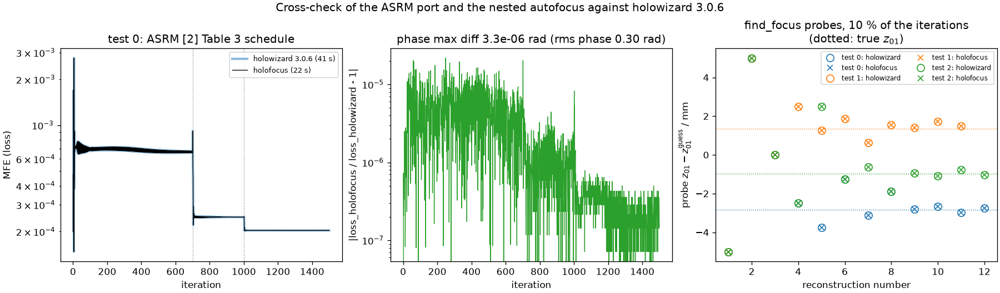
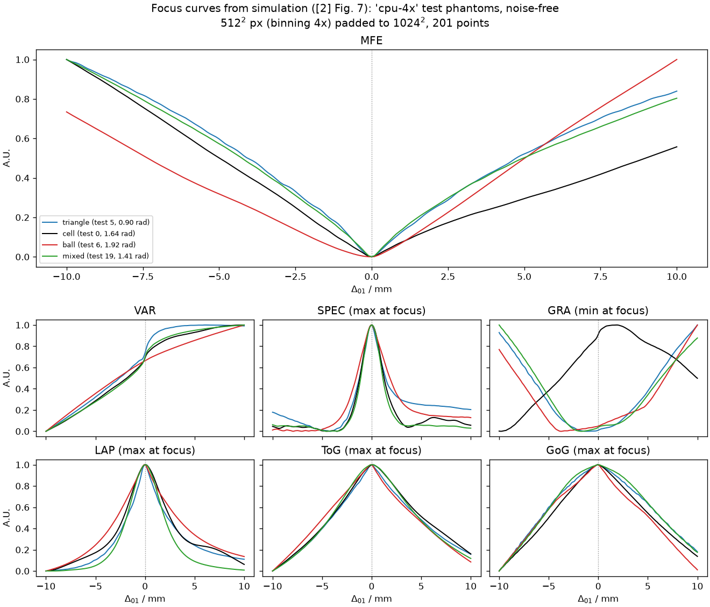
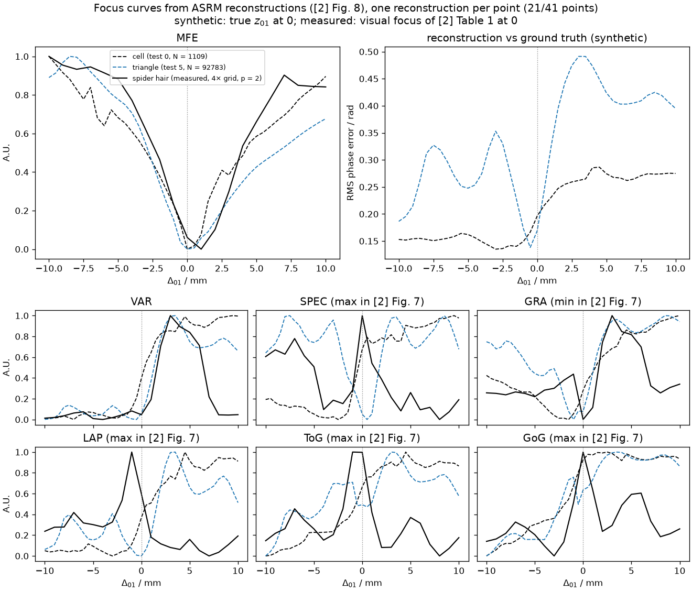
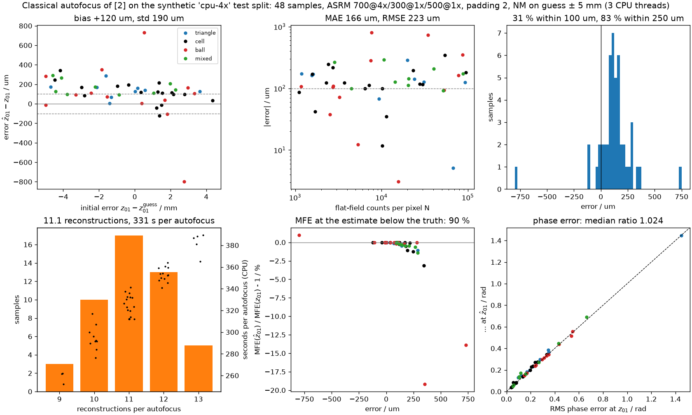
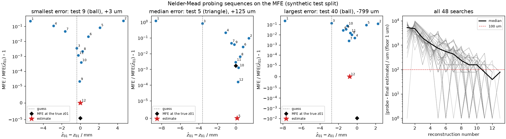
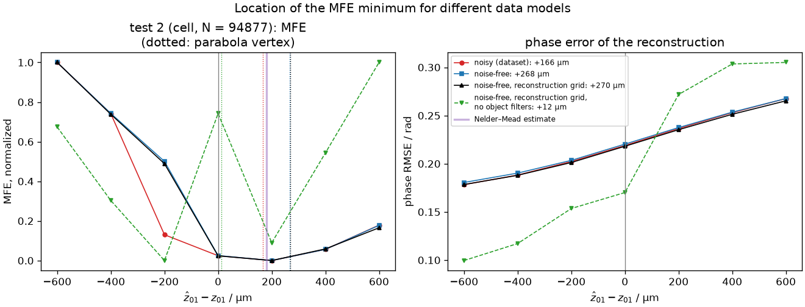
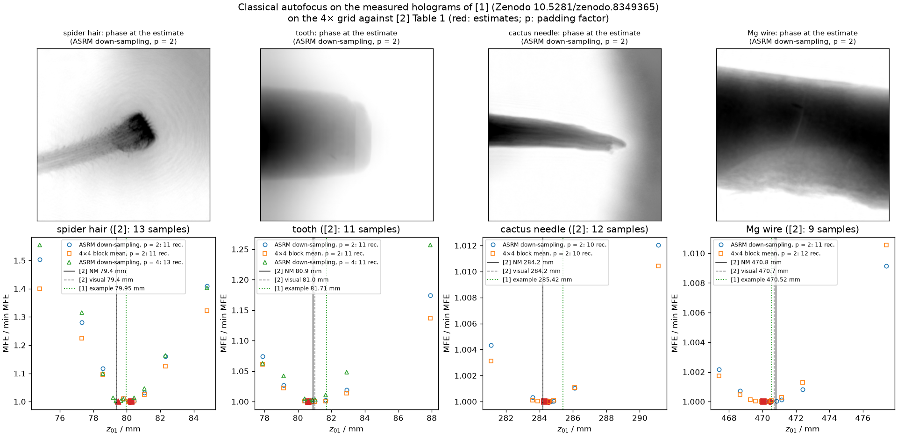
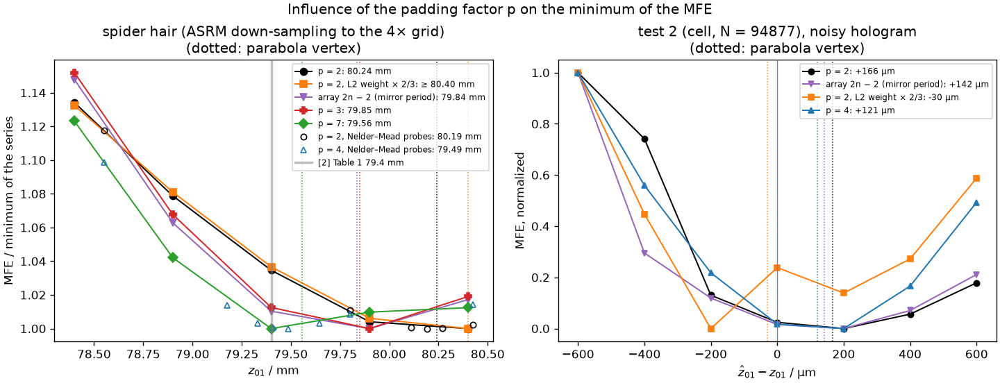

# Laborbuch 03 – Etappe 3: Klassische Autofokus-Baseline nach [2]

| | |
|---|---|
| Datum | 20./21.10.2026 |
| Branch | `cursor/stage3-baseline-1091` |
| Code | `src/holofocus/asrm.py`, `src/holofocus/autofocus/`, `src/holofocus/baseline/`, `src/holofocus/measured.py`, `configs/baseline/`, `tests/`, `scripts/run_stage3_experiments.py`, `scripts/make_stage3_figures.py`, `scripts/crosscheck_asrm_holowizard.py` |
| Ergebnisse | `results/` (pro Sample, Grundlage für den Vergleich in Etappe 4) |
| Abbildungen | `docs/laborbuch/figures/stage3-*.png`, Zahlen in `stage3-metrics.json` |
| Quellen | [1] Dora et al., Opt. Express 32(7), 10801 (2024); [2] Dora et al., Opt. Express 33(4), 6641 (2025); Referenzcode holowizard 3.0.6 (MIT-Lizenz) |

## 1 Ziel

Die modellbasierte Autofokus-Methode von [2] als Baseline, gegen die das gelernte Verfahren
später antritt:

- Innere Rekonstruktion mit ASRM nach [1] Alg. 5 und dem Plan aus [2] Appendix Table 3
  (700/300/500 Iterationen bei 16×/4×/4× Down-Sampling), angepasst an das gebinnte Gitter.
  Der Algorithmus wird nach holofocus portiert; holowizard dient nur noch als externer
  Gegencheck in einer eigenen Umgebung.
- Zielfunktion ist der Model Fit Error (MFE) nach [2] Eq. (14)–(15), eingebettet in die
  verschachtelte Optimierung nach [2] Eq. (22): Nelder–Mead auf
  $z_{01}^\text{guess} \pm 5$ mm, Anfangssimplex aus den beiden Intervallenden (10 mm
  Abstand), Projektion auf $\Omega_z$, Abbruch bei 100 µm Simplexlänge.
- Die Bildkriterien VAR, SPEC, GRA, LAP, ToG und GoG, mit denen [2] den MFE vergleicht, auf
  Fokuskurven. Damit soll die Arbeit zeigen können, warum der MFE die Referenz ist.
- Auswertung auf dem synthetischen Test-Split mit bekanntem `Δz01`: Fehler in `z01` (µm),
  Anzahl der Rekonstruktionen und Rechenzeit pro Autofokus auf der CPU; Fokuskurven wie [2]
  Fig. 7.
- Die gemessenen Hologramme aus dem Zenodo-Archiv von [1], gebinnt, im Vergleich mit [2]
  Table 1.
- Ergebnisse pro Sample speichern, damit Etappe 4 das Netz auf genau denselben Samples messen
  kann.

## 2 Ausgangslage

Etappe 2 ist in `main` gemergt
([PR #8](https://github.com/AliTUHH/master_thesis_autofocus/pull/8), Merge-Commit `222f75f`,
CI grün). Für diese Etappe habe ich mit diesem Stand den Test-Split von `cpu-4x` erzeugt:
250 Samples, Seed 20261020, SHA-256 `147e6336…` (vollständig in `run.yaml`). Train- und
Val-Split braucht erst Etappe 4. In Etappe 1 lief ASRM schon einmal auf der CPU, damals als
holowizard-Aufruf am Spinnenhaar (Laborbuch 01). Diese Etappe ersetzt den Aufruf durch einen
eigenen Port, der mit dem Rest von holofocus zusammenarbeitet (Tensoren, Geräte, Präzision,
Datensatzformat).

## 3 Was gemacht wurde

### 3.1 Module

| Modul | Inhalt |
|---|---|
| `asrm.py` | ASRM-Port: `ASRMStage` (eine Zeile von [2] Table 3), `PAPER2_TABLE3`, `schedule_for_binning`, `ASRMSettings` (Plan, Padding, Fade, $A_0$, Optionen), `asrm_reconstruct` |
| `autofocus/criteria.py` | MFE nach [2] Eq. (15) und Eq. (14), die sechs Bildkriterien, Gauß-Vorfilter, Normierung der Kurven |
| `autofocus/nelder_mead.py` | Nelder–Mead mit Projektion auf Box-Grenzen, Port von `scipy.optimize.minimize(method="Nelder-Mead")` (scipy 1.17) |
| `autofocus/search.py` | `find_focus`: die verschachtelte Suche nach [2] Eq. (22) |
| `autofocus/curves.py` | Fokuskurven aus der Simulation ([2] Fig. 7) und aus Rekonstruktionen ([2] Fig. 8), `symmetric_offsets` |
| `measured.py` | die vier Zenodo-Hologramme von [1] mit Geometrie, $A_0$, Schneidrand und den Werten aus [2] Table 1; `load_measured` mit Blockmittel-Binning |
| `baseline/` | YAML-Konfiguration, Lauf über einen Split (`run_baseline`), Ergebnisdateien, CLI `holofocus-baseline` |
| `yamlconfig.py` | strenges YAML-Parsing, aus `dataset/config.py` ausgelagert und jetzt von Datensatz und Baseline genutzt |
| `configs/baseline/` | `paper2-cpu.yaml` (Hauptlauf auf `cpu-4x`), `ci.yaml` (CI, 16×) |
| `scripts/` | `run_stage3_experiments.py` (Messdaten, Fokuskurven mit Rekonstruktionen), `make_stage3_figures.py`, `crosscheck_asrm_holowizard.py` |

### 3.2 ASRM

Eine Iteration der Stufe $j$ (Regularisierungsniveau) lautet wie im Referenzcode:

```
O' = G_O · fade(pad(mirr(O)))                   Objekt polstern (gespiegelt), Rand ausblenden, Filter Õ
v  = G_v v                                      Momentum-Filter (Gauß, "momentum variance")
y  = O' − γ v                                   Look-ahead-Punkt (Nesterov)
v  = γ v + η ∇L(y) + i β Im(y) / ‖Im(y)‖₂       Momentum mit Datengradient und L2-Term auf μ
O  = P_ΩP(y − v)                                Re(O) ≤ 0, Im(O) ≥ 0  ([2] Eq. (20)–(21))
```

mit $L(y) = \tfrac12 \lVert\, \lvert D_{Fr}(\exp(i y))\rvert - \sqrt{S_\downarrow I}\,\rVert^2$
auf dem Gitter der Stufe. Die Stufen rechnen auf down-gesampelten Daten; dazwischen werden
$O$ und $v$ bilinear hochskaliert. Der Plan auf `cpu-4x` (E3, E4):

| | Stufe 1 | Stufe 2 | Stufe 3 |
|---|---|---|---|
| Iterationen | 700 | 300 | 500 |
| Down-Sampling in [2] (2048² à 6,5 µm) | 16× | 4× | 4× |
| Down-Sampling auf `cpu-4x` (512² à 26 µm) | 4× | 1× | 1× |
| Stufenpixel (beide gleich) | 104 µm | 26 µm | 26 µm |
| Sichtfeld / Array (Padding 2) | 128² / 256² | 512² / 1024² | 512² / 1024² |
| Schrittweite η | 0,9 | 1,1 | 1,1 |
| Momentum γ, FWHM des Momentum-Filters | 1,0, 8 px | 1,0, 16 px | 1,0, 16 px |
| L2-Gewicht β | 10 | 10 | 1 |
| Filter Õ, FWHM Re/Im | 2/0 px | 2/8 px | 2/8 px |
| Fade-Breite (80 px auf 2048²) | 5 px | 20 px | 20 px |

Filterbreiten gelten in Pixeln des Stufengitters, $\sigma = \text{FWHM}/2{,}35$ wie im
Referenzcode. `ASRMSettings.for_binning(b)` erzeugt den Plan für ein beliebiges Binning.

### 3.3 MFE und verschachtelte Suche

Der MFE einer Probe $\hat z_{01}$ ist der Verlust der letzten ASRM-Iteration, also der
Mittelwert über das Sichtfeld von $(\lvert D_{\hat{Fr}}(\exp(i y))\rvert - \sqrt{I})^2$
([2] Eq. (15), E5). `find_focus(hologram, geometry, settings)` sucht

$$z_{01}^* = \operatorname*{argmin}_{\hat z_{01} \in \Omega_z} \mathcal G\big(\tilde O^*(\hat z_{01})\big),
\qquad \Omega_z = [z_{01}^\text{guess} - 5\,\text{mm},\; z_{01}^\text{guess} + 5\,\text{mm}]$$

mit Nelder–Mead ([2] Eq. (22), E6). Jede Probe ist eine vollständige Rekonstruktion mit
$\hat{Fr} = Fr(\hat z_{01})$ bei festem $z_{02}$. Rückgabe: Schätzwert, MFE, alle Proben mit
Zeit, Anzahl der Rekonstruktionen und Iterationen, und die Rekonstruktion am Schätzwert.

### 3.4 Bildkriterien und Fokuskurven

Die Bildkriterien sind Ports von `holowizard.core.find_focus.focus_loss_metrics` und wirken
auf die Phase nach einem Gauß-Vorfilter mit FWHM 4 px (wie im Auswerteskript des
Referenzcodes):

| Kriterium | Definition | Fokus bei |
|---|---|---|
| VAR | Varianz des Bildes | – (in [2] kubisch, kein Extremum) |
| SPEC | $\sum \log(1 + \lvert\mathcal F[x]\rvert)$ ohne Nullfrequenz | Maximum |
| GRA | Summe der Gradientenbeträge | Minimum |
| LAP | Summe des quadrierten Laplace-Operators | Maximum |
| ToG | $\sqrt{\operatorname{var}(g)/\operatorname{mean}(g)}$ der Gradientenbeträge $g$ | Maximum |
| GoG | Gini-Index der Gradientenbeträge | Maximum |

Zwei Arten von Fokuskurven, jeweils über $\Delta_{01} = \hat z_{01} - z_{01}$ und auf $[0, 1]$
normiert wie in [2]:

- **Aus der Simulation** ([2] Sec. 3.5, Fig. 7): Das wahre Austrittsfeld wird um $\Delta_{01}$
  defokussiert, auf $\Omega_P$ projiziert und dann ausgewertet, ohne Rekonstruktion. Der MFE
  vergleicht mit dem rauschfreien Hologramm. 201 Punkte auf ±10 mm wie in [2].
- **Aus Rekonstruktionen** ([2] Sec. 3.6, Fig. 8): an jedem Punkt eine vollständige
  ASRM-Rekonstruktion aus dem verrauschten bzw. gemessenen Hologramm. 41 Punkte auf ±10 mm
  (E8). Bei synthetischen Daten kommt der RMS-Fehler der Phase gegenüber der Wahrheit hinzu.

### 3.5 Baseline-Läufe und Ergebnisdateien

```bash
holofocus-baseline run configs/baseline/paper2-cpu.yaml --data data/cpu-4x/test.h5 \
    --out results/baseline/cpu-4x-test --limit 48 --threads 3
holofocus-baseline summary results/baseline/cpu-4x-test
```

Pro Sample: Autofokus ab $z_{01}^\text{guess}$ und danach eine zusätzliche Rekonstruktion am
wahren `z01` (`evaluate_truth`), um den MFE und den Phasenfehler an der Wahrheit zu kennen.
Ausgaben im Laufverzeichnis:

| Datei | Inhalt |
|---|---|
| `run.yaml` | Konfiguration, ASRM-Einstellungen für das Binning der Daten, Datensatz (Pfad, SHA-256, Seed, Commit des Generators), Git-Commit, Torch-Version, Gerät, Threads, Host |
| `results.csv` | eine Zeile pro Sample, Schlüssel `index`: wahre und geschätzte Distanz, Fehler, Rekonstruktionen, Zeit, MFE am Schätzwert und an der Wahrheit, Phasenfehler an beiden |
| `traces.jsonl` | jede Probe jeder Suche (`z01`, MFE, Sekunden, rekonstruiert oder Wiederholung) |
| `summary.json` | Fehlerstatistik, Anteil innerhalb 50/100/250/1000 µm, Rekonstruktionen und Zeit pro Autofokus |

Läufe lassen sich fortsetzen; ein Verzeichnis mit anderer Konfiguration oder anderem
Datensatz wird abgelehnt. Für Etappe 4 heißt das: Das Netz wird auf den `index`-Werten von
`results.csv` ausgewertet, und die Spalten `error_um`, `n_reconstructions` und `seconds` sind
die Vergleichsgrößen.

### 3.6 Messdaten

`holofocus.measured` beschreibt die vier Hologramme im Zenodo-Archiv von [1]
(`Examples/data/holograms`, 2048² native Pixel, flat-field-korrigiert). Geometrie und
Parameter stammen aus den `alg5_combined`-Beispielen des Referenzcodes und aus [2] Table 1–2:

| Probe | Energie | $z_{02}$ | $A_0$ | Schneidrand | [2]: Anfangssimplex | NM-Ergebnis | visuell | Proben | Typ (Padding) |
|---|---|---|---|---|---|---|---|---|---|
| Spinnenhaar | 11 keV | 19,661 m | 0,98 | – | 74,8 / 84,8 mm | 79,4 mm | 79,4 mm | 13 | 1 (7) |
| Zahn | 17 keV | 19,652 m | 0,96 | 80 px | 77,9 / 87,9 mm | 80,9 mm | 81,0 mm | 11 | 2 (4) |
| Kaktusnadel | 17 keV | 19,652 m | 0,98 | – | 281,1 / 291,1 mm | 284,2 mm | 284,2 mm | 12 | 1 (7) |
| Mg-Draht | 11 keV | 19,661 m | 1,1 | – | 467,4 / 477,4 mm | 470,8 mm | 470,7 mm | 9 | 2 (4) |

Die Proben-Rekonstruktionen laufen wie in [2] auf dem 4×-Gitter (512² à 26 µm; Zahn nach dem
Abschneiden des Rands 472²), auf zwei Datenwegen (E11): 4× gebinnt mit Blockmittel oder
ungebinnt mit dem Down-Sampling in ASRM wie in [2]. Als Schätzwert dient die Mitte des
Anfangssimplex von [2], das Suchintervall ist dann genau dieser Simplex. Die Draht-Probe in der
Flusszelle aus [2] ist nicht im Archiv.

```bash
python scripts/run_stage3_experiments.py --threads 1 measured --holograms DIR --out results/measured/p2
python scripts/run_stage3_experiments.py --threads 1 measured --holograms DIR --binning 1 \
    --out results/measured/b1-p2
python scripts/run_stage3_experiments.py --threads 3 measured --holograms DIR --binning 1 \
    --padding 4 --samples spider_hair tooth --out results/measured/b1-p4
```

Die Padding-Versuche (5.8) rechnen dieselbe Proben-Rekonstruktion des Spinnenhaars an fünf
Punkten auf ±1 mm um 79,4 mm, mit Padding 2, 3 und 7, mit Padding 2 und L2-Gewicht × 2/3 und
auf Arrays von 1022² (`curves --binning 1 --padding P --points 5 --half-range 1e-3`, für
1022² `--padding 1.99609375`, für den L2-Versuch zusätzlich `--l2-scale 0.6667`). Dazu kommt
der MFE-Scan von Sample 2 aus 5.6 mit Padding 4, mit dem L2-Gewicht × 2/3 und auf 1022².
Ausgaben in `results/padding/<lauf>/`, alle Befehle in `docs/usage.md`.

### 3.7 Gegencheck mit holowizard

`scripts/crosscheck_asrm_holowizard.py` läuft in der holowizard-Umgebung (Python 3.11,
holowizard 3.0.6, holofocus ohne Abhängigkeiten installiert) und rechnet mit beiden Codes auf
demselben Hologramm und derselben Fresnelzahl:

- `reconstruct`: der volle Plan aus [2] Table 3; verglichen werden der Verlust jeder
  Iteration und das rekonstruierte Objekt;
- `focus`: beide Autofokus-Suchen (`holowizard … find_focus` und `holofocus.autofocus.find_focus`)
  mit 10 % der Iterationen; verglichen werden die Probenpunkte und der Schätzwert.

holowizard dreht das Hologramm in `process_image` um 90°; es bekommt deshalb das um −90°
gedrehte Hologramm, damit beide Codes auf demselben Array rechnen.

### 3.8 Tests (55 neu, insgesamt 165, davon 1 nur mit CUDA)

| Datei | Prüft |
|---|---|
| `test_asrm.py` | Plan aus [2] Table 3 und Anpassung ans Binning; Validierung; Stufengitter und Sichtfeld; Fade-Profil und Fenster; Spiegel-Padding; Datenaufbereitung; Gauß-Transferfunktion gegen scipy; beide Gradientenregeln gegen Autograd; Phasen-Pinning und Projektion; Rekonstruktion konvergiert und der MFE markiert den Fokus; Optionen, Präzision, Startwert |
| `test_autofocus.py` | Nelder–Mead gegen scipy (dieselben Punkte, 1-D und 2-D, mit und ohne Grenzen); MFE Eq. (14) = Eq. (15) und null im Fokus; Invarianzen der Bildkriterien; Gini/ToG einer Rampe und einer Spitze; Vorfilter; Kurvenhilfen; simulierte und rekonstruierte Fokuskurve; `find_focus` mit Modellzielfunktion; `find_focus` probt dieselben Punkte wie die Referenzsuche (scipy in mm, mit Strafwert) ohne doppelte Rekonstruktionen |
| `test_baseline.py` | Repository-Configs; YAML hin und zurück, 9 Validierungsfälle; Ergebnisdatei und Zusammenfassung; Phasenfehler; Auswahl der Samples; fortsetzbarer Lauf mit `run.yaml`, Traces und Ablehnung anderer Konfigurationen; CLI |
| `test_measured.py` | Werte aus [2] Table 1; Fresnelzahlen gegen [2] Table 2 (Abweichung < 0,2 %); Schneidrand erhält die Arraygröße; Binning und Laden (synthetisches TIFF) |

Die CI rechnet zusätzlich auf dem Demo-Test-Split einen Baseline-Lauf mit
`configs/baseline/ci.yaml` (3 Samples) und erzeugt daraus und aus `results/` die
Stage-3-Abbildungen im Schnellmodus.

## 4 Entscheidungen und Begründung

**E1 – Port statt Abhängigkeit.** holowizard 3.0.6 legt Python 3.11 fest und bringt 162 Pakete
(etwa 9 GB) mit (Laborbuch 01). Als Abhängigkeit wäre das für die CI, für CPU-Rechner und für
spätere GPU-Läufe ein Hindernis. Der Kern von ASRM umfasst wenige hundert Zeilen, und
holowizard steht unter MIT-Lizenz. Portiert sind die Rekonstruktion (`core/reconstruction`,
`core/preprocessing`), die Fokussuche und die Fokuskriterien (`core/find_focus`), in PyTorch
mit derselben Geräte- und Präzisionslogik wie Etappe 1 und 2. Nelder–Mead ist aus scipy 1.17
portiert: scipy ist nur eine Entwicklungsabhängigkeit, und der Port probt nachweislich
dieselben Punkte (Test), sodass die Zahl der Rekonstruktionen direkt mit der Referenz
vergleichbar ist. holowizard bleibt in einer eigenen Umgebung als externer Gegencheck
(Abschnitt 5.1).

**E2 – Referenzcode vor gedrucktem Algorithmus.** Die Zahlen von [2] stammen aus dem
Referenzcode. Wo er von [1] Alg. 5 abweicht, ist deshalb sein Verhalten Standard; das
gedruckte Verhalten ist als Option verfügbar:

- Der Positionsschritt geht vom Look-ahead-Punkt aus, $O = P(y - v)$. [1] Alg. 5 druckt
  $P(O' - v)$ (`update="printed"`).
- Das Residuum in der Detektorebene ist $\psi\,(1 - \sqrt{A/\lvert\psi\rvert})$ mit der
  gemessenen Amplitude $A$; [1] Eq. (22) hat $\psi\,(1 - A/\lvert\psi\rvert)$
  (`gradient="amplitude"`). Der Referenzgradient gehört zur Datenfunktion
  $\sum (a^2/2 - \tfrac23 \sqrt{A}\, a^{3/2})$ mit $a = \lvert\psi\rvert$ (Test gegen Autograd);
  nahe der Konvergenz ist sein Schritt halb so groß.
- Vor jedem Polstern wird die Phase im Sichtfeld so verschoben, dass ihr Maximum 0 ist
  (`pin_phase`, im Referenzcode `shift_phases=True`).
- Das gemessene Hologramm wird durch $A_0^2$ geteilt (Referenz `process_measurement`); ein
  konstantes Polstern mit $A_0$ hat danach keine Wirkung mehr.
- Der Verlust ist der Mittelwert über das Sichtfeld, nicht die Summe. Für den Vergleich von
  Proben derselben Suche ist das gleichgültig.

Der Gegencheck (5.1) zeigt, dass der Port bis auf float32-Rundung dasselbe rechnet.

**E3 – Plan auf dem gebinnten Gitter.** [2] Table 3 gilt für das volle 2048²-Raster. Auf
`cpu-4x` wird das Down-Sampling durch das Binning geteilt: 16×/4×/4× wird 4×/1×/1×. Die Stufen
rechnen damit auf denselben physikalischen Pixeln wie in [2] (104 µm und 26 µm), und weil die
Filterbreiten in Stufenpixeln angegeben sind, behalten sie ihre physikalische Bedeutung. Die
Fade-Breite (80 px auf 2048²) wird 20 px. [2] Table 1 schreibt ausdrücklich, dass die
Probe-Rekonstruktionen des Nelder–Mead auf einem 4× down-gesampelten Gitter liefen. Das ist
genau das Gitter von `cpu-4x`; die Anpassung ist also derselbe Rechenweg und keine
Vereinfachung. Für Binning > 4 (CI, 16×) laufen alle Stufen auf dem gebinnten Gitter
(1×/1×/1×). Die 4×-Stufen sind dann gröber als in [2], und die Filter wirken physikalisch 4×
breiter (offener Punkt 8).

**E4 – Padding 2 statt 7 bzw. 4.** [2] polstert auf 14336² (Typ 1) bzw. 8192² (Typ 2) und
rechnet die Proben auf 3584² bzw. 2048², also mit dem Faktor 7 bzw. 4 relativ zum Sichtfeld.
Nötig ist $N \ge 1/Fr$ ([1] Sec. 3.2.2). Auf `cpu-4x` ist $1/Fr$ = 632–699 px in der Box; mit
Faktor 2 ist $N = 1024$. Bei den 4× gebinnten Messdaten ist $1/Fr$ = 802 px (Spinnenhaar),
508 px (Zahn), 144 px (Kaktusnadel) und 134 px (Mg-Draht); auch hier reicht 1024. Auf der
CPU kostet Faktor 4 aber etwa das 6- bis 7-Fache (2048² statt 1024², 5.9), Faktor 7 noch
einmal ein Vielfaches davon. Der Hauptlauf rechnet deshalb mit Padding 2. Das
Sampling-Kriterium sagt allerdings nichts darüber, ob das Padding die Lage des MFE-Minimums
verschiebt. Das tut es: beim Spinnenhaar um 0,75 mm, bei Sample 2 um 45 µm (5.8). Die
Messdaten rechne ich deshalb zusätzlich mit Padding 4 (Typ 2 von [2]), und 5.8 untersucht,
woher die Verschiebung kommt.

**E5 – MFE: Eq. (14) und Eq. (15) sind dasselbe.** Eq. (14) defokussiert das wahre
Austrittsfeld um $\Delta_{01}$, projiziert, propagiert mit $D^{z_{12}}$ zum Detektor und
macht die Defokussierung mit $D^{-\Delta_{01}}$ rückgängig; Eq. (15) propagiert das projizierte
Feld direkt mit $D^{\hat z_{12}}$. Fresnel-Propagatoren sind im Fourierraum Multiplikationen,
also gilt $D_{Fr_1} D_{Fr_2} = D_{Fr}$ mit $1/Fr = 1/Fr_1 + 1/Fr_2$. Nach dem
Fresnel-Skalierungstheorem gilt auf dem Detektorraster
$1/Fr = 1/Fr(\Delta_{01}) + 1/\hat{Fr}$ ([2] Eq. (5)–(7), `fresnel_number_at`), und damit
ist $D^{-\Delta_{01}} D^{z_{12}} = D^{\hat z_{12}}$. Der Test bestätigt das numerisch
(relativer Unterschied $10^{-9}$). In der Suche ist der MFE einer Probe der Verlust der
letzten ASRM-Iteration, wie in `find_focus` des Referenzcodes; es braucht also keine
zusätzliche Propagation.

**E6 – Nelder–Mead wie in der Referenz, in Millimetern.** Wie `find_focus` des Referenzcodes:
`scipy.optimize.minimize(method="Nelder-Mead")` mit den Intervallenden als Anfangssimplex,
Abschneiden jedes Probenpunkts auf $\Omega_z$ (Projektion), `xatol` = 0,1 mm (Simplexlänge
100 µm) und `fatol` = $10^6$ (Toleranz auf die Funktionswerte praktisch aus). Ein Punkt, der
schon einmal ausgewertet wurde, bekommt statt einer zweiten Rekonstruktion den Strafwert
`float max`; der Simplex zieht sich dann zusammen. Das passiert, wenn eine Spiegelung über
eine Intervallgrenze hinaus zurück auf die Grenze geschnitten wird. Der Simplex rechnet in
Millimetern wie die Referenz. Meine erste Fassung rechnete in Metern. Dort unterscheiden sich
wiederbesuchte Punkte im letzten Bit vom ersten Besuch, der Strafwert greift nicht, und der
Punkt wird ein zweites Mal rekonstruiert. Der Gegencheck zeigte das: 13 statt 12
Rekonstruktionen bei gleichem Schätzwert (`results/crosscheck/focus_0-before-mm-fix.json`).
Nach der Umstellung sind die Probenpunkte bitgleich (5.1), und ein Test prüft das gegen die
scipy-Suche.

**E7 – Bildkriterien wie im Referenzcode, mit einer Korrektur.** VAR, SPEC, GRA, LAP, ToG und
GoG folgen `focus_loss_metrics`. Bei SPEC setzt der Referenzcode nach der
Fourier-Transformation das Bildpixel `x[0, 0] = 0` statt des Spektrums; die Nullfrequenz
bleibt damit drin. Hier wird sie wie beabsichtigt ausgeschlossen. Sie ist einer von
$H \cdot W$ Summanden, der Unterschied ist klein. Der Vorfilter (FWHM 4 px) entspricht dem
Auswerteskript der Referenz.

**E8 – 41 statt 201 Punkte für Fokuskurven aus Rekonstruktionen.** [2] Fig. 8 nutzt 201
Rekonstruktionen pro Kurve. Auf der CPU kostet eine Rekonstruktion 25–110 s je nach Threads;
201 Punkte wären 1,4–6 h pro Kurve. 41 Punkte (0,5 mm Abstand) zeigen die Form der Kurven und
die Lage der Extrema auf 0,5 mm genau. Die simulierten Kurven (keine Rekonstruktion) haben 201
Punkte wie [2] Fig. 7.

**E9 – Stichprobe für den Hauptlauf.** Die ersten 48 Samples des `cpu-4x`-Test-Splits
(9 Dreiecke, 17 Zellen, 13 Kugeln, 9 `mixed`; $N$ = 1,1·10³–9,5·10⁴; `Δz01` = −5,0 bis
+4,3 mm). Mehr ist auf der CPU in vertretbarer Zeit nicht machbar (etwa 5,5 min pro Sample).
Die Auswahl ist nicht handverlesen, sondern die Reihenfolge des Splits, der zufällig gezogen
ist.

**E10 – Zeitmessung.** Die VM hat 4 Kerne. Der Hauptlauf rechnet mit 3 Threads auf den Kernen
0–2 (`taskset`), Nebenexperimente mit 1 Thread auf Kern 3. Ein erster Lauf, der sich die Kerne
mit Tests teilte, brauchte fast doppelt so lange pro Sample und wurde verworfen. Die Zeit pro
Autofokus umfasst alle Rekonstruktionen der Suche, nicht die zusätzliche Rekonstruktion an
der Wahrheit. Speicherbandbreite und Cache teilen sich die Kerne trotzdem; die Zeiten sind
deshalb Richtwerte für diesen Rechner.

**E11 – Messdaten auf zwei Datenwegen.** Der synthetische Datensatz ist 4× gebinnt
(Blockmittel der Intensität wie beim Detektor-Binning). [2] gibt dagegen das volle
2048²-Hologramm an den Referenzcode, der für die Proben intern 4× herunterrechnet (bilineare
Interpolation der Amplitude mit Antialiasing, `prepare_stage_data`). Beide Wege enden auf
denselben Arrays (Stufen 256²/1024²/1024² bei Padding 2) und kosten gleich viel. Ich rechne
die Messdaten auf beiden Wegen: `p2` (4× gebinnt, wie der Datensatz) und `b1-p2` (ungebinnte
Eingabe mit dem Plan aus [2] Table 3 auf 16×/4×/4×, wie [2]). Für den Vergleich mit [2]
Table 1 zählt `b1-p2`; der Unterschied zwischen beiden zeigt, wie empfindlich die Schätzung
auf die Datenaufbereitung reagiert.

## 5 Ergebnisse

### 5.1 Gegencheck mit holowizard

**Abb. 1 – Gegencheck** (`figures/stage3-crosscheck.png`)



Links der Verlust jeder Iteration beider Codes für den vollen Plan aus [2] Table 3, in der
Mitte ihr relativer Unterschied, rechts die Probenpunkte der beiden Fokussuchen.

**Rekonstruktion** (Test-Sample 0, 1500 Iterationen, 4 Threads, beide Codes mit derselben
Fresnelzahl, `results/crosscheck/reconstruct_0.json`):

| Größe | Wert |
|---|---|
| Verlust am Ende von Stufe 1 / 2 / 3 (holowizard) | 6,754·10⁻⁴ / 2,489·10⁻⁴ / 2,0351·10⁻⁴ |
| relativer Unterschied des Endverlusts | 1,4·10⁻⁷ |
| relativer Unterschied pro Iteration, Median / Maximum | 1,1·10⁻⁶ / 2,2·10⁻⁵ |
| Phase: maximaler / RMS-Unterschied (RMS der Phase selbst: 0,30 rad) | 3,3·10⁻⁶ / 1,4·10⁻⁶ rad |
| Absorption: maximaler Unterschied | 5,0·10⁻⁷ |
| Laufzeit holowizard / holofocus | 41,0 s / 21,9 s |

Die Unterschiede entsprechen float32-Rundung, die sich über 1500 Iterationen aufsummiert.

**Autofokus** (`find_focus` beider Codes mit 10 % der Iterationen, 1 Thread,
`results/crosscheck/focus_<i>.json`). Beide Suchen proben bitgleiche Punkte und enden beim
selben Schätzwert:

| Sample | wahres $z_{01}$ | Schätzwert (beide) | Rekonstruktionen | Zeit holowizard / holofocus |
|---|---|---|---|---|
| 0 | 97,179 mm | 97,1875 mm | 12 | 187 s / 100 s |
| 1 | 101,346 mm | 101,4844 mm | 11 | 182 s / 98 s |
| 2 | 99,039 mm | 99,0625 mm | 12 | 200 s / 132 s |

Mit 10 % der Iterationen sind die Rekonstruktionen nicht konvergiert. Die Schätzwerte zeigen
deshalb nur, dass beide Implementierungen gleich rechnen, nicht wie genau die Methode ist.
holowizard rechnet die Fresnelzahl mit anderen Naturkonstanten (relativ −3,4·10⁻⁵, das
entspricht 3 µm in $z_{01}$); in der Suche verwendet jeder Code seine eigene. Vor der
Umstellung auf Millimeter (E6) brauchte holofocus bei Sample 0 13 statt 12
Rekonstruktionen.

### 5.2 Fokuskurven aus der Simulation ([2] Fig. 7)

**Abb. 2 – Fokuskurven ohne Rekonstruktion** (`figures/stage3-simulated-curves.png`)



Das erste Test-Sample jedes Phantomtyps, rauschfrei, 201 Punkte auf ±10 mm (0,1 mm Abstand),
das wahre Austrittsfeld wird defokussiert und projiziert wie in [2] Sec. 3.5. Lage des
Extremums und Anteil der Schritte in die richtige Richtung (1 = ideal unimodal, 0,5 =
monoton oder zufällig):

| Kriterium (Extremum im Fokus) | Dreieck (0,90 rad) | Zelle (1,64 rad) | Kugel (1,92 rad) | gemischt (1,41 rad) |
|---|---|---|---|---|
| MFE (Min.) | 0,0 mm / 1,00 | 0,0 mm / 1,00 | 0,0 mm / 1,00 | 0,0 mm / 1,00 |
| VAR (–) | +6,1 mm / 0,71 | +9,8 mm / 0,51 | +10,0 mm / 0,50 | +10,0 mm / 0,50 |
| SPEC (Max.) | 0,0 mm / 0,70 | 0,0 mm / 0,63 | 0,0 mm / 0,85 | 0,0 mm / 0,67 |
| GRA (Min.) | −1,1 mm / 0,94 | −9,8 mm / 0,10 | −3,7 mm / 0,83 | −1,7 mm / 0,92 |
| LAP (Max.) | 0,0 mm / 1,00 | 0,0 mm / 1,00 | −0,1 mm / 0,99 | 0,0 mm / 0,97 |
| ToG (Max.) | 0,0 mm / 1,00 | +0,1 mm / 0,99 | −0,1 mm / 0,99 | +0,1 mm / 0,99 |
| GoG (Max.) | 0,0 mm / 1,00 | 0,0 mm / 1,00 | −0,1 mm / 0,99 | 0,0 mm / 1,00 |

Das Bild entspricht [2] Fig. 7: Der MFE ist V-förmig mit dem Minimum genau im Fokus, ToG und
GoG ebenso (mit Maximum), VAR steigt monoton und hat kein Extremum. SPEC trifft den Fokus mit
einer schmalen Spitze und ist daneben unruhig wie in [2]. LAP trifft ihn ebenfalls, hier aber
mit glatter Flanke statt der Zacken in [2]. Anders als in [2] ist GRA bei unseren Phantomen
nicht V-förmig: Das Minimum liegt 1–4 mm neben dem Fokus, bei der Zelle ist die Kurve sogar
umgekehrt (Maximum bei etwa +2 mm). Die
Zelle besteht aus vielen kleinen scharfen Organellen; deren Kanten verändern die
Gradientensumme beim Defokussieren offenbar anders als eine einzelne große Struktur.

In diesem Test kommen die Bildkriterien also gut weg. Er arbeitet aber mit dem wahren
Austrittsfeld: Defokussieren und Projizieren erzeugen ein Bild, das bei $\Delta_{01} = 0$
exakt das Objekt ist. Eine echte Autofokussierung hat nur Rekonstruktionen.

### 5.3 Fokuskurven aus Rekonstruktionen ([2] Fig. 8)

**Abb. 3 – Fokuskurven mit einer Rekonstruktion pro Punkt**
(`figures/stage3-reconstruction-curves.png`)



Zwei synthetische Samples mit bekanntem $z_{01}$, jeweils 41 Rekonstruktionen auf ±10 mm
(0,5 mm Abstand, 1 Thread, je 59 min), dazu das Spinnenhaar mit 21 Rekonstruktionen auf
±10 mm um den visuellen Fokus von [2] (79,4 mm, 1 mm Abstand, Datenweg von [2] mit Padding 2,
1 Thread, 30 min). Lage von Maximum und Minimum:

| Kriterium (Extremum im Fokus in [2] Fig. 7) | Dreieck, $N$ = 9,3·10⁴: Max. / Min. | Zelle, $N$ = 1,1·10³: Max. / Min. | Spinnenhaar, um 79,4 mm: Max. / Min. |
|---|---|---|---|
| MFE (Min.) | −8,5 / **0,0 mm** | −10,0 / **0,0 mm** | −10 / +1 mm |
| VAR (–) | +3,5 / −0,5 mm | +9,5 / −7,0 mm | +3 / −4 mm |
| SPEC (Max.) | −7,5 / +0,5 mm | +9,5 / −2,5 mm | **0** / +8 mm |
| GRA (Min.) | +8,5 / −1,0 mm | +10,0 / −1,5 mm | +3 / **0 mm** |
| LAP (Max.) | +3,5 / 0,0 mm | +4,5 / −3,0 mm | −1 / +7 mm |
| ToG (Max.) | +3,0 / −10,0 mm | +4,5 / −10,0 mm | −1 / +8 mm |
| GoG (Max.) | +3,5 / −10,0 mm | +2,5 / −10,0 mm | **0** / −3 mm |
| Phasenfehler gegen die Wahrheit (Min.) | – / −0,5 mm | – / −3,0 mm | – |

Der MFE hat bei beiden Samples sein Minimum am wahren $z_{01}$ (auf dem 0,5-mm-Raster) und ist
fast unimodal: 93 % der Schritte gehen in die richtige Richtung. Bei der Zelle mit
1,1·10³ Photonen pro Pixel variiert er über die ganzen ±10 mm nur um 7,6 %, beim Dreieck um
123 %. Keines der Bildkriterien zeigt den Fokus mit dem Extremum, das es in der Simulation
hat. ToG, GoG, LAP und VAR haben ihr Maximum 2,5–9,5 mm neben dem Fokus, SPEC bei −7,5 bzw.
+9,5 mm. Beim rauscharmen Dreieck liegen dafür die Minima von SPEC, LAP und VAR am Fokus.
Eine fokussierte Rekonstruktion ist glatt, eine defokussierte trägt Rest-Fringes mit viel
hochfrequentem Inhalt. Bei der verrauschten Zelle verschwindet auch dieses umgekehrte Signal.
Die Richtung, in der ein Bildkriterium den Fokus anzeigt, hängt also davon ab, ob man
projizierte Austrittsfelder (5.2) oder Rekonstruktionen auswertet, und bei wenigen Photonen
zeigt es ihn gar nicht. Der MFE dagegen misst, wie gut die Rekonstruktion das gemessene
Hologramm erklärt. Deshalb nimmt [2] ihn als Zielfunktion, und deshalb baut die Baseline
dieser Arbeit auf ihm auf.

Der Phasenfehler gegen die Wahrheit hat sein Minimum bei −0,5 bzw. −3,0 mm und eignet sich
auch hier nicht als Fokusmaß (vgl. 5.6).

Beim gemessenen Spinnenhaar zeigen die Bildkriterien dagegen auf den visuellen Fokus von [2]:
SPEC und GoG haben ihr Maximum und GRA sein Minimum bei 79,4 mm, LAP und ToG ihr Maximum 1 mm
darunter. Der MFE hat sein Minimum mit Padding 2 bei +1 mm (Scheitel bei 80,27 mm), mit
Padding 4 bei 79,49 mm (5.7, 5.8). Er ist hier weniger unimodal als bei den synthetischen
Samples: Bezogen auf 79,4 mm gehen 75 % der Schritte in die richtige Richtung, und außerhalb
von etwa ±6 mm ist er fast flach. Die
Übereinstimmung der Bildkriterien mit dem visuellen Wert ist aber kein Nachweis ihrer
Genauigkeit: Die visuelle Bewertung beruht selbst auf der Schärfe derselben Art von
Rekonstruktionen, und ein wahres $z_{01}$ gibt es für die Messdaten nicht. Warum die
Kriterien beim Haar funktionieren und bei beiden synthetischen Samples nicht, habe ich nicht
untersucht.

### 5.4 Baseline auf dem Test-Split

**Abb. 4 – Genauigkeit und Aufwand** (`figures/stage3-baseline.png`)



Oben links der Fehler über dem Anfangsfehler $z_{01} - z_{01}^\text{guess}$, oben Mitte der
Betrag über der Photonenzahl, oben rechts das Histogramm. Unten die Zahl der Rekonstruktionen
mit der Zeit pro Autofokus, der relative MFE am Schätzwert gegenüber der Wahrheit und der
Phasenfehler an beiden Stellen. 48 Samples (`results/baseline/cpu-4x-test`, `paper2-cpu.yaml`,
3 Threads auf den Kernen 0–2, 4,4 h):

| Größe | Wert |
|---|---|
| Fehler $\hat z_{01} - z_{01}$, Mittel ± Standardabweichung | +120 ± 190 µm |
| Median des Betrags / MAE / RMSE | 124 / 166 / 223 µm |
| 90-%-Quantil / Maximum des Betrags | 289 / 799 µm |
| Anteil innerhalb 50 / 100 / 250 / 1000 µm | 15 / 31 / 83 / 100 % |
| zum Vergleich: Fehler von $z_{01}^\text{guess}$ (MAE / RMSE) | 2273 / 2671 µm |
| Rekonstruktionen pro Autofokus | 11,1 (9–13) |
| Zeit pro Autofokus | 328 s (252–389 s) |
| Zeit pro Rekonstruktion | 29,4 s (27,7–31,7 s) |
| MFE am Schätzwert ≤ MFE an der Wahrheit | 90 % |
| Phasenfehler am Schätzwert / an der Wahrheit (Median des Verhältnisses) | 1,02 |

| Gruppe | $n$ | Fehler, Mittel | Median | MAE | Rekonstruktionen |
|---|---|---|---|---|---|
| Dreieck | 9 | +140 µm | +141 µm | 140 µm | 11,6 |
| Zelle | 17 | +115 µm | +116 µm | 136 µm | 11,2 |
| Kugel | 13 | +79 µm | +94 µm | 220 µm | 10,8 |
| gemischt | 9 | +168 µm | +144 µm | 168 µm | 11,0 |
| $N$ < 4,2·10³ | 16 | +104 µm | +116 µm | 138 µm | 10,9 |
| 4,2·10³ ≤ $N$ < 2,2·10⁴ | 16 | +58 µm | +99 µm | 161 µm | 11,2 |
| $N$ ≥ 2,2·10⁴ | 16 | +198 µm | +152 µm | 198 µm | 11,3 |

Drei Befunde:

1. **Der Fehler ist systematisch positiv.** 88 % der Fehler sind positiv, der Median liegt
   bei +120 µm. Ohne die vier Ausreißer mit einem Betrag über 300 µm bleiben
   +117 ± 93 µm; die Verschiebung ist also größer als die Streuung. Bei vielen Photonen ist
   sie am größten (+198 µm im oberen Drittel). Woher sie kommt, klärt 5.6.
2. **Nelder–Mead findet das Minimum des MFE fast immer.** In 90 % der Fälle ist der MFE am
   Schätzwert kleiner als an der Wahrheit; der Fehler steckt also in der Zielfunktion, nicht
   in der Suche. Von den übrigen fünf Fällen liegen vier weniger als 40 µm neben der
   Wahrheit, also innerhalb der Abbruchtoleranz. Nur Sample 40 (Kugel, −799 µm) endet in einem
   lokalen Minimum: Die Suche hat die Umgebung der Wahrheit nie geprobt (Abb. 5).
3. **Kugeln sind am schwierigsten.** Drei der vier Ausreißer sind Kugeln (Phasenhub bis
   2 rad, glatter Verlauf). Bei zweien liegt der MFE am Schätzwert 14 % bzw. 19 % unter dem
   an der Wahrheit: Die Rekonstruktion am wahren $z_{01}$ konvergiert dort schlechter als an
   der geschätzten Stelle. Der vierte Ausreißer ist eine Zelle (+343 µm, MFE 3 % unter der
   Wahrheit).

Gegenüber dem Schätzwert (MAE 2,3 mm) verbessert der Autofokus den Abstand um den Faktor 14
(MAE 166 µm). Die 100 µm, bei denen Nelder–Mead abbricht, erreicht er nur bei 31 % der
Samples. Das Abbruchkriterium beschreibt die Auflösung der Suche, nicht ihre Genauigkeit.

### 5.5 Ablauf der Suche

**Abb. 5 – Probenfolgen** (`figures/stage3-search.png`)



Links drei Suchen (kleinster, mittlerer und größter Fehler): relativer MFE jeder Probe mit
ihrer Nummer, Raute = MFE an der Wahrheit, Stern = Schätzwert. Rechts der Abstand jeder Probe
zum Endergebnis über der Nummer der Rekonstruktion, für alle 48 Suchen. Die ersten beiden
Proben sind die Intervallenden (10 mm Abstand). Danach halbiert sich der Abstand zum
Endergebnis etwa alle ein bis zwei Rekonstruktionen (Median 5,2 mm, 2,0 mm, 0,74 mm, 0,23 mm
und 0,08 mm nach 1, 3, 5, 8 und 11 Rekonstruktionen). Alle 48 Suchen brauchen 8
Nelder–Mead-Iterationen und 16–19 Auswertungen. Davon sind nur 9–13 Rekonstruktionen, weil
Probenpunkte, die durch die Projektion auf $\Omega_z$ auf einen schon ausgewerteten Punkt
fallen, den Strafwert bekommen (E6). [2] Table 1 nennt für die Messdaten 9–13 Proben, also
dieselbe Größenordnung. Die Photonenzahl ändert daran kaum etwas (10,9–11,3 im Mittel pro
Drittel).

### 5.6 Woher der systematische Fehler kommt

**Abb. 6 – Lage des MFE-Minimums** (`figures/stage3-bias.png`)



Für Sample 2 (Zelle, $N$ = 9,5·10⁴, Fehler im Hauptlauf +180 µm) habe ich den MFE in
0,2-mm-Schritten auf ±0,6 mm um das wahre $z_{01}$ berechnet, für vier Datenmodelle
(`run_stage3_experiments.py bias`, `results/bias/bias-2.json`, 28 Rekonstruktionen):

| Datenmodell und Rekonstruktion | MFE-Minimum (Parabel durch 5 Punkte) | MFE an der Wahrheit | Phasenfehler an der Wahrheit |
|---|---|---|---|
| verrauschtes Hologramm des Datensatzes | +166 µm | 1,834·10⁻⁵ | 0,219 rad |
| dasselbe ohne Rauschen (mit der Pixelintegration der Simulation) | +268 µm | 1,608·10⁻⁵ | 0,220 rad |
| ohne Rauschen, direkt auf dem Rekonstruktionsgitter simuliert (genau das Vorwärtsmodell der Rekonstruktion) | +270 µm | 1,615·10⁻⁵ | 0,218 rad |
| wie zuvor, Rekonstruktion ohne die Objektfilter aus [2] Table 3 | kein glattes Minimum | 3,85·10⁻⁶ | 0,170 rad |
| wie zuvor, ohne Objektfilter und mit 4-facher Iterationszahl (6000) | −237 µm, ab +0,4 mm divergent | 4,62·10⁻⁶ | 0,625 rad |
| verrauscht, Padding 4 statt 2 (5.8) | +121 µm | 1,754·10⁻⁵ | 0,133 rad |
| verrauscht, Padding 2 mit L2-Gewicht × 2/3 (5.8) | −30 µm, Kurve nicht glatt | 1,886·10⁻⁵ | 0,183 rad |
| verrauscht, Array 1022² statt 1024² (Padding 2 ohne Naht, 5.8) | +142 µm | 1,813·10⁻⁵ | 0,206 rad |

Die drei Padding-Varianten liegen in `results/padding/bias-p4`, `bias-p2-l2` und
`bias-p2-1022`, die Variante mit 6000 Iterationen in `results/bias/iterations-4x`. Daraus
folgt:

1. **Rauschen ist nicht die Ursache.** Ohne Rauschen ist die Verschiebung sogar größer.
2. **Die Pixelintegration auch nicht.** Der Datensatz simuliert auf dem 2× feineren Gitter und
   bint die Intensität (Laborbuch 02, E6); das Vorwärtsmodell der Rekonstruktion kennt diese
   Mittelung nicht. Mit Daten aus genau diesem Vorwärtsmodell bleibt die Verschiebung aber
   gleich (+270 statt +268 µm).
3. **Die Verschiebung entsteht in der regularisierten Rekonstruktion.** Die Objektfilter
   (Gauß mit FWHM 2 px auf der Phase und 8 px auf der Absorption, in jeder Iteration) lassen
   nur glatte Objekte zu. Am wahren $z_{01}$ kann ein geglättetes Objekt das Hologramm nicht
   exakt erklären, und der beste Kompromiss liegt bei einer etwas anderen Fresnelzahl. Ohne
   die Filter ist der MFE eine Größenordnung kleiner, aber nach 1500 Iterationen nicht mehr
   glatt in $z_{01}$: Benachbarte Punkte springen um bis zu zwei Drittel, das kleinste
   Ergebnis liegt bei −200 µm, und an der Wahrheit ist der MFE größer als bei ±200 µm. Mit
   der vierfachen Iterationszahl wird die Kurve glatter. Ihr Minimum liegt dann aber bei
   −237 µm, also auf der anderen Seite der Wahrheit, und ab +0,4 mm divergiert die
   Rekonstruktion (MFE 20- bis 30-mal größer, Phasenfehler 18–22 rad). Ohne Filter erklärt
   die Rekonstruktion das Hologramm besser, trifft die Phase nach 6000 Iterationen aber
   deutlich schlechter (0,63 statt 0,22 rad). Die Filter sind also zugleich die Ursache der
   Verschiebung und die Voraussetzung für eine stabile Zielfunktion, auf der Nelder–Mead
   arbeiten kann. Wo das Minimum liegt, bestimmt die Regularisierung mit.
4. **Das Padding trägt einen kleineren Teil bei.** Mit Padding 4 liegt das Minimum bei
   +121 statt +166 µm, und der Phasenfehler an der Wahrheit sinkt von 0,22 auf 0,13 rad.
   Etwa die Hälfte davon macht eine Naht aus, die die Spiegelung nur bei Padding 2 erzeugt;
   ohne sie liegt das Minimum bei +142 µm (5.8).
5. **Auch das L2-Gewicht verschiebt das Minimum.** Mit einem um ein Drittel kleineren
   L2-Gewicht auf $\mu$ liegt es bei −30 µm. Die Kurve ist dann aber nicht mehr glatt: An der
   Wahrheit ist der MFE höher als bei −0,2 und bei +0,2 mm, das kleinste Ergebnis liegt bei
   −0,2 mm. Wie bei den Filtern gilt: Weniger Regularisierung verschiebt das Minimum und macht
   die Zielfunktion unruhiger.

Der Phasenfehler gegen die Wahrheit taugt hier nicht als Fokusmaß. Er steigt in allen
Varianten mit Filtern monoton mit $z_{01}$ (verrauscht: 0,18 rad bei −0,6 mm, 0,27 rad bei
+0,6 mm). Das
passt dazu, dass mehr Propagation (kleineres $Fr$) die niedrigen Ortsfrequenzen der Phase
besser überträgt (Kontrasttransferfunktion $\sin(\pi f^2/Fr)$) und der RMS-Fehler von diesen
Frequenzen dominiert wird.

Für [2] heißt das: Die Simulationen dort ([2] Sec. 3.5, Fig. 7) werten den MFE ohne
Rekonstruktion aus, mit dem projizierten wahren Austrittsfeld. Dort liegt das Minimum per
Konstruktion an der Wahrheit. Bei den Messdaten vergleicht [2] Table 1 Nelder–Mead mit einer
visuellen Beurteilung, die auf denselben regularisierten Rekonstruktionen beruht. Eine
Verschiebung durch die Regularisierung prüft also keiner der beiden Tests. Erst ein
synthetischer Test mit Rekonstruktionen und bekanntem $z_{01}$ macht sie sichtbar. Mit dem
Padding von [2] wäre sie bei diesem Sample etwa 120 µm groß, also kleiner als auf unserem
Rechenweg, aber nicht null.

### 5.7 Messdaten im Vergleich mit [2] Table 1

**Abb. 7 – Autofokus auf den Messdaten** (`figures/stage3-measured.png`)



Oben die Phase am Schätzwert (Datenweg von [2], Padding 2), unten der MFE aller Proben der
Suchen, bezogen auf das jeweilige Minimum. Rot sind die Schätzwerte, schwarz und grau
gestrichelt die Werte aus [2] Table 1 (Nelder–Mead und visuell). Grün gepunktet ist das
$z_{01}$, mit dem die Beispielskripte im Zenodo-Archiv von [1] dieselben Hologramme
rekonstruieren. Suchintervall ist jeweils der Anfangssimplex von [2] (3.6); alle Läufe rechnen
auf dem 4×-Gitter (`results/measured/<lauf>/<probe>.json`):

| Probe | [2] NM / visuell | [1] Beispiel | `b1-p2` (Datenweg von [2]) | `p2` (Blockmittel) | `b1-p4` (Padding 4) | Rekonstruktionen `b1-p2` / `b1-p4` / [2] |
|---|---|---|---|---|---|---|
| Spinnenhaar | 79,4 / 79,4 mm | 79,95 mm | 80,191 mm (+791 µm) | 80,269 mm (+869 µm) | 79,488 mm (+88 µm) | 11 / 13 / 13 |
| Zahn | 80,9 / 81,0 mm | 81,71 mm | 80,634 mm (−266 µm) | 80,634 mm (−266 µm) | 80,634 mm (−266 µm) | 11 / 11 / 11 |
| Kaktusnadel | 284,2 / 284,2 mm | 285,42 mm | 284,538 mm (+337 µm) | 284,303 mm (+103 µm) | – | 10 / – / 12 |
| Mg-Draht | 470,8 / 470,7 mm | 470,52 mm | 470,447 mm (−353 µm) | 470,056 mm (−744 µm) | – | 11 / – / 9 |

In Klammern steht die Abweichung vom Nelder–Mead-Ergebnis von [2]. Ein Autofokus dauerte mit
1 Thread 813–938 s (`b1-p2`, 81–85 s pro Rekonstruktion) bzw. 854–1046 s (`p2`), mit
Padding 4 und 3 Threads 45 min (Spinnenhaar, 13 Rekonstruktionen) bzw. 36 min (Zahn, 11),
also 174–231 s pro Rekonstruktion.

Fünf Befunde:

1. **Abstand zu [2] mit Padding 2: 0,1–0,9 mm.** Auf dem Datenweg von [2] liegen die
   Schätzwerte 0,27–0,79 mm neben dem Nelder–Mead-Ergebnis von [2] (Mittel der Beträge
   0,44 mm), mit dem Blockmittel 0,10–0,87 mm (0,50 mm). Die Suchen brauchen 10–11
   Rekonstruktionen, [2] nennt 9–13 Proben.
2. **Beim Spinnenhaar liegt der Abstand am Padding.** Mit Padding 4 (Arrays 2048² wie Typ 2
   in [2]) endet die Suche bei 79,488 mm, 88 µm neben [2], und braucht wie [2] 13
   Rekonstruktionen. Mit Padding 2 liegt das Minimum des MFE 0,8 mm höher. Das bestätigt die
   Fokuskurve mit 21 Rekonstruktionen auf ±10 mm um 79,4 mm (Padding 2, Abb. 3): Ihr Minimum
   liegt bei 80,27 mm (Parabel durch die drei kleinsten Punkte), und bei 79,4 mm ist der MFE
   3,7 % höher als am Schätzwert. Mit Padding 4 sind es bei 79,41 mm nur noch 0,07 %. Der
   Datenweg macht dagegen nur 78 µm aus. Beim Zahn, den [2] selbst mit Padding 4 rechnet
   (Typ 2), ändert Padding 4 den Schätzwert nicht: Die Suche endet wieder bei 80,634 mm,
   266 µm unter [2]. Das Minimum wird aber schärfer; am Wert von [2] ist der MFE jetzt
   0,31 % höher als am Schätzwert, mit Padding 2 waren es 0,04 %. Wie das Padding wirkt,
   untersucht 5.8.
3. **Die Werte der Autoren streuen ebenso stark.** Die Beispielskripte von [1] rekonstruieren
   dieselben Hologramme bei Werten, die +0,55 / +0,81 / +1,22 / −0,28 mm neben [2] Table 1
   liegen (Mittel der Beträge 0,71 mm). Wie sie bestimmt wurden, steht nicht im Archiv. Von
   ihnen liegen unsere Schätzwerte im Mittel 0,57 mm entfernt. Für die Messdaten gibt es also
   keine Referenz, die genauer als etwa 1 mm ist. Eine Genauigkeit im Bereich von 100 µm lässt
   sich nur synthetisch prüfen (5.4).
4. **Relativ gerechnet sind die Abstände klein.** Für $z_{01} \ll z_{02}$ ist die Fresnelzahl
   fast proportional zu $z_{01}$, $Fr \approx \Delta x^2 z_{01} / (\lambda z_{02}^2)$. Ein
   Millimeter ändert sie bei 80 mm um 1,25 %, bei 470 mm nur um 0,21 %. Bezogen auf $z_{01}$
   liegen die Schätzwerte (`b1-p2`) 1,0 % (Spinnenhaar; mit Padding 4 0,11 %), 0,33 % (Zahn),
   0,12 % (Kaktusnadel) und 0,075 % (Mg-Draht) neben [2]. Die synthetische Baseline erreicht
   0,17 % (MAE 166 µm bei etwa 100 mm).
5. **Bei Kaktusnadel und Mg-Draht ist der MFE fast flach.** Über das ganze Suchintervall
   ändert er sich um 0,9–1,2 %, beim Spinnenhaar um 40–50 % und beim Zahn um 14–17 %. Das
   ist zum großen Teil Geometrie: ±5 mm sind bei 284 bzw. 471 mm nur ±1,8 % bzw. ±1,1 % der
   Fresnelzahl, bei 80 mm dagegen ±6,3 %. Am Wert von [2] ist unser MFE bei diesen beiden
   Proben um weniger als 0,01 % höher als am eigenen Schätzwert (lineare Interpolation zwischen
   den Proben, eine obere Schranke). Der MFE kann beide Werte also kaum unterscheiden, und
   schon der Datenweg verschiebt den Schätzwert um 234 bzw. 391 µm. Beim Zahn ist der MFE am
   Wert von [2] 0,04 % höher, beim Spinnenhaar mit Padding 2 3,7 % (Fokuskurve, Befund 2).

Als Beleg für die Genauigkeit taugen die Messdaten damit nur bedingt, wohl aber als
Plausibilitätsprüfung: Der portierte Autofokus findet auf allen vier Proben ein Minimum, das
weniger als 0,9 mm neben [2] Table 1 liegt, mit ähnlich vielen Rekonstruktionen wie [2]. Beim
Spinnenhaar, der Probe mit dem schärfsten Minimum, trifft er [2] mit Padding 4 auf 88 µm.
Beim Zahn bleibt er auch mit dem Padding von [2] 266 µm darunter.

### 5.8 Einfluss des Paddings

**Abb. 8 – MFE bei verschiedenem Padding** (`figures/stage3-padding.png`)



Links der MFE des Spinnenhaars auf 79,4 ± 1,2 mm, bezogen auf das Minimum der jeweiligen Reihe
(Datenweg von [2], Proben-Rekonstruktionen auf dem 4×-Gitter): je Einstellung fünf
Rekonstruktionen im Abstand von 0,5 mm, bei Padding 2 ergänzt um die 21-Punkte-Kurve aus 5.3,
dazu offen die Proben der Suchen mit Padding 2 und 4 aus 5.7. Rechts der MFE von Sample 2
(verrauscht, wie in 5.6), normiert auf [0, 1]. Punktiert ist jeweils der Scheitel der Parabel
durch den kleinsten Wert und seine beiden Nachbarn. Daten in `results/padding/`.

**Was das Padding ändert.** Vor jeder Iteration spiegelt der Referenzcode das Objekt im
Sichtfeld ($n$ = 512 px auf dem 4×-Gitter) um $n - 1$ Pixel nach allen Seiten
(`ReflectionPad2d`, ein 3×3-Block), blendet den Außenrand des Blocks aus und setzt den Rest
des Arrays auf $O = 0$. Die Daten werden genauso gespiegelt und außerhalb des Blocks auf 1
gesetzt. Bei Padding 4 und 7 liegt der ganze Block im Array. Bei Padding 2 (Array $2n$) wird er
abgeschnitten, es wird nichts ausgeblendet, und die periodische FFT setzt die Spiegelung über
den Arrayrand hinweg fort. `ReflectionPad2d` wiederholt den Randpixel nicht; die Spiegelung
hat deshalb die Periode $2n - 2$ und nicht $2n$. Am Arrayrand, 256 px neben dem Sichtfeld,
entsteht so eine Naht, an der der gespiegelte Inhalt um zwei Pixel springt. Sie liegt
innerhalb der halben Kernbreite $0{,}5/Fr$ (402 px beim Spinnenhaar, 316–350 px auf
`cpu-4x`). Außerdem hängen zwei Größen vom ganzen Array ab. Der L2-Term
$\beta\, \mathrm{Im}(y) / \lVert \mathrm{Im}(y) \rVert_2$ ist mit der Norm über das ganze Array
normiert (Referenz `single_projection/reconstruct.py`). Bei Padding 2 enthält das Array 2×2
Kopien des Sichtfelds, bei Padding 4 und 7 den 3×3-Block; der L2-Schritt pro Pixel ist bei
Padding 2 also 1,5-mal so groß. Und das Momentum $v$ wird nicht gespiegelt: Es sammelt den
Datengradienten auf dem ganzen Array und wirkt über $y = O' - \gamma v$ auf das Sichtfeld
zurück.

Mit Padding 2 als Ausgangspunkt trennen vier Versuche diese Unterschiede: das L2-Gewicht
× 2/3 (gleicht die Normierung aus), ein Array von $2n - 2$ = 1022 px (Periode der Spiegelung,
keine Naht in den Stufen 2 und 3), Padding 3 (der Block passt genau ins Array, keine Naht, L2
wie bei Padding 4) und
Padding 7 (Typ 1 von [2], die Einstellung, mit der [2] das Spinnenhaar gerechnet hat):

| Einstellung | Arrays Stufe 2–3 | Naht | Spinnenhaar: Minimum | Abstand zu [2] | Sample 2: Minimum | Zeit pro Rekonstruktion |
|---|---|---|---|---|---|---|
| Padding 2 | 1024² | ja | 80,24 mm | +0,84 mm | +166 µm | 84 s (1 Thread) |
| Padding 2, L2-Gewicht × 2/3 | 1024² | ja | ≥ 80,4 mm | ≥ +1,0 mm | −30 µm | 83 s (1 Thread) |
| Array $2n - 2$ | 1022² | nein | 79,84 mm | +0,44 mm | +142 µm | 123 s (1 Thread) |
| Padding 3 | 1536² | nein | 79,85 mm | +0,45 mm | – | 225 s (1 Thread) |
| Padding 4 | 2048² | nein | 79,49 mm (Suche) | +0,09 mm | +121 µm | 174–231 s (3 Threads) |
| Padding 7 ([2], Typ 1) | 3584² | nein | 79,56 mm | +0,16 mm | – | 817–936 s (3 Threads) |

Beim Spinnenhaar ist das Minimum der Scheitel der Parabel durch die drei kleinsten Punkte,
bei Padding 4 der Schätzwert der Suche aus 5.7 (deren Proben liegen dort bis auf 80 µm dicht).
Die Zeiten sind Richtwerte (E10); Padding 3 und 7 liefen gleichzeitig und teilten sich die
Speicherbandbreite. Vier Befunde:

1. **Die L2-Normierung ist es nicht.** Mit dem L2-Gewicht × 2/3 bleibt das Minimum des
   Spinnenhaars am Rand der Kurve, bei 80,4 mm oder darüber. Padding 3 normiert wie Padding 4
   über den 3×3-Block und liefert dasselbe Minimum wie das Array von 1022², das wie Padding 2
   nur 2×2 Kopien enthält (79,85 und 79,84 mm). Bei Sample 2 verschiebt das kleinere
   L2-Gewicht das Minimum dagegen stark, auf −30 µm und damit an Padding 4 (+121 µm) vorbei
   (5.6, Befund 5). Das L2-Gewicht wirkt also als Regularisierung mit, erklärt aber nicht den
   Unterschied zwischen Padding 2 und 4.
2. **Die Naht verschiebt das Minimum um 0,4 mm.** Ohne Naht (Array 1022²) liegt das Minimum
   des Spinnenhaars bei 79,84 statt 80,24 mm, und der MFE sinkt an allen fünf Punkten um
   4–8 %: Ohne die Naht erklärt die Rekonstruktion das Hologramm besser. Bei Sample 2 liegt
   das Minimum ohne Naht bei +142 µm (Padding 2: +166 µm, Padding 4: +121 µm), und der
   Phasenfehler an der Wahrheit sinkt von 0,219 auf 0,206 rad. Bei beiden Proben macht die
   Naht also etwa die Hälfte des Unterschieds zwischen Padding 2 und 4 aus.
3. **Der Rest entsteht zwischen Padding 3 und 4.** Ohne Naht ändert ein breiterer Rand nichts
   (255 px beim Array 1022², 511 px bei Padding 3). Erst Padding 4 rückt das Minimum um weitere
   0,36 mm auf 79,49 mm. Zwischen Padding 3 und 4 ändert sich nur, was mehr als 511 px vom
   Sichtfeld entfernt ist: Bei Padding 3 stoßen die ausgeblendeten Ränder des Blocks über den
   Arrayrand direkt aneinander, bei Padding 4 liegen dazwischen 2 × 256 px mit $O = 0$ und
   Daten 1. Das ist weiter weg als die halbe Kernbreite (402 px); der Einfluss muss also über
   mehrere Iterationen kommen, über Datengradient und Momentum im gepolsterten Bereich.
   Genauer habe ich das nicht getrennt. Der MFE ist mit Padding 4 und 7 an allen fünf Punkten
   6–10 % höher als mit Padding 3. Ein kleinerer MFE heißt beim Vergleich verschiedener
   Paddings also nicht, dass das Minimum näher an [2] liegt.
4. **Ab Padding 4 ändert sich nichts mehr.** Mit den Arrays, mit denen [2] das Spinnenhaar
   gerechnet hat (Padding 7, 3584²), liegt der Scheitel bei 79,56 mm, 0,16 mm über [2] und
   0,07 mm neben dem Schätzwert mit Padding 4. An den fünf Punkten weicht der MFE um
   höchstens 0,5 % von den Proben der Suche mit Padding 4 ab (linear interpoliert). Die
   0,07 mm sind so viel, wie die Auswertung selbst ausmacht: Bei Padding 2 liegen der Scheitel
   der 21-Punkte-Kurve, der Scheitel mit den fünf zusätzlichen Punkten und der Schätzwert der
   Suche bis zu 0,08 mm auseinander (80,27 / 80,24 / 80,19 mm). Die 768 px mit $O = 0$, die
   Padding 7 auf jeder Seite mehr hat als Padding 4, wirken also nicht mehr. Eine
   Rekonstruktion dauert mit Padding 7 gut viermal so lange wie mit Padding 4.

Was daraus folgt:

- **Messdaten:** Für Proben, die durch den Bildrand laufen, braucht es Padding 4; mehr
  ändert beim Spinnenhaar nichts (Befund 4). Mit Padding 2 ist der Schätzwert beim
  Spinnenhaar um 0,7 mm verschoben, mit Padding 4 trifft er [2] auf 88 µm. Beim Zahn ändert
  Padding 4 den Schätzwert nicht (5.7).
- **Synthetischer Hauptlauf:** Er rechnet mit Padding 2, also mit Naht. Bei Sample 2 macht
  Padding 4 statt 2 45 µm aus (+121 statt +166 µm), die Naht allein 24 µm. Die mittlere
  Verschiebung des Hauptlaufs (+120 µm) wäre mit Padding 4 vermutlich kleiner, aber nicht
  null; den größeren Teil machen die Objektfilter (5.6). Ein Hauptlauf mit Padding 4 bräuchte
  auf dieser CPU etwa 31 h (48 Samples × 12 Rekonstruktionen × 190 s) und ist ein Fall für die
  GPU (6.5).
  *Nachtrag (21.10.2026):* Bei den Samples 0 und 1 (Zellen mit 1100 und 2700 Photonen pro
  Pixel) verschiebt Padding 4 das Minimum um 150 bzw. 287 µm, auf −33 und +2 µm. Der Schluss
  aus Sample 2 gilt also nicht allgemein (Laborbuch 04, Abschnitt 7).
- **Für die Arbeit:** Das Padding gehört zur Methode und ist nicht nur eine Frage der
  Abtastung. $N \ge 1/Fr$ ist mit Padding 2 erfüllt, und trotzdem verschiebt es das Minimum
  beim Spinnenhaar um 0,75 mm. Wer [2] nachrechnet, braucht mindestens Padding 4 (Typ 2 von
  [2]); Padding 7 (Typ 1) liefert beim Spinnenhaar dasselbe Minimum. Bei Padding 2 erzeugt
  die Spiegelung des Referenzcodes außerdem eine Naht, die es bei den Paddings von [2] nicht
  gibt.

### 5.9 Laufzeiten (CPU) und was eine GPU bräuchte

| Schritt | Threads | Arrays der Stufen | Zeit |
|---|---|---|---|
| eine Rekonstruktion, `cpu-4x` (Plan aus [2] Table 3) | 3 | 256² / 1024² / 1024² | 29,4 s (27,7–31,7 s) |
| ein Autofokus, `cpu-4x` (11,1 Rekonstruktionen) | 3 | wie oben | 328 s (252–389 s) |
| Hauptlauf, 48 Samples (mit der Rekonstruktion an der Wahrheit) | 3 | wie oben | 4,4 h |
| eine Rekonstruktion, Messdaten | 1 | 256² / 1024² / 1024² | 81–87 s |
| ein Autofokus, Messdaten (10–12 Rekonstruktionen) | 1 | wie oben | 813–1046 s |
| eine Rekonstruktion, Messdaten mit Padding 4 | 3 | 512² / 2048² / 2048² | 178–231 s |
| ein Autofokus, Messdaten mit Padding 4 | 3 | wie oben | 45 min (Spinnenhaar, 13 Rekonstruktionen), 36 min (Zahn, 11) |
| eine Rekonstruktion, Messdaten mit Padding 7 | 3 | 896² / 3584² / 3584² | 817–936 s |
| eine Rekonstruktion, `cpu-4x` mit Padding 4 | 3 | 512² / 2048² / 2048² | ≈ 190 s |
| eine Rekonstruktion ohne Objektfilter mit 6000 Iterationen | 1 | 256² / 1024² / 1024² | ≈ 300 s |
| eine Rekonstruktion, holowizard / holofocus (Gegencheck) | 4 | 256² / 1024² / 1024² | 41,0 / 21,9 s |
| Fokuskurve mit 41 Rekonstruktionen | 1 | 256² / 1024² / 1024² | 59 min |
| simulierte Fokuskurven, 4 × 201 Punkte | 1 | 1024² | 175 s |
| Testsuite (165 Tests) | 4 | – | ≈ 15 s |

Auf der CPU sind damit machbar: der Autofokus auf dem 4×-Gitter mit Padding 2 (5–6 min pro
Sample mit 3 Threads), eine Stichprobe von einigen Dutzend Test-Samples, Fokuskurven mit
41 Punkten, die vier Messdaten auf dem 4×-Gitter und einzelne Messdaten mit Padding 4
(36–45 min pro Autofokus). Nicht in vertretbarer Zeit machbar sind:

- **der ganze Test-Split** (250 Samples): etwa 23 h mit 3 Threads;
- **der Hauptlauf mit Padding 4** (5.8): etwa 31 h für die 48 Samples;
- **die Arraygrößen von [2] für Typ 1** (Padding 7, 3584²): knapp 15 min pro
  Rekonstruktion mit 3 Threads, also gut 3 h pro Autofokus mit 13 Rekonstruktionen (die
  Kurve mit fünf Punkten in 5.8 brauchte 73 min);
- **Fokuskurven mit 201 Punkten wie in [2] Fig. 8**: 5 h pro Kurve mit 1 Thread;
- **die abschließende Rekonstruktion in voller Auflösung** (2048² Pixel, Padding 7, also
  14336²) und ein Datensatz mit 1× oder 2× Binning.

[2] nennt 6 s (Typ 2, Proben auf 2048²) bzw. 16 s (Typ 1, Proben auf 3584²) pro Probe auf der
GPU. Bei 2048² sind das etwa 30× weniger als hier mit 3 Threads, bei 3584² etwa 55×. Mit einer GPU dieser Klasse
liefe der ganze Test-Split auf dem 4×-Gitter in etwa einer Stunde, und die Kontrollen mit den
Arraygrößen von [2] wären Routine.

## 6 Offene Punkte

1. **Verschiebung durch die Regularisierung (5.6).** Die Baseline nach [2] liegt im Mittel
   etwa 120 µm zu hoch. Für den Vergleich in Etappe 4 ist zu entscheiden, ob die Baseline so
   wie in [2] antritt oder zusätzlich mit einer Korrektur (z. B. die mittlere Verschiebung auf
   dem Val-Split abziehen). Ohne Objektfilter und mit 6000 Iterationen liegt das Minimum bei
   Sample 2 auf der anderen Seite der Wahrheit (−237 µm), und ab +0,4 mm divergiert die
   Rekonstruktion. Wie die Verschiebung von Filterbreite, Iterationszahl und Padding abhängt,
   ist bisher an einem einzigen Sample gemessen, nicht am Split.
2. **Referenzwerte der Messdaten (5.7).** Beim Spinnenhaar erklärt das Padding den Abstand zu
   [2] Table 1 (5.8). [1] und [2] geben für dieselben Hologramme aber Werte an, die sich um bis
   zu 1,2 mm unterscheiden, und beim Zahn bleiben wir auch mit Padding 4 266 µm unter [2]. Mit
   welchen Einstellungen (Iterationen, Filter, Codeversion) ist [2] Table 1 entstanden, und
   wie wurden die $z_{01}$ in den Beispielskripten von [1] bestimmt? → J. Dora über Daniel.
3. **Padding (5.8).** Padding 2 verschiebt das MFE-Minimum, beim Spinnenhaar um 0,75 mm, bei
   Sample 2 um 45 µm. Etwa die Hälfte kommt bei beiden von einer Naht, die die Spiegelung des
   Referenzcodes nur bei Padding 2 erzeugt. Beim Spinnenhaar entsteht der Rest erst zwischen
   Padding 3 und 4, wo nur Bereiche weiter als 511 px vom Sichtfeld entfernt verschieden
   sind. Warum diese noch wirken, ist offen. Ab Padding 4 ändert sich beim Spinnenhaar
   nichts mehr (Padding 7 getestet). Für Etappe 4 ist zu entscheiden, ob die Baseline mit
   Padding 2 (wie gerechnet) oder mit Padding 4 antritt; Letzteres braucht die GPU
   (Punkt 5).
4. **Starke Phasenobjekte.** Bei zwei Kugeln (Phasenhub ≈ 2 rad) konvergiert die
   Rekonstruktion am wahren $z_{01}$ deutlich schlechter als daneben (MFE 14 % bzw. 19 %
   höher). Ob mehr Iterationen oder andere Schrittweiten helfen, ist offen.
5. **GPU-Zugang** für den ganzen Test-Split, einen Hauptlauf mit Padding 4 (auf dieser CPU
   etwa 31 h für die 48 Samples), die Arraygrößen von [2] und Fokuskurven mit 201 Punkten
   (5.9) → Daniel.
6. **Flusszelle.** Die fünfte Probe aus [2] (Draht in der Flusszelle) ist nicht im
   Zenodo-Archiv → J. Dora.
7. **Unstimmigkeiten in [2].** Table 1 nennt für Typ 2 „2084“ statt 2048 als down-gesampelte
   Größe. Der Text spricht von 11–13 Proben, für den Mg-Draht nennt Table 1 aber 9. Die
   Fresnelzahl der Simulationszeile in Table 2 (9,331·10⁻⁵) passt zu 6,47 µm statt 6,5 µm
   Pixelgröße (Laborbuch 02). Alle drei ändern an den Ergebnissen nichts, sollten in der
   Arbeit aber nicht ungeprüft übernommen werden.
8. **Binning > 4.** Für die CI-Konfiguration (16×) wirken die Filter physikalisch 4× breiter
   als in [2] (E3). Für die Ergebnisse dieser Etappe spielt das keine Rolle.

## 7 Nächste Schritte

- **Etappe 4:** Train- und Val-Split von `cpu-4x` erzeugen (2000 + 250 Samples, etwa 16 min)
  und ein erstes Netz trainieren (CNN-Regression auf `dz01_mm`). Ausgewertet wird auf dem
  ganzen Test-Split; der Vergleich mit der Baseline läuft auf den 48 Samples aus
  `results/baseline/cpu-4x-test/results.csv`, mit Fehler in µm, Zeit pro Autofokus (ein
  Vorwärtsdurchlauf gegen 11 Rekonstruktionen) und dem Verhalten über Phantomtyp und
  Photonenzahl.
- **Kombination:** Die Schätzung des Netzes als $z_{01}^\text{guess}$ für eine engere
  Nelder–Mead-Suche (z. B. ±1 mm statt ±5 mm). Das spart Rekonstruktionen und zeigt, ob das
  Netz die klassische Methode beschleunigen kann.
- **Padding:** Die Baseline ist mit Padding 2 gerechnet. Mit GPU-Zugang den Hauptlauf mit
  Padding 4 wiederholen (6.3, 6.5; Padding 7 ändert beim Spinnenhaar nichts mehr); bis dahin
  ist der Einfluss an Sample 2 (45 µm) und am Spinnenhaar (0,75 mm) beziffert.
- Mit Daniel klären: Referenz für die Genauigkeit ist das wahre $z_{01}$ der Simulation, nicht
  das MFE-Minimum; die Baseline wird so berichtet, wie [2] sie definiert (Punkt 6.1).

## 8 Bezug zur Masterarbeit

- **Methoden, Kapitel klassischer Autofokus:** Abschnitte 3.2–3.4 und E1–E7 (Port von ASRM,
  MFE, verschachtelte Suche, Anpassung an das gebinnte Gitter). Der Gegencheck (5.1, Abb. 1)
  gehört in den Anhang als Nachweis, dass die Implementierung der Referenz entspricht.
- **Warum der MFE die Referenz ist** (Grundlagen oder Diskussion): 5.2 und 5.3 mit Abb. 2–3.
  Kernargument: Auf projizierten Austrittsfeldern finden mehrere Bildkriterien den Fokus, auf
  Rekonstruktionen synthetischer Samples keines zuverlässig, und ihre Richtung kehrt sich
  teilweise um. Der MFE findet den Fokus in beiden Fällen, auch bei 1,1·10³ Photonen pro
  Pixel. Beim gemessenen Spinnenhaar stimmen die Bildkriterien mit dem visuellen Wert von [2]
  überein; der ist aber selbst ein Schärfeurteil und kein wahres $z_{01}$.
- **Ergebnisse, Baseline:** 5.4 und 5.5 mit Abb. 4–5 und den Tabellen. Die Werte pro Sample in
  `results/` sind die Referenz für das Netz in Etappe 4.
- **Diskussion:** 5.6 (Verschiebung des regularisierten MFE, in [2] nicht getestet), 5.7
  (Messdaten gegen [2] Table 1) und 5.8 (das Padding verschiebt das Minimum um bis zu
  0,75 mm, obwohl das Abtastkriterium erfüllt ist). Alle drei zeigen, dass die Lage des
  MFE-Minimums von Einstellungen der Rekonstruktion abhängt, und sprechen für einen Ansatz,
  der direkt gegen das wahre $z_{01}$ trainiert wird.
- **Rechenaufwand:** 5.9. Der klassische Autofokus braucht 9–13 vollständige
  Rekonstruktionen; das ist die Messlatte für die Laufzeit des gelernten Verfahrens.
