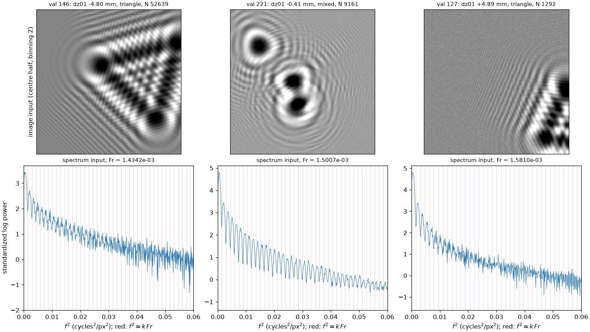
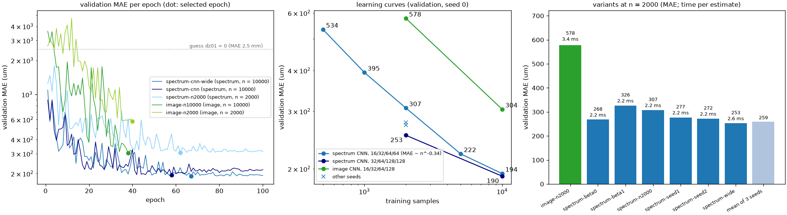
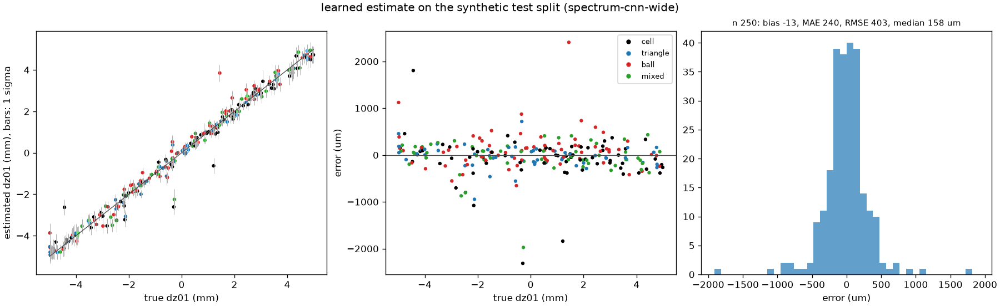
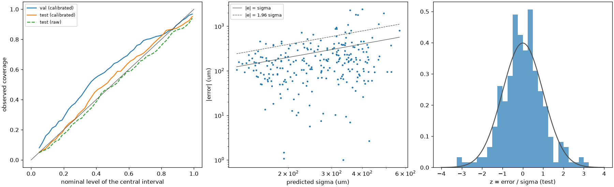
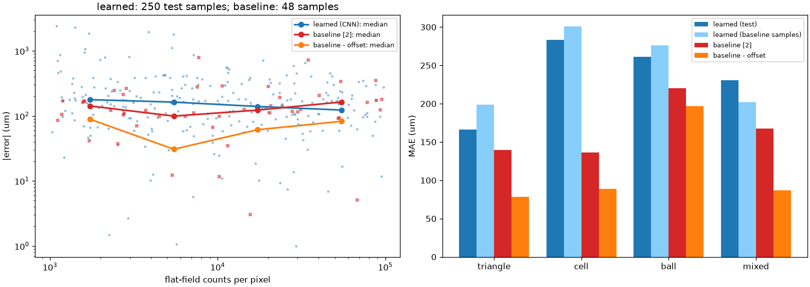
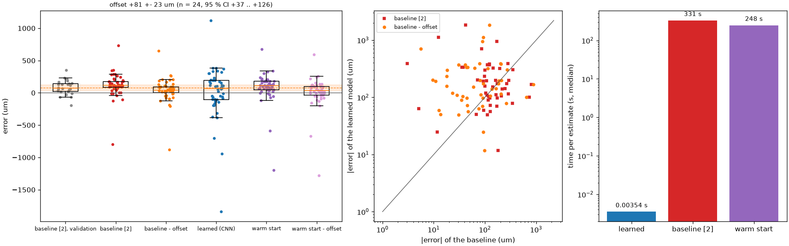
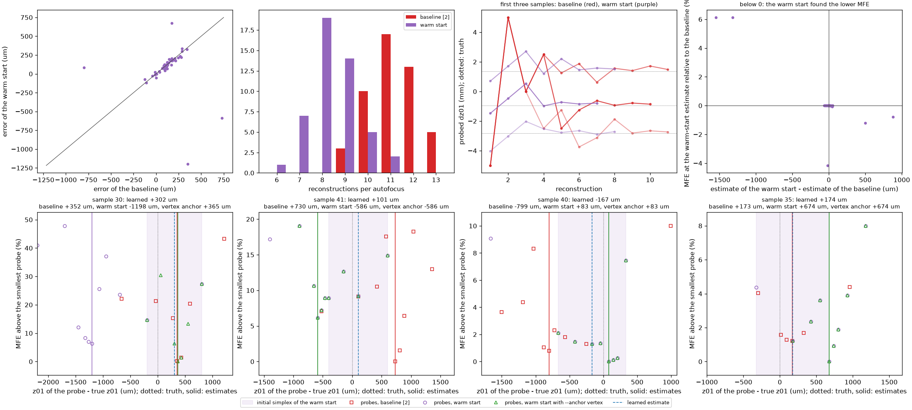

# Laborbuch 04 – Etappe 4: Erstes gelerntes Modell (CNN mit Unsicherheit)

| | |
|---|---|
| Datum | 21.10.2026 |
| Branch | `cursor/stage4-learned-model-1091` |
| Code | `src/holofocus/learned/`, `configs/learned/`, `configs/dataset/cpu-4x-extra.yaml`, Warmstart in `src/holofocus/autofocus/search.py` und `src/holofocus/baseline/`, `configs/baseline/paper2-cpu-warm.yaml`, `scripts/run_stage4_study.py`, `scripts/make_stage4_figures.py`, `tests/test_learned.py` |
| Ergebnisse | `results/learned/` (Modelle, Vorhersagen pro Sample), `results/baseline/cpu-4x-val` (Offset), `results/baseline/cpu-4x-test-warm` (Warmstart), `results/baseline/cpu-4x-test-warm-vertex` (Warmstart mit der Netzschätzung als Ecke), `results/comparison/cpu-4x-test` (Vergleich pro Sample), `results/padding/bias-p2`, `bias-p4` (Padding-Kontrolle) |
| Abbildungen | `docs/laborbuch/figures/stage4-*.png`, Zahlen in `stage4-metrics.json` |
| Quellen | [1] Dora et al., Opt. Express 32(7), 10801 (2024); [2] Dora et al., Opt. Express 33(4), 6641 (2025); [S] Seitzer et al., „On the Pitfalls of Heteroscedastic Uncertainty Estimation with Probabilistic Neural Networks“, ICLR 2022 (β-NLL) |

## 1 Ziel

Plan-Schritte 10 und 11 (`thesis-plan.md`, Phase C): das erste gelernte Autofokus-Verfahren
und sein Vergleich mit der Baseline aus Etappe 3.

- **Problemformulierung (Schritt 10):** Ein kleines CNN schätzt aus einem vorverarbeiteten
  Hologramm $\Delta z_{01} = z_{01} - z_{01}^\text{guess}$ in der Box ±5 mm, als Gaußverteilung
  mit Mittelwert und Varianz. NPE mit sbi folgt in einer späteren Etappe.
- **Modellfamilien (Schritt 11):** klein anfangen, Kurzvergleich auf dem Val-Split mit MAE in
  $z_{01}$ und $Fr$ und der Inferenzzeit.
- **Daten:** bei Bedarf mehr Trainingsdaten mit dem Generator aus Etappe 2. Eingabegröße und
  Modell so wählen, dass das Training auf der CPU läuft; der Code bleibt GPU-fähig.
- **Auswertung:** der ganze synthetische Test-Split (250 Samples) und die 48 Samples der
  Baseline (`results/baseline/cpu-4x-test/results.csv`, gleicher `index`). Verglichen wird mit
  zwei Varianten der Baseline: roh, genau wie in [2], und korrigiert um den mittleren Offset auf
  einer Val-Stichprobe, deren Größe zum CPU-Budget passt, mit der Unsicherheit des Offsets.
- **Metriken:** Hauptmetrik ist der Anteil der Samples innerhalb 100 µm (Erfolgsschwelle,
  Abschnitt 2). Dazu MAE, RMSE, Median, Bias, Anteil innerhalb 250/1000 µm, Überdeckung der
  68-/95-%-Intervalle, Zeit pro Schätzung, und die Abhängigkeit des Fehlers von der
  Photonenzahl des Flatfields und vom Phantomtyp.
- **Wenn die Zeit reicht:** die Schätzung des Netzes als Warmstart für Nelder–Mead (kleinerer
  Anfangssimplex) auf denselben 48 Samples, mit Fehler und Rekonstruktionen pro Autofokus.
- **Messhologramme:** nur, wenn ein Trainingssatz mit passender Geometrie billig ist; sonst
  festhalten, was er braucht.

## 2 Ausgangslage

Etappe 3 ist in `main` gemergt
([PR #9](https://github.com/AliTUHH/master_thesis_autofocus/pull/9), Merge-Commit `2970b8b`,
CI grün). Die Entscheidungen des Koordinators zu den offenen Punkten von Laborbuch 03:

1. Die Baseline tritt in zwei Varianten an, roh und um den Offset auf einer Val-Stichprobe
   korrigiert (Laborbuch 03, Punkt 6.1).
2. Der synthetische Vergleich bleibt bei Padding 2, weil der synthetische Offset aus der
   Zielfunktion kommt und nicht aus dem Padding (Laborbuch 03, 5.6 und 5.8). Messhologramme
   bleiben bei Padding 4. Eine Padding-4-Kontrolle auf einigen synthetischen Test-Samples
   nur, wenn die CPU-Zeit reicht, sonst auf der GPU.
3. Die Punkte 6.2, 6.4 und 6.5 gehen über den Nutzer an Daniel und J. Dora; sie blockieren
   diese Etappe nicht.

Während der Etappe hat der Nutzer zwei weitere Entscheidungen getroffen. Es sind seine
eigenen; Daniel hat sie noch nicht formal bestätigt:

4. **Zielgröße ist $z_{01}$.** Alle Fehler in diesem Laborbuch sind Fehler von $z_{01}$ in µm
   (E1).
5. **Erfolgsschwelle 100 µm.** Ein Autofokus gilt als erfolgreich, wenn
   $\lvert\hat z_{01} - z_{01}\rvert \le 100$ µm. Hauptmetrik ist deshalb der Anteil der
   Samples innerhalb 100 µm (E9); MAE, RMSE, Median und Bias ergänzen ihn.

Train- und Val-Split von `cpu-4x` (2000 + 250 Samples, Seed 20261020) habe ich mit dem Stand
`2970b8b` erzeugt (1108 s für den Train-Split mit 3 Threads), der Test-Split stammt aus Etappe
3 (`222f75f`). Zwischen den beiden Commits hat sich am Simulator nichts geändert:
`git diff 222f75f 2970b8b` über `dataset/`, `forward.py`, `propagation.py`, `phantoms.py`,
`noise.py` und `geometry.py` zeigt nur, dass das YAML-Parsing aus `dataset/config.py` nach
`yamlconfig.py` ausgelagert wurde.

## 3 Was gemacht wurde

### 3.1 Module

| Modul | Inhalt |
|---|---|
| `learned/config.py` | `LearnedConfig` mit Repräsentation, Modell und Training, strenges YAML wie in Etappe 2/3 |
| `learned/representations.py` | `Representation`: Bild (gebinnt, standardisiert) oder radiales Leistungsspektrum auf einer $f^2$-Achse |
| `learned/models.py` | `SpectrumCNN` (1-D), `ImageCNN` (2-D), Gauß-Kopf, β-NLL |
| `learned/data.py` | Laden der Splits als Eingabetensoren (mehrere Train-Dateien hintereinander), D4-Augmentierung |
| `learned/training.py` | Training mit Warm-up und Kosinus-Abfall, Auswahl nach Val-MAE, Kalibrierung von σ auf dem Val-Split, `run.yaml` mit Herkunft |
| `learned/inference.py` | `LearnedAutofocus` (Laden, Schätzen in Metern), `predict_split` mit `predictions.csv` pro Sample und Zeit pro Schätzung |
| `learned/metrics.py` | Punktfehler, Intervallüberdeckung, NLL, Bootstrap-Intervalle, Gruppierung nach Photonenzahl und Phantomtyp |
| `learned/compare.py` | Vergleich pro Sample mit der rohen und der korrigierten Baseline und dem Warmstart, Offset mit Standardfehler und Bootstrap-Intervall, gepaarte Differenzen |
| `learned/cli.py` | `holofocus-learn train / predict / compare / summary` |
| `autofocus/search.py`, `baseline/` | Warmstart: `find_focus(initial_simplex=...)`, `holofocus-baseline run --warm-start` (mit `--anchor vertex`: Netzschätzung als Ecke) |
| `configs/learned/` | `spectrum-cnn.yaml`, `spectrum-cnn-wide.yaml` (Hauptmodell, doppelte Kanalzahl), `image-cnn.yaml`, `ci.yaml` |
| `configs/dataset/cpu-4x-extra.yaml` | 8000 weitere Trainings-Samples mit der Physik von `cpu-4x` |
| `scripts/` | `run_stage4_study.py` (Lernkurve und Varianten, Schritt 11), `make_stage4_figures.py` |

### 3.2 Problemformulierung (Schritt 10)

| | Festlegung |
|---|---|
| Eingabe | ein flatfield-korrigiertes Hologramm des Datensatzes (512² Pixel zu 26 µm, `cpu-4x`), daraus eine von zwei Repräsentationen (3.4) |
| Ausgabe | Mittelwert $\mu$ und Varianz $\sigma^2$ einer Gaußverteilung für $t = \Delta z_{01} / 5\,\text{mm} \in [-1, 1]$ |
| Schätzwert | $\hat z_{01} = z_{01}^\text{guess} + 5\,\text{mm} \cdot \mu$, daraus $\widehat{Fr}$ mit der Geometrie des Datensatzes |
| Unsicherheit | $\hat\sigma = 5\,\text{mm} \cdot s \cdot \sigma$, $s$ auf dem Val-Split kalibriert (3.5) |
| Verlust | β-NLL [S]: $\tfrac12\,\text{sg}(\sigma^2)^\beta\,[\log \sigma^2 + (t - \mu)^2/\sigma^2]$ mit $\beta = 0{,}5$, sg = ohne Gradient |
| Auswahl | Epoche mit dem kleinsten MAE auf dem Val-Split; der Test-Split wird nur für die Auswertung gelesen |

### 3.3 Daten

| Split | Datei | Samples | Seed | Commit | Erzeugung |
|---|---|---|---|---|---|
| Train | `data/cpu-4x/train.h5` | 2000 | 20261020 | `2970b8b` | 1108 s, 3 Threads |
| Train (zusätzlich) | `data/cpu-4x-extra/train.h5` | 8000 | 20261022 | `2970b8b` | 3592 s, 3 Threads |
| Val | `data/cpu-4x/val.h5` | 250 | 20261020 | `2970b8b` | 93 s, 3 Threads |
| Test | `data/cpu-4x/test.h5` | 250 | 20261020 | `222f75f` | Etappe 3 |

`cpu-4x-extra` hat dieselbe Geometrie, dieselben Phantome und dasselbe Rauschen wie `cpu-4x`
(Test `test_extra_training_data_has_the_physics_of_cpu_4x`), einen anderen Seed und speichert
keine Phasenkarten. Die Splits sind nicht nach Datei getrennt, sondern nach Seed und Split-Name:
Die Samples der beiden Dateien sind unabhängige Ziehungen derselben Verteilung.

Mit 2000 Samples fiel die Lernkurve noch steil (5.2); die 8000 zusätzlichen Samples kosteten
eine Stunde auf drei Kernen und waren der wirksamste Hebel (E5). Die Modelle für den Test
und den Vergleich (`spectrum-cnn`, `spectrum-cnn-wide`) sind auf beiden Dateien trainiert,
zusammen 10 000 Samples; die Studie in 5.2 nimmt die ersten $n$ davon (erst `cpu-4x`, dann
`cpu-4x-extra`).

### 3.4 Repräsentationen

**Spektrum** (`kind: spectrum`, Hauptmodell). Für ein schwaches Phasenobjekt gilt
$I = 1 + 2\,\mathcal F^{-1}[\sin(\pi f^2/Fr)\,\hat\varphi]$ (CTF), das Leistungsspektrum des
Hologramms ist also $\sin^2(\pi f^2/Fr)$ mal das des Objekts. Seine Nullstellen liegen bei
$f^2 = k\,Fr$ und sind in $f^2$ periodisch mit der Fresnelzahl als Periode. Die
Repräsentation:

1. Hann-Fenster (nicht periodisch) auf das Hologramm, vorher den gewichteten Mittelwert
   abziehen, damit der Gleichanteil nicht in die Nachbarfrequenzen leckt.
2. $\lvert\text{FFT}\rvert^2$ und radiales Mittel in 1024 gleich breiten Intervallen von $f^2$
   bis 0,125 (cycles/px)². Ein Intervall ist $1{,}2 \cdot 10^{-4}$ breit, etwa $Fr/12$.
3. Natürlicher Logarithmus, dann pro Sample standardisiert (Mittel 0, Varianz 1).

Gleich breite Intervalle in $f^2$ machen die Periode zu einem verschiebungsinvarianten Muster
für Faltungen. Das radiale Mittel ist invariant unter Drehungen um 90° und Spiegelungen (D4)
und unabhängig von der Lage des Objekts. Pro Sample wird aus 512² Pixeln ein Vektor mit 1024
Werten.

**Bild** (`kind: image`). Das Hologramm wird 2×2 gemittelt (256²) und pro Sample standardisiert.
Beim Training wird zufällig eines der acht Elemente der Gruppe D4 angewendet (Drehung um
Vielfache von 90°, Spiegelung); das ändert $z_{01}$ nicht.

### 3.5 Modelle und Training

| | `SpectrumCNN` | `ImageCNN` |
|---|---|---|
| Eingabe | (1, 1024) | (1, 256, 256) |
| Stufen | 4 × [Conv1d k = 7, BatchNorm, ReLU, MaxPool 2], Kanäle 16/32/64/64 (breit: 32/64/128/128) | Stamm Conv 5×5 Stride 2; 3 × [Conv 3×3 Stride 2, Conv 3×3], Kanäle 16/32/64/128, jeweils BatchNorm und ReLU |
| Ende | AdaptiveAvgPool auf 16 Positionen | globales Mittel |
| Kopf | Linear (16 · letzte Kanalzahl)→128, ReLU, Dropout 0,1, Linear 128→2 | Linear 128→128, ReLU, Dropout 0,1, Linear 128→2 |
| Parameter | 178 514 (breit: 449 826) | 308 402 |
| Epochen | 100 | 40 |

Beide Köpfe geben $\mu$ und $\sigma^2 = \text{softplus}(\cdot) + \sigma_\text{min}^2$ aus
($\sigma_\text{min} = 10^{-3}$, also 5 µm). Training mit AdamW (Lernrate $10^{-3}$, Weight
Decay $10^{-4}$, Batch 32), zwei Epochen linearer Warm-up, danach Kosinus-Abfall auf 1 % der
Lernrate. Ausgewählt wird die Epoche mit dem kleinsten MAE auf dem Val-Split. Danach wird
$\sigma$ mit $s = \text{rms}((\mu - t)/\sigma)$ auf dem Val-Split skaliert; dieser Faktor
minimiert dort die NLL bei festem $\mu$. Alle Läufe haben Seed 0, in der Seed-Studie auch 1
und 2. Auf der CPU ist das Training bei gleicher Threadzahl deterministisch: `spectrum-n500`
mit einem Thread neu trainiert (Stand `3e131b9`, derselbe Trainingscode wie beim Lauf der
Studie mit `a8fb361`) liefert bitgleiche Gewichte, dieselbe Epoche, denselben Faktor $s$ und
denselben Verlauf aller Metriken. Andere Threadzahlen habe ich nicht geprüft; auf der GPU ist
Bitgleichheit nicht garantiert (Faltungen in cuDNN).

### 3.6 Auswertung und Vergleich

`holofocus-learn predict` schreibt pro Sample `predictions.csv` mit wahrem und geschätztem
$\Delta z_{01}$, $\hat z_{01}$, Fehler in µm, $\hat\sigma$ (kalibriert und roh), $z$-Wert, wahrer
und geschätzter Fresnelzahl und der Zeit der Schätzung. Die Zeit ist die einer einzelnen
Schätzung (Batch 1, 1 Thread) einschließlich der Repräsentation (FFT), nach einem
Aufwärmaufruf.

`holofocus-learn compare` stellt die Samples einer Baseline-Ergebnisdatei den Vorhersagen
gegenüber (gleicher `index`, gleiches wahres $z_{01}$ geprüft):

- **roh:** $\hat z_{01}$ der Baseline wie in [2];
- **korrigiert:** $\hat z_{01} - \bar b$ mit dem mittleren Fehler $\bar b$ der Baseline auf den
  ersten $n$ Samples des Val-Splits (`results/baseline/cpu-4x-val`). Alle korrigierten Fehler
  teilen denselben Offset; berichtet werden deshalb sein Standardfehler $s_b/\sqrt n$, ein
  Bootstrap-Intervall (95 %, 10 000 Ziehungen) und der Median;
- **gelernt:** die Schätzung des Netzes mit ihrem Intervall;
- **Warmstart** (3.7), roh und um denselben Offset korrigiert.

Gepaarte Vergleiche verwenden die Differenz der mittleren Beträge mit einem gepaarten
Bootstrap-Intervall und den Anteil der Samples, bei denen die erste Methode näher liegt.

### 3.7 Warmstart

`find_focus` nimmt einen Anfangssimplex $(c - w, c + w)$ innerhalb von $\Omega_z$ an. Die
Grenzen, die Projektion auf $\Omega_z$, die Strafwerte und das Abbruchkriterium (100 µm
Simplexlänge) bleiben wie in [2]; nur die beiden ersten Proben liegen nicht an den
Intervallenden (10 mm Abstand), sondern um die Schätzung des Netzes. `holofocus-baseline run
--warm-start predictions.csv` liest $c = \hat z_{01}$ und optional $\hat\sigma$ pro Sample und
nimmt $w = \max(\text{half-width}, k\,\hat\sigma)$, verschoben, falls der Simplex sonst aus
$\Omega_z$ ragt. Mit `--anchor vertex` ist die Netzschätzung selbst die erste Ecke, $(c, c + w)$
bzw. $(c, c - w)$ am oberen Rand von $\Omega_z$; dann wird der MFE an der Netzschätzung immer
ausgewertet. Diese Variante habe ich erst nach der Auswertung in 5.8 ergänzt und nur auf vier
Samples gerechnet (5.8, Punkt 5). Die Warmstart-Quelle (Datei, SHA-256, Breite, Anker) gehört
zum Laufschlüssel, ein Lauf lässt sich also nicht mit anderen Schätzungen fortsetzen.
`configs/baseline/paper2-cpu-warm.yaml` ist `paper2-cpu.yaml` ohne die Rekonstruktion an der
Wahrheit (`evaluate_truth: false`), die nur für die Diagnose in Laborbuch 03 nötig war.

### 3.8 Tests

184 Tests bestehen, einer wird übersprungen (nur CUDA); `ruff` ist sauber. Neu sind 20: 14 in
`test_learned.py`, einer in `test_autofocus.py`, drei in `test_baseline.py` und zwei in
`test_dataset_config.py` (ein neuer Test und `cpu-4x-extra` im Test aller Configs).

| Datei | Prüft |
|---|---|
| `test_learned.py` | Configs und Validierung; Bild-Binning und Standardisierung; Spektrum: Minima bei $k\,Fr$ für ein schwaches Phasenobjekt, D4-Invarianz, Fehler bei leeren Intervallen; D4-Gruppe; Modelle geben positive Varianzen; NLL und β-Gradient; Lernraten-Plan; Metriken und Überdeckung; Gruppierung; Offset, Vergleich, Lesen und Schreiben der Vergleichsdatei; Laden der Splits; Training, Vorhersage und Laden (Spektrum und Bild); CLI mit zwei Trainingsdateien |
| `test_autofocus.py` | `find_focus` aus einem Warmstart |
| `test_baseline.py` | `WarmStart.simplex` (Breite, Verschieben an den Rand, Anker in der Ecke), Lauf und CLI mit Warmstart, auch mit `--anchor vertex` |
| `test_dataset_config.py` | `cpu-4x-extra` hat die Physik von `cpu-4x` |

Die CI trainiert zusätzlich `configs/learned/ci.yaml` auf dem Demo-Datensatz (3 Epochen),
sagt Val und Test vorher, rechnet eine Baseline mit Warmstart auf 3 Samples, vergleicht und
erzeugt die Stage-4-Abbildungen im Schnellmodus (zusammen 11–17 s).

## 4 Entscheidungen und Begründung

**E1 – Zielgröße $z_{01}$, vom Netz als $\Delta z_{01}$ geschätzt.** Die Zielgröße $z_{01}$
hat der Nutzer festgelegt (Abschnitt 2, Punkt 4). Im Datensatz ändert sich von Sample zu
Sample nur $z_{01}$; $z_{02}$, Energie und Pixel sind fest. Dann ist $Fr$ eine monotone
Funktion von $z_{01}$ ($\Delta Fr/Fr \approx \Delta z_{01}/z_{01}$, 1 mm ≈ 1 %), und beide
Größen sind gleichwertig. Das Netz schätzt $\Delta z_{01}$ relativ zum Schätzwert, wie die
Suche in [2] Eq. (17); die Skalierung mit 5 mm bringt die Ausgabe auf $[-1, 1]$. Berichtet
und bewertet wird $\hat z_{01} = z_{01}^\text{guess} + \Delta\hat z_{01}$, mit Fehlern in µm
wie bei der Baseline. Die Vorhersagen enthalten zusätzlich $\widehat{Fr}$ und den relativen
Fehler $\widehat{Fr}/Fr - 1$. Für mehrere Geometrien (Messdaten, Abschnitt 6) kann das Netz
intern die relative Fresnelzahl schätzen; ausgewertet wird weiterhin $z_{01}$.

**E2 – Spektrum als Hauptrepräsentation.** Die Information über $Fr$ steckt in der Lage der
CTF-Minima (3.4). Das radiale Spektrum bündelt sie aus 262 144 Pixeln in 1024 Werte, ist
unabhängig von Lage und Orientierung des Objekts und kostet eine FFT. Ein Netz auf dem Bild
muss diese Struktur selbst lernen. Auf der CPU ist es außerdem pro Epoche etwa 14× langsamer
(26,4 s gegen 1,9 s bei 2000 Samples, 5.2). Das Bild-CNN bleibt als zweite Familie im
Vergleich (Schritt 11).

**E3 – Gauß-Kopf mit β-NLL.** Die Aufgabe verlangt einen Mittelwert und eine Varianz. Mit der
reinen Gauß-NLL ($\beta = 0$) kann ein Netz schwierige Samples mit großer Varianz „abschreiben“
und lernt dort den Mittelwert schlechter [S]. $\beta = 1$ gewichtet jedes Sample mit seiner
Varianz und entspricht im Gradienten des Mittelwerts dem MSE. $\beta = 0{,}5$ ist der in [S]
empfohlene Kompromiss; beide Grenzfälle sind in der Studie (5.2).

**E4 – Auswahl und Kalibrierung auf dem Val-Split.** Die Val-MAE schwankt von Epoche zu Epoche
(Abb. 2); ausgewählt wird die beste Epoche. Die Varianz eines Netzes, das auf seinen
Trainingsdaten überangepasst ist, ist zu klein; ein einzelner Faktor $s$ auf dem Val-Split
korrigiert das. Beide Schritte machen die Val-Zahlen leicht optimistisch; die Zahlen für die
Arbeit kommen vom Test-Split.

**E5 – Mehr Daten vor einem größeren Modell.** Bei 2000 Samples lagen die drei Seeds des
Standardmodells bei 272–307 µm Val-MAE, das breite Modell (doppelte Kanalzahl) bei 253 µm und
das Bild-CNN bei 578 µm. Die Lernkurve des Standardmodells fiel bis dahin ohne Anzeichen einer
Sättigung (534, 395, 307 µm bei 500, 1000, 2000 Samples). 8000 weitere Samples kosten auf drei
Kernen eine Stunde, ein Training auf 10 000 Samples 14 min (Standard) bzw. 38 min (breit) auf
einem Kern. Ich habe deshalb die Daten verfünffacht und beide Breiten darauf trainiert, statt
die Architektur weiter zu variieren. Mit 10 000 Samples sinkt der Val-MAE auf 194 µm
(Standard) und 190 µm (breit). Der Vorteil der Breite schrumpft von gut 10 % (253 µm gegen
285 µm im Mittel der drei Seeds) auf 2 % und ist auf dem Test-Split verschwunden (5.3). Die
Datenmenge war der wirksamere Hebel.

**E6 – Größe der Val-Stichprobe für den Offset: n = 24.** Der Offset ist der mittlere Fehler
der Baseline auf den ersten $n$ Samples des Val-Splits. Bei der Streuung aus Etappe 3
(190 µm) ist sein Standardfehler $190/\sqrt n$ µm: 55 µm bei $n = 12$, 39 µm bei $n = 24$,
27 µm bei $n = 48$. Ein Sample kostet mit 3 Threads 5–6 min (11–12 Rekonstruktionen und die
Rekonstruktion an der Wahrheit, die `paper2-cpu.yaml` mitrechnet), $n = 24$ also gut 2 h der
drei Kerne, $n = 48$ das Doppelte. Bei $n = 24$ ist der Standardfehler etwa ein Drittel des
Offsets aus Etappe 3 und erhöht die Streuung der korrigierten Fehler kaum
($\sqrt{190^2 + 39^2} \approx 194$ µm). Geplant waren mindestens 24 Samples (gestartet mit
`--limit 48`); angehalten habe ich nach dem 24., um die drei Kerne für den Warmstart
freizugeben. Das hing nur vom CPU-Budget ab, nicht von den Werten; die Samples sind die ersten
24 des Val-Splits (`--limit 24` reproduziert den Lauf).

**E7 – Warmstart mit festem Halbmesser 0,5 mm.** Der kalte Start beginnt an den Enden von
$\Omega_z$ (10 mm Abstand) und braucht bis zur Simplexlänge von 100 µm im Mittel 11
Rekonstruktionen. Ein Simplex von ±0,5 mm um die Netzschätzung ist 1 mm lang; bis 100 µm
fehlen dann gut drei Halbierungen statt knapp sieben. Er muss das MFE-Minimum nicht
einschließen: Nelder–Mead verschiebt den Simplex durch Spiegeln und Expandieren, die Grenzen
von $\Omega_z$ bleiben dieselben. Der Abstand zwischen Netzschätzung und MFE-Minimum streut
mit dem Fehler des Netzes (RMSE auf dem Val-Split 299 µm) und dem der Baseline (Offset
etwa 120 µm, Streuung 190 µm); grob geschätzt liegt das Minimum bei gut 80 % der Samples im
Anfangssimplex. Ein an $\hat\sigma$ angepasster Halbmesser (`--sigmas`) ist implementiert,
aber nicht gerechnet: Bei $\hat\sigma \approx 250$ µm ergäbe $2\hat\sigma$ fast dieselbe
Breite.

**E8 – Zeitmessung.** Das Netz wird mit Batch 1 und 1 Thread gemessen, einschließlich FFT und
Laden auf das Gerät, aber ohne das Lesen aus der HDF5-Datei. Die Baseline lief mit 3 Threads.
Der Vergleich ist damit für das Netz konservativ.

**E9 – Hauptmetrik: Anteil innerhalb 100 µm.** Die Schwelle hat der Nutzer festgelegt
(Abschnitt 2, Punkt 5). 100 µm sind 0,1 % in $Fr$ (5.1) und so viel wie die Abbruchtoleranz
der Suche in [2] (Simplexlänge 100 µm, 3.7); genauer als etwa diese Toleranz trifft die
klassische Suche ihr eigenes MFE-Minimum nicht. Ein Anteil ist auf 48 Samples nur grob
bestimmt: Sein 95-%-Intervall (Wilson) reicht etwa ±13 Prozentpunkte weit, auf 250 Samples
etwa ±6. Ob zwei Methoden auf denselben Samples verschieden oft treffen, prüfe ich mit dem
exakten McNemar-Test, der nur die Samples zählt, die genau eine der beiden trifft. MAE, RMSE
und Median bleiben als Ergänzung, weil der Anteil nicht unterscheidet, ob ein Fehlschlag
150 µm oder 2 mm danebenliegt.

## 5 Ergebnisse

**Hauptmetrik: Anteil innerhalb 100 µm** (Erfolgsschwelle des Nutzers, Abschnitt 2), mit
95-%-Intervall nach Wilson:

| Methode | Samples | innerhalb 100 µm | MAE | Zeit pro Schätzung |
|---|---|---|---|---|
| Netz (`spectrum-cnn-wide`, Hauptmodell) | Test-Split, 250 | **34 %** (28–40 %) | 240 µm | 3,5 ms |
| Netz (`spectrum-cnn`, Standardbreite) | Test-Split, 250 | **36 %** (31–43 %) | 240 µm | 3,3 ms |
| Netz (Hauptmodell) | 48 Samples der Baseline | **27 %** (17–41 %) | 257 µm | 3,5 ms |
| Baseline [2], roh | 48 Samples der Baseline | **31 %** (20–45 %) | 166 µm | 331 s |
| Baseline − Offset | 48 Samples der Baseline | **69 %** (55–80 %) | 116 µm | 331 s |
| Warmstart aus dem Netz | 48 Samples der Baseline | **40 %** (27–54 %) | 171 µm | 248 s |
| Warmstart − Offset | 48 Samples der Baseline | **65 %** (50–77 %) | 128 µm | 248 s |

Die Einzelheiten folgen in 5.3 (Test-Split), 5.7 (Vergleich) und 5.8 (Warmstart). Alle
Baseline-Zahlen gelten für Padding 2; Abschnitt 7 zeigt, dass Padding 4 die Verschiebung der
Baseline deutlich verkleinern kann.

### 5.1 Eingaben

*Abb. 1 – Drei Val-Samples mit kleinem, mittlerem und großem $\Delta z_{01}$. Oben die
Bildeingabe (mittlere Hälfte, 2×2 gebinnt), unten die Spektrumeingabe mit den Linien
$f^2 = k\,Fr$ der wahren Fresnelzahl (rot).*

Bei mittlerer und hoher Photonenzahl liegen die Minima des Spektrums auf den roten Linien und
sind bis zum Rand des Ausschnitts ($f^2 = 0{,}06$) einzeln zu sehen. Bei 1300 Photonen pro Pixel
(rechts) gehen sie oberhalb von etwa $f^2 = 0{,}02$ im Rauschen unter. Über $\Omega_z$ ändert
sich die Periode nur um ±5 %, das $k$-te Minimum verschiebt sich dabei um $0{,}05\,k$
Perioden. 100 µm in $z_{01}$ sind 0,1 % in $Fr$, beim 80. Minimum also 0,08 Perioden oder
etwa ein Intervall der Spektrumachse. Die Information für eine genaue Schätzung steckt damit
in den hohen Ordnungen, die das Rauschen zuerst verdeckt.

### 5.2 Training und Modellfamilien (Schritt 11)

*Abb. 2 – Links: Val-MAE pro Epoche (Punkt: gewählte Epoche). Mitte: Lernkurven der drei
Familien (Seed 0), Kreuze: andere Seeds. Rechts: Varianten bei 2000 Samples mit der Zeit pro
Schätzung, dazu das Mittel der Vorhersagen der drei Seeds.*

Alle Zahlen auf dem Val-Split (250 Samples), Training auf einem Kern
(`results/learned/study/`, `results/learned/spectrum-cnn*`):

| Lauf | n | Epoche | **≤ 100 µm** | MAE | RMSE | Median | MAE von $Fr$ (rel.) | NLL | Überdeckung 68/95 % | Training | s/Epoche | ms/Schätzung |
|---|---|---|---|---|---|---|---|---|---|---|---|---|
| *Spektrum-CNN, 16/32/64/64, 178 514 Parameter* | | | | | | | | | | | | |
| `spectrum-n500` | 500 | 32 | **16 %** | 534 | 860 | 343 | 5,33·10⁻³ | 7,99 | 80/93 % | 47 s | 0,5 | 2,2 |
| `spectrum-n1000` | 1000 | 74 | **21 %** | 395 | 602 | 237 | 3,95·10⁻³ | 7,73 | 78/95 % | 91 s | 0,9 | 2,2 |
| `spectrum-n2000` | 2000 | 62 | **25 %** | 307 | 429 | 230 | 3,09·10⁻³ | 7,38 | 74/93 % | 192 s | 1,9 | 2,2 |
| `spectrum-seed1` | 2000 | 97 | **30 %** | 277 | 413 | 207 | 2,79·10⁻³ | 7,39 | 78/95 % | 179 s | 1,8 | 2,2 |
| `spectrum-seed2` | 2000 | 81 | **27 %** | 272 | 398 | 210 | 2,73·10⁻³ | 7,35 | 77/92 % | 183 s | 1,8 | 2,2 |
| Mittel der drei Seeds | 2000 | – | **30 %** | 259 | 384 | 182 | – | 7,29 | 82/96 % | – | – | – |
| `spectrum-beta0` (β = 0) | 2000 | 76 | **34 %** | 268 | 404 | 169 | 2,69·10⁻³ | 7,29 | 75/94 % | 172 s | 1,7 | 2,2 |
| `spectrum-beta1` (β = 1) | 2000 | 62 | **27 %** | 326 | 457 | 227 | 3,27·10⁻³ | 7,47 | 73/95 % | 176 s | 1,8 | 2,2 |
| `spectrum-n5000` | 5000 | 45 | **34 %** | 222 | 314 | 160 | 2,23·10⁻³ | 7,05 | 71/95 % | 429 s | 4,3 | 2,1 |
| `spectrum-cnn` | 10 000 | 58 | **41 %** | 194 | 279 | 134 | 1,95·10⁻³ | 6,96 | 74/94 % | 849 s | 8,5 | 3,3 |
| *Spektrum-CNN, breit, 32/64/128/128, 449 826 Parameter* | | | | | | | | | | | | |
| `spectrum-wide` | 2000 | 72 | **30 %** | 253 | 388 | 175 | 2,54·10⁻³ | 7,28 | 77/96 % | 460 s | 4,6 | 2,6 |
| `spectrum-cnn-wide` (Hauptmodell) | 10 000 | 67 | **42 %** | 190 | 299 | 128 | 1,91·10⁻³ | 6,99 | 78/94 % | 2258 s | 22,6 | 3,5 |
| *Bild-CNN, 16/32/64/128, 308 402 Parameter* | | | | | | | | | | | | |
| `image-n2000` | 2000 | 40 | **15 %** | 578 | 770 | 457 | 5,81·10⁻³ | 7,98 | 70/94 % | 1057 s | 26,4 | 3,4 |
| `image-n10000` | 10 000 | 38 | **28 %** | 304 | 467 | 200 | 3,07·10⁻³ | 7,34 | 73/94 % | 5027 s | 125,7 | 3,5 |

≤ 100 µm: Anteil der Val-Samples innerhalb der Erfolgsschwelle (Hauptmetrik, auf 250 Samples
auf etwa ±6 Prozentpunkte bestimmt). MAE, RMSE und Median in µm. Die relative MAE von $Fr$ ist
praktisch die MAE von $z_{01}$ geteilt durch 100 mm (E1).

- **Lernkurve.** Der Anteil des Standardmodells innerhalb 100 µm steigt von 16 % (500
  Samples) auf 41 % (10 000 Samples), ohne abzuflachen (25, 34, 41 % bei 2000, 5000, 10 000).
  Der Val-MAE fällt von 534 auf 194 µm, im Mittel wie $n^{-0{,}34}$. Zwischen 5000 und
  10 000 Samples ist diese Steigung flacher ($-0{,}19$), bei einer Streuung von etwa ±6 %
  zwischen Seeds ist das aber noch kein Beleg für eine Sättigung.
- **Seeds.** Bei 2000 Samples liegen drei Seeds zwischen 272 und 307 µm. Unterschiede unter
  etwa 30 µm zwischen einzelnen Läufen sind deshalb nicht belastbar. Das Mittel der drei
  Vorhersagen (Ensemble, offline gerechnet) erreicht 259 µm, besser als jeder einzelne Seed;
  seine Intervalle (Mischung der drei Gaußverteilungen) sind etwas zu breit.
- **β.** β = 0 (268 µm) liegt knapp unter, β = 1 (326 µm) knapp über der Spanne der drei
  Seeds mit β = 0,5 (272–307 µm). Mit je einem Lauf ist das kein belastbarer Unterschied;
  β = 0,5 bleibt.
- **Breite.** Doppelte Kanalzahl hilft bei 2000 Samples (253 µm), bei 10 000 kaum noch
  (190 gegen 194 µm), siehe E5. Das Training dauert 2,7-mal so lange.
- **Bild gegen Spektrum.** Mit 10 000 statt 2000 Samples fällt der Val-MAE des Bild-CNN von
  578 auf 304 µm, wie $n^{-0{,}40}$; das Spektrum-CNN fällt im selben Bereich wie
  $n^{-0{,}29}$ (307 → 194 µm). Das Bild-CNN gewinnt also mehr durch mehr Daten, liegt aber
  auch bei 10 000 Samples gut 50 % hinter dem Spektrum-CNN und braucht dafür auf einem Kern
  84 statt 14 min (126 s gegen 8,5 s pro Epoche, 40 statt 100 Epochen). Sein Val-MAE springt
  in der Mitte des Trainings stark (bis 1,8 mm in Epoche 26, Abb. 2 links) und beruhigt sich
  erst, wenn die Lernrate abfällt. Seine σ sind vor der Kalibrierung zu groß ($s = 0{,}66$,
  bei beiden Spektrum-CNNs 1,14). Ob es mit mehr Daten und Epochen das Spektrum einholt,
  lässt sich erst auf der GPU prüfen (8.1).
- **Zeit pro Schätzung.** 2–4 ms für alle Modelle, gemessen mit einem Thread neben den
  laufenden Baseline-Rechnungen auf den anderen Kernen; die Unterschiede zwischen den Läufen
  kommen eher von dieser Last als von der Modellgröße.
- **Auswahl.** Nach der vorab festgelegten Regel (kleinster Val-MAE, vor dem Blick auf den
  Test-Split) ist `spectrum-cnn-wide` das Hauptmodell. Auch auf der Hauptmetrik liegt es
  knapp vorn (42 gegen 41 % innerhalb 100 µm); die Regel stand fest, bevor der Nutzer die
  Schwelle bestimmt hat. Der Abstand zu `spectrum-cnn` liegt innerhalb der Seed-Streuung,
  RMSE und NLL sprechen leicht für das Standardmodell; beide werden auf dem Test-Split
  berichtet (5.3).

### 5.3 Test-Split

*Abb. 3 – Hauptmodell (`spectrum-cnn-wide`) auf dem ganzen Test-Split: Schätzung gegen
Wahrheit mit 1σ-Balken, Fehler gegen $\Delta z_{01}$ nach Phantomtyp, Histogramm der Fehler.*

| Test-Split, 250 Samples | `spectrum-cnn-wide` (Hauptmodell) | `spectrum-cnn` |
|---|---|---|
| **innerhalb 100 µm** (Erfolgsschwelle) | **34 %** (28–40 %) | **36 %** (31–43 %) |
| innerhalb 250 / 1000 µm | 72 % / 97 % | 71 % / 97 % |
| MAE | 240 µm | 240 µm |
| RMSE | 403 µm | 385 µm |
| Median des Betrags | 158 µm | 150 µm |
| Bias | −13 µm | −8 µm |
| Überdeckung 68 % / 95 % | 70 % / 91 % | 69 % / 91 % |
| NLL | 7,26 | 7,32 |
| MAE von $Fr$, relativ | 2,4·10⁻³ | 2,4·10⁻³ |
| Zeit pro Schätzung (Median) | 3,5 ms | 3,3 ms |
| zum Vergleich: MAE des Schätzwerts $z_{01}^\text{guess}$ | 2348 µm | 2348 µm |

Das Netz allein erreicht die Erfolgsschwelle bei gut einem Drittel der Test-Samples: 34 %
(Hauptmodell) bzw. 36 % (Standardmodell) liegen innerhalb 100 µm, 72 % innerhalb 250 µm und
97 % innerhalb 1 mm. Auf dem Val-Split waren es 42 bzw. 41 % innerhalb 100 µm. Der Unterschied
zwischen den Modellen ist nicht gesichert: 50 Test-Samples trifft nur das Standardmodell, 43
nur das Hauptmodell (McNemar, $p = 0{,}53$). Beide Modelle sind auf dem Test-Split gleich gut;
die Wahl nach dem Val-MAE (190 gegen 194 µm) hat sich nicht bestätigt, aber auch nicht
geschadet. Das Netz verkleinert den Fehler des Schätzwerts etwa um den Faktor 10. Der Test-MAE liegt 50 µm über dem Val-MAE, bei einem
Standardfehler der Differenz von etwa 25 µm. Fast der ganze Unterschied kommt von wenigen
großen Fehlern: Auf dem Test-Split liegen 7 Samples (2,8 %) mehr als 1 mm daneben, das größte
um 2,4 mm, auf dem Val-Split 2. Ohne sie ist der MAE 195 µm (Test, 243 Samples) und 176 µm
(Val, 248 Samples). Die Auswahl der Epoche trägt wenig bei: Ab Epoche 50 liegt der Val-MAE im
Median bei 196 µm, in der gewählten Epoche bei 190 µm. Die sieben Ausreißer sind Zellen (4),
Kugeln (2) und ein gemischtes Phantom, alle mit weniger als 5500 Photonen pro Pixel, vier mit
weniger als 2000. Zwei davon und beide Ausreißer des Val-Splits liegen am Rand von $\Omega_z$
($\lvert\Delta z_{01}\rvert > 4{,}4$ mm) und sind zur Mitte hin geschätzt.

Nachträglich, also nicht vorab festgelegt, habe ich die Vorhersagen beider Modelle gemittelt.
Ihre Fehler sind zu 0,72 korreliert, das Mittel erreicht trotzdem 177 µm Val-MAE und 218 µm
Test-MAE (RMSE 365 µm, Median 135 µm). Innerhalb 100 µm liegen damit 41 % der Test-Samples;
auf dem Val-Split bleibt es bei 42 %, dort gewinnt das Mittel auf der Hauptmetrik also
nichts. Die 68-/95-%-Intervalle der Mischung der beiden Gaußverteilungen decken auf dem
Test-Split 79 % bzw. 94 %. Ein Ensemble ist damit der naheliegende nächste Hebel (9.3). Das Hauptmodell
bleibt das einzelne Netz, für das die Auswahlregel galt.

### 5.4 Kalibrierung

*Abb. 4 – Überdeckung der zentralen Intervalle gegen ihr Nennniveau (Val und Test, kalibriert;
Test auch unkalibriert), Betrag des Fehlers gegen das vorhergesagte σ, Histogramm von
$z = e/\sigma$ auf dem Test-Split mit der Standardnormalverteilung.*

Der Faktor $s = 1{,}139$ aus dem Val-Split hebt die Überdeckung auf dem Test-Split von 66 %
auf 70 % (68-%-Intervall) und von 89 % auf 91 % (95-%-Intervall). Im Kern passt die
Gaußannahme (Abb. 4 rechts), die Ränder sind schwerer: $\text{rms}(z) = 1{,}25$ auf dem
Test-Split, die 95-%-Intervalle sind also zu schmal; die sieben Ausreißer haben
$\lvert z\rvert$ von 2,4 bis 6,5. Das vorhergesagte σ liegt zwischen 120 und 570 µm und ordnet
die Fehler nur schwach (Spearman-Korrelation zwischen σ und
$\lvert e\rvert$: 0,22). Es taugt damit als grobe Angabe der Unsicherheit, aber nicht, um
einzelne Ausreißer zu erkennen.

### 5.5 Abhängigkeit von Photonenzahl und Phantomtyp

*Abb. 5 – Links: Betrag des Fehlers gegen die Photonenzahl des Flatfields, Punkte für das Netz
(250 Test-Samples) und die rohe Baseline (48 Samples), Linien für die Mediane in vier
Bereichen. Rechts: MAE nach Phantomtyp.*

| Photonen pro Pixel | Netz: n | Netz: **≤ 100 µm** | Netz: MAE | Netz: Median | Baseline: n | roh: **≤ 100 µm** | korrigiert: **≤ 100 µm** | roh: Median | korrigiert: Median |
|---|---|---|---|---|---|---|---|---|---|
| 10³–3·10³ | 61 | **23 %** | 350 | 178 | 14 | **3** | **9** | 142 | 89 |
| 3·10³–10⁴ | 70 | **39 %** | 245 | 163 | 9 | **5** | **6** | 99 | 31 |
| 10⁴–3·10⁴ | 62 | **32 %** | 196 | 140 | 12 | **4** | **9** | 123 | 61 |
| 3·10⁴–10⁵ | 57 | **40 %** | 164 | 123 | 13 | **3** | **9** | 164 | 83 |

| Phantomtyp | Netz: n | Netz: **≤ 100 µm** | Netz: MAE | Netz: Median | Baseline: n | roh: **≤ 100 µm** | korrigiert: **≤ 100 µm** | Netz auf diesen: **≤ 100 µm** | roh: MAE | korrigiert: MAE | Netz auf diesen: MAE |
|---|---|---|---|---|---|---|---|---|---|---|---|
| Dreieck | 54 | **43 %** | 166 | 119 | 9 | **2** | **8** | **5** | 140 | 78 | 199 |
| Zelle | 69 | **28 %** | 283 | 167 | 17 | **6** | **11** | **6** | 136 | 89 | 301 |
| Kugel | 71 | **28 %** | 261 | 167 | 13 | **5** | **8** | **1** | 220 | 197 | 276 |
| gemischt | 56 | **39 %** | 230 | 173 | 9 | **2** | **6** | **1** | 168 | 87 | 202 |

MAE und Median in µm. ≤ 100 µm: für das Netz der Anteil der Test-Samples, für die Baseline die
Zahl der Samples (von $n$). Der Fehler des Netzes hängt deutlich von der Photonenzahl ab: Der
MAE fällt von 350 µm im untersten auf 164 µm im obersten Bereich, der Median von 178 auf
123 µm, und die großen Fehler (5.3) liegen fast alle unten. Der Anteil innerhalb 100 µm steigt
von 23 % im untersten Bereich auf 32–40 % darüber; bei 57–70 Samples pro Bereich (etwa ±12
Prozentpunkte) ist das ein schwächerer Trend als beim MAE. Die Photonenzahl bestimmt also vor
allem, wie weit ein Fehlschlag danebenliegt. Das passt zu 5.1: Bei wenig Photonen
verschwinden die hohen Ordnungen der Minima im Rauschen. Bei der Baseline ist kein Trend zu
erkennen; ihr Fehler wird vom Offset bestimmt, und mit 9–14 Samples pro Bereich schwanken die
Werte stark. Unter den Phantomtypen sind Dreiecke für das Netz am leichtesten (43 % innerhalb
100 µm, MAE 166 µm) und Zellen und Kugeln am schwersten (28 %). Eine naheliegende Erklärung:
Die scharfen Kanten der Dreiecke tragen Leistung bis zu hohen Frequenzen, wo die Minima am
stärksten auf $Fr$ reagieren. Für die Baseline sind Kugeln am schwersten, auch nach der
Korrektur (197 µm).

### 5.6 Offset der Baseline auf dem Val-Split

Auf den ersten 24 Samples des Val-Splits (`results/baseline/cpu-4x-val`, 11,2 Rekonstruktionen
pro Autofokus wie auf dem Test-Split) ist der Fehler der Baseline im Mittel **+81 µm**:
Standardabweichung 114 µm, Standardfehler 23 µm, 95-%-Bootstrap-Intervall +37 bis +126 µm,
Median +71 µm (+36 bis +135 µm); 12 der 24 Samples liegen innerhalb 100 µm. Auf den 48
Test-Samples war der mittlere Fehler +120 µm bei 190 µm Standardabweichung. Die Differenz von
39 µm ist etwa ein Standardfehler der Differenz (36 µm). Der Offset ist also sicher positiv,
seine Größe auf etwa ±45 µm bekannt. Abgezogen wird der Mittelwert, +81 µm.

Herkunft des Laufs: Die Samples 0–2 liefen ab 07:08 mit dem Stand `2970b8b`. Dann habe ich
den Lauf angehalten, um die drei Kerne für die 8000 zusätzlichen Trainings-Samples
freizugeben, und um 08:40 mit dem Stand `c2c21e1` fortgesetzt (Samples 3–23). `run.yaml`
nennt den Stand beim ersten Start. Fortgesetzt wird ein Lauf nur bei gleichem Laufschlüssel
(Config, ASRM-Einstellungen, SHA-256 des Datensatzes, Warmstart). Dazwischen kam nur der
Warmstart hinzu, und der ist hier nicht aktiv: Die Traces der Samples 3–23 nennen als
Anfangssimplex [95, 105] mm, also die Intervallenden wie in Etappe 3.

### 5.7 Vergleich auf den 48 Samples der Baseline

*Abb. 6 – Links: Fehler pro Methode auf den 48 Samples (grau: die 24 Val-Samples der Baseline,
aus denen der Offset stammt; Band: sein 95-%-Intervall). Mitte: Betrag des Fehlers des Netzes
gegen den der Baseline pro Sample. Rechts: Zeit pro Schätzung (Median).*

| 48 Samples | **≤ 100 µm** | ≤ 250 / 1000 µm | MAE | RMSE | Median | Bias | Überdeckung 68/95 % | Zeit pro Schätzung | Rekonstruktionen |
|---|---|---|---|---|---|---|---|---|---|
| Baseline [2], roh | **31 %** (20–45 %) | 83 / 100 % | 166 | 223 | 124 | +120 | – | 331 s | 11,1 (9–13) |
| Baseline − Offset | **69 %** (55–80 %) | 92 / 100 % | 116 | 192 | 79 | +39 | – | 331 s | 11,1 (9–13) |
| Netz (`spectrum-cnn-wide`) | **27 %** (17–41 %) | 69 / 96 % | 257 | 406 | 161 | +1 | 63 / 88 % | 3,5 ms | – |
| Netz (`spectrum-cnn`) | **52 %** (38–66 %) | 75 / 100 % | 195 | 290 | 93 | +29 | 75 / 92 % | 3,3 ms | – |
| Warmstart | **40 %** (27–54 %) | 88 / 98 % | 171 | 260 | 119 | +84 | – | 248 s | 8,4 (6–11) |
| Warmstart − Offset | **65 %** (50–77 %) | 92 / 98 % | 128 | 246 | 76 | +3 | – | 248 s | 8,4 (6–11) |

≤ 100 µm mit 95-%-Intervall nach Wilson. MAE, RMSE, Median und Bias in µm; Zeiten mit
3 Threads (Baseline) bzw. 1 Thread (Netz).

Gepaarte Vergleiche: für die Hauptmetrik die Zahl der Samples, die nur die erste bzw. nur die
zweite Methode innerhalb 100 µm schätzt, mit dem exakten McNemar-Test (E9); für die MAE die
Differenz mit 95-%-Bootstrap-Intervall und der Anteil der Samples, bei denen die erste Methode
näher liegt:

| Paar | ≤ 100 µm: nur erste / nur zweite | McNemar $p$ | Differenz der MAE | Intervall | erste näher |
|---|---|---|---|---|---|
| Netz − Baseline roh | 9 / 11 | 0,82 | +91 µm | −7 bis +204 µm | 48 % |
| Netz − Baseline korrigiert | 1 / 21 | < 0,001 | +141 µm | +47 bis +247 µm | 25 % |
| Warmstart − Baseline roh | 6 / 2 | 0,29 | +5 µm | −44 bis +58 µm | 52 % |
| Warmstart korrigiert − Baseline korrigiert | 2 / 4 | 0,69 | +12 µm | −44 bis +73 µm | 46 % |

Auf der Hauptmetrik liegt das Netz auf diesen 48 Samples gleichauf mit der rohen Baseline
(27 gegen 31 % innerhalb 100 µm; 9 Samples trifft nur das Netz, 11 nur die Baseline) und klar
hinter der korrigierten (69 %). Dasselbe Bild gibt die MAE: Gegen die rohe Baseline ist der
Unterschied nicht gesichert (das Intervall schließt 0 ein, das Netz liegt bei knapp der
Hälfte der Samples näher), gegen die korrigierte schon. Dafür hat das Netz keinen Bias (+1
gegen +120 µm) und ist etwa 94 000-mal schneller. Die Korrektur um den Offset verringert den
Median der Baseline von 124 auf 79 µm und hebt den Anteil innerhalb 100 µm von 31 auf 69 %;
der verbleibende Bias von +39 µm ist der Unterschied zwischen dem Offset auf dem Val-Split
und dem mittleren Fehler auf diesen 48 Samples (5.6).

Für das Netz sind 48 Samples eine kleine Stichprobe. Das Standardmodell schätzt hier 52 %
innerhalb 100 µm, das Hauptmodell 27 % (14 Samples trifft nur das Standardmodell, 2 nur das
Hauptmodell, $p = 0{,}004$). Auf den übrigen 202 Samples des Test-Splits ist es umgekehrt (33
gegen 35 %, $p = 0{,}65$), auf dem ganzen Test-Split sind beide gleich (5.3). Der Unterschied
gehört also zu diesen 48 Samples, nicht zu den Modellen. Zwei der sieben großen Fehler des
Hauptmodells (Samples 16 und 37) fallen ebenfalls hinein; ohne sie läge seine MAE hier bei
203 µm statt 257 µm. Die belastbare Zahl für das Netz ist der Test-Split mit 34–36 % innerhalb
100 µm. Ob die rohe Baseline auf dem ganzen Test-Split ebenfalls bei etwa einem Drittel
liegt, zeigt erst ein Lauf auf allen 250 Samples (auf der GPU, 9.6).

### 5.8 Warmstart

*Abb. 7 – Oben, von links: Fehler des Warmstarts gegen den der kalten Suche (Baseline [2])
pro Sample; Rekonstruktionen pro Autofokus; geprobtes $\Delta z_{01}$ der ersten drei Samples
über der Nummer der Rekonstruktion (gepunktet die Wahrheit); MFE am Schätzwert des
Warmstarts relativ zu dem der kalten Suche gegen den Abstand der beiden Schätzwerte. Unten:
MFE aller Proben relativ zur kleinsten Probe, über $z_{01}$ relativ zur Wahrheit, für die vier
Samples, bei denen kalte Suche und Warmstart am weitesten auseinanderliegen: rot die kalte
Suche, violett der Warmstart, grün der Warmstart mit der Netzschätzung als Ecke (Punkt 5);
schattiert der Anfangssimplex des Warmstarts, durchgezogen die Schätzwerte, gestrichelt die
Netzschätzung.*

Auf denselben 48 Samples startet Nelder–Mead mit dem Simplex $\hat z_{01} \pm 0{,}5$ mm um
die Schätzung des Hauptmodells (E7). Alles andere ist wie in Etappe 3: dieselben Grenzen,
dieselbe Abbruchregel, dieselben Kerne und Threads (`results/baseline/cpu-4x-test-warm`).

| 48 Samples | kalt (Baseline [2]) | Warmstart |
|---|---|---|
| **innerhalb 100 µm** | **31 %** (20–45 %) | **40 %** (27–54 %) |
| MAE / RMSE / Median | 166 / 223 / 124 µm | 171 / 260 / 119 µm |
| Bias | +120 µm | +84 µm |
| Rekonstruktionen pro Autofokus | 11,1 (9–13) | 8,4 (6–11) |
| Zeit pro Autofokus (Mittel / Median) | 328 / 331 s | 252 / 248 s |
| Zeit pro Rekonstruktion | 29,4 s | 29,8 s |
| Schätzwerte weniger als 100 µm auseinander | – | 44 von 48 (Median 20 µm) |

1. **Ein Viertel weniger Rekonstruktionen.** Der Warmstart braucht im Mittel 8,4 statt 11,1
   Rekonstruktionen (−24 %), bei 46 der 48 Samples weniger, und ist entsprechend schneller
   (Median 248 statt 331 s). E7 hatte mit gut drei statt knapp sieben Halbierungen gerechnet.
   Das passt zum Verlauf der kalten Suche (Laborbuch 03, 5.5): Nach 5 Rekonstruktionen liegt
   sie im Median 0,74 mm vom Endergebnis, etwa so weit wie die Ecken des Anfangssimplex; danach
   braucht sie noch 6 Rekonstruktionen, der Warmstart zusätzlich die beiden Ecken. Wie weit die
   Netzschätzung danebenliegt, ändert daran wenig: 8,2 Rekonstruktionen, wenn sie weniger als
   250 µm vom Ergebnis der kalten Suche entfernt ist (27 Samples), 8,9 bei mehr als 500 µm
   (7 Samples). Auch die beiden größten Fehler des Netzes auf diesen Samples fängt die Suche
   ab: Bei Sample 16 (Netz −1840 µm) endet sie bei −28 µm (kalt −42 µm), bei Sample 37 (Netz
   +1122 µm) wie die kalte bei −12 µm.
2. **Meist dasselbe Minimum und damit derselbe Offset.** Bei 44 der 48 Samples liegen die
   Schätzwerte von Warmstart und kalter Suche weniger als 100 µm auseinander, im Median 20 µm
   und im Mittel −5 µm; das ist die Auflösung des Abbruchkriteriums (Simplexlänge 100 µm). Der
   Warmstart minimiert denselben MFE und erbt dessen Verschiebung. Sein Bias ist mit +84 µm
   kleiner als +120 µm, aber 31 der 36 µm Unterschied kommen von den vier Ausnahmen unter
   Punkt 4. Die Wahrheit liegt bei 92 % der Samples im Anfangssimplex, das Ergebnis der kalten
   Suche bei 85 % (E7 hatte gut 80 % geschätzt).
3. **Die Hauptmetrik steigt, aber nicht gesichert.** Innerhalb 100 µm liegen 40 statt 31 %:
   6 Samples trifft nur der Warmstart, 2 nur die kalte Suche (McNemar, $p = 0{,}29$). Sieben
   dieser acht Samples liegen bei der kalten Suche knapp an der Schwelle (87–123 µm Betrag)
   und wechseln die Seite durch eine Verschiebung von 17–55 µm, also innerhalb der Auflösung
   der Suche. Nur Sample 40 ist ein echter Gewinn (Punkt 4). Die MAE ist gleich (+5 µm,
   Intervall −44 bis +58 µm). Weil der Offset der Baseline (+120 µm) knapp über der Schwelle
   liegt, entscheiden bei vielen Samples Verschiebungen von wenigen 10 µm über Treffer oder
   nicht. Nach Abzug des Offsets liegt der Warmstart bei 65 % gegen 69 % (2 gegen 4 Samples,
   $p = 0{,}69$).
4. **Die vier Ausnahmen zeigen schmale Senken im MFE** (Abb. 7 unten). Drei der vier sind
   Kugeln, für die die Baseline auch sonst am schwersten ist (5.5), Sample 35 ist ein
   gemischtes Phantom.
   - *Sample 30:* Die Netzschätzung (+302 µm) liegt nur 50 µm neben dem Minimum der kalten
     Suche (+352 µm). Der symmetrische Anfangssimplex wertet aber nicht sie aus, sondern
     −198 und +802 µm (MFE 14 % bzw. 27 % über dem Minimum). Nelder–Mead spiegelt die
     schlechtere Ecke an der besseren nach −1198 µm. Dort ist der MFE kleiner als an beiden
     Ecken (6 % über dem Minimum), und die Suche endet dort: −1198 statt +352 µm.
   - *Sample 41:* Das Netz liegt mit +101 µm nahe an der Wahrheit. Die kalte Suche
     endet in einer schmalen Senke bei +730 µm, der Warmstart in einem anderen lokalen Minimum
     bei −586 µm (MFE 6 % höher). Zwischen −650 und +1400 µm hat der MFE hier mindestens drei
     lokale Minima (bei etwa −590, +100 und +730 µm), mit Unterschieden bis 18 %.
   - *Sample 40:* Die kalte Suche endet bei −799 µm, der Warmstart bei +83 µm mit einem um
     0,8 % kleineren MFE. Hier korrigiert der Warmstart einen Fehlschlag der kalten Suche.
   - *Sample 35:* Die obere Ecke des Anfangssimplex (+674 µm) trifft eine schmale Senke,
     1,2 % unter dem glatten Minimum bei +173 µm, an dem die kalte Suche und das Netz
     (+174 µm) liegen. 63 µm daneben ist der MFE 0,9 % höher, 125 µm daneben 3,6 %. Der
     Warmstart findet den kleineren MFE und liegt trotzdem 500 µm weiter von der Wahrheit.

   Dasselbe im Kleinen zeigt Sample 27: Zwei Proben 15 µm auseinander (+328 und +343 µm)
   unterscheiden sich um 4,2 % im MFE. Der MFE ist also auf der Skala von 10–100 µm nicht
   glatt, und welche Senke Nelder–Mead findet, hängt vom Anfangssimplex ab. Woher die Senken
   kommen, habe ich nicht untersucht. Naheliegend ist, dass die Rekonstruktion mit fester
   Iterationszahl bei manchen $z_{01}$ in eine etwas bessere Lösung läuft.
5. **Die Netzschätzung als Ecke** (`--anchor vertex`, 3.7). Bei Sample 30 lag die
   Netzschätzung 50 µm neben dem Minimum, der symmetrische Simplex hat sie aber nie
   ausgewertet. Mit `--anchor vertex` ist sie die erste Probe, die zweite liegt 0,5 mm darüber.
   Gerechnet habe ich das nur auf den vier Ausnahmen (`results/baseline/cpu-4x-test-warm-vertex`):

   | Sample | Netz | kalt | Warmstart | Ecke | Rekonstruktionen kalt / Warmstart / Ecke | MFE am Ergebnis, Ecke gegen kalt |
   |---|---|---|---|---|---|---|
   | 30 | +302 | +352 | −1198 | **+365** | 10 / 11 / 7 | −0,2 % |
   | 35 | +174 | +173 | +674 | +674 | 10 / 10 / 8 | −1,2 % |
   | 40 | −167 | −799 | +83 | +83 | 12 / 9 / 8 | −0,8 % |
   | 41 | +101 | +730 | −586 | −586 | 13 / 10 / 9 | +6,1 % |

   Fehler in µm. `run.yaml` nennt `3e131b9`, weil der Lauf vor dem Commit der Option startete;
   der Code ist unverändert der von `b8aacfb`. Bei Sample 30 findet die Suche jetzt das
   Minimum der kalten Suche (+365 statt −1198 µm) mit 7 Rekonstruktionen. Die drei anderen
   enden wie beim symmetrischen Warmstart.
   Bei Sample 35 trifft die zweite Ecke (+674 µm) wieder die schmale Senke; weil sie den
   kleineren MFE hat, bleibt Nelder–Mead dort, sobald eine Probe hineinfällt. Bei Sample 41
   liegt die Netzschätzung (+101 µm) selbst in einem lokalen Minimum, 9 % über dem der kalten
   Suche; die Suche verlässt es zum Minimum bei −586 µm (6 % darüber). Auf den vier Samples
   braucht die Variante im Mittel 8,0 statt 10,0 Rekonstruktionen, weil die Netzschätzung eine
   der beiden ersten Proben ist. Die vier sind nach ihrem Ergebnis ausgewählt; das ist eine
   Diagnose, kein Vergleich. Ob die Ecke im Mittel besser ist, zeigt erst ein Lauf auf allen
   48 Samples (auf dieser CPU etwa 3 h mit 3 Threads) oder auf dem ganzen Test-Split (9.1).

**Fazit.** Der Warmstart macht die Baseline um ein Viertel billiger, aber nicht genauer: Er
findet fast immer dasselbe MFE-Minimum und erbt dessen Offset. Wo er abweicht, liegt es an den
schmalen Senken des MFE und bei Sample 30 am symmetrischen Anfangssimplex, nicht an großen
Fehlern des Netzes; die Netzschätzung als Ecke behebt nur das Zweite. Genauer wird die
Kombination erst, wenn der Offset korrigiert wird (65 %, nur synthetisch möglich, 8.2) oder
wenn die Zielfunktion ein Minimum näher an der Wahrheit hat (Padding 4, Abschnitt 7) und
glatter wird (9.1).

### 5.9 Laufzeiten

Alle Rechnungen liefen auf dieser VM mit 4 Kernen: die Baseline-Läufe mit 3 Threads auf den
Kernen 0–2, Training, Vorhersagen und die Padding-Kontrolle mit einem Thread auf Kern 3.

| Schritt | Umfang | Zeit | Kerne |
|---|---|---|---|
| Daten: Val-Split `cpu-4x` | 250 Samples | 93 s | 3 |
| Daten: Train-Split `cpu-4x` | 2000 Samples | 1108 s (0,55 s pro Sample) | 3 |
| Daten: `cpu-4x-extra` | 8000 Samples | 3592 s (0,45 s pro Sample) | 3 |
| Training `spectrum-cnn` | 10 000 Samples, 100 Epochen | 849 s | 1 |
| Training `spectrum-cnn-wide` | 10 000 Samples, 100 Epochen | 2258 s | 1 |
| Studie (11 Läufe, 5.2) | 500–10 000 Samples | 8013 s, davon 5027 s für `image-n10000` | 1 |
| Vorhersage | ein Hologramm | 3,3–3,5 ms (Median) | 1 |
| Baseline auf dem Val-Split | 24 Samples, 269 Rekonstruktionen | 8631 s (Median 331 s pro Autofokus), dazu je eine Rekonstruktion an der Wahrheit | 3 |
| Warmstart | 48 Samples, 405 Rekonstruktionen | 12 081 s (Median 248 s pro Autofokus, 29,8 s pro Rekonstruktion) | 3 |
| Warmstart, `--anchor vertex` | 4 Samples, 32 Rekonstruktionen | 901 s (Median 223 s pro Autofokus) | 3 |
| Padding-Kontrolle | 2 Samples × 7 Punkte, Padding 2 und 4 | 8578 s (etwa 90 bzw. 520 s pro Rekonstruktion) | 1 |

Das erste Sample der Val-Baseline lief zum Teil parallel zur Erzeugung des Train-Splits und
brauchte 82 s pro Rekonstruktion; ohne dieses Sample sind es 29,7 s wie in Etappe 3 (29,4 s).
Umgekehrt hat die Baseline den Train-Split gebremst (0,55 statt 0,45 s pro Sample).

Zusammen hat die Etappe etwa 28 Kernstunden gerechnet (ein Lauf mit 3 Threads zählt als
3 Kerne): 7,1 für das Lernen (Daten 4,0, alle Trainingsläufe 3,1) und 20,4 für die klassische
Suche (Offset 7,2, Warmstart 10,1, Ecke 0,8, Padding-Kontrolle 2,4), dazu 0,2 für kleinere
Kontrollen (Determinismus, eine Vorprüfung der Ecke an Sample 30). Ein Autofokus der Baseline
kostet etwa 990 Kernsekunden (331 s mit 3 Threads). Daten und alle Trainingsläufe kosten
damit so viel wie etwa 26 Autofokus-Läufe, Daten und das Hauptmodell allein (4,6 Kernstunden)
etwa 17; danach kostet eine Schätzung des Netzes 3,5 ms auf einem Kern.

## 6 Messhologramme: was ein Trainingssatz mit passender Geometrie bräuchte

Das Netz dieser Etappe kennt nur die Fresnelzahlen von `cpu-4x`. Keine der vier gemessenen
Proben aus dem Zenodo-Archiv liegt in diesem Bereich (4×-Gitter, 26 µm Pixel,
$Fr$ an den Grenzen von $\Omega_z$ = Schätzwert ± 5 mm, berechnet mit `MEASURED_SAMPLES`):

| Probe | Energie | $z_{02}$ | Mitte von $\Omega_z$ | $Fr$ (Mitte) | $Fr$ in $\Omega_z$ | relative Breite |
|---|---|---|---|---|---|---|
| `cpu-4x` (Training) | 11 keV | 20,000 m | 100,0 mm | 1,507·10⁻³ | 1,431–1,583·10⁻³ | ±5,0 % |
| Spinnenhaar | 11 keV | 19,661 m | 79,8 mm | 1,243·10⁻³ | 1,165–1,321·10⁻³ | ±6,3 % |
| Zahn | 17 keV | 19,652 m | 82,9 mm | 1,998·10⁻³ | 1,877–2,119·10⁻³ | ±6,1 % |
| Kaktusnadel | 17 keV | 19,652 m | 286,1 mm | 6,968·10⁻³ | 6,844–7,092·10⁻³ | ±1,8 % |
| Mg-Draht | 11 keV | 19,661 m | 472,4 mm | 7,510·10⁻³ | 7,429–7,591·10⁻³ | ±1,1 % |

Ein Trainingssatz mit passender Geometrie ist deshalb in dieser Etappe nicht billig. Er
bräuchte:

1. **Geometrie.** Entweder ein Datensatz pro Aufbau (vier Datensätze; auf der CPU etwa 60 min
   pro 8000 Samples mit 3 Threads, 3.3) oder ein Netz, das die Geometrie als Eingabe kennt.
   Naheliegend ist das zweite: das Spektrum auf der Achse $u = f^2/Fr^\text{guess}$
   ($Fr^\text{guess}$ aus Energie, $z_{02}$, Pixel und $z_{01}^\text{guess}$) und als Ziel die
   relative Fresnelzahl $Fr/Fr^\text{guess} - 1$ (im Datensatz schon als Label
   `fresnel_ratio` vorhanden). Die Minima liegen dann für jeden Aufbau bei
   $u = k\,(1 + \delta)$. Ein Datensatz mit $z_{01}^\text{guess}$ über 80–480 mm und beiden
   Energien deckt dann alle vier Proben ab; `configs/dataset/cpu-4x-z01-range.yaml`
   (80–300 mm, 11 keV) ist ein erster Schritt, erreicht aber den Mg-Draht und 17 keV nicht.
   Bei $Fr \approx 7 \cdot 10^{-3}$ passen bis zur Nyquistfrequenz entlang der Achsen nur etwa
   35 Perioden ins Spektrum, bei `cpu-4x` 83 bis $f^2 = 0{,}125$; der Bereich von $u$ muss
   sich also nach dem größten $Fr$ richten.
2. **Objekte.** Haar, Nadel und Draht sind lange Fasern, die das Sichtfeld durchqueren; der
   Zahn ist groß, dicht und ragt über das Sichtfeld hinaus; der Mg-Draht absorbiert deutlich.
   Die Phantome aus Etappe 2 (Dreieck, Zelle, Kugel, gemischt, 0,5–2 rad, ganz im Sichtfeld)
   decken das nicht ab. Nötig wären Fasern und Zylinder mit zufälliger Lage über den Rand
   hinaus, größere Phasenhübe und Absorption und ein $\delta/\beta$ pro Material.
3. **Detektor.** Die gemessenen Hologramme haben nach der Flatfield-Korrektur korrelierte
   Restmuster (Laborbuch 02, Abb. `stage2-measured-noise.png`), $A_0 \ne 1$ (0,96–1,1) und beim
   Zahn einen Schneidrand. Ein Rauschmodell mit korreliertem Hintergrund oder echte
   Leerbild-Reste wären nötig.
4. **Referenz.** Für Messdaten gibt es kein wahres $z_{01}$, nur das MFE-Ergebnis und den
   visuellen Fokus aus [2] Table 1, und [1] und [2] weichen für dieselben Hologramme um bis
   zu 1,2 mm voneinander ab (Laborbuch 03, 5.7). Auf Messdaten lässt sich das Netz deshalb
   nur gegen diese Referenzen und auf Konsistenz prüfen (z. B. mehrere Ausschnitte desselben
   Hologramms).

Für eine spätere Etappe heißt das: Phantome für Fasern und dichte Objekte, ein
Hintergrundmodell, die geometrieunabhängige Repräsentation, ein Datensatz über die vier
Aufbauten (auf der GPU in Minuten) und ein Test gegen [2] Table 1 mit Padding 4.

## 7 Padding-4-Kontrolle

Neben dem Warmstart war ein Kern frei. Darauf habe ich die Kontrolle aus Entscheidung 2 an
zwei weiteren Samples gerechnet, zusätzlich zu Sample 2 aus Laborbuch 03 (5.6, 5.8). Das
Verfahren ist dasselbe wie dort: MFE des verrauschten Hologramms an 7 Punkten im Abstand von
0,2 mm auf ±0,6 mm um das wahre $z_{01}$, mit Padding 2 und 4, Minimum als Scheitel der
Parabel durch die fünf Punkte um den kleinsten Wert (`run_stage3_experiments.py bias`,
`results/padding/bias-p2/` und `bias-p4/`). Die Samples 0 und 1 sind die ersten beiden des
Test-Splits, also nicht nach ihren Werten ausgewählt. Wie Sample 2 sind beide Zellen, mit
deutlich weniger Photonen.

| Sample | Photonen pro Pixel | Minimum, Padding 2 | Minimum, Padding 4 | Verschiebung | Tiefe der Kurve, Padding 2 / 4 | Suche (Padding 2): kalt / Warmstart |
|---|---|---|---|---|---|---|
| 0 | 1 109 | +117 µm | −33 µm | −150 µm | 1,2 % / 0,3 % | +87 / +110 µm |
| 1 | 2 730 | +289 µm | +2 µm | −287 µm | 3,5 % / 0,8 % | +217 / +172 µm |
| 2 (Laborbuch 03) | 94 877 | +166 µm | +121 µm | −45 µm | 20 % / 8 % | +180 / +176 µm |
| Mittel | | +191 µm | +30 µm | −161 µm | | +161 / +153 µm |

Tiefe: größter durch kleinsten MFE der 7 Punkte, minus 1. Die letzte Spalte ist der Fehler
der Suche aus Etappe 3 und des Warmstarts (5.8), beide mit Padding 2. Eine Rekonstruktion
dauerte mit einem Thread etwa 90 s (Padding 2) bzw. 520 s (Padding 4), die ganze Kontrolle
2,4 h auf einem Kern.

1. **Bei den beiden Samples mit wenig Photonen nimmt Padding 4 fast die ganze Verschiebung
   weg.** Das Minimum rückt bei Sample 0 von +117 auf −33 µm und bei Sample 1 von +289 auf
   +2 µm, bei Sample 2 nur von +166 auf +121 µm. Im Mittel der drei Zellen liegt es mit
   Padding 2 bei +191 µm, mit Padding 4 bei +30 µm. Die Kurve von Sample 1 hat mit Padding 2
   einen Knick: Zwischen −0,2 und 0 mm fällt der MFE um 1,9 %, in den anderen Schritten um
   höchstens 0,7 %. Die Parabel durch die drei Punkte um den kleinsten Wert liegt deshalb bei
   +186 statt +289 µm. Auch damit verschiebt Padding 4 das Minimum dieses Samples um 184 µm,
   im Mittel der drei um 126 µm.
2. **Mit Padding 4 sind die Kurven flacher, aber glatt.** Über ±0,6 mm ändert sich der MFE
   mit Padding 4 bei Sample 0 nur um 0,3 %, bei Sample 1 um 0,8 %. Bei wenig Photonen besteht
   der MFE zum größten Teil aus dem Rauschen des Hologramms, das keine Rekonstruktion erklären
   kann, und ändert sich mit $z_{01}$ relativ wenig. Trotzdem sind beide Kurven glatt und fast
   symmetrisch; die Parabeln durch fünf und durch drei Punkte stimmen auf 3 µm überein. Wie
   genau Nelder–Mead ein so flaches Minimum trifft, zeigt die Kontrolle nicht. Mit Padding 2
   lag die kalte Suche bei den drei Samples 14–72 µm neben dem Scheitel.
3. **Laborbuch 03 ist an einer Stelle zu korrigieren.** In 5.8 („Synthetischer Hauptlauf“)
   habe ich aus Sample 2 geschlossen, die mittlere Verschiebung des Hauptlaufs wäre mit
   Padding 4 kleiner, aber nicht null, und den größeren Teil machten die Objektfilter.
   Sample 2 hat die meisten Photonen der drei und die tiefste Kurve; bei den beiden anderen
   macht das Padding den größeren Teil aus. Auf diesem Schluss beruht Entscheidung 2
   (Abschnitt 2): Der synthetische Offset komme aus der Zielfunktion, nicht aus dem Padding.
   Drei Zellen widerlegen das nicht, stützen es aber nicht mehr. Laborbuch 03 hat an der
   Stelle einen Nachtrag mit Verweis hierher.

Was das für den Vergleich heißt: Die rohe Baseline rechnet mit Padding 2, [2] mit Padding 4
bzw. 7 (Laborbuch 03, E4). Überträgt sich der Befund auf die anderen Phantomtypen, wäre die
Baseline mit dem Padding von [2] deutlich weniger verschoben als hier (+120 µm auf den 48
Samples), und der Vergleich mit der rohen Baseline in 5.7 wäre für das Netz zu günstig. Bis
das geklärt ist, ist die korrigierte Baseline (69 % innerhalb 100 µm) der bessere Maßstab
dafür, was das Verfahren aus [2] auf diesen Daten leisten kann. Klären lässt es nur ein Lauf
mit Padding 4 auf mehr Samples und allen Phantomtypen: auf dieser CPU etwa 31 h für die 48
Samples (Laborbuch 03, 5.8), auf der GPU ein Teil von 9.6 (8.6). Der Warmstart (5.8) erbt die
Verschiebung, weil er dieselbe Zielfunktion mit Padding 2 minimiert.

## 8 Offene Punkte

1. **Spektrum oder Bild als Eingabe des Hauptmodells?** Das Spektrum ist eine physikalisch
   begründete Vorverarbeitung (CTF, 3.4), kein Lernen direkt auf dem Hologramm. Bei gleicher
   Datenmenge liegt das Bild-CNN deutlich dahinter (5.2). → Daniel: Ist die Spektrum-Eingabe
   für die Arbeit in Ordnung, oder soll das Hauptmodell auf dem Bild arbeiten (dann auf der
   GPU mit mehr Daten)?
2. **Die korrigierte Baseline gibt es nur synthetisch.** Der Offset braucht Samples mit
   bekanntem $z_{01}$ und hängt vermutlich von Objekt, Rauschen und Padding ab. Für
   Messhologramme bleibt nur die rohe Baseline. → Koordinator/Daniel: In der Arbeit die
   korrigierte Baseline als bestmögliche klassische Variante für synthetische Daten führen,
   auf Messdaten nur die rohe?
3. **Zielgröße und Erfolgsschwelle bestätigen.** Der Nutzer hat $z_{01}$ als Zielgröße und
   100 µm als Erfolgsschwelle festgelegt (Abschnitt 2); Daniel hat beides noch nicht formal
   bestätigt. Mit dieser Schwelle erreicht das Netz allein 34 % (Test-Split), die rohe
   Baseline 31 % und die korrigierte 69 % (48 Samples), der Warmstart 40 % bzw. nach Abzug
   des Offsets 65 %. Auf Messdaten lässt sich die Schwelle nicht prüfen, solange die
   Referenzen für $z_{01}$ um bis zu 1,2 mm auseinanderliegen (Laborbuch 03, 5.7). → Daniel:
   Schwelle und Zielgröße bestätigen; was gilt für Messdaten?
4. **GPU** (wie Laborbuch 03, Punkt 6.4): Bild-CNN mit mehr Daten, Ensembles, Padding 4 auf
   mehr Samples, Datensätze für die Messgeometrien.
5. **Schwere Ränder.** Die 95-%-Intervalle decken auf dem Test-Split nur 91 %. Braucht die
   Arbeit verlässliche 95-%-Intervalle? Dann NPE (Etappe 7), eine Verteilung mit
   schwereren Rändern oder konforme Intervalle.
6. **Padding der Baseline (Entscheidung 2).** Bei zwei von drei geprüften Zellen nimmt
   Padding 4 den größten Teil der Verschiebung weg (Abschnitt 7). Mit dem Padding von [2]
   wäre die rohe Baseline dann ein stärkerer Gegner als mit Padding 2. → Koordinator:
   Entscheidung 2 überdenken? Vorschlag: Den synthetischen Vergleich mit der Baseline auf der
   GPU mit Padding 4 über alle Phantomtypen wiederholen (9.6). Bis dahin gilt die korrigierte
   Baseline als Maßstab, die rohe mit Padding 2 vermutlich als zu schwach.
7. **Schmale Senken im MFE** (5.8, Punkte 4 und 5). Bei mehreren Samples hat der MFE schmale
   Senken, einige Prozent tief; zwei Proben 15 µm auseinander unterscheiden sich bei Sample 27
   um 4,2 %. Welche Senke Nelder–Mead findet, hängt vom Anfangssimplex ab. → J. Dora (über den
   Nutzer): Ist das aus [2] bekannt, etwa als Folge der festen Iterationszahl der
   Rekonstruktion?

## 9 Nächste Schritte

1. **Warmstart weiter prüfen.** Die Netzschätzung als Ecke (`--anchor vertex`) auf allen
   48 Samples rechnen (auf dieser CPU etwa 3 h mit 3 Threads) oder mit 9.6 auf dem ganzen
   Test-Split; erst dann ist sie mit dem symmetrischen Warmstart vergleichbar (5.8, Punkt 5).
   Gegen die schmalen Senken des MFE hilft kein Anfangssimplex. Zu klären ist, woher sie
   kommen: ein dichter MFE-Scan (Schritt 10 µm) an einem der Samples 27, 35 oder 41, mit der
   Iterationszahl aus [2] und mit einer größeren. Verschwinden die Senken mit mehr
   Iterationen, liegt es an der festen Iterationszahl der Rekonstruktion; dann wäre eine
   glattere Zielfunktion der Hebel (mehr Iterationen oder ein Mittel über benachbarte
   $z_{01}$), nicht der Simplex.
2. **NPE mit sbi** (Plan, Etappe 7): eine Posterior-Verteilung von $\Delta z_{01}$ statt
   einer Gaußverteilung, mit dem Spektrum-CNN als Einbettung, und derselbe Vergleich wie hier
   (Kalibrierung wie in 5.4, dieselben 48 Samples).
3. **Ensembles** aus 3–5 Seeds. Bei 2000 Samples senkte das Mittel aus drei Seeds den Val-MAE
   von 285 µm (Mittel der Einzelmodelle) auf 259 µm, bei 10 000 Samples das Mittel der beiden
   Breiten den Test-MAE von 240 auf 218 µm (5.3). Auf der GPU kostet das Minuten.
4. **Messhologramme:** geometrieunabhängige Repräsentation, Phantome für Fasern und dichte
   Objekte und ein Datensatz über die vier Aufbauten (Abschnitt 6), dann ein Test gegen
   [2] Table 1 mit Padding 4.
5. **Bild-CNN auf der GPU** mit mehr Daten und voller Auflösung, falls das Hauptmodell auf
   dem Bild arbeiten soll (8.1).
6. **Baseline auf dem ganzen Test-Split** auf der GPU (DESY Maxwell): alle 250 Samples roh
   und mit Warmstart, mit Padding 2 wie hier und mit Padding 4 (Abschnitt 7). Erst damit ist
   der Anteil innerhalb 100 µm für Baseline und Warmstart so genau bestimmt wie für das Netz
   (etwa ±6 statt ±13 Prozentpunkte, E9).

## 10 Bezug zur Masterarbeit

- **Methoden:** die Problemformulierung (Regression von $\Delta z_{01}$ mit Gauß-Unsicherheit,
  β-NLL [S], Kalibrierung auf dem Val-Split, 3.2 und 3.5), die Spektrum-Repräsentation mit
  ihrer CTF-Begründung (3.4, Abb. 1) und das Vergleichsprotokoll (dieselben Samples, rohe und
  korrigierte Baseline, Offset mit Unsicherheit, gepaarter Bootstrap, 3.6).
- **Ergebnisse:** Lernkurve und Modellfamilien (Plan-Schritt 11, 5.2), Genauigkeit und
  Kalibrierung auf dem Test-Split (5.3, 5.4), Abhängigkeit von Photonenzahl und Phantomtyp
  (5.5), Vergleich mit der Baseline und Warmstart (5.6–5.8).
- **Diskussion:** Genauigkeit gegen Rechenzeit (Millisekunden gegen Minuten), der
  systematische Offset des MFE-Verfahrens, seine Korrektur und seine Abhängigkeit vom
  Padding (Abschnitt 7), die Kombination aus Netz und Nelder–Mead mit den schmalen Senken des
  MFE (5.8), die Grenzen dieser Etappe (nur synthetische Daten, eine Geometrie,
  Gaußannahme).

Reproduktion: alle Befehle in `docs/usage.md`, Abschnitt „Learned autofocus (Stage 4)“.
