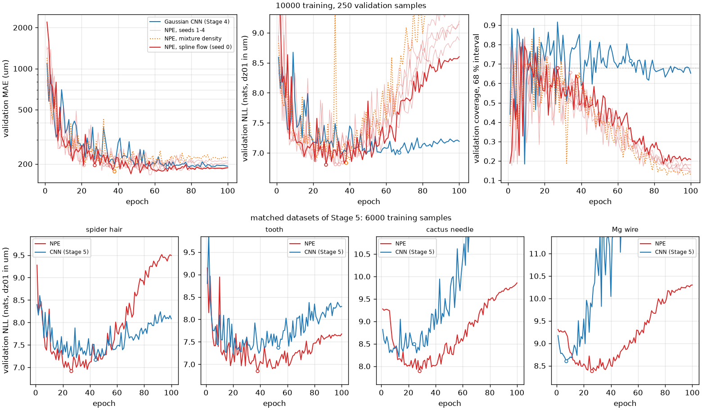
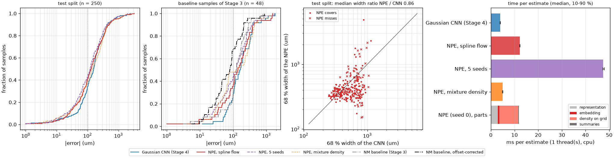
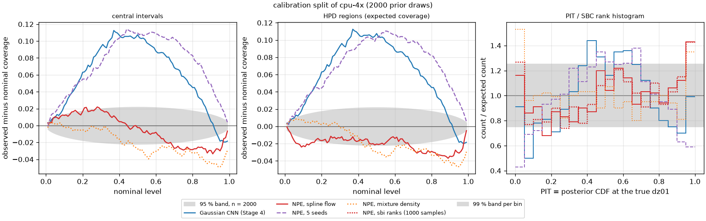
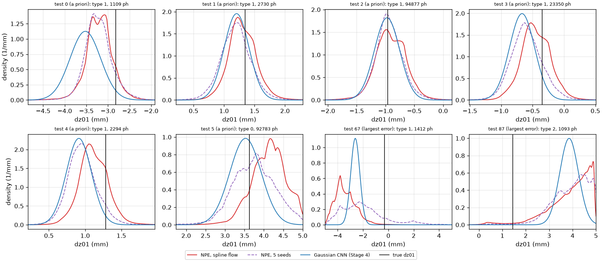
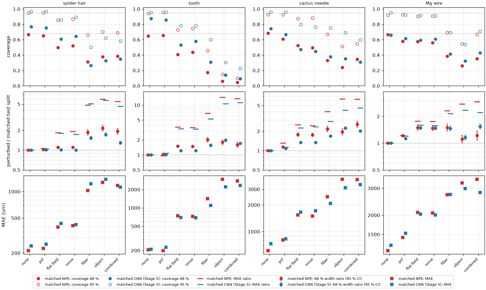
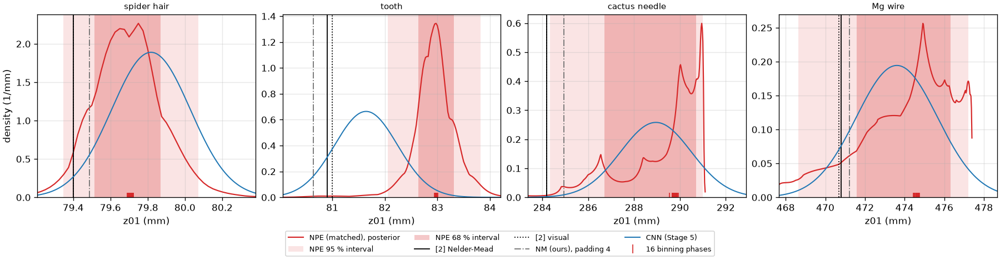
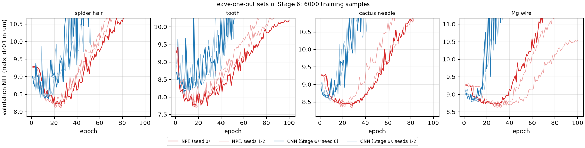
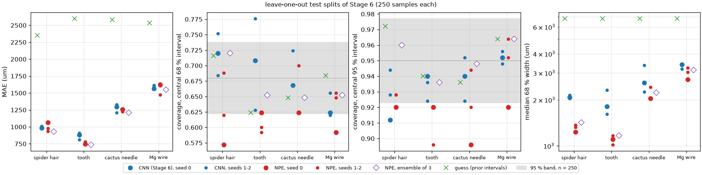
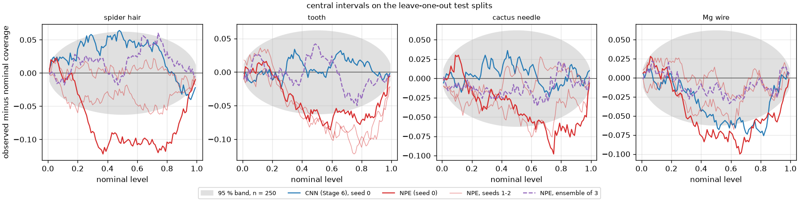
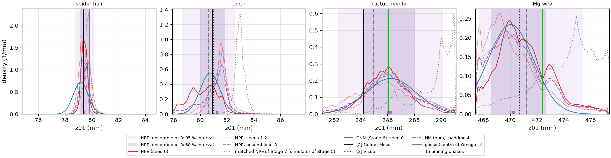

# Laborbuch 07 – Etappe 7: Posterior von $z_{01}$ mit Neural Posterior Estimation (sbi)

| | |
|---|---|
| Datum | 22.10.2026 |
| Branch | `cursor/stage7-npe-acb3` |
| Code | `src/holofocus/learned/npe.py` (NPE mit sbi), `posterior.py` (Posterior auf dem Gitter, Kalibrierung), `NPEConfig` in `config.py`, `holofocus-learn npe-train`/`npe-predict`/`npe-check` in `cli.py`; `configs/learned/npe-{nsf,mdn,ci}.yaml`, `configs/dataset/cpu-4x-calibration.yaml`; `scripts/run_stage7_study.py`, `scripts/make_stage7_figures.py`; `cluster/maxwell/jobs/npe.sh`; `tests/test_npe.py`, `tests/test_posterior.py` |
| Ergebnisse | `results/npe/` (Modelle, Vorhersagen pro Sample, sbi-Prüfungen, Vergleich, Zeiten, gestörte Splits, Messhologramme), `results/learned/spectrum-cnn-wide/calibration/` (CNN von Etappe 4 auf dem Kalibrier-Split), `results/datasets/cpu-4x-calibration-calibration.csv` |
| Abbildungen | `docs/laborbuch/figures/stage7-*.png`, Zahlen in `stage7-metrics.json` |
| Nachtrag | Abschnitt 9: das NPE auf dem Objektmodell von Etappe 6 (Branch `cursor/stage7-npe-1091`; `scripts/run_stage7_loo_study.py`, `scripts/make_stage7_loo_figures.py`; `results/npe-loo/`; `figures/stage7-loo-*.png`, Zahlen in `stage7-loo-metrics.json`) |
| Quellen | [2] Dora et al., Opt. Express 33(4), 6641 (2025); [6] M. Deistler et al., „Simulation-based inference: A practical guide“, arXiv:2508.12939 (2025) |

## 1 Ziel

Plan-Schritt 13 (`thesis-plan.md`), „Optional: `z01` mit Unsicherheit (SBI [6])“: Zweck ist
der Aufgabenpunkt „Schätzungen für z01“, als „posterior statt Punkt-Schätzer“; Ergebnis ist
ein Zusatzkapitel oder ein Anhang. Das Aufgabenpapier nennt simulation-based inference [6] als
Beispiel, nicht als Kern der Arbeit (Plan, Abschnitt 2). Die Aufgabe:

- **Daten:** die synthetischen Splits von `cpu-4x` mit den zusätzlichen Trainings-Samples von
  `cpu-4x-extra`, das Spektrum als Eingabe oder Einbettung; so gebaut, dass alles später
  unverändert auf dem Objektmodell von Etappe 6 läuft.
- **Vergleich** mit dem Gauß-CNN von Etappe 4 auf dem ganzen Test-Split und auf denselben 48
  Samples wie die Baseline: Anteil innerhalb 100 µm, MAE, Kalibrierung (Überdeckung der 68-
  und 95-%-Intervalle, etwa expected coverage oder SBC) und Zeit pro Schätzung.
- **Robustheit:** Wird die Posterior unter den Störungen von Etappe 5 (Rauschen, Flatfield,
  messungsähnliche Objekte) breiter, dort, wo die Intervalle des CNN zu schmal waren?
- **Messhologramme:** die vier Hologramme nur der Vollständigkeit halber; an ihnen wird nichts
  eingestellt.
- CPU-taugliche Läufe hier, ein Maxwell-Job für größere.

Das Objektmodell bleibt in dieser Etappe, wie es ist; daran arbeitet Etappe 6.

## 2 Ausgangslage

Etappe 5 ist in `main` gemergt
([PR #12](https://github.com/AliTUHH/master_thesis_autofocus/pull/12), Merge-Commit
`57dbee6`); CI grün. Etappe 6 (ein realistischeres Objektmodell) läuft parallel auf einem
eigenen Branch.

Das Hauptmodell von Etappe 4 (`results/learned/spectrum-cnn-wide`) schätzt $\Delta z_{01}$ aus
dem radialen Leistungsspektrum (1024 Intervalle bis $f^2 = 0{,}125$) mit einem Gauß-Kopf
($\hat\mu$, $\hat\sigma$), trainiert mit β-NLL auf 10 000 Samples (`cpu-4x` und
`cpu-4x-extra`); $\hat\sigma$ ist auf dem Val-Split mit dem Faktor 1,139 nachkalibriert
(Laborbuch 04, 3.4 und 3.5). Seine Werte auf dem Test-Split (250 Samples) und auf den 48
Samples, auf denen Etappe 3 die Baseline gerechnet hat (Test-Indizes 0–47, Laborbuch 04, 5.7):

| Satz | Methode | MAE | innerhalb 100 µm | Überdeckung 68/95 % | NLL |
|---|---|---|---|---|---|
| Test (250) | CNN | 240 µm | 33,6 % | 70,0 / 91,2 % | 7,26 |
| Baseline-Samples (48) | CNN | 257 µm | 27,1 % | 62,5 / 87,5 % | 7,28 |
| Baseline-Samples (48) | Baseline [2], roh | 166 µm | 31,3 % | – | – |
| Baseline-Samples (48) | Baseline [2], Offset-korrigiert | 116 µm | 68,8 % | – | – |

Die NLL ist hier und im Folgenden die mittlere negative Log-Dichte des wahren $z_{01}$ in nat,
mit der Dichte pro µm. Auf passenden simulierten Daten waren die Intervalle des CNN kalibriert,
unter den Störungen von Etappe 5 nicht: Unter `combined` wächst $\hat\sigma$ im Median um den
Faktor 1,3–2,3, der MAE um 2,2–11, und die 68-%-Intervalle decken nur noch 9–43 % (Laborbuch
05, 5.5, Punkt 5).

**NPE nach [6].** Neural Posterior Estimation trainiert einen bedingten Dichteschätzer
$q_\phi(\theta \mid x)$ auf Paaren $(\theta, x)$ mit $\theta$ aus dem Prior und $x$ aus dem
Simulator, indem es $-\log q_\phi(\theta \mid x)$ minimiert. Danach ist die Inferenz amortisiert:
Für ein neues $x$ kostet die Posterior einen Vorwärtsdurchlauf, ohne neue Simulationen. Der
Leitfaden [6] empfiehlt NPE mit normalisierenden Flüssen als Ausgangspunkt (A1.2),
Einbettungsnetze für hochdimensionale Daten, mit dem Dichteschätzer zusammen trainiert
(Sec. 3.2, A1.1), und den Val-Loss als Kriterium für die Auswahl, weil er die KL-Divergenz zur
wahren Posterior nach oben beschränkt (A1.1). Geprüft wird auf einem eigenen Kalibrier-Satz aus
Prior-Ziehungen und Simulationen, mit SBC, expected coverage und TARP (Sec. 3.4, A5); diese
globalen Prüfungen sind nur notwendige Bedingungen, auch der Prior selbst besteht sie. In
seinem Beispiel aus der Neurowissenschaft sind einzelne NPEs überkonfident, ein Ensemble aus
fünf Seeds ist kalibriert (Fig. 10).

## 3 Was gemacht wurde

### 3.1 Kalibrier-Split (`b4d9b5e`)

`configs/dataset/cpu-4x-calibration.yaml` hat die Physik von `cpu-4x` (Geometrie, Ziehung,
Simulation, Phantome, Rauschen; Test `test_calibration_split_has_the_physics_of_cpu_4x`), einen
eigenen Seed (20261070) und einen einzigen Split `calibration` mit 2000 Samples. Er dient nur
der Prüfung der Kalibrierung, nie dem Training oder der Auswahl (E6). Erzeugt mit 3 Threads in
16 min (0,48 s/Sample), 1,4 GB; der Fingerabdruck liegt in
`results/datasets/cpu-4x-calibration-calibration.csv`, damit `check_cluster_run.py data` einen
auf Maxwell neu erzeugten Split prüfen kann.

### 3.2 NPE (`7f7cc8e`)

`holofocus.learned.npe` schätzt die Posterior von $t = \Delta z_{01} / 5\,\text{mm}$:

- **Prior:** gleichverteilt auf dem `dz01_range` der Split-Dateien, bei allen Datensätzen
  dieser Arbeit ±5 mm, also $t \in [-1, 1]$ ($\Omega_z$ von [2]). Der Prior wird aus den Dateien
  gelesen; Trainings- und Val-Split müssen denselben Bereich haben.
- **Einbettung:** der Faltungsteil von `spectrum-cnn-wide` (Kanäle 32/64/128/128, Kern 7,
  adaptives Pooling auf 16) mit einem MLP 2048 → 128 → 32 (ReLU, Dropout 0,1) statt des
  Gauß-Kopfs. Eingabe ist dieselbe Repräsentation wie in Etappe 4.
- **Dichteschätzer:** `posterior_nn` von sbi 0.27, ein Neural Spline Flow (NSF) mit den
  Voreinstellungen von sbi (5 Transformationen, 10 Intervalle, 50 versteckte Einheiten),
  z-Standardisierung von $t$; zusammen mit der Einbettung 482 091 Parameter (CNN: 449 826). Als
  Variante ein Mixture Density Network (MDN) mit 10 Komponenten (`npe-mdn.yaml`).
- **Training:** eigene Schleife mit dem Plan von Etappe 4 (AdamW, Lernrate $10^{-3}$, Weight
  Decay $10^{-4}$, 2 Epochen Warm-up, Cosinus-Abfall, Batch 32, 100 Epochen, Gradienten-Clipping
  bei 5) auf $-\log q(t \mid x)$; behalten wird die Epoche mit dem kleinsten Val-Loss. Einbettung
  und Fluss lernen gemeinsam.
- **Posterior auf dem Gitter:** Die Flüsse von sbi haben unbeschränkten Träger. Die Posterior
  ist deshalb die Dichte auf 2001 Punkten von $t$ über dem Prior-Kasten (Abstand 5 µm), dort
  normiert, wie `DirectPosterior` von sbi auf den Träger des Priors abschneidet
  (`GridPosterior` in `posterior.py`). Daraus: Median (Punktschätzung), Mittelwert,
  Standardabweichung, Modus, zentrale 68- und 95-%-Intervalle (Quantile), die Breiten der
  HPD-Regionen, und für den wahren Wert der PIT $F(t^*)$, das HPD-Niveau und die Log-Dichte pro
  µm; dazu die Masse des Flusses im Kasten (1 minus „leakage“ in [6]).
- **Einbettung außerhalb des sbi-Schätzers:** Ein sbi-Schätzer wiederholt seine Bedingung für
  jeden Wert von $t$; mit der Einbettung darin liefe das CNN für jeden der 2001 Gitterpunkte.
  `EmbeddedEstimator` setzt beides zu einem sbi-Schätzer von $x$ zusammen, für `DirectPosterior`
  und die Prüfungen von sbi.
- **Ensemble:** mehrere Läufe zusammen geladen geben die Posterior als Mittel ihrer Dichten
  ([6], Fig. 10).
- **CLI:** `holofocus-learn npe-train`, `npe-predict` (Vorhersagen pro Sample wie in Etappe 4,
  mit Intervallen, PIT und HPD-Niveau) und `npe-check` (Prüfungen von sbi, 3.3). sbi ist ein
  optionales Extra (`pip install -e ".[npe]"`); `posterior.py` und alles andere laufen ohne.

### 3.3 Prüfungen der Kalibrierung

Für jedes Sample eines Satzes ist der PIT $F(t^*)$ der normierte Rang von $t^*$ unter unendlich
vielen Posterior-Samples, die Statistik der SBC für einen Parameter, und das HPD-Niveau die
Masse von $\{t : q(t) > q(t^*)\}$, das kleinste Niveau, dessen HPD-Region $t^*$ enthält ([6], A5).
Bei kalibrierter Posterior sind beide über den Satz gleichverteilt. Der Anteil mit HPD-Niveau
$\le a$ ist die expected coverage zum Niveau $a$, der Anteil mit $|F(t^*) - 0{,}5| \le a/2$ die
Überdeckung der zentralen Intervalle. `calibration_summary` gibt beide Kurven, das
SBC-Histogramm (20 Klassen) und Kolmogorov-Smirnov-Tests auf Gleichverteilung. Für das Gauß-CNN
gibt es PIT und HPD-Niveau geschlossen (`gaussian_pit`, `gaussian_hpd_level`), sodass beide
Methoden dieselben Statistiken auf denselben Samples bekommen.

Gegenprüfung mit sbi (`npe-check`): pro Kalibrier-Sample 1000 Samples der `DirectPosterior`
von sbi (Rejection am Prior-Kasten); daraus die Ränge von `run_sbc` für $t$ und für
$\log q(t \mid x)$ (expected coverage nach [6], A5), `check_sbc` (KS-Test der Ränge, C2ST der
Ränge und der datengemittelten Posterior) und TARP (`check_tarp`: ATC und KS-Test). Das prüft
das Gitter gegen die Samples von sbi. Dazu kommt die C2ST der gleichverteilt verrauschten Ränge
(`c2st_ranks_jittered`, `b1547d0`), weil die C2ST von sbi an ganzzahligen Rängen nichts misst
(5.3, Punkt 4).

### 3.4 Läufe

| Lauf | Training | Val | Threads | Zweck |
|---|---|---|---|---|
| `npe-nsf` | `cpu-4x` + `cpu-4x-extra` (10 000) | `cpu-4x` (250) | 1 | Hauptmodell (Seed 0) |
| `npe-nsf-seed1` … `-seed4` | dieselben | dieselben | 3 | Ensemble aus fünf Seeds (E7) |
| `npe-mdn` | dieselben | dieselben | 3 | Variante des Dichteschätzers |
| `matched-<probe>` | `matched-<probe>` (6000) | `matched-<probe>` (250) | 3 | Störungen und Messhologramme (E8) |

Die Trainings liefen aus einem Worktree mit festem Stand (`7f7cc8e`, E10). Das Hauptmodell lief
mit 1 Thread neben den Läufen mit 3 Threads.

### 3.5 Studie (`e7639f3`, `8aa83de`, `9ad576d`, `08d0e74`, `3bfb2d7`, `55c0d03`)

`scripts/run_stage7_study.py` hat sieben Befehle:

- `predict`: alle NPE-Läufe auf Val, Test und dem Kalibrier-Split (die passenden auf ihrem Val
  und Test), das Ensemble der fünf Seeds auf Test und Kalibrier-Split und das CNN von Etappe 4
  auf dem Kalibrier-Split.
- `sbc`: die Prüfungen von sbi (3.3) für `npe-nsf` und `npe-mdn` auf dem Kalibrier-Split.
- `compare`: NPE, Ensemble, MDN und CNN auf dem Test-Split, auf den 48 Samples der Baseline
  (mit deren rohen und korrigierten Fehlern aus Etappe 4) und auf dem Kalibrier-Split: Fehler der
  Punktschätzung, Überdeckung und Breite der zentralen Intervalle, NLL, PIT- und HPD-Statistiken,
  die Rangkorrelation (Spearman, gleiche Werte mit ihrem mittleren Rang, wie sie im Bootstrap
  vorkommen) zwischen 68-%-Breite und Fehlerbetrag, gepaarte Differenzen zum CNN mit
  Bootstrap-Intervallen und dieselben Größen auf Teilmengen: Terzile der Photonenzahl,
  Phantomtypen und die vier Viertel des Bereichs von $\Delta z_{01}$
  (`results/npe/comparison/`).
- `timing`: Zeit pro Schätzung (E9), dazu die Teile einer NPE-Schätzung.
- `examples`: die Posterior-Dichten der Test-Samples 0–5 (vorab festgelegt) und der zwei
  größten Fehler des NPE.
- `perturb`: die passenden NPEs auf ihrem Test-Split und auf den sechs gestörten Splits von
  Etappe 5 (`data/sim2real/<probe>/<störung>.h5`, dieselben Dateien, geprüft gegen ihre Config).
  Pro Sample zählt das Verhältnis der 68-%-Breite gestört zu ungestört, gepaart über dieselben
  Samples; daneben das passende CNN von Etappe 5 auf denselben Samples
  (`results/sim2real/<probe>/<störung>/`), nur wenn Datensatz und Modell (SHA-256) mit seiner
  Referenz übereinstimmen, und die gepaarten Differenzen zu ihm mit Bootstrap-Intervallen.
- `measured`: die passenden NPEs auf den vier Messhologrammen, 4× gebinnt wie in Etappe 3 und 5,
  dazu die 16 Phasen des Binning-Gitters; Abstände zu [2] Table 1, zur Baseline mit Padding 4
  und zum CNN von Etappe 5, und wo die Referenzen in der Posterior liegen (PIT, HPD-Niveau).

`scripts/make_stage7_figures.py` (`9ad5a26`, `3d1123d`, `b32d37b`) zeichnet die Abbildungen
aus den Ergebnisdateien und braucht sbi nicht.

### 3.6 Maxwell (`0bcbad9`)

`cluster/maxwell/jobs/npe.sh` trainiert ein NPE mit `npe-train`, sagt Val, Test und den
Kalibrier-Split vorher und rechnet auf diesem die Prüfungen von sbi; als Array
(`--array 1-4`) trainiert Task $k$ mit Seed $k$ nach `<name>-seed<k>`. `setup_env.sh
--with-sbi` installiert das Extra `npe` mit sbi und dessen Abhängigkeiten in den Versionen der
VM (`requirements-vm.txt`), ohne torch zu ändern. `docs/maxwell-gpu.md`, 8.1, beschreibt den
Kalibrier-Split auf Maxwell, drei Läufe (dieselben 10 000 Samples als Kontrolle, 60 000 Samples
mit Ensemble und MDN, die vier Proben auf 56 000 Samples) und deren Auswertung auf der VM; was
nur auf der A100 zu prüfen ist, steht dort unter PRÜFEN.

### 3.7 Tests (`e0e2daf`)

295 Tests bestehen, einer wird übersprungen (nur CUDA); `ruff` ist sauber. In `main`
(`57dbee6`) waren es 278. Neu sind 18:

| Datei | Neu | Prüft |
|---|---|---|
| `test_posterior.py` | 7 | Gaußverteilung auf dem Gitter: Momente, Quantile, Intervalle; abgeschnittene Posterior und ihre Masse im Kasten; PIT und HPD-Niveau gleich den geschlossenen Formen; Mischung eines Ensembles; Kolmogorov-Verteilung und KS-Test; Kalibrierung einer kalibrierten und einer überkonfidenten Posterior (Kurven, Histogramm, Tests); Metriken und Zeilen der Vorhersagen |
| `test_npe.py` | 6 | Configs des Repositorys und ihre Validierung; NSF und MDN: Dichte auf dem Gitter und Zustand nach Speichern und Laden; Prior aus `dz01_range`; Training, Vorhersage, Ensemble und Prüfungen von sbi auf einem Mini-Datensatz; CLI |
| `test_dataset_config.py` | 2 | der Kalibrier-Split hat die Physik von `cpu-4x`; seine Config im Test aller Configs |
| `test_cluster_kit.py` | 3 | Job `npe` lokal als Array-Task 1 (Training mit Seed 1 nach `<name>-seed1`, Vorhersagen für Val und den Kalibrier-Split, Prüfungen von sbi, Kopie nach DUST; 13 s); `npe.sh` mit `bash -n`; Jobname und Name des Logs |

`test_npe.py` überspringt sich ohne sbi. Die CI installiert das Extra `npe` und rechnet
zusätzlich alle Befehle der Studie auf dem Demo-Datensatz mit zwei NPEs aus `npe-ci.yaml` und
dem CI-Modell als CNN (Kalibrier-Split: der Val-Split des Demo-Datensatzes; Störungen `noise`
und `object` auf 4 Samples), dazu die Stage-7-Abbildungen im Schnellmodus, einmal aus diesem
Lauf und einmal aus den versionierten Ergebnissen; lokal mit 1 Thread 28 s
(`526ef05`).

## 4 Entscheidungen und Begründung

**E1 – Einbettung und Fluss zusammen trainiert.** Die Einbettung hat die Architektur des
Spektrum-CNN von Etappe 4, lernt aber neu, zusammen mit dem Fluss. Eingefrorene Merkmale des CNN
wären auf $\hat\mu$ und $\hat\sigma$ eines Gauß-Kopfs trainiert und hielten womöglich gerade das
nicht fest, was eine schiefe oder mehrgipflige Posterior braucht. [6] empfiehlt, Einbettungsnetze
Ende-zu-Ende mit dem Dichteschätzer zu trainieren (A1.1). Die Architektur zu übernehmen hält
den Vergleich fair: Beide Modelle sehen dieselbe Repräsentation mit demselben Faltungsteil, und
der Unterschied liegt im Kopf und im Verlust.

**E2 – Eigene Trainingsschleife statt `NPE.train` von sbi.** `NPE.train` teilt die Val-Daten
zufällig von den Trainingsdaten ab (10 %) und stoppt nach 20 Epochen ohne Verbesserung, mit
Batch 200 und Lernrate $5 \cdot 10^{-4}$. Hier nutzen CNN und NPE denselben festen Val-Split,
dieselben 10 000 Trainings-Samples und denselben Plan; so ist der Unterschied der Ergebnisse
der des Modells.

**E3 – Posterior auf dem Gitter.** Der Parameter ist eindimensional. Auf 2001 Punkten sind
Quantile, HPD-Regionen und PIT bis auf den Gitterabstand von 5 µm genau, deterministisch und
kosten einen Durchlauf des Flusses mit 2001 Werten. Mit 1000 Samples pro Hologramm hätten Ränge
und Quantile ein Monte-Carlo-Rauschen und die Ränge eine Auflösung von $10^{-3}$. Die Samples von
sbi prüfen das Gitter (3.3).

**E4 – Median als Punktschätzung.** Der Median minimiert den erwarteten absoluten Fehler unter
der Posterior, passt also zum MAE, und bleibt bei schiefen Posteriors in der Masse. Beim Gauß-CNN
fallen Median und Mittelwert zusammen.

**E5 – Auswahl nach dem Val-Loss, 100 Epochen ohne Early Stopping.** Alle NPE-Läufe erreichen
ihren kleinsten Val-Loss zwischen Epoche 21 und 38 und überanpassen danach: Der Trainings-Loss
fällt weiter, der Val-Loss steigt, und die Intervalle auf dem Val-Split werden zu schmal (5.1).
Die Auswahl nach dem Val-Loss wirkt wie Early Stopping ([6], Sec. 3.3: Checkpoints und Early
Stopping). Ich habe die 100 Epochen trotzdem für alle Läufe beibehalten: Plan und Auswahl sind
dieselben wie beim CNN und bei allen Mitgliedern des Ensembles, und ein Abbruch spart nur
Rechenzeit, die ausgewählte Epoche ändert er nicht, solange die Geduld länger ist als die
Schwankungen des Val-Loss.

**E6 – Kalibrierung auf einem eigenen Split.** Auf den 250 Test-Samples hat eine Überdeckung von
68 % einen Standardfehler von 3,0 Prozentpunkten, auf 2000 Samples von 1,0. [6] nennt 1000 bis
10 000 Simulationen für SBC und HPD (A5). Der Kalibrier-Split ist von Training, Auswahl und
Test unabhängig; der Test-Split bleibt derselbe wie in Etappe 4, damit der Vergleich mit CNN
und Baseline auf denselben Samples steht.

**E7 – Ensemble aus fünf Seeds.** Wie in [6], Fig. 10: fünf Läufe, die sich nur im Seed
(Initialisierung und Reihenfolge der Batches) unterscheiden, und als Posterior das Mittel der
Dichten. Ein Ensemble deckt die Streuung zwischen Läufen ab, die eine einzelne NPE nicht kennt,
und kostet fünfmal die Rechenzeit.

**E8 – Passende NPEs für Störungen und Messhologramme.** Die gestörten Splits von Etappe 5 und
die Messhologramme haben die Aufbauten der vier Proben; das NPE auf `cpu-4x` kennt nur dessen
Aufbau. Pro Probe gibt es deshalb ein NPE auf den 6000 Samples des passenden Datensatzes, mit
derselben Config wie das Hauptmodell, so wie das passende CNN von Etappe 5 die Config von
`spectrum-cnn-wide` hat. Verglichen werden NPE und CNN auf denselben gestörten Samples. Ein
Ensemble pro Probe hätte die Rechenzeit verfünffacht.

**E9 – Zeit pro Schätzung unter gleichen Bedingungen.** CNN und NPE laufen mit derselben Zahl
von Threads auf denselben Hologrammen, abwechselnd in wechselnder Reihenfolge, vom Hologramm
im Speicher bis zu Punktschätzung und Intervallen (beim NPE einschließlich der Dichte auf dem
Gitter), mit Batch 1.

**E10 – Eingefrorener Code für lange Läufe.** Alle Trainings liefen aus einem Worktree mit dem
Stand `7f7cc8e`. Training und Vorhersage sind seither unverändert; die Prüfung mit sbi hat
danach die C2ST der verrauschten Ränge bekommen (`b1547d0`), Ränge und TARP blieben dabei
gleich. Jede Ergebnisdatei hält ihren Commit, die Prüfsummen von Modell und Daten fest.
Vorhersagen, deren Modell und Daten sich nicht geändert haben, nutzt die Studie wieder.

**E11 – Eine Studie für jeden Datensatz.** `run_stage7_study.py` nimmt die Läufe (`--npe`), das
CNN (`--cnn`) und die Splits als Optionen und schreibt alles unter `--npe`. Auf dem Objektmodell
von Etappe 6 oder mit den großen Läufen von Maxwell laufen dieselben Befehle mit anderen Pfaden,
ohne die Ergebnisse dieser Etappe zu überschreiben (`docs/usage.md`).

## 5 Ergebnisse

Kurz: Auf simulierten Daten schätzt das NPE $z_{01}$ so genau wie das Gauß-CNN von Etappe 4
(Test-MAE 246 gegen 240 µm, gepaarte Differenz +6 µm [−24, +40]), mit 14–20 % schmaleren
Intervallen nahe der nominalen Überdeckung und einer um 0,23–0,35 nat kleineren NLL (5.2). Auf
2000 Prior-Ziehungen weicht seine Überdeckung höchstens 3,5 Prozentpunkte vom Nominalen ab, die
des CNN bis 11; ganz kalibriert ist es aber nicht (die 68- und 95-%-Intervalle decken 66,0 und
92,0 %, Bias −42 µm), was erst die 2000 Samples zeigen (5.3). Seine Breiten ordnen die Samples
besser nach ihrem Fehler (Rangkorrelation 0,45 gegen 0,26; 5.2). Eine Schätzung kostet
12 ms, dreimal so viel wie beim CNN (5.5), vernachlässigbar gegen die 331 s der Baseline, die
auf den 48 Samples genauer bleibt (5.2). Unter den Störungen von Etappe 5 wird die Posterior
breiter, in 19 von 24 Fällen stärker als beim CNN, aber weit weniger, als der Fehler wächst:
Unter messungsähnlichen Objekten decken die 68-%-Intervalle nur noch 4–38 % (CNN 9–43 %), und
der Median liegt meist weiter daneben als die Schätzung des CNN (5.6). Auf den Messhologrammen
ist das NPE bei drei von vier Proben weiter von [2] entfernt als das CNN; bei Kaktusnadel und
Mg-Draht hat seine Posterior mehrere Gipfel bis an den Rand des Priors (5.7). Das Ensemble der
fünf Seeds ist genauer als das CNN und als jeder einzelne Seed (MAE auf dem Kalibrier-Split
189 gegen 215 µm beim CNN, −26 µm [−36, −16]) und hat kaum Bias (−10 µm), deckt aber zu viel
(78,3/97,6 %); das MDN deckt zu wenig (65,5/90,1 %). Nach Photonenzahl, Phantomtyp und Bereich
von $\Delta z_{01}$ aufgeteilt, ist keines der Modelle kalibriert (5.3, Punkt 7).

### 5.1 Training

*Abb. 1 – Oben: Val-MAE, Val-NLL und Überdeckung der 68-%-Intervalle auf dem Val-Split von
`cpu-4x` pro Epoche, für das CNN von Etappe 4 (blau), das NPE (Seed 0, rot), die Seeds 1–4
(blass) und das MDN (orange gepunktet); Kreise: ausgewählte Epoche. Unten: Val-NLL der
passenden NPEs (rot) und der passenden CNNs von Etappe 5 (blau).*

Val-NLL aus dem Trainingsverlauf (Val-Loss + ln 5000, in nat mit der Dichte pro µm), Val-MAE,
Überdeckung und Median der 68-%-Breite in der ausgewählten Epoche
(`results/npe/<lauf>/summary.json`, `history.csv`):

| Lauf | beste Epoche | Val-NLL beste / letzte Epoche | Val-MAE | Überdeckung 68/95 % | Breite 68 % | Training |
|---|---|---|---|---|---|---|
| `npe-nsf` | 27 | 6,81 / 8,60 | 196 µm | 68,0 / 92,4 % | 375 µm | 48 min, 1 Thread |
| `npe-nsf-seed1` | 34 | 6,81 / 8,88 | 196 µm | 65,6 / 95,2 % | 383 µm | 18,8 min, 3 Threads |
| `npe-nsf-seed2` | 32 | 6,82 / 9,50 | 197 µm | 57,2 / 91,2 % | 320 µm | 18,6 min, 3 Threads |
| `npe-nsf-seed3` | 36 | 6,84 / 9,14 | 192 µm | 60,0 / 89,6 % | 332 µm | 18,6 min, 3 Threads |
| `npe-nsf-seed4` | 21 | 6,88 / 9,20 | 197 µm | 73,2 / 94,0 % | 443 µm | 18,5 min, 3 Threads |
| `npe-mdn` | 38 | 6,83 / 9,96 | 177 µm | 63,6 / 92,0 % | 344 µm | 14,4 min, 3 Threads |
| CNN, Etappe 4 | 67 (nach Val-MAE) | 7,01 / 7,19 | 190 µm | 71,6 % / – | – | 38 min, 1 Thread |
| `matched-spider_hair` | 26 | 6,92 / 9,49 | 239 µm | 66,0 / 94,4 % | 411 µm | 12,7 min, 3 Threads |
| `matched-tooth` | 38 | 6,85 / 7,68 | 211 µm | 65,6 / 94,0 % | 387 µm | 12,2 min, 3 Threads |
| `matched-cactus_needle` | 28 | 7,90 / 9,86 | 621 µm | 65,2 / 91,6 % | 1096 µm | 13,6 min, 3 Threads |
| `matched-magnesium_wire` | 26 | 8,39 / 10,30 | 1162 µm | 67,2 / 96,0 % | 1909 µm | 12,9 min, 3 Threads |

Die Überdeckung des CNN ist die seines rohen $\hat\sigma$ im Trainingsverlauf, vor der
Nachkalibrierung.

1. **Nach etwa 30 Epochen überangepasst.** Beim Hauptmodell fällt der Trainings-Loss bis
   Epoche 100 weiter (−1,65 → −3,16), die Val-NLL steigt (6,81 → 8,60), die 68-%-Intervalle auf
   dem Val-Split schrumpfen von 375 auf 89 µm und decken zuletzt 21 % statt 68 %. Der Val-MAE
   wird dabei nicht schlechter, sondern etwas besser (196 → 188 µm, kleinster Wert 169 µm in
   Epoche 47): Der Median der Posterior lernt weiter, ihre Breite schrumpft zu stark. Das ist
   die Überanpassung, vor der [6] warnt (A1.1: sie macht die Posterior überkonfident). Die
   Auswahl nach dem Val-Loss nimmt Epoche 27 mit kalibrierten Intervallen; der Preis sind
   8–27 µm Val-MAE gegenüber späteren Epochen. Nach dem Val-MAE ausgewählt (Epoche 47) deckten
   die Intervalle nur 58/85 %.
2. **Das CNN überangepasst kaum.** Seine Val-NLL steigt nach der ausgewählten Epoche nur von
   7,01 auf 7,19, die Überdeckung bleibt bei 65–72 %. Der Gauß-Kopf hat zwei Ausgaben pro
   Sample; der Fluss kann die Dichte um die Trainingswerte beliebig eng ziehen.
3. **Passende Datensätze: dasselbe Bild.** Beste Epochen 26–38, danach steigt die Val-NLL um
   0,8–2,6 nat. In der ausgewählten Epoche haben die passenden NPEs bei allen vier Proben eine
   kleinere Val-NLL als die passenden CNNs (6,92/6,85/7,90/8,39 gegen 7,17/7,38/8,50/8,61) und
   einen kleineren Val-MAE (239/211/621/1162 gegen 253/237/731/1204 µm).
4. **Seeds: dieselbe Val-NLL, verschiedene Breiten.** Die fünf Seeds erreichen in ihrer
   besten Epoche (21–36) dieselbe Val-NLL (6,81–6,88) und denselben Val-MAE (192–197 µm). Auf
   denselben 250 Samples decken ihre 68-%-Intervalle aber 57,2–73,2 %, bei Breiten von 320 bis
   443 µm; auf dem Kalibrier-Split decken sie 61,2–69,0 %, und ihre Breiten (331–446 µm) haben
   dieselbe Reihenfolge (5.3, Punkt 6). Wie breit ein Lauf wird, hängt also vom Seed ab, und die
   Val-NLL unterscheidet es kaum. Wie beim Hauptmodell sinkt der Val-MAE nach der ausgewählten
   Epoche weiter (kleinster Wert 166–186 µm in Epoche 54–60).
5. **MDN: genauer auf dem Val-Split, mit Sprüngen.** Das MDN (459 426 Parameter) hat bei
   derselben Val-NLL (6,83) den kleinsten Val-MAE (177 µm, zugleich sein kleinster Wert über
   alle Epochen). Nach den ersten zehn Epochen springt seine Val-NLL einmal um 2,4 nat
   (Epoche 32: 9,44 gegen 6,93 und 7,06 in den Nachbarepochen; die 68-%-Intervalle decken dort
   19 %), die der Flüsse höchstens um 1,0 nat (Abb. 1).

### 5.2 Test-Split, Kalibrier-Split und die 48 Samples der Baseline

*Abb. 2 – Verteilung des Fehlerbetrags auf dem Test-Split und auf den 48 Samples der Baseline;
68-%-Breite des NPE gegen die des CNN pro Test-Sample (Kreuz: wahrer Wert außerhalb des
NPE-Intervalls); Zeit pro Schätzung.*

`results/npe/comparison/` (`comparison.csv`, pro Sample `<satz>.csv`). NPE ist `npe-nsf`
(Seed 0), Ensemble das Mittel der Dichten der Seeds 0–4, MDN `npe-mdn`. Fehler und Breiten
(Median über die Samples) in µm, zentrale Intervalle, NLL in nat mit der Dichte pro µm:

| Satz | Methode | MAE | Median | **innerhalb 100 µm** | Bias | Überdeckung 68/95 % | Breite 68/95 % | NLL |
|---|---|---|---|---|---|---|---|---|
| Test (250) | CNN | 240 | 158 | **33,6 %** | −13 | 70,0 / 91,2 % | 540 / 1065 | 7,26 |
| Test (250) | NPE | 246 | 129 | **40,8 %** | −21 | 66,4 / 92,4 % | 389 / 793 | 6,91 |
| Test (250) | Ensemble | 214 | 122 | **42,8 %** | +8 | 75,2 / 96,8 % | 426 / 894 | 6,79 |
| Test (250) | MDN | 251 | 143 | **38,0 %** | +13 | 59,2 / 84,4 % | 343 / 677 | 7,13 |
| Kalibrier-Split (2000) | CNN | 215 | 137 | **39,3 %** | −15 | 75,7 / 93,2 % | 555 / 1093 | 7,11 |
| Kalibrier-Split (2000) | NPE | 223 | 134 | **38,8 %** | −42 | 66,0 / 92,0 % | 384 / 775 | 6,88 |
| Kalibrier-Split (2000) | Ensemble | 189 | 116 | **43,9 %** | −10 | 78,3 / 97,6 % | 422 / 872 | 6,74 |
| Kalibrier-Split (2000) | MDN | 206 | 128 | **40,1 %** | +1 | 65,5 / 90,1 % | 349 / 687 | 6,86 |
| Baseline-Samples (48) | CNN | 257 | 161 | **27,1 %** | +1 | 62,5 / 87,5 % | 494 / 974 | 7,28 |
| Baseline-Samples (48) | NPE | 242 | 138 | **35,4 %** | −11 | 62,5 / 89,6 % | 390 / 804 | 6,93 |
| Baseline-Samples (48) | Ensemble | 196 | 125 | **43,8 %** | +11 | 79,2 / 95,8 % | 417 / 894 | 6,80 |
| Baseline-Samples (48) | MDN | 230 | 126 | **47,9 %** | +12 | 56,3 / 81,3 % | 336 / 659 | 7,17 |
| Baseline-Samples (48) | Baseline [2], roh | 166 | 124 | **31,3 %** | +120 | – | – | – |
| Baseline-Samples (48) | Baseline, Offset-korrigiert | 116 | 79 | **68,8 %** | +39 | – | – | – |

Gepaart, Methode minus CNN auf denselben Samples, in eckigen Klammern das
95-%-Bootstrap-Intervall; Überdeckung und Anteil innerhalb 100 µm in Prozentpunkten; Median des
Verhältnisses der 68-%-Breiten pro Sample; Rangkorrelation (Spearman) zwischen 68-%-Breite und
Fehlerbetrag, Methode gegen CNN; Anteil der Samples, bei denen die Methode näher liegt:

| Satz | Methode | MAE | innerhalb 100 µm | Überdeckung 68 % | Überdeckung 95 % | NLL | Breite 68 % / CNN | Rangkorrelation | näher |
|---|---|---|---|---|---|---|---|---|---|
| Test | NPE | +6 [−24, +40] µm | +7,2 [−0,8, +14,8] | −3,6 [−10,8, +3,2] | +1,2 [−2,8, +5,2] | −0,35 [−0,59, −0,15] | 0,86 | 0,47 gegen 0,22: +0,25 [+0,08, +0,39] | 52,8 % |
| Test | Ensemble | −26 [−51, +1] µm | +9,2 [+2,0, +16,4] | +5,2 [−1,2, +11,6] | +5,6 [+2,4, +9,2] | −0,47 [−0,71, −0,27] | 0,94 | 0,46 gegen 0,22: +0,24 [+0,09, +0,39] | 62,4 % |
| Test | MDN | +11 [−14, +39] µm | +4,4 [−2,8, +11,2] | −10,8 [−17,2, −4,0] | −6,8 [−11,2, −2,4] | −0,14 [−0,39, +0,10] | 0,77 | 0,38 gegen 0,22: +0,16 [+0,02, +0,28] | 53,2 % |
| Kalibrier-Split | NPE | +8 [−5, +21] µm | −0,5 [−3,2, +2,3] | −9,7 [−12,2, −7,2] | −1,2 [−2,6, +0,3] | −0,23 [−0,32, −0,15] | 0,80 | 0,45 gegen 0,26: +0,18 [+0,13, +0,24] | 50,3 % |
| Kalibrier-Split | Ensemble | −26 [−36, −16] µm | +4,7 [+2,1, +7,3] | +2,6 [+0,5, +4,7] | +4,5 [+3,4, +5,6] | −0,38 [−0,46, −0,30] | 0,90 | 0,44 gegen 0,26: +0,18 [+0,13, +0,23] | 56,9 % |
| Kalibrier-Split | MDN | −9 [−19, +2] µm | +0,8 [−1,9, +3,5] | −10,2 [−12,5, −7,9] | −3,1 [−4,4, −1,8] | −0,25 [−0,34, −0,17] | 0,72 | 0,32 gegen 0,26: +0,06 [+0,00, +0,11] | 53,0 % |
| Baseline-Samples | NPE | −14 [−61, +35] µm | +8,3 [−8,3, +25,0] | 0 [−16,7, +16,7] | +2,1 [−8,3, +12,5] | −0,35 [−0,81, −0,01] | 0,87 | 0,50 gegen 0,21: +0,29 [−0,06, +0,61] | 58,3 % |
| Baseline-Samples | Ensemble | −61 [−117, −10] µm | +16,7 [+2,1, +31,3] | +16,7 [+2,1, +31,3] | +8,3 [0, +18,8] | −0,48 [−1,01, −0,11] | 0,93 | 0,40 gegen 0,21: +0,19 [−0,08, +0,46] | 70,8 % |
| Baseline-Samples | MDN | −26 [−64, +10] µm | +20,8 [+6,3, +35,4] | −6,3 [−22,9, +8,3] | −6,3 [−16,7, +4,2] | −0,11 [−0,66, +0,34] | 0,77 | 0,30 gegen 0,21: +0,09 [−0,22, +0,38] | 56,3 % |

NPE gegen die Baseline auf den 48 Samples: +77 µm [−30, +196] gegen die rohe und +126 µm
[+22, +240] gegen die Offset-korrigierte (NPE näher bei 50 bzw. 38 % der Samples).

1. **Gleich genau.** Die Differenzen der MAE (+6 und +8 µm) sind mit null verträglich. Auf
   dem Test-Split liegen beim NPE 7,2 Prozentpunkte mehr Samples innerhalb 100 µm (Median des
   Fehlers 129 gegen 158 µm); auf dem achtmal größeren Kalibrier-Split verschwindet das
   (−0,5 Prozentpunkte, 134 gegen 137 µm). Der Vorsprung auf dem Test-Split gehört zu dessen
   250 Samples, nicht zum Modell.
2. **Schmalere Intervalle, kleinere NLL.** Die 68-%-Intervalle des NPE sind im Median 14 %
   (Test) bzw. 20 % (Kalibrier-Split) schmaler und decken trotzdem fast nominal; das CNN
   überdeckt bei 68 % (75,7 % auf dem Kalibrier-Split, 5.3). Die NLL ist um 0,35 bzw. 0,23 nat
   kleiner, die Dichte am wahren Wert also im geometrischen Mittel 1,4- bzw. 1,3-mal so hoch.
3. **Die Breite des NPE sagt mehr über den Fehler.** Die Rangkorrelation zwischen 68-%-Breite
   und Fehlerbetrag ist beim NPE 0,45–0,50, beim CNN 0,21–0,26 (Differenz auf dem
   Kalibrier-Split +0,18 [+0,13, +0,24]). Das Viertel der Samples mit den schmalsten
   NPE-Intervallen hat einen MAE von 102–108 µm, das mit den breitesten 461–552 µm; beim CNN
   sind es 129–158 und 331–423 µm. Ein schmales Intervall des NPE heißt also eher, dass die
   Schätzung stimmt.
4. **Die Baseline bleibt auf den 48 Samples genauer.** Gegen die rohe Baseline ist der
   Unterschied nicht gesichert, gegen die korrigierte schon (+126 µm [+22, +240]), wie beim CNN
   in Etappe 4 (Laborbuch 04, 5.7). Beim Ensemble (MAE 196 µm) sind es +30 µm [−60, +134] und
   +80 µm [−8, +178], auf 48 Samples beides nicht gesichert. Eine Schätzung des NPE kostet dafür
   12 ms statt 331 s (5.5).
5. **Das Ensemble ist das genaueste Modell und zu breit.** Auf dem Kalibrier-Split ist sein
   MAE 26 µm [−36, −16] kleiner als der des CNN und 20–47 µm kleiner als der jedes einzelnen
   Seeds (gepaart, kein Intervall enthält null; gegen Seed 0 −34 µm [−42, −26]); 43,9 % der
   Samples liegen innerhalb 100 µm (CNN 39,3 %), auf dem Test-Split 42,8 % (+9,2 Prozentpunkte
   [+2,0, +16,4]). Der Bias von Seed 0 (−42 µm) verschwindet (−10 µm). Seine 68-%-Intervalle
   sind im Median 10 % schmaler als die des CNN und decken trotzdem mehr (78,3 %, +2,6
   Prozentpunkte [+0,5, +4,7]), bei 95 % 97,6 %; die NLL ist mit 6,74 die kleinste (5.3,
   Punkt 6). Seine Breite ordnet die Fehler so gut wie die von Seed 0 (Rangkorrelation 0,40 bis
   0,46; MAE im schmalsten Viertel 76–88 µm, im breitesten 392–472 µm).
6. **Das MDN ist so genau wie das CNN und zu schmal.** Auf dem Kalibrier-Split ist sein MAE
   mit dem des CNN verträglich (−9 µm [−19, +2]); seine 68-%-Intervalle sind im Median 28 %
   schmaler und decken 10,2 Prozentpunkte [−12,5, −7,9] weniger (65,5/90,1 %). Seine Breite
   ordnet die Fehler nur wenig besser als die des CNN (0,32 gegen 0,26).

### 5.3 Kalibrierung auf dem Kalibrier-Split

*Abb. 3 – Kalibrier-Split (2000 Prior-Ziehungen). Links: beobachtete minus nominale
Überdeckung der zentralen Intervalle; Mitte: dasselbe für die HPD-Regionen (expected coverage);
grau: 95-%-Band für 2000 Samples. Rechts: Histogramm des PIT (SBC-Ränge), beim NPE auf dem
Gitter und aus den 1000 Samples von sbi; grau: 99-%-Band pro Klasse. CNN blau, NPE rot,
Ensemble lila gestrichelt, MDN orange gepunktet.*

`results/npe/<lauf>/calibration/` (Vorhersagen; für `npe-nsf` und `npe-mdn` dazu
`sbi-checks.json`, `sbi-ranks.csv`), `results/learned/spectrum-cnn-wide/calibration/`,
`results/npe/comparison/calibration.json`; „sbi“: aus 1000 Samples der `DirectPosterior` pro
Hologramm (3.3):

| | CNN | NPE, Gitter | NPE, sbi | Ensemble | MDN, Gitter | MDN, sbi |
|---|---|---|---|---|---|---|
| zentrale Intervalle 68/95 % | 75,7 / 93,2 % | 66,0 / 92,0 % | – | 78,3 / 97,6 % | 65,5 / 90,1 % | – |
| HPD-Regionen 68/95 % (expected coverage) | 75,7 / 93,2 % | 65,8 / 91,9 % | 65,9 / 92,0 % | 77,7 / 97,9 % | 65,4 / 90,4 % | 65,3 / 90,5 % |
| größte / mittlere Abweichung der HPD-Kurve | 11,1 / +6,0 Prozentpunkte | 3,5 / −2,1 | 3,6 / −2,1 | 11,0 / +7,0 | 4,7 / −1,8 | 4,6 / −1,8 |
| PIT unter 0,025 / über 0,975 | 3,1 / 3,8 % | 3,5 / 4,5 % | 3,4 / 4,4 % | 1,1 / 1,4 % | 5,1 / 4,8 % | 5,1 / 4,8 % |
| mittlerer PIT | 0,513 | 0,528 | 0,528 | 0,510 | 0,490 | 0,490 |
| KS-Test PIT, $p$ | $7 \cdot 10^{-10}$ | $2 \cdot 10^{-6}$ | $1{,}3 \cdot 10^{-6}$ | $1{,}7 \cdot 10^{-8}$ | 0,053 | 0,047 |
| KS-Test HPD-Niveau, $p$ | $1{,}5 \cdot 10^{-22}$ | 0,006 | 0,004 | $2{,}8 \cdot 10^{-22}$ | $1{,}7 \cdot 10^{-4}$ | $1{,}9 \cdot 10^{-4}$ |
| C2ST der Ränge: sbi / verrauscht | – | – | 0,696 / 0,504 | – | – | 0,698 / 0,507 |
| C2ST datengemittelte Posterior gegen Prior | – | – | 0,502 | – | – | 0,491 |
| TARP: ATC, KS-$p$ | – | – | +0,019, 0,80 | – | – | −0,011, 1,00 |

1. **Das CNN ist im Kern zu breit, in den Ausläufern zu schmal.** Seine zentralen Intervalle
   decken bei mittleren Niveaus bis 11 Prozentpunkte mehr als nominal, bei 95 % 1,8 weniger
   (Abb. 3). Seine Fehler sind also schwerer verteilt als seine Gauß-Annahme, und die
   Nachkalibrierung mit einem Faktor (1,139, Laborbuch 04, 3.5) trifft nur ein Niveau. Auf den
   250 Test-Samples fällt das nicht auf (KS-$p$ = 0,69), auf 2000 deutlich
   ($p = 7 \cdot 10^{-10}$).
2. **Das NPE ist auf allen Niveaus nahe am Nominalen, aber leicht überkonfident.** Seine
   HPD-Kurve liegt höchstens 3,5 und im Mittel 2,1 Prozentpunkte unter der Diagonale; die
   95-%-Intervalle verfehlen 8,0 statt 5 % der Samples (3,5 % darunter, 4,5 % darüber). Der
   mittlere PIT von 0,528 heißt: Der wahre Wert liegt etwas öfter über dem Median als darunter,
   die Schätzung also im Mittel zu tief (Bias −42 µm, beim CNN −15 µm). Auf 2000 Samples
   verwerfen die KS-Tests die Gleichverteilung (PIT $p = 2 \cdot 10^{-6}$, HPD-Niveau
   $p$ = 0,006), auf den 250 Test-Samples nicht ($p$ = 0,89 bzw. 0,52).
3. **Gitter und sbi stimmen überein.** Die Ränge aus 1000 Samples der `DirectPosterior` und
   der PIT auf dem Gitter korrelieren mit 0,999 und unterscheiden sich im Mittel um 0,010, im
   Rahmen des Monte-Carlo-Rauschens von 1000 Samples (Standardabweichung 0,016 bei einem PIT
   von 0,5); die expected coverage aus den Samples ist 65,9/92,0 %, auf dem Gitter
   65,8/91,9 %. Die Statistiken des Gitters sind also die von sbi, ohne dessen Rauschen (E3).
4. **Die C2ST der Ränge von sbi misst hier nichts.** sbi 0.27 stellt die ganzzahligen Ränge
   (0–1000) gegen kontinuierlich gleichverteilte Werte, und sein Klassifikator (Random Forest)
   trennt beide schon an der Ganzzahligkeit: 2000 exakt gleichverteilte ganzzahlige Ränge
   (`torch.randint(0, 1001)`, fünf Seeds) erreichen mit `check_uniformity_c2st` 0,697–0,706,
   praktisch dasselbe wie unsere (0,696). Gleichverteilt verrauscht, $(r + u)\,L/(L + 1)$ mit
   $u \sim U(0, 1)$ und $L = 1000$, geben unsere Ränge 0,504, zwei gleichverteilte
   Stichproben 0,491–0,502 (`c2st_ranks_jittered`, `b1547d0`). Die Ränge sind also fast
   gleichverteilt; nur der KS-Test auf 2000 Samples sieht die Abweichung.
5. **Die globalen Prüfungen sind notwendig, nicht hinreichend.** Die datengemittelte Posterior
   ist vom Prior nicht zu unterscheiden (C2ST 0,502), und TARP findet nichts (ATC +0,019,
   $p$ = 0,80). Beides bestünde auch der Prior selbst ([6], Sec. 3.4); erst zusammen mit den
   schmalen Intervallen und der kleineren NLL (5.2) sagt es etwas über die Posterior.
6. **Das Ensemble ist zu breit, das MDN zu schmal.** Jeder Seed für sich ist auf dem
   Kalibrier-Split leicht überkonfident (68-%-Überdeckung 61,2–69,0 %, 95 %: 90,2–95,4 %). Das
   Mittel ihrer Dichten deckt dagegen auf fast allen Niveaus zu viel: Die HPD-Kurve liegt bis
   11,0 und im Mittel 7,0 Prozentpunkte über der Diagonale, so weit wie beim CNN, und aus dem
   95-%-Intervall fallen 2,4 statt 5 % der Samples; die KS-Tests verwerfen die Gleichverteilung
   ($p = 1{,}7 \cdot 10^{-8}$ und $2{,}8 \cdot 10^{-22}$). Die Mediane der Seeds liegen
   auseinander, jeder Seed hat seinen eigenen Bias in Teilen des Priors (Punkt 7), und das
   Mittel der Dichten ist deshalb breiter als jede einzelne. In [6], Fig. 10, macht dasselbe aus
   überkonfidenten NPEs ein kalibriertes Ensemble; hier, wo die Seeds nur wenig überkonfident
   sind, ein konservatives. Das MDN deckt bei 68 % wie das NPE (65,5 %), bei 95 % aber nur
   90,1 % (5,1 % darunter, 4,8 % darüber): Seine Ausläufer sind zu dünn. Sein mittlerer PIT ist
   0,490 (Bias +1 µm); der KS-Test des PIT verwirft knapp nicht ($p$ = 0,053), der des
   HPD-Niveaus schon ($p = 1{,}7 \cdot 10^{-4}$). Gitter und sbi stimmen auch beim MDN überein,
   und auch bei ihm finden C2ST und TARP nichts.
7. **Lokal ist keines der Modelle kalibriert.** SBC, expected coverage und TARP mitteln über
   den Prior ([6], Sec. 3.4). Aufgeteilt nach Dritteln der Photonenzahl, Phantomtyp und
   Vierteln des Bereichs von $\Delta z_{01}$ (`subsets` in `calibration.json`; 458–667 Samples
   pro Teilmenge, Standardfehler einer Überdeckung von 68 % etwa 2 Prozentpunkte), Überdeckung
   der 68-%-Intervalle in % / MAE in µm, rechts die gepaarte Differenz des MAE zum CNN in µm:

   | Teilmenge | n | CNN | NPE | Ensemble | MDN | NPE − CNN | Ensemble − CNN |
   |---|---|---|---|---|---|---|---|
   | Photonen < 4,6·10³ | 667 | 69,7 / 258 | 63,1 / 274 | 73,6 / 237 | 59,5 / 261 | +16 [−11, +45] | −20 [−42, +1] |
   | Photonen 4,6·10³–2,1·10⁴ | 666 | 74,6 / 204 | 66,7 / 209 | 76,7 / 183 | 65,5 / 194 | +4 [−17, +27] | −21 [−36, −6] |
   | Photonen > 2,1·10⁴ | 667 | 82,6 / 183 | 68,2 / 187 | 84,4 / 147 | 71,4 / 164 | +3 [−16, +23] | −36 [−51, −23] |
   | Dreieck | 484 | 85,1 / 148 | 75,8 / 143 | 86,2 / 116 | 76,0 / 127 | −6 [−22, +10] | −32 [−46, −19] |
   | Zelle | 510 | 72,0 / 227 | 64,9 / 226 | 72,4 / 201 | 62,9 / 210 | −1 [−23, +23] | −26 [−46, −6] |
   | Kugel | 496 | 70,0 / 254 | 62,1 / 295 | 79,0 / 234 | 62,1 / 263 | +40 [+3, +81] | −20 [−43, +5] |
   | gemischt | 510 | 75,9 / 229 | 61,6 / 226 | 75,9 / 202 | 61,2 / 223 | −3 [−27, +20] | −27 [−48, −6] |
   | $\Delta z_{01}$ −5 bis −2,5 mm | 528 | 79,4 / 239 | 63,8 / 224 | 76,7 / 191 | 57,4 / 216 | −15 [−39, +8] | −48 [−67, −30] |
   | $\Delta z_{01}$ −2,5 bis 0 mm | 458 | 71,4 / 180 | 67,2 / 241 | 81,0 / 185 | 62,2 / 209 | +61 [+33, +92] | +5 [−14, +26] |
   | $\Delta z_{01}$ 0 bis 2,5 mm | 492 | 69,9 / 192 | 71,5 / 209 | 79,1 / 188 | 65,2 / 200 | +17 [−6, +44] | −4 [−21, +15] |
   | $\Delta z_{01}$ 2,5 bis 5 mm | 522 | 81,0 / 244 | 61,9 / 219 | 76,6 / 192 | 76,6 / 201 | −25 [−52, +6] | −52 [−73, −31] |

   - **Streuung über die Teilmengen:** Die Überdeckung liegt beim CNN zwischen 69,7 und
     85,1 % (im Mittel 7,6 Prozentpunkte vom Nominalen entfernt), beim NPE zwischen 61,6 und
     75,8 % (4,0), beim Ensemble zwischen 72,4 und 86,2 % (10,3) und beim MDN zwischen 57,4
     und 76,6 % (6,2). Das NPE liegt in 8 von 11 Teilmengen näher am Nominalen als das CNN.
   - **Die Breiten folgen der Photonenzahl zu wenig.** Vom unteren zum oberen Drittel fällt
     der MAE beim CNN um 29 %, beim NPE um 32 %, der Median der Breite nur um 2 bzw. 10 %
     (570 → 559 µm, 407 → 368 µm); deshalb steigt die Überdeckung bei allen Modellen mit der
     Photonenzahl (CNN 69,7 → 82,6 %, NPE 63,1 → 68,2 %).
   - **Phantomtypen:** Dreiecke sind am leichtesten (MAE 116–148 µm), dort decken CNN und
     Ensemble zu viel (85,1 und 86,2 %); Kugeln am schwersten (234–295 µm). Auf den Kugeln ist
     das NPE 40 µm [+3, +81] ungenauer als das CNN.
   - **Ränder des Priors:** Das CNN zieht seine Schätzungen an beiden Rändern zur Mitte
     (Bias +76 µm im ersten, −108 µm im letzten Viertel) und gibt dort Intervalle von 672 und
     691 µm statt 393–402 µm in der Mitte, die zu viel decken (79,4 und 81,0 %). Die Breiten
     des NPE sind in allen Vierteln ähnlich (351–408 µm). Das Ensemble ist an den Rändern
     deutlich genauer als das CNN (−48 und −52 µm), in der Mitte gleich genau.
   - **Ein Bias von Seed 0:** Das NPE hat im zweiten Viertel einen Bias von −95 µm und ist dort
     61 µm [+33, +92] ungenauer als das CNN. Das ist eine Eigenheit dieses Seeds: Die Biases der
     fünf Seeds in den vier Vierteln liegen zwischen −101 und +118 µm, jeder Seed hat sein
     eigenes Muster, und im Mittel der Dichten bleiben +32, +4, −48 und −28 µm (Ensemble gegen
     CNN im zweiten Viertel +5 µm [−14, +26]).

   Global kalibriert heißt also nicht lokal kalibriert: Die Breiten passen sich dem Rauschen zu
   wenig an, und einzelne Läufe haben Biases in Teilen des Priors, die im globalen Mittel
   verschwinden. Ein lokaler Test für einzelne Hologramme wie L-C2ST ([6], Sec. 3.4) ist nicht
   gerechnet (6, Punkt 2).

### 5.4 Formen der Posterior

*Abb. 4 – Posterior-Dichten auf dem Test-Split: die vorab festgelegten Samples 0–5 und die zwei
größten Fehler des NPE (Samples 67 und 87, unten rechts). NPE (Seed 0) rot, Ensemble der fünf
Seeds lila gestrichelt, Gauß-Dichte des CNN von Etappe 4 blau, wahrer Wert schwarz; im Titel
Phantomtyp (0 Dreieck, 1 Zelle, 2 Kugel) und Photonenzahl.*

`results/npe/comparison/posteriors.json` (Dichten auf dem Gitter), Intervalle und PIT aus den
Vorhersagen pro Sample; Fehler und 68-%-Breiten in µm:

| Sample | Phantom, Photonen | wahres $\Delta z_{01}$ | NPE: Fehler, Breite, PIT | Ensemble: Fehler, Breite | CNN: Fehler, Breite |
|---|---|---|---|---|---|
| 0 | Zelle, 1109 | −2,821 mm | −375, 552, 0,901 | −415, 569 | −703, 705 |
| 1 | Zelle, 2730 | +1,346 mm | −58, 433, 0,594 | −152, 477 | −140, 406 |
| 2 | Zelle, 94 877 | −0,961 mm | +45, 506, 0,432 | +13, 448 | −12, 436 |
| 3 | Zelle, 23 350 | −0,351 mm | −107, 449, 0,663 | −254, 482 | −318, 398 |
| 4 | Zelle, 2294 | +1,284 mm | −176, 376, 0,806 | −333, 382 | −370, 346 |
| 5 | Dreieck, 92 783 | +3,625 mm | +517, 863, 0,134 | +124, 1085 | −98, 806 |
| 67 | Zelle, 1412 | −0,296 mm | −3197, 1620, 0,994 | −1937, 3131 | −2314, 710 |
| 87 | Kugel, 1093 | +1,444 mm | +2661, 1687, 0,030 | +2605, 1530 | +2408, 794 |

1. **Vorab festgelegte Samples:** Der Median des NPE liegt bei vier von sechs näher am wahren
   Wert als die Schätzung des CNN (0, 1, 3 und 4), und sein 68-%-Intervall enthält ihn bei vier
   (CNN: drei). Die Posteriors sind leicht schief, mit einer Schulter auf einer Seite
   (Samples 0, 3 und 4), was eine Gauß-Dichte nicht darstellen kann; bei Sample 0 hat das NPE
   zwei Gipfel (−3,35 und −3,08 mm). Bei Sample 5 (Dreieck, 92 783 Photonen) hat es drei Gipfel
   zwischen 3,95 und 4,35 mm, alle über dem wahren Wert; im Ensemble verschwimmen sie zu einer
   breiten Dichte (1085 µm), deren Median 124 µm über dem wahren Wert liegt.
2. **Die größten Fehler** gehören zu Hologrammen mit wenig Photonen (1412 und 1093). Das NPE
   liegt um 3,2 und 2,7 mm daneben, das CNN um 2,3 und 2,4 mm. Die 68-%-Breite des NPE ist dabei
   1620 und 1687 µm, das 4,2- und 4,3-Fache seines Medians auf dem Test-Split (389 µm), die des
   CNN 710 und 794 µm, das 1,3- und 1,5-Fache. Bei Sample 67 hat das NPE drei Gipfel zwischen
   −4,3 und −3,0 mm und am wahren Wert (−0,296 mm) kaum Dichte (1 % seines Gipfels); das
   Ensemble hat dort einen kleinen Gipfel (−0,22 mm, 29 % seines höchsten). Bei Sample 87 liegen
   die Gipfel des NPE bei 4,75 und 4,88 mm, am Rand des Priors. Das NPE zeigt also an, dass es
   unsicher ist, aber nicht, wo der wahre Wert liegt.

Anteil der Samples mit schiefer oder mehrgipfliger Posterior, gemessen als 95-%-HPD-Region
schmaler als 90 % des zentralen 95-%-Intervalls (`hpd_width_95_um` < 0,9 · `width_95_um` in den
Vorhersagen pro Sample; bei einer symmetrischen, eingipfligen Posterior sind beide gleich
breit); für die Messhologramme das Verhältnis der beiden Breiten:

| Satz | `cpu-4x` | Spinnenhaar | Zahn | Kaktusnadel | Mg-Draht |
|---|---|---|---|---|---|
| Test-Split (Kalibrier-Split) | 2,8 % (2,1 %) | 5,2 % | 0,8 % | 4,0 % | 28,8 % |
| `flat-field` | – | 7,2 % | 1,6 % | 22,4 % | 41,2 % |
| `object` | – | 15,6 % | 40,8 % | 55,6 % | 42,4 % |
| `combined` | – | 14,4 % | 34,8 % | 66,0 % | 67,6 % |
| Messhologramm, HPD / zentral | – | 1,01 | 0,99 | 0,87 | 0,93 |

3. **Auf passenden Daten meist eine Glocke, höchstens leicht schief.** Bei 95–99 % der Samples
   sind HPD-Region und zentrales Intervall fast gleich breit, und Mittelwert und Median liegen
   im Median höchstens 0,07 $\sigma$ auseinander. Ausnahme ist der Mg-Draht (29 %), mit dem
   größten $z_{01}$ und den wenigsten CTF-Perioden im Spektrum (17, Laborbuch 05, 5.1).
4. **Unter Fehlspezifikation öfter schief oder mehrgipflig:** unter `object` und `combined` bei
   14–68 % der Samples. Die Messhologramme der Kaktusnadel (0,87; im 68-%-Niveau 0,58) und des
   Mg-Drahts (0,93; im 68-%-Niveau 0,89) haben solche Formen (5.7).

### 5.5 Zeit pro Schätzung

`results/npe/timing.json`: 50 Test-Samples, jedes viermal, die Methoden abwechselnd in
wechselnder Reihenfolge, 1 Thread, Batch 1, auf der sonst ruhigen VM (E9); vom Hologramm im
Speicher bis zu Punktschätzung und Intervallen:

| Methode | Median | 10–90 % | gegen CNN |
|---|---|---|---|
| CNN, Etappe 4 | 3,9 ms | 3,8–4,0 ms | 1 |
| NPE (Fluss) | 12,2 ms | 12,1–12,3 ms | 3,1 |
| Ensemble (fünf Flüsse) | 47,5 ms | 47,3–48,0 ms | 12,2 |
| MDN | 5,0 ms | 4,9–5,1 ms | 1,3 |
| Baseline [2], Etappe 3 (3 Threads) | 331 s | – | – |

1. **Beim NPE kostet das Gitter am meisten.** Von den 12,2 ms sind 2,9 ms die Repräsentation
   (wie beim CNN), 0,7 ms die Einbettung, 7,9 ms die Dichte des Flusses auf den 2001
   Gitterpunkten und 0,35 ms Quantile und HPD-Regionen. Ein gröberes Gitter ginge schneller;
   bei 12 ms gegen 331 s lohnt das nicht.
2. **Das MDN** braucht 5,0 ms, weil seine Dichte auf dem Gitter eine Summe von zehn
   Gauß-Funktionen ist; **das Ensemble** rechnet Einbettung und Fluss fünfmal, 47,5 ms.
3. Die Spalte `seconds` der Vorhersagen pro Sample kommt aus `predict` (beim Hauptmodell mit
   1 Thread neben einem Lauf mit 3 Threads, sonst mit 3 Threads) und dient nicht dem Vergleich.

### 5.6 Robustheit unter den Störungen von Etappe 5

*Abb. 5 – Pro Probe (Spalten) und Störung von Etappe 5: Überdeckung der 68- und
95-%-Intervalle (oben), Verhältnis der 68-%-Breite gestört zu ungestört mit 95-%-Intervall und
Verhältnis des MAE (Striche; Mitte), MAE (unten); passendes NPE rot, passendes CNN von Etappe 5
blau.*

`results/npe/sim2real/<probe>.{json,csv}`: je 250 Samples der passenden Test-Splits, ungestört
und mit den sechs Störungen von Etappe 5 (dieselben Dateien, Laborbuch 05, 3.7), passende NPEs
und CNNs auf denselben Samples. Ungestört, mit der gepaarten Differenz NPE minus CNN:

| Probe | MAE NPE / CNN | Differenz | Überdeckung 68 % NPE / CNN | Breite 68 % NPE / CNN | NLL NPE / CNN |
|---|---|---|---|---|---|
| Spinnenhaar | 213 / 241 µm | −28 [−55, −2] µm | 66,8 / 76,8 % | 402 / 664 µm | 6,88 / 7,11 |
| Zahn | 206 / 209 µm | −3 [−37, +33] µm | 64,8 / 87,6 % | 357 / 712 µm | 6,76 / 7,13 |
| Kaktusnadel | 613 / 735 µm | −122 [−191, −50] µm | 68,4 / 74,4 % | 1002 / 1625 µm | 7,79 / 8,15 |
| Mg-Draht | 1176 / 1273 µm | −97 [−195, −0,4] µm | 66,8 / 66,0 % | 1780 / 2300 µm | 8,38 / 8,63 |

Verhältnis der 68-%-Breite gestört zu ungestört (geometrisches Mittel über dieselben Samples),
NPE und in Klammern CNN; rechts das Verhältnis des MAE über die vier Proben:

| Störung | Spinnenhaar | Zahn | Kaktusnadel | Mg-Draht | MAE gestört / ungestört, NPE (CNN) |
|---|---|---|---|---|---|
| `psf` | 1,02 (1,01) | 1,03 (1,02) | 1,14 (1,09) | 1,21 (1,13) | 0,97–1,31 (1,04–1,20) |
| `flat-field` | 1,11 (1,01) | 1,49 (1,22) | 1,77 (1,34) | 1,50 (1,48) | 1,78–3,61 (1,60–3,34) |
| `noise` | 1,10 (1,00) | 1,48 (1,22) | 1,75 (1,34) | 1,48 (1,47) | 1,76–3,53 (1,58–3,30) |
| `fiber` | 1,86 (1,53) | 2,03 (1,57) | 2,17 (1,68) | 1,50 (1,47) | 2,31–6,87 (2,15–5,28) |
| `object` | 2,16 (1,73) | 1,80 (1,98) | 1,95 (2,22) | 1,11 (1,16) | 2,76–14,3 (2,34–10,6) |
| `combined` | 1,93 (1,29) | 1,61 (1,72) | 2,56 (2,02) | 1,22 (1,54) | 2,92–13,5 (2,21–11,2) |

Überdeckung der 68-%-Intervalle in %, NPE und in Klammern CNN:

| Störung | Spinnenhaar | Zahn | Kaktusnadel | Mg-Draht |
|---|---|---|---|---|
| keine | 67 (77) | 65 (88) | 68 (74) | 67 (66) |
| `psf` | 65 (76) | 66 (86) | 61 (67) | 58 (62) |
| `flat-field` | 50 (61) | 41 (53) | 52 (47) | 58 (59) |
| `noise` | 52 (64) | 44 (58) | 50 (45) | 56 (61) |
| `fiber` | 31 (26) | 17 (31) | 33 (38) | 38 (42) |
| `object` | 38 (33) | 6 (14) | 24 (35) | 26 (32) |
| `combined` | 38 (35) | 4 (9) | 34 (31) | 35 (43) |

1. **Ungestört ist das passende NPE genauer als das passende CNN**, bei der Kaktusnadel um
   122 µm, beim Mg-Draht um 97 µm und beim Spinnenhaar um 28 µm, beim Zahn gleich (−3 µm). Am
   deutlichsten dort, wo das CNN mit 6000 Samples früh überangepasst war (beste Epochen 24 und
   7 bei Kaktusnadel und Mg-Draht, Laborbuch 05, 5.1, Punkt 3); auf `cpu-4x` mit 10 000
   Samples gibt es keinen Unterschied (5.2). Die Intervalle des NPE sind 23–50 % schmaler und
   decken 65–68 %, die des CNN 66–88 %.
2. **Ja, die Posterior wird breiter**, unter jeder Störung bei jeder Probe (geometrisches
   Mittel 1,02–2,56), und in 19 von 24 Fällen stärker als beim CNN. Unter `psf` kaum, wo auch
   der Fehler kaum wächst; unter `flat-field` und `noise` um 1,10–1,77 (CNN 1,00–1,48), unter
   den Objekt-Störungen um 1,11–2,56 (CNN 1,16–2,22).
3. **Aber weit weniger, als der Fehler wächst.** Unter `object` und `combined` wächst der MAE
   des NPE um den Faktor 2,8–14,3, seine Breite um 1,1–2,6. Die 68-%-Intervalle decken dann
   4–38 % (CNN 9–43 %), die 95-%-Intervalle 10–70 % (CNN 23–71 %); unter `flat-field` und
   `noise` decken die 68-%-Intervalle 41–58 % (CNN 45–64 %). In 18 von 24 Fällen deckt das NPE
   weniger als das CNN; gemessen am Verlust gegenüber dem ungestörten Split, auf dem das CNN
   überdeckt, verliert es in 13 von 24 Fällen weniger. Zu schmal sind die Intervalle unter den
   Störungen bei beiden.
4. **Unter messungsähnlichen Objekten ist der Median des NPE schlechter als die Schätzung des
   CNN.** Unter `object` liegt sein MAE beim Zahn 742 µm [+535, +944], bei der Kaktusnadel
   772 µm [+585, +961] und beim Mg-Draht 264 µm [+85, +443] über dem des CNN, nur beim
   Spinnenhaar 107 µm [−205, −8] darunter; unter `combined` ebenso (+445, +487 und +625 µm,
   Spinnenhaar +49 [−50, +155] µm). Am deutlichsten beim Zahn unter `object`: Bias +2,87 mm
   (CNN +1,60 mm), Breite nur ×1,80, Überdeckung 6/15 %. Das NPE verschiebt seine Posterior
   also weiter und hält sie dabei schmal.
5. **Die NLL des NPE bleibt meist kleiner** (21 von 24 Fällen), unter `combined` um bis zu
   3,9 nat (Zahn). Die Dichte des Flusses fällt neben dem Gipfel langsamer ab als eine
   Gauß-Dichte; die NLL bestraft seine Fehlschätzungen deshalb weniger als die des CNN, die
   zentralen Intervalle zählen nur, ob der wahre Wert drin liegt.
6. **Das NPE ist nur bezüglich seines Simulators kalibriert.** Unter Fehlspezifikation zeigt es
   seine Unsicherheit nicht ehrlicher an als das CNN: Seine Breite reagiert stärker, aber viel
   zu schwach. [6] nennt Fehlspezifikation als wichtigste Grenze von NPE und empfiehlt, vor der
   Inferenz darauf zu prüfen (Sec. 3.4) und mit Rauschen in den Simulationen zu trainieren (A3)
   (6, Punkte 1 und 4).

### 5.7 Messhologramme

*Abb. 6 – Posterior der passenden NPEs auf den vier Messhologrammen (rot, 68- und
95-%-Intervall schattiert), die Gauß-Dichte des passenden CNN von Etappe 5 (blau), [2] Table 1
(Nelder-Mead und visuell), unsere Suche mit Padding 4 und die Mediane der 16 Binning-Phasen
(Striche unten).*

`results/npe/measured/<probe>.json`; 4× gebinnt wie in Etappe 3 und 5; an diesen Hologrammen
wurde nichts eingestellt. Abstände als Schätzung minus Referenz in µm, in Klammern das
HPD-Niveau der Referenz (über 0,95: außerhalb der 95-%-HPD-Region); Binning-Phasen als
Standardabweichung (Spannweite) der 16 Mediane in µm; Zeit pro Schätzung mit 1 Thread:

| Probe | Schätzwert | NPE (Median) | 68-%-Intervall | Breite 68/95 % | − [2] NM | − Padding 4 | − [1] | − CNN | Binning-Phasen | Zeit |
|---|---|---|---|---|---|---|---|---|---|---|
| Spinnenhaar | 79,800 mm | 79,690 mm | 79,514–79,868 mm | 354 / 726 | +290 (0,893) | +202 (0,700) | −260 (0,860) | −128 (0,552) | 11 (34) | 10,8 ms |
| Zahn | 82,900 mm | 82,950 mm | 82,632–83,313 mm | 680 / 1761 | +2050 (0,986) | +2316 (0,987) | +1242 (0,975) | +1307 (0,976) | 18 (59) | 12,7 ms |
| Kaktusnadel | 286,100 mm | 289,844 mm | 286,711–290,717 mm | 4006 / 6656 | +5644 (0,991) | +4916 (0,949) | +4428 (0,951) | +891 (0,740) | 101 (388) | 10,8 ms |
| Mg-Draht | 472,400 mm | 474,521 mm | 471,579–476,320 mm | 4741 / 8605 | +3721 (0,887) | +3293 (0,863) | +4005 (0,901) | +908 (0,638) | 100 (313) | 10,9 ms |

1. **Alle vier Schätzungen liegen über [2]**, um 0,29, 2,05, 5,64 und 3,72 mm (CNN von
   Etappe 5: 0,42, 0,74, 4,75 und 2,81 mm). Näher an [2] als das CNN ist das NPE nur beim
   Spinnenhaar; beim Zahn, bei der Kaktusnadel und beim Mg-Draht liegt es 1,31, 0,89 und
   0,91 mm weiter darüber. [2] liegt beim Spinnenhaar und beim Mg-Draht in der
   95-%-HPD-Region (Niveau 0,89), beim Zahn und bei der Kaktusnadel nicht (0,99).
2. **Beim Zahn bleibt das NPE am Schätzwert** (+50 µm) und gibt 680 µm Breite (68 %) an, das
   1,9-Fache seines Medians auf dem passenden Test-Split; alle Referenzen liegen außerhalb
   seiner 95-%-HPD-Region. Das passt zum Zahn unter `object` (5.6, Punkt 4): verschoben und
   schmal.
3. **Kaktusnadel und Mg-Draht: mehrere Gipfel bis an den Rand des Priors.** Der höchste Gipfel
   der Kaktusnadel liegt bei 290,945 mm, 0,16 mm unter der oberen Grenze von $\Omega_z$
   (291,1 mm), weitere bei 290,0 und 290,7 mm; ihre 68-%-HPD-Region ist 2,3 mm breit, das
   zentrale 68-%-Intervall 4,0 mm. Beim Mg-Draht hat die Dichte an der oberen Grenze
   (477,4 mm) noch ein Drittel ihres Gipfels. Solche Formen sind auf den passenden Test-Splits
   selten und unter den Objekt-Störungen häufig (5.4). Die 68-%-Breiten sind das 4,0- bzw.
   2,7-Fache des Medians auf dem Test-Split; beim CNN war $\hat\sigma$ auf den Messhologrammen
   von Zahn, Kaktusnadel und Mg-Draht das 1,7- bis 1,9-Fache (Laborbuch 05, 5.2).
4. **Spinnenhaar unauffällig:** Breite 354 µm, das 0,88-Fache des Medians auf dem Test-Split,
   eine flache Kuppe; [2] liegt beim HPD-Niveau 0,89, unsere Suche mit Padding 4 bei 0,70.
5. **Die Schätzung hängt kaum an der Abtastung.** Die 16 Binning-Phasen verschieben den Median
   um 11–101 µm (Standardabweichung), 2–3 % der 68-%-Breite, wie beim CNN (8–91 µm).
6. Masse des Flusses im Prior-Kasten 0,993–0,997; 10,8–12,7 ms pro Schätzung, beim Zahn länger,
   wie beim CNN wegen der FFT auf 472² Pixeln (Laborbuch 05, 5.2).

### 5.8 Laufzeiten

| Schritt | Threads | Zeit |
|---|---|---|
| Kalibrier-Split, 2000 Samples (3.1) | 3 | 16 min |
| `npe-nsf`, 100 Epochen auf 10 000 Samples | 1, neben 3 | 48 min (25–31 s pro Epoche), dazu 1,4 min Laden |
| `npe-nsf-seed1` … `-seed4`, nacheinander | 3 | je 18,5–18,8 min (10,7–13,3 s pro Epoche), dazu 44–53 s Laden |
| `npe-mdn` | 3 | 14,4 min (8,5–9,1 s pro Epoche), dazu 46 s Laden |
| passende NPEs, je 100 Epochen auf 6000 Samples | 3 | 12,2–13,6 min (7–9 s pro Epoche) |
| `predict`: Seeds 1–4 und MDN auf Val, Test und Kalibrier-Split, Ensemble auf Test und Kalibrier-Split (die übrigen Vorhersagen waren aktuell) | 3 | 3,4 min |
| `sbc`, 2000 × 1000 Samples | 1 | NSF 36 s, MDN 33 s, dazu je 18–19 s Laden |
| `compare` | 1 | 19 s |
| `timing` | 1 | 19 s |
| `examples` | 1 | 3 s |
| `perturb`, 4 Proben × 7 Sätze | 1 | 1,7 min; erneut mit vorhandenen Vorhersagen 27–30 s |
| `measured` | 1 | 6 s |
| Abbildungen | 1 | 4 s |
| Testsuite (296 Tests) | 1, die Cluster-Tests 4 | 61 s |
| Schritt der Etappe 7 in der CI, lokal | 1 | 28 s |

## 6 Offene Punkte

1. **Fehlspezifikation erkennen.** [6] empfiehlt, vor der Inferenz zu prüfen, ob die Messung im
   Bereich der Simulationen liegt (Sec. 3.4: Prior-Predictive-Prüfungen, Ausreißer im Raum der
   Einbettung). Für die Messhologramme habe ich das nicht gerechnet; 5.6 zeigt, dass die
   Breite der Posterior allein es nicht anzeigt. Ein Abstand der Einbettung eines Hologramms zu
   denen der Trainings-Samples wäre ein kleiner nächster Schritt.
2. **Lokale Kalibrierung.** SBC, expected coverage und TARP prüfen die Kalibrierung im Mittel
   über den Prior. Die Aufteilung nach Photonenzahl, Phantomtyp und Bereich von
   $\Delta z_{01}$ (5.3, Punkt 7) zeigt, dass keines der Modelle lokal kalibriert ist: Die
   Breiten folgen der Photonenzahl zu wenig, und einzelne Seeds haben Biases in Teilen des
   Priors. Ein lokaler Test für einzelne Hologramme wie L-C2ST ([6], Sec. 3.4) ist nicht
   gerechnet.
3. **Posterior-Predictive-Prüfungen** ([6], Sec. 3.4) gehen hier nicht direkt: $z_{01}$ allein
   bestimmt kein Hologramm, das Objekt ist ein Störparameter, den das NPE nicht schätzt.
4. **Training mit Störungen.** [6] nennt Rauschen in den Simulationen als Mittel gegen
   Fehlspezifikation (A3). Die Läufe auf dem Objektmodell von Etappe 6 sind die naheliegende
   Prüfung (7, Punkt 1).
5. **Leichte Überkonfidenz und Bias** auf dem Kalibrier-Split (66,0/92,0 %, −42 µm). Das
   Ensemble der fünf Seeds hebt den Bias auf (−10 µm) und ist genauer, deckt aber zu viel
   (78,3/97,6 %, 5.3, Punkt 6). Ob mehr Trainingsdaten die Seeds einander näher bringen und das
   Ensemble damit ans Nominale, zeigen die Läufe auf Maxwell (Ensemble auf 60 000 Samples,
   `docs/maxwell-gpu.md`, 8.1).
6. **Auswahl der Epoche.** Nach dem Val-Loss ist das NPE kalibriert, nach dem Val-MAE wäre es
   8–27 µm genauer und überkonfident (5.1). Ob mehr Daten beides zusammenbringen, zeigen die
   Läufe auf Maxwell (`docs/maxwell-gpu.md`, 8.1).
7. **Ensembles für die passenden NPEs** habe ich nicht gerechnet (E8); fünf Seeds pro Probe
   kosten hier etwa 4 h mit 3 Threads.
8. → Daniel: Soll die Posterior ein Zusatzkapitel werden oder in den Anhang (Plan-Schritt 13
   lässt beides offen)?
9. → Daniel: Gibt es Messreihen, in denen $z_{01}$ um bekannte Beträge verändert wurde
   (Verfahrweg des Probentischs)? Mit ihnen ließe sich die Kalibrierung an Messdaten prüfen,
   wenigstens für Differenzen von $z_{01}$.

## 7 Nächste Schritte

1. **Objektmodell von Etappe 6:** dieselben Befehle mit den neuen Datensätzen (`--npe`,
   `--cnn` und die Split-Optionen; E11, `docs/usage.md`). Daran zeigt sich, ob ein
   realistischerer Simulator die Posterior unter den Störungen und auf den Messhologrammen
   ehrlicher macht. Auf den Leave-one-out-Sätzen gerechnet in Abschnitt 9.
2. **Maxwell** (`docs/maxwell-gpu.md`, 8.1): 60 000 Samples mit Ensemble und MDN, die vier
   Proben auf 56 000 Samples, ausgewertet mit denselben Befehlen auf der VM.
3. **Fehlspezifikation prüfen** (6, Punkt 1), bevor eine Posterior auf Messhologrammen
   berichtet wird.
4. **Warmstart mit der Breite:** Die Breite des NPE ordnet die Fehler besser als die des CNN
   (5.2). Ein Anfangssimplex mit der 68-%-Breite des NPE statt einer festen Größe wäre auf
   simulierten Daten zu prüfen, wo die Breite stimmt.

## 8 Bezug zur Masterarbeit

- **Aufgabenpunkt „Schätzungen für z01“ (Plan-Schritt 13):** Das NPE gibt zu jedem Hologramm
  eine Posterior statt eines Punktes mit Gauß-Fehler, gleich genau, auf dem Simulator besser
  kalibriert und mit Breiten, die den Fehler besser vorhersagen; ein Ensemble aus fünf Seeds
  ist genauer als das CNN, dafür konservativ. Das trägt ein Zusatzkapitel
  oder einen Anhang: Methode (3.2, 3.3, E1–E7), Vergleich (5.2), Kalibrierung (5.3) und Grenzen
  (5.6, 5.7).
- **Hauptaussage:** Ein besseres Modell der Unsicherheit schließt die Lücke zwischen Simulation
  und Messung nicht. Unter Fehlspezifikation sind NPE und CNN gleich überkonfident; die Lücke
  liegt im Simulator (Laborbuch 05, 5.5), nicht im Schätzer. Das stützt den Schritt zu
  Etappe 6.
- **Methodik:** Kalibrierung braucht einen eigenen, großen Satz (E6). Auf 250 Test-Samples
  fallen weder die Fehler des CNN noch die des NPE auf, und global kalibriert heißt nicht
  lokal kalibriert (5.3, Punkt 7).
- **Quellen:** [6] Sec. 3.2–3.4, A1.1, A1.2, A3, A5 und Fig. 10; [2] Table 1 für die
  Messhologramme.

## 9 NPE auf dem Objektmodell von Etappe 6

Nachtrag vom 22.10.2026 auf `main` mit Etappe 6 (Merge-Commit `ab44194`,
[PR #14](https://github.com/AliTUHH/master_thesis_autofocus/pull/14)), Branch
`cursor/stage7-npe-1091`.

Kurz: Auf den Leave-one-out-Test-Splits ist das Ensemble der drei NPEs mindestens so genau wie
das Leave-one-out-CNN (MAE 931, 736, 1212 und 1547 µm bei Spinnenhaar, Zahn, Kaktusnadel und
Mg-Draht gegen 982, 880, 1296 und 1567 µm; gepaart −20 bis −144 µm, gesichert nur beim Zahn)
und deckt nominal (68-%-Intervalle 64,8–72,0 %, 95-%-Intervalle 93,6–96,4 %), mit 16–33 %
schmaleren Intervallen (beim Mg-Draht gleich breit) und einer um 0,18–0,42 nat kleineren NLL.
Einzelne NPEs sind wie auf `cpu-4x` leicht überkonfident (68-%-Intervalle im Mittel 62,8 %).
Vom Schätzwert allein (MAE 2,3–2,6 mm) sind alle Modelle weit entfernt (9.5, 9.6). Auf den
Messhologrammen löst sich die Posterior nicht, wo das CNN es nicht tut: Bei der Kaktusnadel
bleibt sie beim Schätzwert (−68 µm) und ist so breit wie das CNN (68 %: 3,8 mm). Beim
Spinnenhaar und beim Mg-Draht rückt sie wie das CNN ab, etwas weniger weit (−0,37 und
−2,13 mm gegen −0,63 und −2,37 mm), und liegt damit näher an [2] und an Padding 4 als das CNN
und als der Schätzwert: beim Spinnenhaar zwischen beiden (+29 und −59 µm), beim Mg-Draht gegen
Padding 4 nur knapp (960 gegen 1172 µm beim Schätzwert). Dort ist sie breit, mit einem zweiten
Gipfel nahe dem unteren Rand des Priors, und ihr zentrales 68-%-Intervall enthält den Schätzwert.
Beim Zahn rückt sie weniger weit ab als das CNN und landet über beiden Referenzen (+359 und
+624 µm, CNN −167 und +99 µm); die Mediane der drei Seeds liegen dort 1,3 mm auseinander.
Welche Referenzen in den Intervallen liegen, ist bei allen vier Proben dasselbe wie beim CNN
(9.7). Mit dem Simulator von Etappe 5 lag das passende NPE 0,29–5,64 mm über [2] (5.7), jetzt
liegt das Ensemble zwischen 0,53 mm darunter und 1,83 mm darüber. Eine Schätzung kostet mit
einem Thread 11–13 ms, mit dem Ensemble 29–31 ms, mit dem CNN 2,5–4,1 ms (9.8). Die Eingabe des
NPE ist die des CNN, bitgleich; über das Band des CNN reicht sie nicht (E14).

### 9.1 Ziel

Das NPE dieser Etappe unverändert auf den Leave-one-out-Sätzen von Etappe 6 (Laborbuch 06,
3.4; hier 7, Punkt 1): Code und `configs/learned/npe-nsf.yaml` wie in 3.2, pro Probe ein NPE
auf `data/loo-<probe>` mit jedem der drei Seeds der Leave-one-out-CNNs (0, 1 und 2, Laborbuch
06, 5.5, Punkt 5) und das Ensemble der drei. Gefragt ist:

- **simuliert:** MAE und Überdeckung der 68- und 95-%-Intervalle auf den
  Leave-one-out-Test-Splits, gegen das Leave-one-out-CNN und gegen den Schätzwert allein;
- **gemessen:** auf den vier Messhologrammen die Schätzung mit 68- und 95-%-Intervall, ob die
  Intervalle [2] Table 1 und unsere Suche mit Padding 4 enthalten, wie weit die Posterior vom
  Schätzwert abrückt und ob sie mehrere Gipfel hat, neben dem Leave-one-out-CNN
  (`results/measured/cnn-loo`). Die Hauptfrage: Löst sich die Posterior vom Schätzwert, wo das
  CNN es nicht tut? Bei der Kaktusnadel blieb das CNN beim Schätzwert, bei Spinnenhaar und
  Mg-Draht war es gegen Padding 4 nicht besser als er (Laborbuch 06, 5.6, Punkt 3, und 5.7,
  Punkt 2);
- **Zeit** pro Schätzung mit einem Thread;
- ob die Eingabe des NPE über das Band des CNN reicht, wo die Textur zu viel Leistung hat
  (Laborbuch 06, 6, Punkt 3).

Die großen Sätze (`loo-<probe>-large`, 50 000 weitere Trainings-Samples) rechnet der Nutzer
auf Maxwell (`docs/maxwell-gpu.md`, 8.2).

### 9.2 Vorgehen

| Lauf | Training | Val | Seed | Threads |
|---|---|---|---|---|
| `matched-<probe>` | `loo-<probe>` (6000) | `loo-<probe>` (250) | 0 (der Config) | 3 |
| `matched-<probe>-seed1` | dieselben | dieselben | 1 | 3 |
| `matched-<probe>-seed2` | dieselben | dieselben | 2 | 1, neben dem Lauf mit 3 |

Die zwölf Läufe liegen unter `results/npe-loo/`, mit den Namen der passenden NPEs von
`results/npe/` und des Maxwell-Jobs `npe.sh` (`<name>-seed<k>`). Sie liefen aus einem Worktree
mit dem Stand `ab44194`; Training, Vorhersage und Config sind dieselben wie in 3.2 (`7f7cc8e`,
seither hat sich nur die Prüfung mit sbi geändert, E10).

`scripts/run_stage7_loo_study.py` nutzt die Funktionen von `run_stage7_study.py` (3.5):

- `predict`: jeder Lauf auf Val und Test seines Satzes, das Ensemble der drei Seeds (Mittel der
  Dichten, E7) auf Test.
- `compare`: auf den Leave-one-out-Test-Splits die drei Seeds, das Ensemble, die drei
  Leave-one-out-CNNs (`results/learned/loo-<probe>`, Seeds 1 und 2 aus
  `results/objectmodel/seeds/`) und der Schätzwert (E13), mit denselben Größen wie in 5.2 und
  gepaarten Differenzen mit Bootstrap-Intervallen (`results/npe-loo/comparison/`).
- `measured`: die drei Seeds und das Ensemble auf den Messhologrammen wie in 5.7 (E15)
  (`results/npe-loo/measured/<probe>.json`).
- `timing`: CNN, ein NPE und das Ensemble abwechselnd auf je 20 Test-Hologrammen jeder Probe,
  dreimal, 1 Thread, Batch 1 (E9; `results/npe-loo/timing.json`).

`scripts/make_stage7_loo_figures.py` zeichnet Abb. 7–10 und schreibt
`stage7-loo-metrics.json`. Die CI rechnet `predict`, `compare` und `timing` auf dem
Demo-Datensatz mit zwei NPEs aus `npe-ci.yaml` und dem CI-Modell als CNN, die Abbildungen im
Schnellmodus, dazu `compare` und die Abbildungen aus den versionierten Ergebnissen.

### 9.3 Entscheidungen

**E12 – Drei Seeds wie beim CNN, ihr Ensemble als Schätzung.** Dieselben Seeds wie bei den
Leave-one-out-CNNs (Laborbuch 06, E9), damit die Streuung über Seeds bei beiden Modellen
dieselbe Bedeutung hat. Das Ensemble ist das Mittel der drei Dichten wie in E7, mit drei statt
fünf Seeds; die zwölf Trainings kosten so etwa 7 Kernstunden statt 12 (9.9).

**E13 – Der Schätzwert als Bezug, mit den Intervallen des Priors.** Wie in Laborbuch 06, 5.6
und 5.7: ein Verfahren, das nur den Schätzwert ausgibt ($\Delta z_{01} = 0$, der Median des
Priors), mit den zentralen Intervallen des gleichverteilten Priors um ihn ($\pm 3{,}4$ mm für
68 %, $\pm 4{,}75$ mm für 95 %). Es weiß, was man ohne Hologramm weiß: Auf den Test-Splits, deren
$\Delta z_{01}$ gleichverteilt ist, ist es kalibriert, und sein MAE ist der mittlere Betrag von
$\Delta z_{01}$, etwa 2,5 mm. Ein Modell, das etwas lernt, muss bei derselben Überdeckung
schmaler sein und näher liegen.

**E14 – Dieselbe Eingabe wie das CNN.** `npe-nsf.yaml` hat dieselbe Repräsentation wie
`spectrum-cnn-wide.yaml`: das radiale Leistungsspektrum nach 2×-Binning, 1024 Intervalle bis
$f^2 = 0{,}125$. Auf je acht Test-Hologrammen jeder Probe sind die Eingaben von NPE und CNN
bitgleich. Die zu hohe Leistung der Textur über diesem Band (Laborbuch 06, 5.2, Punkt 6)
erreicht das NPE also so wenig wie das CNN. Eine Variante bis $f^2 = 0{,}25$ wie `-hf` in
Etappe 5 hätte die Config geändert und gerade den Teil des Spektrums gezeigt, den das
Objektmodell falsch hat.

**E15 – Messhologramme wie in 5.7.** 4× gebinnt, die 16 Phasen des Binning-Gitters, an den
Hologrammen nichts eingestellt. Als Gipfel zählt ein lokales Maximum der Dichte, dessen
Prominenz mindestens 10 % der höchsten Dichte ist; außerhalb des Prior-Kastens ist die Dichte
null, ein Anstieg bis an den Rand zählt also als Gipfel dort. Dazu die Masse innerhalb 0,5 mm
von jedem Rand des Kastens.

### 9.4 Training

*Abb. 7 – Val-NLL pro Epoche auf den vier Leave-one-out-Sätzen (6000 Trainings-Samples) für die
NPEs (rot; Seed 0 kräftig, Seeds 1 und 2 blass) und die Leave-one-out-CNNs von Etappe 6 (blau);
Kreise: ausgewählte Epoche. Beim CNN die NLL seines rohen $\hat\sigma$, vor der
Nachkalibrierung.*

`results/npe-loo/<lauf>/summary.json` und `history.csv`, für die CNNs
`results/learned/loo-<probe>/` und `results/objectmodel/seeds/`. Val-NLL in nat mit der Dichte
pro µm (Val-Loss + ln 5000), Werte der Seeds 0/1/2; das CNN wählt seine Epoche nach dem Val-MAE
(Laborbuch 06, 5.5):

| Probe | NPE: beste Epoche | Val-NLL beste / letzte Epoche | Val-MAE | Überdeckung 68 % (Val) | CNN: beste Epoche | CNN: Val-MAE |
|---|---|---|---|---|---|---|
| Spinnenhaar | 26 / 25 / 21 | 8,16–8,19 / 11,0–11,8 | 1032 / 1042 / 1053 µm | 63,6 / 64,8 / 64,8 % | 19 / 15 / 11 | 993 / 1012 / 1085 µm |
| Zahn | 17 / 18 / 16 | 7,74–7,76 / 10,2–10,8 | 663 / 663 / 691 µm | 66,0 / 58,8 / 60,0 % | 8 / 55 / 7 | 777 / 764 / 759 µm |
| Kaktusnadel | 28 / 22 / 19 | 8,38–8,42 / 11,3–12,5 | 1132 / 1207 / 1160 µm | 71,2 / 75,2 / 69,2 % | 6 / 9 / 66 | 1195 / 1149 / 1206 µm |
| Mg-Draht | 27 / 32 / 29 | 8,67–8,70 / 10,5–12,3 | 1506 / 1443 / 1418 µm | 61,2 / 68,8 / 70,0 % | 7 / 12 / 10 | 1449 / 1460 / 1485 µm |

1. **Überangepasst nach 16–32 Epochen, wie auf `cpu-4x`** (5.1, Punkt 1). Bis Epoche 100
   steigt die Val-NLL um 1,9–4,1 nat, und die 68-%-Intervalle auf dem Val-Split decken zuletzt
   nur 7–22 %; die Auswahl nach dem Val-Loss (E5) nimmt die Epoche davor. Mit 6000 Samples kommt
   das Minimum etwas früher als auf `cpu-4x` mit 10 000 (21–36) und als bei den passenden NPEs
   mit dem Simulator von Etappe 5 (26–38, 5.1, Punkt 3).
2. **Dieselbe Val-NLL, verschiedene Breiten.** Pro Probe liegen die drei Seeds in ihrer besten
   Epoche höchstens 0,03 nat auseinander, ihre Überdeckung auf dem Val-Split aber bis zu 8,8
   Prozentpunkte (Mg-Draht 61,2–70,0 %), wie in 5.1, Punkt 4.
3. **Die beste Epoche ist stabiler als beim CNN:** beim NPE 16–32, pro Probe höchstens 9
   Epochen Spannweite, beim CNN 6–66, bis 60 Epochen. Die Val-NLL des NPE hat ein deutliches
   Minimum, der Val-MAE des CNN ist danach flach (Laborbuch 06, 5.5, Punkt 4). Die rohe Val-NLL
   des CNN steigt nach wenigen Epochen steil, bis Epoche 100 auf 15–30 nat (Abb. 7): Sein
   $\hat\sigma$ schrumpft, und erst die Nachkalibrierung auf dem Val-Split gleicht das in der
   ausgewählten Epoche aus.
4. **Val-MAE:** beim Zahn ist das NPE genauer als das CNN (663–691 gegen 759–777 µm), bei den
   anderen drei Proben liegt es innerhalb ±67 µm des CNN mit demselben Seed.

### 9.5 Leave-one-out-Test-Splits

*Abb. 8 – Auf den vier Leave-one-out-Test-Splits (je 250 Samples): MAE, Überdeckung der
zentralen 68- und 95-%-Intervalle und Median der 68-%-Breite (logarithmisch), für die
Leave-one-out-CNNs (blau, Seed 0 groß), die NPEs (rot, Seed 0 groß), ihr Ensemble (Raute) und
den Schätzwert mit den Intervallen des Priors (Kreuz); grau: 95-%-Band für 250 Samples um die
nominale Überdeckung.*

`results/npe-loo/comparison/` (`comparison.csv`, pro Probe `<probe>.{json,csv}`). CNN ist das
Leave-one-out-CNN mit Seed 0 (`results/learned/loo-<probe>`), NPE das NPE mit Seed 0, Ensemble
das Mittel der Dichten der Seeds 0–2, Schätzwert wie in E13; in den Zeilen „Seeds 0–2“ die
Spannweite über die drei Seeds. Fehler und Breiten (Median über die Samples) in µm, zentrale
Intervalle, NLL in nat mit der Dichte pro µm:

| Probe | Methode | MAE | Median | Bias | Überdeckung 68/95 % | Breite 68/95 % | NLL |
|---|---|---|---|---|---|---|---|
| Spinnenhaar | CNN | 982 | 583 | −242 | 72,0 / 91,2 % | 2074 / 4088 | 8,44 |
| | CNN, Seeds 0–2 | 982–1013 | 562–660 | −242 bis −166 | 68,4–75,2 / 91,2–94,4 % | 2040–2146 / 4020–4230 | 8,35–8,44 |
| | NPE | 1066 | 538 | −151 | 57,2 / 92,0 % | 1231 / 2625 | 8,16 |
| | NPE, Seeds 0–2 | 937–1066 | 364–538 | −151 bis −12 | 57,2–68,8 / 92,0–92,8 % | 1231–1365 / 2625–3088 | 8,05–8,16 |
| | **Ensemble** | **931** | 419 | −90 | **72,0 / 96,0 %** | 1418 / 3107 | 8,02 |
| | Schätzwert | 2349 | 2251 | −175 | 71,6 / 97,2 % | 6800 / 9500 | 9,21 |
| Zahn | CNN | 880 | 554 | +20 | 70,8 / 94,0 % | 1810 / 3567 | 8,22 |
| | CNN, Seeds 0–2 | 814–908 | 418–565 | +20 bis +93 | 62,8–77,6 / 92,4–94,0 % | 1615–2311 / 3184–4556 | 8,22–8,39 |
| | NPE | 749 | 396 | +268 | 62,4 / 92,0 % | 1105 / 2594 | 7,96 |
| | NPE, Seeds 0–2 | 749–781 | 338–407 | +165 bis +282 | 59,2–62,4 / 89,6–92,0 % | 1017–1167 / 2170–2594 | 7,91–7,96 |
| | **Ensemble** | **736** | 355 | +242 | **65,2 / 93,6 %** | 1167 / 2611 | 7,82 |
| | Schätzwert | 2599 | 2577 | +1 | 62,4 / 94,0 % | 6800 / 9500 | 9,21 |
| Kaktusnadel | CNN | 1296 | 855 | −439 | 66,8 / 94,0 % | 2593 / 5111 | 8,65 |
| | CNN, Seeds 0–2 | 1211–1327 | 768–960 | −439 bis −145 | 66,8–72,4 / 92,4–95,2 % | 2260–3365 / 4454–6633 | 8,58–8,85 |
| | NPE | 1259 | 807 | −166 | 62,4 / 89,6 % | 2041 / 3950 | 8,56 |
| | NPE, Seeds 0–2 | 1225–1259 | 744–807 | −166 bis −51 | 62,4–70,0 / 89,6–94,4 % | 2041–2422 / 3905–4663 | 8,45–8,56 |
| | **Ensemble** | **1212** | 738 | −109 | **64,8 / 94,8 %** | 2234 / 4291 | 8,42 |
| | Schätzwert | 2584 | 2460 | −279 | 64,8 / 93,6 % | 6800 / 9500 | 9,21 |
| Mg-Draht | CNN | 1567 | 1177 | −328 | 62,4 / 95,2 % | 3399 / 6699 | 8,84 |
| | CNN, Seeds 0–2 | 1567–1614 | 1177–1199 | −328 bis −282 | 62,0–65,6 / 94,8–95,6 % | 3182–3399 / 6272–6699 | 8,84–8,88 |
| | NPE | 1623 | 1093 | −624 | 59,2 / 92,0 % | 2720 / 5806 | 8,74 |
| | NPE, Seeds 0–2 | 1475–1623 | 926–1093 | −624 bis −306 | 59,2–65,6 / 92,0–96,4 % | 2720–3238 / 5806–6733 | 8,63–8,74 |
| | **Ensemble** | **1547** | 1039 | −493 | **65,2 / 96,4 %** | 3131 / 6471 | 8,65 |
| | Schätzwert | 2535 | 2581 | +118 | 68,4 / 96,4 % | 6800 / 9500 | 9,21 |

Gepaart, Methode minus CNN mit demselben Seed (Ensemble minus CNN mit Seed 0), in eckigen
Klammern das 95-%-Bootstrap-Intervall; Überdeckung in Prozentpunkten; Median des Verhältnisses
der 68-%-Breiten pro Sample; Rangkorrelation (Spearman) zwischen 68-%-Breite und Fehlerbetrag,
Methode gegen CNN:

| Probe | Paar | MAE | Überdeckung 68 % | Überdeckung 95 % | NLL | Breite 68 % / CNN | Rangkorrelation |
|---|---|---|---|---|---|---|---|
| Spinnenhaar | NPE − CNN, Seed 0 | +83 [−29, +203] µm | −14,8 [−22,0, −7,6] | +0,8 [−3,2, +4,4] | −0,27 [−0,41, −0,15] | 0,63 | 0,74 gegen 0,54: +0,20 [+0,10, +0,30] |
| | Seed 1 | −13 [−118, +96] µm | −13,2 [−20,0, −6,8] | 0 [−3,2, +3,2] | −0,26 [−0,38, −0,15] | 0,68 | 0,66 gegen 0,65: +0,01 [−0,09, +0,10] |
| | Seed 2 | −76 [−174, +25] µm | +0,4 [−6,0, +6,8] | −1,6 [−4,4, +1,2] | −0,30 [−0,41, −0,19] | 0,69 | 0,64 gegen 0,65: −0,02 [−0,13, +0,09] |
| | **Ensemble − CNN** | **−52 [−154, +54] µm** | 0 [−6,0, +6,0] | +4,8 [+1,2, +8,4] | −0,42 [−0,54, −0,31] | 0,76 | 0,70 gegen 0,54: +0,16 [+0,05, +0,28] |
| Zahn | NPE − CNN, Seed 0 | −130 [−225, −37] µm | −8,4 [−14,4, −2,0] | −2,0 [−6,0, +2,0] | −0,26 [−0,39, −0,14] | 0,67 | 0,63 gegen 0,58: +0,05 [−0,06, +0,16] |
| | Seed 1 | −33 [−141, +75] µm | −18,4 [−24,8, −12,0] | −2,8 [−6,8, +1,2] | −0,48 [−0,63, −0,34] | 0,46 | 0,61 gegen 0,40: +0,22 [+0,09, +0,34] |
| | Seed 2 | −128 [−208, −49] µm | −2,8 [−8,8, +3,2] | −4,0 [−8,0, 0] | −0,31 [−0,44, −0,19] | 0,71 | 0,68 gegen 0,59: +0,09 [0, +0,18] |
| | **Ensemble − CNN** | **−144 [−225, −63] µm** | −5,6 [−12,0, +0,4] | −0,4 [−3,6, +2,8] | −0,40 [−0,50, −0,30] | 0,67 | 0,67 gegen 0,58: +0,10 [+0,01, +0,19] |
| Kaktusnadel | NPE − CNN, Seed 0 | −37 [−146, +71] µm | −4,4 [−10,0, +1,2] | −4,4 [−8,0, −0,8] | −0,08 [−0,19, +0,04] | 0,77 | 0,63 gegen 0,63: 0 [−0,07, +0,08] |
| | Seed 1 | +14 [−66, +95] µm | +3,2 [−2,4, +8,8] | −0,8 [−3,6, +2,0] | −0,13 [−0,21, −0,06] | 1,02 | 0,64 gegen 0,58: +0,06 [−0,02, +0,15] |
| | Seed 2 | −99 [−188, −11] µm | −10,0 [−16,0, −4,0] | −0,4 [−4,0, +3,2] | −0,39 [−0,49, −0,28] | 0,67 | 0,63 gegen 0,41: +0,21 [+0,09, +0,33] |
| | **Ensemble − CNN** | **−84 [−175, +7] µm** | −2,0 [−7,2, +3,6] | +0,8 [−2,4, +4,0] | −0,22 [−0,30, −0,15] | 0,84 | 0,64 gegen 0,63: +0,01 [−0,06, +0,09] |
| Mg-Draht | NPE − CNN, Seed 0 | +57 [−33, +146] µm | −3,2 [−8,0, +2,0] | −3,2 [−6,8, +0,4] | −0,09 [−0,17, −0,02] | 0,90 | 0,58 gegen 0,55: +0,03 [−0,05, +0,11] |
| | Seed 1 | −4 [−91, +79] µm | −0,8 [−6,0, +4,8] | +0,4 [−2,4, +3,2] | −0,18 [−0,26, −0,10] | 0,95 | 0,59 gegen 0,57: +0,02 [−0,06, +0,09] |
| | Seed 2 | −118 [−193, −43] µm | +3,6 [−1,6, +8,8] | +0,8 [−2,4, +4,0] | −0,23 [−0,30, −0,16] | 1,00 | 0,59 gegen 0,56: +0,03 [−0,04, +0,10] |
| | **Ensemble − CNN** | **−20 [−91, +51] µm** | +2,8 [−2,0, +7,6] | +1,2 [−1,6, +4,4] | −0,18 [−0,25, −0,12] | 1,01 | 0,60 gegen 0,55: +0,05 [−0,01, +0,12] |

Gegen den Schätzwert (gepaart, MAE): Ensemble −1419 [−1613, −1220], −1862 [−2071, −1654],
−1372 [−1598, −1139] und −989 [−1200, −776] µm; CNN −1367, −1719, −1288 und −969 µm, alle
Intervalle weit von null.

1. **Das Ensemble ist mindestens so genau wie das CNN.** Sein MAE ist 20–144 µm kleiner,
   gesichert nur beim Zahn (−144 µm [−225, −63]), bei der Kaktusnadel knapp nicht (−84 µm
   [−175, +7]). Seed gegen Seed ist das NPE in 4 der 12 Paare gesichert genauer (Zahn Seeds 0
   und 2, Kaktusnadel und Mg-Draht Seed 2), in keinem gesichert ungenauer; im Mittel der 12
   Paare um 40 µm. Das Ensemble ist 22–64 µm genauer als der Mittelwert seiner drei Seeds. Ein
   Ensemble der drei CNNs habe ich nicht gerechnet; ein Teil seines Vorsprungs kann also vom
   Mitteln kommen und stünde dem CNN genauso offen (9.10, Punkt 2).
2. **Das Ensemble deckt nominal, einzelne NPEs zu wenig.** Die 68-%-Intervalle des Ensembles
   decken 64,8–72,0 %, die 95-%-Intervalle 93,6–96,4 %, alle im 95-%-Band für 250 Samples
   (62,2–73,8 % bzw. 92,3–97,7 %). Die zwölf einzelnen NPEs decken im Mittel 62,8 und 92,4 %,
   fünf von ihnen bei 68 % unter dem Band; die CNN-Seeds 68,6 und 93,8 %. Wie in [6], Fig. 10,
   und in 5.3, Punkt 6: Das Mittel der Dichten verbreitert die Intervalle (beim Spinnenhaar
   1418 µm gegen 1231–1365 µm der Seeds), mit drei Seeds hier bis ans Nominale, mit fünf auf
   `cpu-4x` darüber (78,3/97,6 %).
3. **Schmaler bei derselben Überdeckung, kleinere NLL.** Die 68-%-Intervalle des Ensembles
   sind im Median 24, 33 und 16 % schmaler als die des CNN (Spinnenhaar, Zahn, Kaktusnadel),
   beim Mg-Draht gleich breit (1,01). Seine NLL ist um 0,18–0,42 nat kleiner; auch jedes
   einzelne NPE hat eine kleinere NLL als das CNN mit demselben Seed (−0,08 bis −0,48 nat, in
   11 von 12 Paaren gesichert).
4. **Die Breite ordnet die Fehler, beim Spinnenhaar und beim Zahn besser als beim CNN**
   (Rangkorrelation 0,70 gegen 0,54 und 0,67 gegen 0,58), bei Kaktusnadel und Mg-Draht gleich
   gut (0,60–0,64 gegen 0,55–0,63). Auf `cpu-4x` war der Unterschied größer (0,45 gegen 0,26,
   5.2, Punkt 3); hier ordnet schon die Breite des CNN die Fehler gut.
5. **Biases beim Zahn und beim Mg-Draht.** Alle drei NPEs schätzen den Zahn zu hoch (+165 bis
   +282 µm, Ensemble +242 µm; CNN +20 bis +93 µm) und den Mg-Draht zu tief (−306 bis −624 µm,
   Ensemble −493 µm; CNN −282 bis −328 µm); beim Spinnenhaar und bei der Kaktusnadel ist ihr
   Bias kleiner als der des CNN (−12 bis −166 gegen −145 bis −439 µm). Der Median des Fehlers
   ist bei jedem NPE kleiner als beim CNN mit demselben Seed, beim Ensemble 355–1039 gegen
   554–1177 µm, um mehr als der MAE: Das NPE liegt öfter nah am wahren Wert, seine großen Fehler
   sind dafür größer.
6. **Gegen den Schätzwert:** Das Ensemble hat 28–61 % seines MAE (das CNN 34–62 %), mit 17–46 %
   seiner 68-%-Breite bei ähnlicher Überdeckung. Am meisten sagt das Spektrum über den Zahn
   (28 %), am wenigsten über den Mg-Draht (61 %).

### 9.6 Kalibrierung

*Abb. 9 – Beobachtete minus nominale Überdeckung der zentralen Intervalle auf den
Leave-one-out-Test-Splits über alle Niveaus: Leave-one-out-CNN (Seed 0, blau), NPE (Seed 0
rot, Seeds 1 und 2 blass) und Ensemble (gestrichelt); grau: 95-%-Band für 250 Samples.*

Abweichung der zentralen Intervalle von der nominalen Überdeckung, gemittelt über die Niveaus
0,01–0,99 und ihr größter Betrag, in Prozentpunkten (`stage7-loo-metrics.json`, `calibration`);
Überdeckung der 68-%-HPD-Regionen des Ensembles; Anteil der wahren Werte unter dem 2,5- und über
dem 97,5-%-Quantil (PIT) und p-Wert des Kolmogorow-Smirnow-Tests auf Gleichverteilung des PIT:

| Probe | CNN | NPE Seed 0 / 1 / 2 | Ensemble | Ensemble: HPD 68 % | Ensemble: PIT < 2,5 % / > 97,5 % | KS-p Ensemble / CNN |
|---|---|---|---|---|---|---|
| Spinnenhaar | +2,7 / 6,4 | −7,2 / 12,2; −3,7 / 6,2; +0,3 / 2,4 | +1,5 / 6,0 | 74,8 % | 1,6 / 2,4 % | 0,62 / 0,004 |
| Zahn | +0,5 / 3,4 | −4,2 / 8,6; −5,1 / 12,2; −5,6 / 11,2 | −0,3 / 5,0 | 71,2 % | 5,6 / 0,8 % | 0,009 / 0,37 |
| Kaktusnadel | +0,5 / 3,6 | −3,7 / 9,8; −0,4 / 3,0; −3,9 / 7,6 | −1,2 / 3,6 | 66,0 % | 2,4 / 2,8 % | 0,49 / 0,007 |
| Mg-Draht | −3,3 / 7,6 | −4,5 / 10,0; −2,4 / 6,8; +0,1 / 3,0 | −0,9 / 3,4 | 60,8 % | 0,4 / 3,2 % | 0,002 / 0,012 |

1. **Das Ensemble ist über alle Niveaus nominal**: im Mittel −1,2 bis +1,5 Prozentpunkte,
   höchstens 6,0 daneben, so viel wie die halbe Breite des 95-%-Bands bei mittleren Niveaus.
2. **Die einzelnen NPEs decken zu wenig**: im Mittel 3,4 Prozentpunkte, bei 10 der 12 Läufe
   unter null (−0,4 bis −7,2), bis 12,2 Prozentpunkte bei einzelnen Niveaus; nur Spinnenhaar
   und Mg-Draht mit Seed 2 liegen auf dem Nominalen. Das CNN mit Seed 0 liegt im Mittel −3,3 bis
   +2,7 Prozentpunkte daneben.
3. **Die Biases sieht der PIT.** Beim Zahn liegt der wahre Wert bei 7,2–8,4 % der Samples unter
   dem 2,5-%-Quantil eines einzelnen NPE, beim Ensemble bei 5,6 %; beim Mg-Draht ist der
   PIT-Mittelwert des Ensembles 0,56. Der KS-Test verwirft die Gleichverteilung beim Ensemble
   für Zahn und Mg-Draht, beim CNN für Spinnenhaar, Kaktusnadel und Mg-Draht. Im Mittel über den
   Prior kalibriert, in Teilen verschoben, wie in 5.3, Punkt 7.
4. **HPD-Regionen beim Mg-Draht:** Die 68-%-HPD-Regionen des Ensembles decken dort nur 60,8 %
   (zentrale Intervalle 65,2 %), über alle Niveaus höchstens 7,2 Prozentpunkte daneben
   (zentrale 3,4). Bei symmetrischen Posteriors mit einem Gipfel wären beide gleich; der
   Unterschied kommt von schiefen oder mehrgipfligen Posteriors.
5. **Vorbehalt:** Einen Kalibrier-Split wie in 3.1 gibt es für die Leave-one-out-Sätze nicht.
   Auf 250 Samples ist das 95-%-Band bei 68 % etwa ±5,8 Prozentpunkte breit (E6); eine
   Abweichung von 3 Prozentpunkten wie in 5.3 sähe man hier nicht.

### 9.7 Messhologramme

*Abb. 10 – Posterior auf den vier Messhologrammen über dem Prior-Kasten $\Omega_z$: Ensemble
(violett gestrichelt, 68- und 95-%-Intervall schattiert), die drei NPEs (rot, Seed 0 kräftig),
die Gauß-Dichte des Leave-one-out-CNN (Seed 0, blau) und die Posterior des passenden NPE mit dem
Simulator von Etappe 5 (grau gepunktet, 5.7); [2] Table 1 (Nelder-Mead und visuell), unsere
Suche mit Padding 4, der Schätzwert (grün) und die Mediane des Ensembles für die 16
Binning-Phasen (Striche unten).*

`results/npe-loo/measured/<probe>.json` (E15). Die Posterior des Ensembles, in mm; Abstand
Median minus Schätzwert in µm, in Klammern das HPD-Niveau des Schätzwerts (über 0,68: außerhalb
der 68-%-HPD-Region); Breite 68 % in µm, in Klammern das Verhältnis zum Median auf dem
Test-Split; die Mediane der drei Seeds mit ihrer Standardabweichung in µm:

| Probe | Schätzwert | Median | − Schätzwert | 68-%-Intervall | 95-%-Intervall | Breite 68 % | Gipfel | Masse am Rand | Seeds |
|---|---|---|---|---|---|---|---|---|---|
| Spinnenhaar | 79,800 | 79,429 | −371 (0,74) | 79,125–79,773 | 78,781–80,184 | 647 (0,46) | einer | 0 | 79,439 / 79,664 / 79,246 (209) |
| Zahn | 82,900 | 81,259 | −1641 (0,98) | 80,006–81,856 | 78,595–82,634 | 1851 (1,59) | einer (Seed 0: zwei) | 1,6 % unten | 80,299 / 81,439 / 81,580 (703) |
| Kaktusnadel | 286,100 | 286,032 | −68 (0,03) | 284,258–288,021 | 282,251–290,122 | 3763 (1,68) | einer | 0,9 % unten, 1,2 % oben | 285,942 / 285,810 / 286,310 (259) |
| Mg-Draht | 472,400 | 470,268 | −2132 (0,90) | 468,568–472,665 | 467,636–475,433 | 4098 (1,31) | zwei: 469,65 und 467,65 | 6,2 % unten | 470,751 / 469,696 / 470,305 (530) |

Abstände zu den Referenzen, Schätzung minus Referenz in µm, fett der kleinste Betrag unter
Ensemble, CNN und Schätzwert; „ja/nein“: [2] bzw. Padding 4 im zentralen 68-%-Intervall. Das CNN
ist `results/measured/cnn-loo` (Seed 0, Laborbuch 06, 5.6), „Etappe 5“ das passende NPE mit dem
Simulator von Etappe 5 (5.7):

| Probe | [2] | Padding 4 | Ensemble − [2] | − Padding 4 | 68 % | CNN − [2] | − Padding 4 | 68 % | Schätzwert − [2] | − Padding 4 | Etappe 5 − [2] |
|---|---|---|---|---|---|---|---|---|---|---|---|
| Spinnenhaar | 79,400 | 79,488 | **+29** | **−59** | ja/ja | −231 | −319 | ja/ja | +400 | +312 | +290 |
| Zahn | 80,900 | 80,634 | +359 | +624 | ja/ja | **−167** | **+99** | ja/ja | +2000 | +2266 | +2050 |
| Kaktusnadel | 284,200 | 284,928 | **+1832** | **+1104** | nein/ja | +2049 | +1321 | nein/ja | +1900 | +1172 | +5644 |
| Mg-Draht | 470,800 | 471,228 | **−532** | **−960** | ja/ja | −771 | −1200 | ja/ja | +1600 | +1172 | +3721 |

1. **Kaktusnadel: Die Posterior löst sich nicht vom Schätzwert.** Der Median liegt 68 µm
   darunter, die drei Seeds zwischen −290 und +210 µm (die CNN-Seeds +149 bis +609 µm); der
   Schätzwert liegt neben dem Gipfel (286,03 mm, HPD-Niveau 0,03). Die Posterior ist glatt, mit
   einem Gipfel und höchstens 1,2 % Masse an jedem Rand, und ihr 68-%-Intervall ist 3,76 mm
   breit, das 1,68-Fache ihres Medians auf dem Test-Split und so breit wie das des CNN
   (3,73 mm). Das Spektrum sagt dem NPE über die Kaktusnadel so wenig wie dem CNN. [2] liegt
   knapp außerhalb des zentralen 68-%-Intervalls (PIT 0,15), aber in der 68-%-HPD-Region
   (Niveau 0,66), Padding 4 im 68-%-Intervall; beides, weil die Posterior breit um den
   Schätzwert liegt. Die Gipfel bis an den oberen Rand, die das NPE mit dem Simulator von
   Etappe 5 hier hatte (5.7, Punkt 3), sind verschwunden.
2. **Spinnenhaar: abgerückt, zwischen die Referenzen.** Der Median liegt 371 µm unter dem
   Schätzwert (CNN 631 µm), der Schätzwert außerhalb des 68-%-Intervalls (HPD-Niveau 0,74). Das
   Ensemble landet 29 µm über [2] und 59 µm unter Padding 4, beide im 68-%-Intervall
   (HPD-Niveau 0,20 und 0,31); die Posterior ist schmal und hat einen Gipfel (68 %: 647 µm, das
   0,46-Fache des Medians auf dem Test-Split, beim CNN 0,53). Ein Teil davon ist das Mitteln:
   Die drei Seeds liegen +39, +264 und −154 µm von [2], die drei CNN-Seeds −231, +38 und
   −229 µm. Gegen Padding 4 liegt aber jedes der drei NPEs näher als der Schätzwert (49, 176
   und 242 gegen 312 µm), von den CNNs nur Seed 1 (50 µm; Seeds 0 und 2: 319 und 316 µm). Wo das
   CNN gegen Padding 4 nicht besser war als der Schätzwert (Laborbuch 06, 5.7, Punkt 2), ist es
   das NPE.
3. **Mg-Draht: abgerückt wie das CNN, etwas weniger weit, breit und mit zwei Gipfeln.** Der
   Median liegt 2,13 mm unter dem Schätzwert (CNN-Seeds 2,37–2,73 mm), damit 532 µm unter [2]
   und 960 µm unter Padding 4 (CNN 771 und 1200 µm, Schätzwert 1600 und 1172 µm darüber). Gegen
   Padding 4 ist das nur knapp besser als der Schätzwert: Die Seeds liegen 477, 1533 und 923 µm
   darunter (einer weiter weg als der Schätzwert), die drei CNNs 1200–1557 µm (alle weiter weg).
   Die Posterior ist breit (68 %: 4,10 mm, die HPD-Region 3,75 mm) und hat einen zweiten
   Gipfel bei 467,65 mm, 0,25 mm über dem unteren Rand von $\Omega_z$ (Höhe 0,68 des
   Hauptgipfels bei 469,65 mm); 6,2 % ihrer Masse liegen innerhalb 0,5 mm vom unteren Rand, bei
   Seed 1 9,3 %. Den Schätzwert
   enthält ihr zentrales 68-%-Intervall (bis 472,665 mm), die 68-%-HPD-Region nicht (Niveau
   0,90); das 68-%-Intervall des CNN schließt ihn aus. Das NPE ist hier breiter als das CNN
   (4,10 gegen 3,38 mm) und zeigt mit dem zweiten Gipfel, wohin seine Unsicherheit reicht.
4. **Zahn: abgerückt, aber weniger weit als das CNN.** Der Median liegt 1,64 mm unter dem
   Schätzwert (CNN-Seeds 2,17–2,29 mm), damit 359 µm über [2] und 624 µm über Padding 4; beide
   liegen im 68-%-Intervall, der Schätzwert außerhalb des 95-%-Intervalls (HPD-Niveau 0,98). Das
   CNN lag näher (−167 und +99 µm); der Zahn ist die einzige Probe, bei der das NPE deutlich
   weiter von den Referenzen liegt als das CNN. Dort sind sich die Seeds nicht einig: Mediane
   80,30, 81,44 und 81,58 mm (Standardabweichung 703 µm, bei den CNNs 67 µm); Seed 0 hat zwei
   Gipfel (80,81 und 79,47 mm) und 4,4 % seiner Masse am unteren Rand. Auf dem Test-Split sind
   dieselben drei NPEs gleich genau (MAE 749–781 µm, 9.5). Das 68-%-Intervall des Ensembles
   (1,85 mm, das 1,59-Fache des Medians auf dem Test-Split) umfasst die Streuung; die einzelnen
   NPEs geben 1,1–2,1 mm an.
5. **Welche Referenzen in den 68-%-Intervallen liegen, ist dasselbe wie beim CNN:** [2] und
   Padding 4 bei Spinnenhaar, Zahn und Mg-Draht, bei der Kaktusnadel nur Padding 4 ([2] im
   95-%-Intervall). Bei den einzelnen Seeds weicht das beim Zahn ab (Seed 1: Padding 4 erst im
   95-%-Intervall, Seed 2: beide erst dort) und bei der Kaktusnadel (Seed 1 enthält auch [2]).
6. **Gegen den Simulator von Etappe 5:** Das passende NPE lag dort 0,29, 2,05, 5,64 und
   3,72 mm über [2], mit [2] bei HPD-Niveaus von 0,89–0,99; das Ensemble liegt jetzt +0,03,
   +0,36, +1,83 und −0,53 mm von [2], mit HPD-Niveaus 0,20, 0,52, 0,66 und 0,36. Das
   Objektmodell verschiebt das NPE wie das CNN (Laborbuch 06, 5.5, Punkt 2).
7. **Abtastung, Masse und Zeit:** Die 16 Binning-Phasen verschieben den Median des Ensembles um
   4, 30, 175 und 108 µm (Standardabweichung), höchstens 5 % seiner 68-%-Breite (CNN 10, 17,
   172 und 61 µm). Masse im Prior-Kasten 0,993–0,997. Eine Schätzung auf einem Messhologramm
   dauert mit einem Thread 10,8–12,7 ms für ein NPE und 28,2–30,4 ms für das Ensemble.

### 9.8 Zeit pro Schätzung

`results/npe-loo/timing.json`: je 20 Test-Hologramme pro Probe, dreimal, CNN, NPE (Seed 0) und
Ensemble abwechselnd, 1 Thread, Batch 1, sonst lief nichts (E9); vom Hologramm im Speicher bis
zu Punktschätzung und Intervallen. Median, in Klammern 10–90 %:

| Probe | Pixel | CNN | NPE | Ensemble (drei Flüsse) | NPE / CNN | Ensemble / CNN |
|---|---|---|---|---|---|---|
| Spinnenhaar | 512² | 3,52 ms (3,48–3,62) | 12,22 ms (12,10–12,32) | 29,83 ms (29,66–30,18) | 3,5 | 8,5 |
| Zahn | 472² | 4,13 ms (4,11–4,19) | 12,61 ms (12,52–12,74) | 30,63 ms (30,45–30,85) | 3,1 | 7,4 |
| Kaktusnadel | 512² | 2,47 ms (2,44–2,54) | 10,92 ms (10,84–11,05) | 28,81 ms (28,66–29,07) | 4,4 | 11,7 |
| Mg-Draht | 512² | 2,46 ms (2,43–2,54) | 10,93 ms (10,83–11,10) | 28,82 ms (28,67–29,09) | 4,4 | 11,7 |

1. **Wie in 5.5 kostet das Gitter am meisten.** Vom NPE sind 1,7–3,4 ms die Repräsentation,
   0,7–0,8 ms die Einbettung, 8,0 ms die Dichte des Flusses auf den 2001 Gitterpunkten und
   0,35 ms Quantile und HPD-Regionen. Das Ensemble rechnet die Repräsentation einmal, Einbettung
   und Fluss dreimal; mit fünf Flüssen waren es in 5.5 47,5 ms.
2. **Die Spanne zwischen den Proben ist fast ganz die Repräsentation**, und die hängt nicht nur
   an der Probe: Dieselben zehn Hologramme der Kaktusnadel brauchen je nach Lage im Speicher
   1,7 oder 2,6–3,0 ms (nachgemessen mit Kopien an verschiedenen Adressen, Skript nicht
   versioniert), die des Spinnenhaars 1,8 oder 2,7–3,1 ms. Der Wert des Spinnenhaars (2,62 ms
   bei 512² Pixeln) ist dieser Effekt; beim Zahn kommt die FFT auf 472² Pixeln dazu (3,40 ms,
   Laborbuch 05, 5.2). Ohne die Repräsentation braucht das CNN 0,7–0,9 ms, ein NPE 9,2–9,6 ms
   und das Ensemble 27,1–27,2 ms.
3. Gegen die 331 s der Baseline [2] (Etappe 3, 3 Threads) sind alle drei vernachlässigbar.

### 9.9 Laufzeiten

Auf der VM (4 Kerne), mit der Uhr der Programme. Die beiden Trainings-Lanes liefen von 08:54 bis
10:56 Uhr nebeneinander; ihre Wandzeiten enthalten eine Pause der VM von etwa 7,6 min, die in
beiden Lanes je einen Lauf verlängert hat.

| Schritt | Threads | Zeit |
|---|---|---|
| 8 NPEs (Seeds 0 und 1), nacheinander | 3 | je 11,9–12,3 min (7,0–7,2 s pro Epoche), dazu 30–39 s Laden |
| 4 NPEs (Seed 2), nacheinander, daneben | 1 | je 27,0–28,0 min (16,1–16,5 s pro Epoche), dazu 52–56 s Laden |
| `predict`: 12 Läufe auf Val und Test, 4 Ensembles auf Test | 3 | 1,6 min |
| Prüfung der Eingabe (E14), 4 × 8 Hologramme | 1 | 3 s |
| `compare` | 1 | 13 s; erneut gerechnet, dieselben Dateien |
| `measured` | 1 | 14 s |
| `timing` | 1 | 17 s |
| Abbildungen | 1 | 3 s |
| Testsuite (352 Tests, unverändert) | 1, die Cluster-Tests 4 | 50 s |
| Schritt der CI für diesen Abschnitt, lokal | 2 | 31 s |

Zusammen kosten die zwölf Trainings etwa 7 Kernstunden (Threads mal Zeit, mit Laden): 5,0 für
die acht Läufe mit 3 Threads, 1,9 für die vier mit einem; die Auswertung kostet Minuten.

### 9.10 Offene Punkte und nächste Schritte

1. **Maxwell** (`docs/maxwell-gpu.md`, 8.2): dieselben drei Seeds auf `loo-<probe>-large` mit
   50 000 weiteren Trainings-Samples, ausgewertet mit denselben Befehlen auf der VM. Daran zeigt
   sich, ob mehr Daten die Posterior bei Kaktusnadel und Mg-Draht schmaler machen, die
   Kaktusnadel vom Schätzwert lösen und die Seeds beim Zahn einig machen.
2. **Ein Ensemble der CNNs.** Für einen fairen Vergleich des Ensembles fehlt die Mischung der
   drei Gauß-Dichten der CNN-Seeds (9.5, Punkt 1). Die Vorhersagen liegen vor; es wäre eine
   Variante von `compare`.
3. **Der Zahn auf dem Messhologramm.** Drei NPEs, die auf dem Test-Split übereinstimmen, liegen
   auf dem Messhologramm 1,3 mm auseinander, die CNNs nicht (9.7, Punkt 4). Das spricht dafür,
   dass das Messhologramm des Zahns dort liegt, wo die Trainingsdaten den Fluss nicht festlegen.
   Die Prüfung auf Fehlspezifikation (6, Punkt 1; Abstand der Einbettung zu denen der
   Trainings-Samples) ist weiter offen und hier am dringendsten.
4. **Kalibrierung auf mehr Samples.** Für die Leave-one-out-Sätze gibt es keinen Kalibrier-Split;
   die Biases bei Zahn und Mg-Draht (9.5, Punkt 5) und die HPD-Regionen beim Mg-Draht (9.6,
   Punkt 4) wären auf 2000 Prior-Ziehungen wie in 3.1 zu prüfen. Nach den Zeiten der
   Leave-one-out-Sätze (Laborbuch 06, 5.8) kostet das etwa 3,4 Kernstunden beim Spinnenhaar,
   1 h beim Zahn und je etwa 12 min bei Kaktusnadel und Mg-Draht.
5. → Daniel: unverändert die Frage nach dem Einstellen an den Testhologrammen (Laborbuch 06, 6,
   Punkt 1).

### 9.11 Bezug zur Masterarbeit

- **Posterior auf dem realistischeren Simulator:** Auf dem Objektmodell ist das NPE mindestens
  so genau wie das CNN, das Ensemble aus drei Seeds kalibriert (9.5, 9.6). Das Zusatzkapitel aus
  8 trägt damit auch auf dem Simulator von Etappe 6.
- **Hauptaussage aus 8 bestätigt:** Mit dem Objektmodell liegt das Ensemble auf den
  Messhologrammen 0,26–3,81 mm näher an [2] als das passende NPE mit dem Simulator von Etappe 5
  (9.7, Punkt 6). Die Lücke lag im Simulator, nicht im Schätzer: Den Schätzer zu wechseln (NPE
  statt CNN, beide mit Seed 0 auf dem Objektmodell) verschiebt die Schätzungen auf den
  Messhologrammen um 0,27–0,72 mm, den Simulator zu wechseln (NPE mit Seed 0) beim Spinnenhaar
  um 0,25 mm und bei den anderen drei Proben um 2,65–3,90 mm.
- **Was die Posterior dazugibt:** Wo das Spektrum wenig sagt (Kaktusnadel), bleibt sie breit um
  den Schätzwert, wie das CNN; wo die Sätze nicht ausreichen (Mg-Draht, Zahn), zeigt sie es als
  zweiten Gipfel, Masse am Rand oder Streuung über Seeds, was ein Gauß-Kopf nicht kann
  (9.7, Punkte 3 und 4).
- **Methodik:** Seed gegen Seed vergleichen (9.5, Punkt 1); der Schätzwert mit den Intervallen
  des Priors als Bezug (E13); ein einzelnes NPE ist leicht überkonfident, ein Ensemble aus drei
  kalibriert (9.6).

Reproduktion: `docs/usage.md`, Abschnitt „Stage 7 on the object model“.
