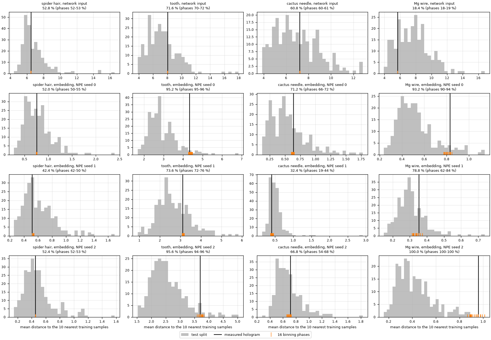
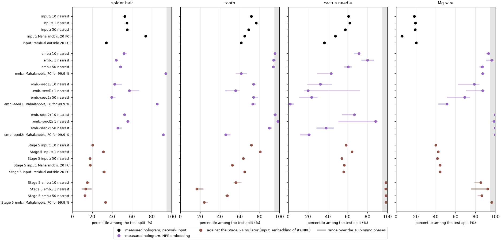
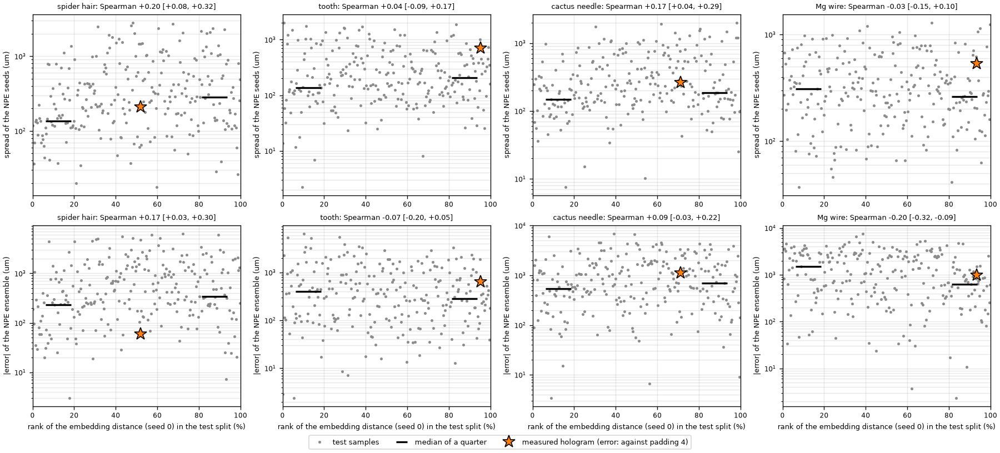
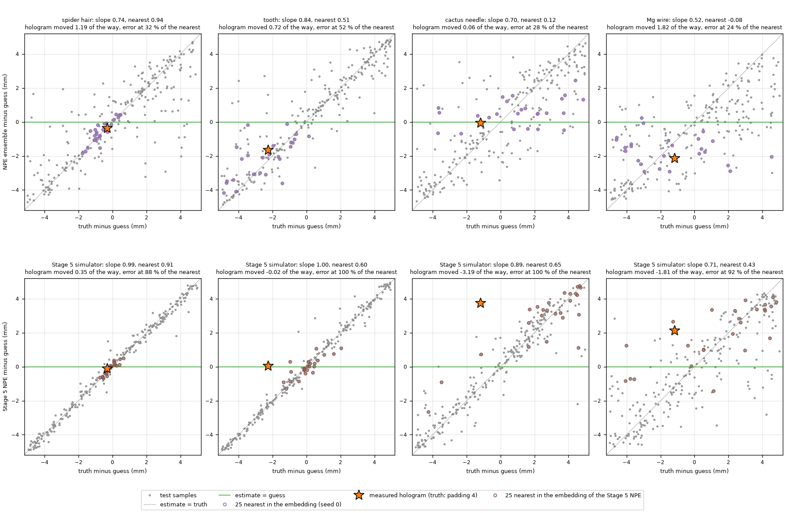
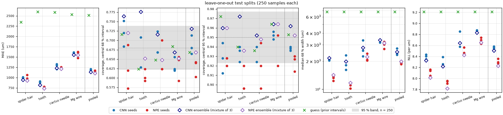
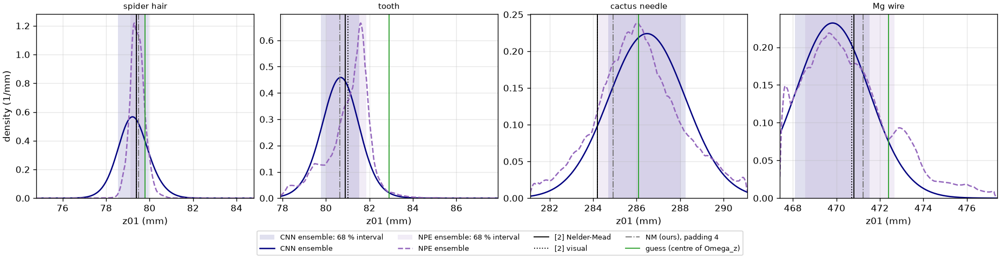
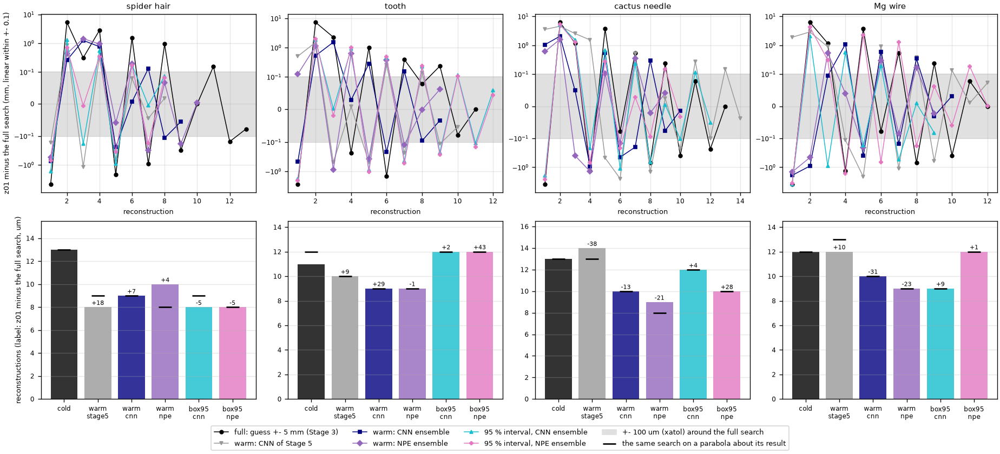

# Laborbuch 08 – Etappe 8: Fehlspezifikation, faire Ensembles und Warmstart auf den Messhologrammen

| | |
|---|---|
| Datum | 22.10.2026 |
| Branch | `cursor/stage8-misspecification-warmstart-1091` |
| Code | `src/holofocus/learned/misspecification.py` (Abstand zu den nächsten Trainings-Samples, Hauptkomponenten, Mahalanobis-Abstand), `GaussianMixture` und `mixture_summaries` in `src/holofocus/learned/posterior.py`, `bounds` und `revisit_tolerance` in `find_focus` und `search_points` (`src/holofocus/autofocus/search.py`); `scripts/run_stage8_study.py` (`sources`, `misspec`, `ensembles`, `warmstart`), `--box`, `--box-level` und `--revisit-tolerance` in `scripts/run_stage3_experiments.py measured`, `scripts/make_stage8_figures.py`; `tests/test_misspecification.py`, Erweiterungen von `tests/test_autofocus.py` und `tests/test_posterior.py` |
| Ergebnisse | `results/misspecification/` (Abstände, Perzentile, Fehler pro Test-Sample, Nachbarschaften, Positivkontrolle), `results/ensembles/` (CNN-Ensemble gegen NPE-Ensemble), `results/measured/{cnn,npe}-loo-ensemble/` (die beiden Ensembles auf den Messhologrammen), `results/measured/{warm,box95}-{cnn,npe}-loo-ensemble-b1-p4/` (die neuen Suchen), `results/measured/warmstart.{json,csv}` |
| Abbildungen | `docs/laborbuch/figures/stage8-*.png`, Zahlen in `stage8-metrics.json` |
| Quellen | [2] Dora et al., Opt. Express 33(4), 6641 (2025); [6] M. Deistler et al., „Simulation-based inference: A practical guide“, arXiv:2508.12939 (2025) |

Kurz: **Fehlspezifikation.** In der Eingabe der Netze liegen die vier Messhologramme beim
6.–77. Perzentil der simulierten Test-Samples ihres Leave-one-out-Satzes, in den Einbettungen
der drei NPEs beim 2.–100. (Zahn bei zwei Seeds beim 95., Mg-Draht bei einem beim 100.). Der
Abstand erklärt das Versagen nicht. Auf den Test-Splits heißt fern in der Einbettung „klar
bestimmt“, nicht „ungewöhnlich“ (mit dem Mahalanobis-Abstand haben ferne Samples kleinere
Fehler, Rangkorrelation −0,24 bis −0,56). Gegen den Simulator von Etappe 5, der für die
Messhologramme nachweislich falsch war, sieht der Abstand in der Eingabe nichts (18.–80.
Perzentil) und der in der Einbettung nur die Kaktusnadel (98.) und den Mg-Draht halb, nicht den
Zahn, bei dem das NPE dieses Simulators 2,3 mm danebenlag. Was ein Hologramm erwarten lässt,
steht in seiner Nachbarschaft in der Einbettung (Rangkorrelation des Fehlers mit dem Mittel
seiner 25 nächsten Test-Samples +0,52 bis +0,67). Danach ist das Versagen auf den
Messhologrammen fehlende Information, kein falscher Simulator: Die Kaktusnadel bleibt beim
Schätzwert, weil es die simulierten Hologramme in ihrer Nähe auch tun (Steigung 0,12, ganzer
Split 0,70), und kein Messhologramm versagt mehr als ein typisches Test-Sample. Gegen seine 25
Nachbarn in der Einbettung versagt jedes Hologramm mit dem Objektmodell gewöhnlich (24.–52.
Perzentil des Fehlers), mit dem Simulator von Etappe 5 schlechter als fast alle (88.–100., Zahn
und Kaktusnadel über allen); das trennt die beiden Simulatoren, braucht aber die Wahrheit.
**Ensembles.** Ensemble gegen Ensemble sind CNN und NPE gleich genau
(MAE über die vier Test-Splits 1138 gegen 1106 µm, gepaart −31 µm [−67, +4]); mehr als die
Hälfte des Vorsprungs aus Etappe 7 war das Mitteln. Das NPE-Ensemble deckt nominal (68 / 95 %:
66,8 / 95,2 %) mit 21 % schmaleren Intervallen, das CNN-Ensemble deckt zu viel (73,1 / 96,2 %).
Auf den Messhologrammen liegt das NPE-Ensemble bei drei Proben näher an Padding 4, das
CNN-Ensemble beim Zahn (29 gegen 624 µm). **Warmstart.** Alle 16 neuen Suchen enden höchstens
43 µm neben der vollen, innerhalb ihrer Toleranz von 100 µm, und keine im Intervall an
seinem Rand. Sie sparen wenig: Über die vier Proben braucht der Warmstart vom NPE-Ensemble 24 %
weniger Rekonstruktionen, der vom CNN-Ensemble 22 %, die Suche im 95-%-Intervall des
NPE-Ensembles 14 % und die im Intervall des CNN-Ensembles 16 % weniger; der Warmstart von
Etappe 5 sparte 10 %. Mit 3 Threads dauern die vier vollen Suchen 169 min, die Warmstarts von
beiden Ensembles je 128 min. Nelder–Mead braucht pro Halbierung der Startbreite im Mittel 1,5
Rekonstruktionen, ein gelerntes Intervall spart deshalb nur mit dem Logarithmus seiner Breite,
und ein Warmstart braucht nie weniger als etwa 9; dieselben 24 Suchen auf einer Parabel
brauchen zusammen genau so viele Rekonstruktionen wie die echten (251), einzeln höchstens zwei
mehr oder weniger.

## 1 Ziel

Drei Fragen aus Etappe 7 (Laborbuch 07, 6 und 9.10), alle auf den Leave-one-out-Sätzen von
Etappe 6 und den Modellen, die Etappe 7 darauf trainiert hat:

1. **Fehlspezifikation** (Laborbuch 07, 6, Punkt 1): Wie weit liegt jedes Messhologramm von
   seinem Leave-one-out-Trainingssatz entfernt, in der Eingabe, die die Netze sehen, und in der
   Einbettung des NPE? Der Abstand wird als Perzentil unter zurückgehaltenen simulierten Samples
   angegeben. Erklärt er, wo die gelernten Schätzungen versagen? Beim Zahn liegen die Mediane
   der drei NPE-Seeds 1,3 mm auseinander, bei der Kaktusnadel bleibt die Schätzung beim
   Schätzwert (Laborbuch 07, 9.7, Punkte 1 und 4).
2. **Fairer Vergleich** (Laborbuch 07, 9.10, Punkt 2): das Ensemble der drei CNN-Seeds gegen
   das Ensemble der drei NPE-Seeds, auf den Leave-one-out-Test-Splits und auf den
   Messhologrammen. In Etappe 7 stand das NPE-Ensemble gegen ein einzelnes CNN; ein Teil seines
   Vorsprungs konnte vom Mitteln kommen.
3. **Warmstart auf den Messhologrammen:** die Suche mit Padding 4, gestartet von der gelernten
   Schätzung, und eine zweite, auf das gelernte 95-%-Intervall beschränkt statt auf
   Schätzwert ± 5 mm, mit beiden Ensembles. Kommt dasselbe heraus wie bei der vollen Suche, und
   wie viel schneller geht es? Was Etappe 5 davon schon gerechnet hat, wird wiederverwendet.

Alles andere steht als offener Punkt in Abschnitt 6. Keiner der drei Teile braucht die GPU
(E14).

## 2 Ausgangslage

Etappe 7 auf dem Objektmodell ist in `main` gemergt
([PR #15](https://github.com/AliTUHH/master_thesis_autofocus/pull/15), Merge-Commit
`7fcaafe`); dieser Branch geht von dort aus. Die Modelle:

- **CNN:** die Leave-one-out-CNNs von Etappe 6, Seed 0 in `results/learned/loo-<probe>`, Seeds 1
  und 2 in `results/objectmodel/seeds/seed-<k>/loo-<probe>` (Laborbuch 06, 5.5), jedes mit einem
  Gauß-Kopf und auf dem Val-Split nachkalibriertem $\hat\sigma$;
- **NPE:** die drei Seeds von Etappe 7, `results/npe-loo/matched-<probe>`, `-seed1`, `-seed2`,
  und ihr Ensemble (Mittel der Dichten, Median als Schätzung; Laborbuch 07, 9.2).

Beide sehen dieselbe Eingabe, bitgleich (Laborbuch 07, E14): das radiale Leistungsspektrum des
4× gebinnten Hologramms nach weiterem 2×-Binning, Hann-Fenster, 1024 Intervalle bis
$f^2 = 0{,}125$, logarithmiert und pro Sample standardisiert. Jeder Leave-one-out-Satz hat 6000
Trainings-, 250 Val- und 250 Test-Samples.

Aus Etappe 7 (Laborbuch 07, 9.5 und 9.7), MAE auf den Test-Splits und Abstände auf den
Messhologrammen in µm, Spinnenhaar / Zahn / Kaktusnadel / Mg-Draht:

| | Spinnenhaar | Zahn | Kaktusnadel | Mg-Draht |
|---|---|---|---|---|
| MAE NPE-Ensemble | 931 | 736 | 1212 | 1547 |
| MAE CNN (Seed 0) | 982 | 880 | 1296 | 1567 |
| MAE Schätzwert | 2349 | 2599 | 2584 | 2535 |
| NPE-Ensemble − Padding 4 | −59 | +624 | +1104 | −960 |
| NPE-Ensemble − Schätzwert | −371 | −1641 | −68 | −2132 |
| Mediane der NPE-Seeds (mm) | 79,439 / 79,664 / 79,246 | 80,299 / 81,439 / 81,580 | 285,942 / 285,810 / 286,310 | 470,751 / 469,696 / 470,305 |

Die Suche mit Padding 4 ist die von Etappe 3 auf dem ungebinnten Hologramm (Laborbuch 03, 5.7,
und Laborbuch 05, 3.5); sie dient hier wie in Etappe 7 als Wahrheit auf den Messhologrammen.
Etappe 5 hat sie kalt und mit einem Warmstart vom passenden CNN von Etappe 5 gerechnet
(Laborbuch 05, 5.3); beides wird hier wiederverwendet, nicht neu gerechnet:

| Probe | $\Omega_z$ (mm) | kalt | Rekonstruktionen | Zeit | Warmstart (Etappe 5) von | Ende | Rekonstruktionen | Zeit |
|---|---|---|---|---|---|---|---|---|
| Spinnenhaar | 74,8–84,8 | 79,4875 | 13 | 45 min | 79,818 | 79,5052 | 8 | 28 min |
| Zahn | 77,9–87,9 | 80,6344 | 11 | 36 min | 81,643 | 80,6433 | 10 | 37 min |
| Kaktusnadel | 281,1–291,1 | 284,9281 | 13 | 45 min | 288,953 | 284,8900 | 14 | 53 min |
| Mg-Draht | 467,4–477,4 | 471,2281 | 12 | 42 min | 473,613 | 471,2383 | 12 | 42 min |

Alle mit 3 Threads auf der VM; der Warmstart der Kaktusnadel enthält eine Rekonstruktion, die
neben der Testsuite lief (405 statt etwa 215 s). Der Warmstart von Etappe 5 sparte zusammen 5
von 49 Rekonstruktionen, weil die Netzschätzungen von Etappe 5 bei drei Proben 1,0–4,0 mm neben
dem Minimum lagen (Laborbuch 05, 5.3, Punkt 2). Die Schätzungen der beiden Ensembles liegen
näher an Padding 4, 0,03–1,55 mm (5.5), die von Etappe 5 0,33–4,02 mm.

## 3 Was gemacht wurde

### 3.1 Suche in gegebenen Grenzen (`15a6bb4`)

`find_focus` (`src/holofocus/autofocus/search.py`) nimmt zwei neue Argumente:

- `bounds = (lower, upper)` ersetzt $\Omega_z = $ Schätzwert ± 5 mm als Suchintervall: Der
  Anfangssimplex liegt an seinen Enden (oder ist mit `initial_simplex` gegeben und muss darin
  liegen), und die Versuchspunkte werden auf es projiziert, wie sonst auf $\Omega_z$.
- `revisit_tolerance`: Ein Versuchspunkt, der höchstens so weit von einem früheren entfernt
  ist, zählt als Wiederholung und gibt den Strafwert zurück, ohne Rekonstruktion. Bisher (0)
  erkannte die Suche nur bitgleiche Wiederholungen, wie der Code von [2].

`run_stage3_experiments.py measured` bekommt `--box DIR` (das zentrale Intervall
`intervals[<level>]` aus `DIR/<probe>.json`, geschnitten mit $\Omega_z$, als Suchintervall),
`--box-level` (Vorgabe 95) und `--revisit-tolerance`; der Datensatz eines Laufs hält Quelle,
SHA-256, Intervall und Grenzen fest. Alles andere ist wie bei `b1-p4`: ungebinntes Hologramm,
Padding 4, ASRM mit dem Plan von [2] Table 3, Nelder–Mead mit Abbruch bei 100 µm Simplexlänge.

### 3.2 Das Ensemble der CNNs (`15a6bb4`, `901c04e`)

`GaussianMixture` (`src/holofocus/learned/posterior.py`) ist die Mischung gleich gewichteter
Gauß-Dichten, pro Hologramm eine pro Seed mit $\hat\mu$ und nachkalibriertem $\hat\sigma$; daraus
Median (Punktschätzung, wie beim NPE), Mittelwert und Standardabweichung, zentrale Intervalle
über die Verteilungsfunktion, HPD-Breiten und HPD-Niveaus und die Dichte auf dem Gitter von
2001 Punkten über $\Omega_z$, wie beim NPE (`mixture_summaries`). Mit einem Seed ist sie die
Gauß-Dichte des CNN.

`run_stage8_study.py sources` schreibt beide Ensembles auf den Messhologrammen nach
`results/measured/cnn-loo-ensemble/<probe>.json` und `npe-loo-ensemble/<probe>.json`, mit
Median, zentralen Intervallen, HPD-Breiten, Gipfeln, den Abständen zu [2] und Padding 4 und den
16 Binning-Phasen. Das CNN-Ensemble entsteht aus den versionierten Schätzungen der drei Seeds
(`results/measured/cnn-loo` und `results/objectmodel/seeds/seed-<k>/measured`), das
NPE-Ensemble ist aus `results/npe-loo/measured` übernommen. Diese Dateien sind die Quellen der
Warmstarts und der Intervalle.

### 3.3 Abstände (`e7bec24`)

`src/holofocus/learned/misspecification.py` hat zwei Abstände eines Punktes zu den
Trainingspunkten, in einem beliebigen Raum:

- `knn_distance`: der mittlere euklidische Abstand zu den $k$ nächsten Trainingspunkten, ohne
  Modell der Verteilung;
- `PrincipalComponents`: die Hauptkomponenten der Trainingspunkte, der Mahalanobis-Abstand in
  den ersten von ihnen und der RMS des Restes außerhalb.

Gerechnet wird in zwei Räumen (E1): in der **Eingabe** der Netze (1024 Werte, für CNN und NPE
dieselbe) und in der **Einbettung** jedes der drei NPE-Seeds (32 Merkmale, die Eingabe des
Flusses). Maße (E2, E3): der Abstand zu den 10 nächsten Trainings-Samples als Hauptmaß, zu dem
nächsten und zu den 50 nächsten als Prüfung; der Mahalanobis-Abstand in den ersten 20
Hauptkomponenten der Eingabe (59–66 % ihrer Varianz) mit dem RMS des Restes, in der Einbettung
in so vielen Hauptkomponenten, wie 99,9 % der Varianz tragen (8–24). Den Maßstab gibt der
Test-Split (E4): das Perzentil des Hologramms unter den Abständen der 250 Test-Samples zum selben
Trainingssatz (Gleichstände zählen halb). Das Hologramm geht 4× gebinnt ein wie in Etappe 7,
dazu seine 16 Binning-Phasen (E5).

### 3.4 Was versagt, und die Nachbarschaften (`e7bec24`, `66df569`, `3360b1a`, `3e94af6`)

`run_stage8_study.py misspec` nimmt pro Test-Sample drei Größen für „Versagen“ (E6), für jedes
der beiden Ensembles: den Betrag des Fehlers, die Breite des 95-%-Intervalls und die
Standardabweichung der Schätzungen der drei Seeds. Dazu, pro Raum und Maß:

1. **Abstand und Versagen auf dem Test-Split:** die Rangkorrelation (Spearman) des Abstands mit
   jeder der drei Größen, mit Bootstrap-Intervall (2000 Ziehungen), und die mittlere Größe im
   nächsten und im fernsten Viertel.
2. **Das Hologramm:** dieselben drei Größen, mit Padding 4 als Wahrheit, als Perzentile unter
   dem Test-Split.
3. **Die Nachbarschaft des Hologramms:** die 25 Test-Samples, die ihm im jeweiligen Raum am
   nächsten liegen (euklidisch, E7). Für sie: MAE, Median der Breiten und der Streuung der
   Seeds, Überdeckung, Median der Verschiebung der Schätzung vom Schätzwert und die Steigung
   dieser Verschiebung gegen den wahren Abstand vom Schätzwert (1: die Schätzung folgt der
   Wahrheit, 0: sie bleibt beim Schätzwert). Dazu die Perzentile der Größen des Hologramms
   unter seinen 25 Nachbarn.
4. **Sagt eine Nachbarschaft das Versagen voraus?** Pro Test-Sample das Mittel jeder Größe über
   seine 25 nächsten anderen Test-Samples, und dessen Rangkorrelation mit der Größe des Samples
   selbst. Das prüft auf simulierten Daten, ob der Schluss aus Punkt 3 trägt.

### 3.5 Positivkontrolle (`66df569`, `08f9363`)

Mit `--control results/npe` rechnet `misspec` dieselben Abstände des Hologramms noch einmal
gegen den Simulator von Etappe 5: zu den Trainings-Samples von `data/matched-<probe>`, in der
Eingabe und in der Einbettung des NPE, das Etappe 7 darauf trainiert hat
(`results/npe/matched-<probe>`, Laborbuch 07, 5.7), als Perzentile unter dessen Test-Split.
Dazu derselbe Blick wie in 3.4, Punkte 2 und 3 (`08f9363`): das Versagen dieses NPE auf seinem
Test-Split und auf dem Hologramm und die 25 nächsten Test-Samples des Hologramms in der Eingabe
und in seiner Einbettung. Mit diesem Simulator lagen die gelernten Schätzungen 0,29–5,64 mm
über [2]; er war für die Messhologramme nachweislich falsch (E8).

### 3.6 Die Ensembles verglichen (`e7bec24`)

`run_stage8_study.py ensembles` rechnet auf den vier Leave-one-out-Test-Splits pro Sample die
Mischung der drei CNN-Seeds (3.2) und stellt sie neben die drei CNN-Seeds, die drei NPE-Seeds,
das NPE-Ensemble und den Schätzwert mit den Intervallen des Priors (Laborbuch 07, E13): MAE,
Median des Betrags, Anteil innerhalb 100 µm, Bias, Überdeckung der zentralen 68- und
95-%-Intervalle, mittlere Breiten, NLL, KS-Test der PIT-Werte und die Rangkorrelation von Breite
und Fehler, pro Probe und über die vier Proben zusammen (1000 Samples). Paare mit
Bootstrap-Intervallen: NPE-Ensemble gegen CNN-Ensemble, jedes Ensemble gegen seinen Seed 0 und
die beiden Seeds 0 gegeneinander (`results/ensembles/`). Auf den Messhologrammen: die beiden
Ensembles aus 3.2 mit [2] und Padding 4.

### 3.7 Die Suchen

Vier neue Suchen pro Probe, alle mit Padding 4 auf dem ungebinnten Hologramm und mit
`--revisit-tolerance 1e-9` (E11):

| Variante | Verzeichnis unter `results/measured/` | Start |
|---|---|---|
| warm, CNN-Ensemble | `warm-cnn-loo-ensemble-b1-p4` | Median ± 0,5 mm, in $\Omega_z$ |
| warm, NPE-Ensemble | `warm-npe-loo-ensemble-b1-p4` | Median ± 0,5 mm, in $\Omega_z$ |
| 95 %, CNN-Ensemble | `box95-cnn-loo-ensemble-b1-p4` | Enden des 95-%-Intervalls ∩ $\Omega_z$, das auch die Grenzen sind |
| 95 %, NPE-Ensemble | `box95-npe-loo-ensemble-b1-p4` | ebenso |

Die Intervalle, in mm (Breite in Klammern); das kalte Ergebnis liegt in allen acht:

| Probe | 95 %, CNN-Ensemble | 95 %, NPE-Ensemble |
|---|---|---|
| Spinnenhaar | 77,826–80,772 (2,95) | 78,781–80,184 (1,40) |
| Zahn | 78,834–82,439 (3,61) | 78,595–82,634 (4,04) |
| Kaktusnadel | 282,954–289,988 (7,03) | 282,251–290,122 (7,87) |
| Mg-Draht | 467,400–473,247 (5,85; unten auf $\Omega_z$ geschnitten) | 467,636–475,433 (7,80) |

Die Suchen liefen in zwei Lanes nebeneinander (E13): Lane A mit 3 Threads (warm NPE, 95 % NPE,
warm CNN, nacheinander; zwischen den beiden letzten `misspec` mit der Positivkontrolle und
`ensembles`, ebenfalls mit 3 Threads), Lane B mit einem Thread (95 % CNN). Die Suchen liefen aus
einem Worktree mit dem Stand `901c04e`, damit die Arbeit am Repo sie nicht änderte; jede ihrer
Ergebnisdateien nennt diesen Commit. `run_stage8_study.py warmstart` stellt alle sechs Suchen pro Probe nebeneinander
(die kalte und die von Etappe 5 dazu) und schreibt `results/measured/warmstart.{json,csv}`.

Um die Zahl der Rekonstruktionen zu erklären, rechnet `warmstart` jede Suche noch einmal auf
der Parabel um ihr Ergebnis (`4b8ba53`, E15): `search_points` (`search.py`) gibt die Punkte, die
`find_focus` bei einer gegebenen MFE-Kurve abfragt, ohne zu rekonstruieren. Beide teilen sich
das Intervall in Millimetern, den Start, die Regel für Wiederholungen und den Aufruf von
Nelder–Mead, und `search_points` bekommt dieselben Eingaben wie die Suche: Schätzwert,
Intervall, Anfangssimplex und Toleranz aus dem Datensatz. Dazu die Rekonstruktionen auf einer
Parabel gegen die Breite des Startintervalls (Minimum an 97 Stellen darin) und gegen den Abstand
eines Warmstarts vom Minimum (`parabola` in `warmstart.json`). Zum Vergleich zählt `warmstart`
die Auswertungen von Brents Verfahren in Grenzen auf Modellkurven aus denselben Intervallen
(`brent`) und passt an die Punkte aller Suchen einer Probe mit der Threadzahl der vollen Suche
den Anstieg der MFE vom Minimum an (`curves`; `1969a01`, 5.6, Punkt 9, und 7, Punkt 1).

### 3.8 Tests

`tests/test_misspecification.py` (4 Tests): der Abstand zu den nächsten Punkten auf einem
kleinen Satz von Hand und in Stücken gegen die direkte Rechnung; Hauptkomponenten,
Mahalanobis-Abstand und Rest einer achsenparallelen Gauß-Verteilung mit bekannten Varianzen;
Punkte auf einer Ebene, deren Rang die Zahl der Komponenten begrenzt; Fehler bei falschen
Eingaben. In `tests/test_autofocus.py` (3 Tests): die Suche in gegebenen Grenzen (Start an ihren
Enden, alle Punkte darin, das Minimum mit weniger Rekonstruktionen als kalt, ein Intervall ohne
das Minimum endet an seinem Rand, ein Warmstart darin), die Toleranz für Wiederholungen (ein
Punkt, der sich im letzten Bit unterscheidet, wird ohne Toleranz neu rekonstruiert, mit 1 nm
nicht) und `search_points` gegen `find_focus` mit einer Modellkurve statt der Rekonstruktion,
kalt, im Intervall und mit zwei Warmstarts: dieselben Punkte in derselben Reihenfolge, mit
denselben Wiederholungen, und mit der Wurzel des Abstands dieselben wie mit der Parabel. Ein
erster Entwurf nahm das Intervall der Suche in Metern und rechnete es in Millimeter um; dabei
wich das obere Ende von $\Omega_z$ im letzten Bit ab (105,00000000000001 statt 105 mm), und eine
Wiederholung wurde rekonstruiert. Deshalb rechnen beide das Intervall mit derselben Funktion.
In `tests/test_posterior.py` (2 Tests): Die Mischung aus einem Glied ist die Gauß-Dichte; die
Mischung aus zwei Gliedern gegen Median, Standardabweichung, Quantile, Dichte, HPD-Niveaus und
-Breiten, die Fassung auf dem Gitter und die Zusammenfassung. Die CI rechnet `misspec` und
`ensembles` auf den NPE-Läufen ihres Schritts für Etappe 7, dazu `ensembles`, `warmstart` und
alle Abbildungen aus den versionierten Ergebnissen.

363 Tests bestehen, einer wird übersprungen (nur CUDA); `ruff` ist sauber. In `main`
(`7fcaafe`) waren es 352; ein Test in `tests/test_autofocus.py` läuft mit vier Fällen.

## 4 Entscheidungen und Begründung

**E1 – Zwei Räume.** Die Eingabe ist für CNN und NPE dieselbe und hängt an keinem Modell: Ein
Abstand dort sagt, ob das Hologramm für den Simulator ungewöhnlich ist, unabhängig davon, was ein
Netz daraus macht. Die Einbettung ist das, was der Fluss sieht; [6] nennt Ausreißer im Raum der
Einbettung als Prüfung auf Fehlspezifikation (Sec. 3.4). Sie ist gelernt und hängt am Seed,
deshalb jede der drei.

**E2 – Der Abstand zu den 10 nächsten Trainings-Samples als Hauptmaß.** Er braucht kein Modell
der Verteilung und folgt ihrer lokalen Dichte, auch wenn die Trainingspunkte auf einer
gekrümmten Fläche liegen. Mit $k = 1$ hängt er an einzelnen Samples, mit $k = 50$ mittelt er
über einen größeren Teil des Satzes; beide laufen als Prüfung mit.

**E3 – Mahalanobis in wenigen Komponenten.** Die standardisierte Eingabe hat Rang 1023
(Mittelwert 0 und Varianz 1 pro Sample), und 90 % ihrer Varianz verteilen sich auf 222–377
Komponenten. Eine volle Kovarianz aus 6000 Samples würde in den schwachen Richtungen vom
Rauschen bestimmt. Die ersten 20 Komponenten fassen die groben Formen des Spektrums (59–66 % der
Varianz), der RMS des Restes alles andere. Die Einbettungen nutzen von ihren 32 Merkmalen
15–25 Richtungen (beim Zahn alle 32); 8–24 Komponenten tragen 99,9 % ihrer Varianz, 90 % schon
zwei (beim Zahn sechs).

**E4 – Der Test-Split als Maßstab.** Kein Abstand hat eine eigene Skala. Die 250 Test-Samples
stammen aus demselben Simulator, und kein Netz hat sie gesehen; ihr Abstand zum Trainingssatz
ist, was ein passendes, neues Hologramm hätte. Perzentil 50 heißt: so typisch wie ein simuliertes
Hologramm; 100: weiter weg als jedes.

**E5 – Binning-Phasen.** Die 16 Phasen des 4×-Binnings verschieben das Gitter um ganze native
Pixel (Laborbuch 07, 5.7). Hängt das Perzentil an ihnen, misst es die Abtastung, nicht das
Hologramm.

**E6 – Was „Versagen“ heißt.** Auf dem Test-Split ist die Wahrheit bekannt; auf den
Messhologrammen nehme ich Padding 4 als Wahrheit wie in Etappe 7. Die Breite des 95-%-Intervalls
und die Streuung der drei Seeds brauchen keine Wahrheit; die Streuung ist die Größe, die beim Zahn
auffiel.

**E7 – 25 Nachbarn.** 10 % eines Test-Splits: genug für Mittelwerte und eine Steigung, und doch
eine Gegend, nicht der ganze Satz. Euklidisch im Raum selbst, ohne Hauptkomponenten, damit die
Nachbarschaft nicht an einer Wahl der Komponenten hängt.

**E8 – Eine Positivkontrolle.** Ein unauffälliges Perzentil sagt nur dann etwas, wenn das Maß
eine Fehlspezifikation anzeigt, von der man weiß, dass sie da ist. Der Simulator von Etappe 5 ist
so ein Fall: Mit ihm lagen die Schätzungen bis zu 5,6 mm daneben, und Etappe 6 hat gezeigt, dass
das am Objektmodell lag (Laborbuch 06, 5.5). Dasselbe Maß gegen ihn muss das Hologramm weit
draußen sehen, sonst ist es für diese Art Fehlspezifikation blind.

**E9 – Das CNN-Ensemble als Mischung.** Wie beim NPE (Laborbuch 07, E7 und E12) ist das Ensemble
die Mischung der Dichten der drei Seeds und seine Schätzung ihr Median. Die Mischung nehme ich
so, wie sie aus den nachkalibrierten Seeds entsteht, ohne sie noch einmal nachzukalibrieren:
Verglichen werden die beiden Rezepte, nicht zwei nachträglich angepasste Ergebnisse.

**E10 – Etappe 5 wiederverwenden.** Die kalte Suche (`b1-p4`) und der Warmstart vom CNN von
Etappe 5 (`warm-b1-p4`) sind gerechnet, mit demselben Code der Suche und mit 3 Threads
(Laborbuch 05, 5.3). Ich rechne sie nicht neu; neu sind nur die Starts von den Ensembles und die
Suchen im 95-%-Intervall.

**E11 – Wiederholungen bis 1 nm.** Beim Warmstart von Etappe 5 rechneten Zahn und Mg-Draht je
einen Punkt zweimal, den der Simplex auf zwei Wegen erreichte, die sich in den letzten Bits
unterschieden (Laborbuch 05, 5.3, Punkt 2). Die Toleranz von 1 nm fängt das ab und ändert sonst
nichts: Die Suche bricht bei 100 µm Simplexlänge ab und kommt einem früheren Punkt nie auf 1 nm
nahe, ohne ihn zu wiederholen. Die kalte Suche lief ohne Toleranz; `warmstart` zählt deshalb
bei allen Suchen auch die verschiedenen Punkte.

**E12 – „Dasselbe Ergebnis“ heißt höchstens 100 µm daneben.** Das ist die Toleranz der Suche
(`xatol`): Näher beieinander liegende Ergebnisse unterscheidet sie nicht. Dazu der MFE am Ende,
relativ zum kleinsten der sechs Suchen.

**E13 – Zeit: Rekonstruktionen zählen, Sekunden mit Lane.** Fast die ganze Zeit einer Suche sind
ihre Rekonstruktionen (etwa 210 s mit 3 Threads); ihre Zahl hängt nicht an der Maschine. Nach der
Regel der VM (4 Kerne: 3 Threads neben höchstens einem Lauf mit einem Thread) liefen die vier
Suchen in zwei Lanes; so laufen auch die kalten Suchen von Etappe 3 und 5. Die Zeiten der Lane
mit 3 Threads sind direkt vergleichbar; die der Lane mit einem Thread rechne ich mit der Rate der
kalten Suche derselben Probe um (`seconds_at_cold_rate`).

**E14 – Keine GPU.** Die Abstände kosten Minuten, der Vergleich der Ensembles Sekunden, die 16
Suchen 26,6 Kernstunden auf der VM (5.7). Nichts davon braucht Maxwell; `docs/maxwell-gpu.md`
bleibt unverändert. Was die GPU sinnvoll machen würde, steht in Abschnitt 6 (Punkt 1).

**E15 – Eine Parabel als Modell der Suche.** Nelder–Mead vergleicht nur Funktionswerte, und
die Suche bricht nur an der Länge des Simplex ab ($f_\text{atol} = 10^6$). Auf jeder Kurve, die
um ihr Minimum symmetrisch ist und nach beiden Seiten steigt, fragt sie deshalb dieselben
Punkte ab wie auf der Parabel um dieses Minimum. Die Parabel trennt so, was an der Geometrie
liegt (Breite und Lage des Starts, Lage des Minimums), von dem, was an der Form der MFE-Kurve
liegt: Wo die echte Suche anders läuft, entscheidet die Asymmetrie der Kurve oder ihr Rauschen.

## 5 Ergebnisse

### 5.1 Wo die Messhologramme liegen

*Abb. 1 – Mittlerer Abstand zu den 10 nächsten Trainings-Samples für die 250 Test-Samples
(Histogramm) und das Messhologramm (Linie) mit seinen 16 Binning-Phasen (Striche), in der Eingabe
der Netze (oben) und in der Einbettung der drei NPE-Seeds, pro Probe; im Titel das Perzentil des
Hologramms und die Spanne über die Phasen.*

*Abb. 2 – Perzentile der Messhologramme unter dem Test-Split für alle Maße (Punkt) und ihre
Spanne über die 16 Binning-Phasen (Balken): Eingabe (schwarz), Einbettung der drei NPE-Seeds
(violett) und die Positivkontrolle gegen den Simulator von Etappe 5 (braun, 5.3); grau: über
95 %.*

`results/misspecification/<probe>.json` und `summary.csv`. Perzentil des Hologramms unter den
250 Test-Samples, in Klammern die Spanne über die 16 Binning-Phasen; „Einbettung“ mit den Seeds
0 / 1 / 2:

| Probe | Eingabe, 10 nächste | Eingabe, Mahalanobis (20) | Eingabe, Rest | Einbettung, 10 nächste | Einbettung, Mahalanobis |
|---|---|---|---|---|---|
| Spinnenhaar | 52,8 (52,4–52,8) | 73,6 | 34,0 | 52,0 / 42,4 / 52,4 | 94,0 / 85,2 / 91,6 |
| Zahn | 71,6 (70,4–71,6) | 64,8 | 61,2 | 95,2 / 73,6 / 95,6 | 61,2 / 72,8 / 45,6 |
| Kaktusnadel | 60,8 (60,4–61,2) | 47,6 | 36,4 | 71,2 / 32,4 / 66,8 | 43,2 / 2,0 / 20,8 |
| Mg-Draht | 18,4 (18,4–18,8) | 6,0 | 20,4 | 93,2 / 78,8 / 100 | 87,2 / 51,2 / 100 |

1. **In der Eingabe liegt kein Hologramm am Rand.** Mit jedem Maß liegen die vier Hologramme
   zwischen dem 6. und dem 77. Perzentil. Der Mg-Draht liegt dem Trainingssatz näher als 82 %
   der Test-Samples (Mahalanobis: als 94 %). Für den Simulator mit Objektmodell sind die
   Spektren der Messhologramme gewöhnlich.
2. **In der Einbettung fallen Zahn und Mg-Draht auf, aber nicht bei jedem Seed.** Beim Zahn
   liegen die Seeds 0 und 2 beim 95. Perzentil (Abstand 4,33 bei einem 95. Perzentil des
   Test-Splits von 4,27, Seed 2: 3,70 gegen 3,64), Seed 1 beim 74. Beim Mg-Draht liegt die
   Einbettung von Seed 2 weiter weg als jedes Test-Sample (0,959 gegen höchstens 0,891,
   Mahalanobis 6,24 gegen 5,50), Seed 0 beim 93. und Seed 1 beim 79. Perzentil. Spinnenhaar und
   Kaktusnadel liegen in der Einbettung beim 32.–71. Perzentil.
3. **Die Binning-Phasen ändern daran nichts.** In der Eingabe überdecken die 16 Phasen mit
   jedem Maß höchstens 2 Perzentilpunkte. In der Einbettung (10 nächste) sind es bei Spinnenhaar
   und Zahn höchstens 7 Punkte, bei Kaktusnadel und Mg-Draht mit Seed 1 bis zu 25 (19,2–44,0 und
   62,4–84,0): Dort reagiert die Einbettung auf die Abtastung. Punkt 2 hängt nicht daran: Beim
   Zahn bleiben die Seeds 0 und 2 mit allen Phasen über dem 93. Perzentil (94,8–96,0 und
   93,6–96,4), Seed 2 beim Mg-Draht beim 99,6.–100.
4. **Die Maße sind sich nicht einig.** Mit Mahalanobis liegt das Spinnenhaar in der Einbettung
   beim 85.–94. Perzentil, die Kaktusnadel bei Seed 1 beim 2. Was ein Abstand in der Einbettung
   bedeutet, zeigt erst 5.2.

### 5.2 Erklären die Abstände, wo die Schätzungen versagen?

*Abb. 3 – Auf den Test-Splits: Streuung der drei NPE-Seeds (oben) und Fehlerbetrag des
NPE-Ensembles (unten) gegen den Rang des Abstands in der Einbettung von Seed 0 (10 nächste),
mit dem Median des nächsten und des fernsten Viertels (Striche) und dem Messhologramm (Stern;
Fehler gegen Padding 4); im Titel die Rangkorrelation mit Bootstrap-Intervall.*

*Abb. 4 – Verschiebung des NPE-Ensembles vom Schätzwert gegen den wahren Abstand vom Schätzwert
auf den Test-Splits (grau), die 25 Test-Samples, die dem Hologramm in der Einbettung von Seed 0
am nächsten liegen (violette Kreise), und das Hologramm (Stern, Wahrheit Padding 4); im Titel
die Steigung auf dem ganzen Split und unter den Nachbarn, der Anteil des Weges zu Padding 4,
den das Ensemble auf dem Hologramm zurücklegt, und das Perzentil seines Fehlers unter den
Nachbarn. Unten dasselbe für das NPE der Positivkontrolle auf dem Test-Split des Simulators von
Etappe 5, mit den 25 Nachbarn in seiner Einbettung (braune Kreise; 5.3).*

**Abstand und Versagen auf dem Test-Split.** Rangkorrelation des Abstands zu den 10 nächsten
Trainings-Samples (Einbettung: Seed 0) und des Mahalanobis-Abstands in der Einbettung mit den
Größen des NPE-Ensembles, in Klammern das 95-%-Bootstrap-Intervall:

| Probe | Eingabe: Fehler | Eingabe: Streuung | Eingabe: Breite 95 % | Einbettung: Fehler | Einbettung: Streuung | Einbettung, Mahalanobis: Fehler | Einbettung, Mahalanobis: Breite 95 % |
|---|---|---|---|---|---|---|---|
| Spinnenhaar | +0,19 [+0,06, +0,31] | +0,29 | +0,24 | +0,17 [+0,03, +0,30] | +0,20 | −0,24 [−0,37, −0,12] | −0,29 |
| Zahn | +0,09 [−0,03, +0,21] | +0,15 | +0,16 | −0,07 [−0,20, +0,05] | +0,04 | −0,51 [−0,60, −0,40] | −0,73 |
| Kaktusnadel | +0,37 [+0,25, +0,49] | +0,42 | +0,49 | +0,09 [−0,03, +0,22] | +0,17 | −0,30 [−0,42, −0,18] | −0,39 |
| Mg-Draht | +0,45 [+0,34, +0,54] | +0,50 | +0,59 | −0,20 [−0,32, −0,09] | −0,03 | −0,33 [−0,43, −0,22] | −0,49 |

1. **In der Eingabe gehen Abstand und Versagen zusammen.** Bei allen vier Proben haben die
   Test-Samples, die weit vom Trainingssatz liegen, größere Fehler, breitere Intervalle und
   uneinigere Seeds; im fernsten Viertel ist der mittlere Fehler 1,5- bis 2,6-mal so groß wie im
   nächsten (Spinnenhaar 657 gegen 1524 µm, Mg-Draht 893 gegen 2357 µm). Beim CNN-Ensemble ist es
   dasselbe (Fehler +0,13 bis +0,43).
2. **In der Einbettung ist es umgekehrt: Fern heißt informativ.** Mit dem Mahalanobis-Abstand
   haben die fernen Test-Samples bei allen Proben und allen Seeds *kleinere* Fehler und
   schmalere Intervalle (Fehler −0,24 bis −0,56, Breite −0,29 bis −0,77); beim Zahn ist der
   mittlere Fehler im fernsten Viertel 241 µm, im nächsten 1497 µm. Mit den 10 nächsten ist die
   Korrelation schwach und wechselt das Vorzeichen (Fehler −0,20 bis +0,17). Die Einbettung legt
   die Hologramme, aus denen der Fluss wenig über $z_{01}$ erfährt, in die Mitte, wo er eine
   breite Posterior um den Schätzwert ausgibt, und zieht die informativen entlang von $z_{01}$
   auseinander. Ein großer Abstand in der Einbettung heißt auf simulierten Daten also „klar
   bestimmt“, nicht „ungewöhnlich“, und der Test-Split kann ihm keine Skala für Fehlspezifikation
   geben. Die hohen Perzentile von Zahn und Mg-Draht in 5.1 sagen deshalb allein nicht, dass dort
   etwas versagt.

**Das Versagen auf den Messhologrammen.** Mit Padding 4 als Wahrheit; Perzentile unter dem
Test-Split, NPE-Ensemble und in Klammern CNN-Ensemble. „Anteil des Weges“: Verschiebung der
Schätzung vom Schätzwert geteilt durch Padding 4 minus Schätzwert (1: bis Padding 4, 0: beim
Schätzwert):

| Probe | Padding 4 − Schätzwert | Schätzung − Padding 4 | Perzentil | Streuung der Seeds | Perzentil | Breite 95 % | Perzentil | Anteil des Weges |
|---|---|---|---|---|---|---|---|---|
| Spinnenhaar | −312 µm | −59 (−243) µm | 9,6 (26,8) | 209 (155) µm | 41,6 (16,0) | 1403 (2946) µm | 16,4 (20,0) | 1,19 (1,78) |
| Zahn | −2266 µm | +624 (+29) µm | 66,4 (4,0) | 703 (67) µm | 83,2 (5,2) | 4039 (3605) µm | 70,4 (34,4) | 0,72 (0,99) |
| Kaktusnadel | −1172 µm | +1104 (+1549) µm | 62,0 (72,8) | 259 (230) µm | 58,0 (25,2) | 7871 (7034) µm | 77,6 (67,2) | 0,06 (−0,32) |
| Mg-Draht | −1172 µm | −960 (−1406) µm | 48,4 (55,2) | 530 (187) µm | 76,8 (16,4) | 7797 (6886) µm | 57,6 (51,6) | 1,82 (2,20) |

3. **Kein Messhologramm versagt mehr als ein typisches simuliertes.** Die Fehler der Ensembles
   liegen beim 4.–73. Perzentil der Test-Splits, die Breiten beim 16.–78., die Streuungen beim
   5.–83. Am auffälligsten ist die Streuung der NPE-Seeds beim Zahn (83. Perzentil, über alle
   16 Binning-Phasen 0,68 mm im Median).

**Die Nachbarschaften.** Die 25 Test-Samples, die dem Hologramm in der Einbettung von Seed 0 am
nächsten liegen, in Klammern die 25 nächsten in der Eingabe; Größen des NPE-Ensembles (Mediane von
Breite und Streuung, Überdeckung der 68- und 95-%-Intervalle) und die Steigung der Verschiebung
gegen die Wahrheit (ganzer Test-Split: 0,74 / 0,84 / 0,70 / 0,52):

| Probe | MAE | Steigung | Breite 95 % | Streuung | Überdeckung 68 / 95 % | Wahrheit − Schätzwert, Median |
|---|---|---|---|---|---|---|
| Spinnenhaar | 230 (550) µm | 0,94 (0,90) | 1313 (2005) µm | 140 (137) µm | 76 / 100 (64 / 88) % | −765 (−1062) µm |
| Zahn | 889 (471) µm | 0,51 (0,95) | 4685 (2561) µm | 513 (165) µm | 68 / 100 (72 / 96) % | −2402 (−1415) µm |
| Kaktusnadel | 2005 (1233) µm | 0,12 (0,73) | 8268 (4465) µm | 483 (213) µm | 56 / 96 (60 / 96) % | +1204 (+1378) µm |
| Mg-Draht | 2188 (1132) µm | −0,08 (0,55) | 8616 (5304) µm | 345 (176) µm | 56 / 92 (68 / 92) % | −1819 (−2768) µm |

Perzentile des Hologramms unter seinen 25 Nachbarn, NPE-Ensemble, Fehler / Streuung /
Verschiebung vom Schätzwert:

| Probe | Nachbarn in der Einbettung (Seed 0) | Nachbarn in der Eingabe |
|---|---|---|
| Spinnenhaar | 32 / 68 / 64 | 16 / 56 / 64 |
| Zahn | 52 / 80 / 60 | 84 / 88 / 52 |
| Kaktusnadel | 28 / 12 / 24 | 56 / 64 / 44 |
| Mg-Draht | 24 / 68 / 28 | 64 / 88 / 60 |

**Sagt eine Nachbarschaft das Versagen voraus?** (3.4, Punkt 4) Rangkorrelation der Größe
jedes Test-Samples mit ihrem Mittel über seine 25 nächsten anderen Test-Samples, NPE-Ensemble,
beim Fehler mit 95-%-Bootstrap-Intervall:

| Probe | Eingabe: Fehler | Eingabe: Streuung | Eingabe: Breite 95 % | Einbettung (Seed 0): Fehler | Einbettung: Streuung | Einbettung: Breite 95 % |
|---|---|---|---|---|---|---|
| Spinnenhaar | +0,47 [+0,37, +0,56] | +0,57 | +0,73 | +0,67 [+0,59, +0,74] | +0,72 | +0,96 |
| Zahn | +0,23 [+0,11, +0,34] | +0,26 | +0,42 | +0,56 [+0,47, +0,63] | +0,70 | +0,93 |
| Kaktusnadel | +0,56 [+0,47, +0,65] | +0,57 | +0,84 | +0,57 [+0,47, +0,65] | +0,62 | +0,96 |
| Mg-Draht | +0,51 [+0,42, +0,60] | +0,50 | +0,86 | +0,52 [+0,43, +0,61] | +0,59 | +0,98 |

4. **Die Nachbarschaft in der Einbettung sagt das Versagen voraus, der Abstand nicht.** Mit
   den Einbettungen der Seeds 1 und 2 ist es dasselbe (Fehler +0,55 bis +0,66), beim
   CNN-Ensemble auch (Fehler +0,50 bis +0,65). Die Nachbarschaft in der Eingabe sagt weniger,
   beim Zahn fast nichts (Fehler +0,23, Streuung +0,26). Der Abstand zu den 10 nächsten
   Trainings-Samples geht mit dem Fehler nur schwach zusammen (−0,20 bis +0,45, erste
   Tabelle). Was ein Hologramm erwarten lässt,
   steht also in seiner Nachbarschaft in der Einbettung, nicht in seinem Abstand vom
   Trainingssatz. Das gilt für simulierte Hologramme; ob es auch für ein Hologramm gilt, das
   der Simulator falsch beschreibt, prüft 5.3.
5. **Kaktusnadel: Das Spektrum sagt wenig, das Hologramm ist nicht falsch.** Ihr Hologramm ist in
   beiden Räumen gewöhnlich, und dass die Schätzung beim Schätzwert bleibt (Anteil des Weges 0,06,
   CNN −0,32), tun auch die simulierten Hologramme in seiner Nähe: Unter den 25 Nachbarn in der
   Einbettung folgen die Schätzungen der Wahrheit mit der Steigung 0,12 (ganzer Split 0,70), die
   Intervalle sind 8,3 mm breit, und der Fehler des Hologramms liegt beim 28. Perzentil seiner
   Nachbarn. Das ist der Fall „zu wenig Information“, nicht „falscher Simulator“.
6. **Mg-Draht: ebenso, mit einem Seed am Rand.** In der Eingabe liegt er dem Trainingssatz näher
   als 82 % der Test-Samples; seine Nachbarn in der Einbettung sind schlecht bestimmt (MAE 2,19 mm, Steigung
   −0,08, Breite 8,6 mm). Dass das NPE-Ensemble über Padding 4 hinausschießt (Anteil 1,82), liegt
   beim 28. Perzentil der Verschiebungen dieser Nachbarn. Nur Seed 2 sieht ihn außerhalb seines
   Test-Splits (5.1, Punkt 2), und gerade bei ihm ist der Abstand auf simulierten Daten mit
   kleineren Fehlern verbunden (Mahalanobis −0,36).
7. **Zahn: der einzige Hinweis auf Fehlspezifikation, und ein schwacher.** Zwei von drei
   Einbettungen sehen ihn beim 95. Perzentil, die Streuung der Seeds liegt beim 83. Perzentil
   des Test-Splits und beim 80. bzw. 88. seiner Nachbarn, und unter seinen Nachbarn in der
   Eingabe liegt sein NPE-Fehler beim 84. Perzentil. In der Eingabe ist er gewöhnlich (72.), und
   das CNN-Ensemble trifft Padding 4 auf 29 µm (CNN-Seeds einig: 67 µm). Die Einbettungen der
   NPEs gehen mit dem Zahn also anders um als mit simulierten Zähnen, das Spektrum selbst ist
   nicht auffällig.
8. **Spinnenhaar:** überall gewöhnlich; die Schätzung ist die beste der vier (−59 µm, 10.
   Perzentil des Test-Splits).

**Antwort auf Frage 1.** Der Abstand erklärt das Versagen nicht, in keinem der beiden Räume:
Gegen das Objektmodell sind die Messhologramme gewöhnlich (5.1), und gegen den Simulator von
Etappe 5, der nachweislich falsch war, wären sie es in der Eingabe auch, in der Einbettung beim
Zahn ebenso (5.3, Punkte 2 und 3). Was das Versagen erklärt, sind die Nachbarn in der
Einbettung: Mit dem Objektmodell versagen die vier Hologramme wie ihre 25 nächsten simulierten
Hologramme (24.–52. Perzentil des Fehlers), mit dem Simulator von Etappe 5 schlechter als fast
alle (88.–100.; 5.3, Punkt 5). Dass die Kaktusnadel beim Schätzwert bleibt und der
Mg-Draht über Padding 4 hinausschießt, ist deshalb zu wenig Information im Spektrum, kein
falscher Simulator. Die Streuung der NPE-Seeds beim Zahn bleibt der einzige Hinweis auf eine
Fehlspezifikation (Punkt 7); sein Fehler ist für seine Nachbarn in der Einbettung gewöhnlich
(52.), für die in der Eingabe hoch (84.).

### 5.3 Positivkontrolle gegen den Simulator von Etappe 5

`control` in `results/misspecification/<probe>.json`, Zeilen `control-*` in `summary.csv`. Das
NPE, das Etappe 7 auf den Sätzen von Etappe 5 trainiert hat (`results/npe/matched-<probe>`), auf
den Messhologrammen (Laborbuch 07, 5.7) mit Padding 4 als Wahrheit, und die Perzentile des
Hologramms unter dem Test-Split dieses Simulators, in Klammern die Spanne über die 16
Binning-Phasen:

| Probe | Schätzung − Padding 4 | Breite 95 % | Fehler, Perzentil | Eingabe, 10 nächste | Eingabe, Mahalanobis (20) | Einbettung, 10 nächste | Einbettung, Mahalanobis |
|---|---|---|---|---|---|---|---|
| Spinnenhaar | +202 µm | 726 µm | 61,6 | 20,4 (20,0–20,8) | 18,0 | 14,8 (14,8–17,2) | 33,2 |
| Zahn | +2316 µm | 1761 µm | 99,2 | 71,6 (71,2–71,6) | 52,4 | 56,0 (53,6–61,6) | 24,0 |
| Kaktusnadel | +4916 µm | 6656 µm | 99,6 | 58,4 (58,4–59,2) | 56,4 | 98,4 (98,4–99,2) | 98,4 |
| Mg-Draht | +3293 µm | 8605 µm | 91,6 | 40,0 (39,2–41,2) | 44,4 | 85,2 (78,8–85,6) | 96,4 |

1. **Mit dem falschen Simulator versagen die Messhologramme, wie es kaum ein simuliertes tut.**
   Beim Zahn, bei der Kaktusnadel und beim Mg-Draht liegt das NPE 2,3, 4,9 und 3,3 mm neben
   Padding 4, weiter als 99,2, 99,6 und 91,6 % seiner Test-Samples (MAE dort 206, 613 und
   1176 µm), beim Zahn mit einem 95-%-Intervall von 1,8 mm, außerhalb dessen Padding 4 liegt
   (HPD-Niveau 0,987). Mit dem Objektmodell liegen die Fehler des NPE-Ensembles beim 10.–66.
   Perzentil (5.2, Punkt 3). Das Versagen selbst, gemessen an Padding 4, trennt die beiden
   Simulatoren also klar.
2. **In der Eingabe sieht der Abstand davon nichts.** Mit jedem Maß liegen die Messhologramme
   beim 18.–80. Perzentil des Test-Splits von Etappe 5 (10 nächste: 20.–72.), so gewöhnlich wie
   gegen das Objektmodell (6.–77., 5.1). Ein unauffälliges Perzentil in der Eingabe sagt deshalb
   nicht, dass ein Simulator stimmt; 5.1, Punkt 1 zeigt nur, dass die Spektren keine groben
   Ausreißer sind.
3. **In der Einbettung sieht er die Kaktusnadel, den Mg-Draht halb und den Zahn nicht.** Die
   Kaktusnadel liegt mit allen vier Maßen beim 98,4. Perzentil, beim 2,7-Fachen des Medians des
   Test-Splits (Phasen 96,4–100), der Mg-Draht mit Mahalanobis beim 96,4., mit den 10 nächsten
   beim 85,2., der Zahn beim 16.–56., obwohl das NPE dort am sichersten falsch liegt; das
   Spinnenhaar (Fehler 0,2 mm) beim 12.–33. Der Abstand in der Einbettung zeigt eine grobe
   Fehlspezifikation an, aber nicht jede: Ein Hologramm kann dort gewöhnlich aussehen und doch
   2,3 mm danebenliegen.
4. **Beim Zahn geht der Abstand sogar gegen das Versagen.** Mit dem Objektmodell liegt er in
   zwei der drei Einbettungen beim 95. Perzentil, und das Ensemble liegt 0,6 mm neben Padding 4;
   mit dem Simulator von Etappe 5 beim 56. Perzentil, und das NPE liegt 2,3 mm daneben. Nur bei
   der Kaktusnadel gehen Abstand und Versagen zusammen: mit Etappe 5 das 98,4. Perzentil und
   4,9 mm, mit dem Objektmodell das 32.–71. und 1,1 mm.

**Die Nachbarschaften gegen Etappe 5.** `control.neighbours`: die 25 Test-Samples des Simulators
von Etappe 5, die dem Hologramm in der Einbettung dieses NPE am nächsten liegen, in Klammern die
25 nächsten in der Eingabe, wie in 5.2 (ganzer Test-Split: MAE 213 / 206 / 613 / 1176 µm,
Steigung 0,99 / 1,00 / 0,89 / 0,71). Rechts das Perzentil des Hologramms unter ihnen, Fehler /
Breite 95 % / Verschiebung vom Schätzwert, und zum Vergleich der Fehler mit dem Objektmodell
(5.2):

| Probe | MAE | Steigung | Breite 95 % | Wahrheit − Schätzwert, Median | Perzentil des Hologramms | Objektmodell: Fehler |
|---|---|---|---|---|---|---|
| Spinnenhaar | 120 (172) µm | 0,91 (1,03) | 684 (686) µm | −139 (−976) µm | 88 / 68 / 44 (56 / 64 / 76) | 32 (16) |
| Zahn | 334 (274) µm | 0,60 (1,01) | 1083 (906) µm | +59 (−909) µm | 100 / 80 / 56 (100 / 80 / 56) | 52 (84) |
| Kaktusnadel | 908 (938) µm | 0,65 (0,88) | 5055 (4144) µm | +3223 (+316) µm | 100 / 76 / 64 (100 / 88 / 92) | 28 (56) |
| Mg-Draht | 1527 (1228) µm | 0,43 (0,67) | 8285 (4781) µm | +2363 (−632) µm | 92 / 60 / 48 (96 / 88 / 88) | 24 (64) |

5. **Gegen seine Nachbarn versagt das Hologramm nur mit dem falschen Simulator** (Abb. 4, unten
   gegen oben). Mit dem Simulator von Etappe 5 liegt der Fehler des Hologramms in der
   Einbettung beim 88.–100. Perzentil seiner 25 Nachbarn, beim Zahn und bei der Kaktusnadel
   über allen (2,3 und 4,9 mm gegen eine MAE der Nachbarn von 0,33 und 0,91 mm); mit dem
   Objektmodell beim 24.–52. Passte das Hologramm zu seinen Nachbarn, läge es mit der
   Wahrscheinlichkeit 1/26 über allen 25. In der Eingabe trennt die Nachbarschaft weniger
   (56.–100. gegen 16.–84.). Breite und
   Verschiebung, die keine Wahrheit brauchen, liegen auch mit Etappe 5 im Bereich der Nachbarn
   (60.–88. und 44.–92. Perzentil); was den falschen Simulator verrät, ist der Fehler, und der
   braucht Padding 4.
6. **Das falsche NPE legt das Hologramm zu Samples mit der falschen Wahrheit.** Beim Zahn liegt
   Padding 4 2,27 mm unter dem Schätzwert, seine Nachbarn in der Einbettung von Etappe 5 liegen
   im Median 59 µm darüber, und die Schätzung bleibt beim Schätzwert (Anteil des Weges −0,02)
   mit einem 95-%-Intervall von 1,8 mm. Bei Kaktusnadel und Mg-Draht liegen die Nachbarn
   3,2 und 2,4 mm über dem Schätzwert, die Wahrheit 1,2 mm darunter, und die Schätzungen gehen
   3,7 und 2,1 mm nach oben. Mit dem Objektmodell liegen die Nachbarn beim Zahn und beim
   Mg-Draht auf der Seite der Wahrheit (−2,40 und −1,82 mm; 5.2), bei der Kaktusnadel nicht
   (+1,20 mm), aber dort sind sie schlecht bestimmt (Steigung 0,12). Beim Zahn zeigt sich die
   Fehlspezifikation also nicht als Abstand: Das Hologramm landet in einer gewöhnlichen Gegend
   der Einbettung (56. Perzentil), nur in der falschen.

### 5.4 Die Ensembles auf den Test-Splits

*Abb. 5 – Auf den vier Leave-one-out-Test-Splits (je 250 Samples) und zusammen (rechts): MAE,
Überdeckung der zentralen 68- und 95-%-Intervalle, Median der 68-%-Breite (logarithmisch) und NLL
für die CNN-Seeds (blau), das CNN-Ensemble (dunkelblaue Raute), die NPE-Seeds (rot), das
NPE-Ensemble (violette Raute) und den Schätzwert mit den Intervallen des Priors (Kreuz); grau:
95-%-Band für 250 Samples um die nominale Überdeckung.*

`results/ensembles/` (`comparison.csv`, `<probe>.json`, `pooled.json`). CNN-Ensemble / NPE-Ensemble;
Differenz NPE minus CNN gepaart, mit 95-%-Bootstrap-Intervall:

| Probe | MAE (µm) | NPE − CNN (µm) | innerhalb 100 µm | Überdeckung 68 % | Überdeckung 95 % | Breite 68 %, Median (µm) | NLL | NPE − CNN, NLL |
|---|---|---|---|---|---|---|---|---|
| Spinnenhaar | 945 / 931 | −14 [−89, +67] | 12,4 / 16,4 % | 76,4 / 72,0 % | 96,0 / 96,0 % | 2171 / 1418 | 8,33 / 8,02 | −0,31 |
| Zahn | 820 / 736 | −84 [−161, −8] | 12,4 / 21,6 % | 77,6 / 65,2 % | 97,2 / 93,6 % | 1984 / 1167 | 8,22 / 7,82 | −0,40 |
| Kaktusnadel | 1230 / 1212 | −18 [−89, +53] | 5,6 / 8,0 % | 71,6 / 64,8 % | 95,2 / 94,8 % | 2789 / 2234 | 8,65 / 8,42 | −0,22 |
| Mg-Draht | 1556 / 1547 | −9 [−70, +50] | 8,8 / 7,6 % | 66,8 / 65,2 % | 96,4 / 96,4 % | 3369 / 3131 | 8,83 / 8,65 | −0,18 |
| zusammen (1000) | 1138 / 1106 | −31 [−67, +4] | 9,8 / 13,4 % | 73,1 / 66,8 % | 96,2 / 95,2 % | 2519 / 1991 | 8,51 / 8,23 | −0,28 [−0,32, −0,24] |

1. **Gleich genau.** Gegen das CNN-Ensemble ist das NPE-Ensemble nur beim Zahn gesichert genauer
   (−84 µm); zusammen −31 µm [−67, +4]. Innerhalb 100 µm liegt es zusammen 3,6 Prozentpunkte öfter
   [1,1, 6,2].
2. **Mehr als die Hälfte des Vorsprungs aus Etappe 7 war das Mitteln.** Gegen das einzelne CNN
   (Seed 0) liegt das NPE-Ensemble über die vier Proben zusammen 75 µm vorn (MAE 1106 gegen
   1181 µm; pro Probe Laborbuch 07, 9.5), gegen das CNN-Ensemble 31 µm. Das Mitteln bringt beiden
   etwas: CNN-Ensemble minus CNN −43 µm [−67, −20], NPE-Ensemble minus NPE −68 µm [−95, −41];
   Seed 0 gegen Seed 0 ist das NPE −7 µm [−59, +44].
3. **Das NPE-Ensemble ist kalibriert, das CNN-Ensemble deckt zu viel.** Zusammen decken die
   68-%-Intervalle des CNN-Ensembles 73,1 % (über dem 95-%-Band für 1000 Samples, 65,1–70,9 %),
   bei Spinnenhaar und Zahn 76,4 und 77,6 %, über dem Band für 250 Samples (62,2–73,8 %); seine
   PIT-Werte sind nicht gleichverteilt (KS $p < 10^{-4}$). Das NPE-Ensemble deckt 66,8 / 95,2 %
   (KS $p = 0{,}998$). Das liegt an den Gliedern: Die CNN-Seeds sind einzeln auf ihrem Val-Split
   nachkalibriert (Seed 0 zusammen 68,0 %), die NPEs einzeln leicht überkonfident (Seed 0:
   60,3 %).
   Eine Mischung ist breiter als ihre Glieder im Mittel, weil die Streuung ihrer Mittelwerte
   dazukommt (E9); das bringt die NPEs ans Nominale und die CNNs darüber.
4. **Schmaler und mit kleinerer NLL.** Die 68-%-Intervalle des NPE-Ensembles sind im Median 21 %
   schmaler (pro Probe 31, 37, 20 und 4 %), die NLL ist bei allen vier Proben gesichert kleiner
   (−0,18 bis −0,40 nat). Seine Breite ordnet die Fehler etwas besser (Rangkorrelation zusammen
   0,70 gegen 0,64, Differenz +0,06 [+0,02, +0,10]).

### 5.5 Die Ensembles auf den Messhologrammen

*Abb. 6 – Die beiden Ensembles auf den Messhologrammen über dem Prior-Kasten $\Omega_z$:
CNN-Ensemble (dunkelblau) und NPE-Ensemble (violett gestrichelt), 68-%-Intervalle schattiert;
[2] Table 1, Padding 4 und der Schätzwert (grün).*

`results/ensembles/measured.{json,csv}`; Schätzung (Median) in mm, Abstände in µm, CNN-Ensemble /
NPE-Ensemble. In allen acht Fällen liegt Padding 4 im 68-%-Intervall, [2] in sieben (bei der
Kaktusnadel bei beiden erst im 95-%-Intervall):

| Probe | Schätzung | − [2] | − Padding 4 | Breite 68 % | Streuung der Seeds | Streuung über die Binning-Phasen |
|---|---|---|---|---|---|---|
| Spinnenhaar | 79,245 / 79,429 | −155 / +29 | −243 / −59 | 1430 / 647 | 155 / 209 | 4 / 4 |
| Zahn | 80,663 / 81,259 | −237 / +359 | **+29** / +624 | 1754 / 1851 | 67 / 703 | 21 / 30 |
| Kaktusnadel | 286,477 / 286,032 | +2277 / +1832 | +1549 / +1104 | 3549 / 3763 | 230 / 259 | 146 / 175 |
| Mg-Draht | 469,822 / 470,268 | −978 / −532 | −1406 / −960 | 3438 / 4098 | 187 / 530 | 72 / 108 |

1. **Gegen Padding 4 liegt das NPE-Ensemble bei drei Proben näher, das CNN-Ensemble beim Zahn.**
   Beim Spinnenhaar 59 gegen 243 µm, bei Kaktusnadel und Mg-Draht 1,10 und 0,96 gegen 1,55 und
   1,41 mm. Beim Zahn trifft das CNN-Ensemble Padding 4 auf 29 µm (HPD-Niveau 0,04), das
   NPE-Ensemble liegt 624 µm darüber.
2. **Breiten:** Beim Spinnenhaar ist das NPE-Ensemble halb so breit (647 gegen 1430 µm), sonst
   etwas breiter als das CNN-Ensemble (Zahn und Kaktusnadel 6 %, Mg-Draht 19 %).
3. **Wo die NPE-Seeds streuen, tun es die CNN-Seeds nicht:** beim Zahn 703 gegen 67 µm, beim
   Mg-Draht 530 gegen 187 µm (5.2, Punkt 7).

### 5.6 Warmstart und Suche im 95-%-Intervall

*Abb. 7 – Die Suchen mit Padding 4 auf den vier Messhologrammen: oben die rekonstruierten
Punkte in ihrer Reihenfolge, als Abstand vom Ergebnis der vollen Suche (innerhalb ±0,1 mm
linear, darüber logarithmisch; grau: ±100 µm, die Toleranz der Suche); unten die Zahl der
Rekonstruktionen, beschriftet mit dem Abstand des Ergebnisses von der vollen Suche in µm, und
als schwarzer Strich die Zahl derselben Suche auf der Parabel um ihr Ergebnis (E15).*

`results/measured/warmstart.{json,csv}`. Rekonstruktionen, in Klammern dieselbe Suche auf der
Parabel um ihr Ergebnis (E15); „Punkte“: verschiedene Punkte, wo die Suche einen Punkt zweimal
rekonstruierte (Etappe 5 ohne Toleranz, E11):

| Probe | voll | warm, CNN von Etappe 5 | warm, CNN-Ensemble | warm, NPE-Ensemble | 95 %, CNN-Ensemble | 95 %, NPE-Ensemble |
|---|---|---|---|---|---|---|
| Spinnenhaar | 13 (13) | 8 (9) | 9 (9) | 10 (8) | 8 (9) | 8 (8) |
| Zahn | 11 (12) | 10 (10), 9 Punkte | 9 (9) | 9 (9) | 12 (12) | 12 (12) |
| Kaktusnadel | 13 (13) | 14 (13) | 10 (10) | 9 (8) | 12 (12) | 10 (10) |
| Mg-Draht | 12 (12) | 12 (13), 11 Punkte | 10 (10) | 9 (9) | 9 (9) | 12 (12) |
| zusammen | 49 (50) | 44 (45) | 38 (38) | 37 (34) | 41 (42) | 42 (42) |
| gegen voll | – | −10 % | −22 % | −24 % | −16 % | −14 % |

Zeit in min mit 3 Threads; die Suche im Intervall des CNN-Ensembles lief mit einem Thread und
steht hier mit der Rate der vollen Suche derselben Probe (E13), gemessen in Klammern:

| Probe | voll | warm, CNN von Etappe 5 | warm, CNN-Ensemble | warm, NPE-Ensemble | 95 %, CNN-Ensemble | 95 %, NPE-Ensemble |
|---|---|---|---|---|---|---|
| Spinnenhaar | 45 | 28 | 32 | 36 | 28 (75) | 28 |
| Zahn | 36 | 37 | 29 | 33 | 39 (118) | 43 |
| Kaktusnadel | 45 | 53 | 33 | 29 | 42 (108) | 35 |
| Mg-Draht | 42 | 42 | 33 | 30 | 32 (83) | 42 |
| zusammen | 169 | 160 | 128 | 128 | 141 (384) | 149 |
| gegen voll | – | −6 % | −25 % | −24 % | −17 % | −12 % |

Ergebnis minus volle Suche in µm (volle Suche: ihr Ergebnis in mm), in Klammern die MFE am Ende
über der kleinsten der sechs Suchen derselben Probe in ppm (die Suche im Intervall des
CNN-Ensembles mit einem Thread liegt dabei um einige ppm zu hoch, Punkt 9):

| Probe | voll | warm, CNN von Etappe 5 | warm, CNN-Ensemble | warm, NPE-Ensemble | 95 %, CNN-Ensemble | 95 %, NPE-Ensemble |
|---|---|---|---|---|---|---|
| Spinnenhaar | 79,4875 (0,0) | +18 (36,4) | +7 (4,2) | +4 (1,1) | −5 (6,4) | −5 (5,5) |
| Zahn | 80,6344 (40,9) | +9 (13,6) | +29 (1,7) | −1 (47,0) | +2 (0,0) | +43 (30,4) |
| Kaktusnadel | 284,9281 (0,2) | −38 (0,7) | −13 (0,8) | −21 (0,0) | +4 (8,6) | +28 (1,1) |
| Mg-Draht | 471,2281 (0,3) | +10 (1,3) | −31 (1,2) | −23 (1,0) | +9 (6,8) | +1 (0,0) |
| größter Betrag | – | 38 | 31 | 23 | 9 | 43 |

Der Start: beim Warmstart die Schätzung minus volle Suche in µm, sonst die Breite des
Startintervalls in mm:

| Probe | voll | warm, CNN von Etappe 5 | warm, CNN-Ensemble | warm, NPE-Ensemble | 95 %, CNN-Ensemble | 95 %, NPE-Ensemble |
|---|---|---|---|---|---|---|
| Spinnenhaar | 10,00 | +330 | −243 | −59 | 2,95 | 1,40 |
| Zahn | 10,00 | +1009 | +29 | +624 | 3,61 | 4,04 |
| Kaktusnadel | 10,00 | +4024 | +1549 | +1104 | 7,03 | 7,87 |
| Mg-Draht | 10,00 | +2385 | −1406 | −960 | 5,85 | 7,80 |

1. **Dasselbe Ergebnis.** Alle 16 neuen Suchen enden höchstens 43 µm neben der vollen
   Suche, innerhalb ihrer Toleranz von 100 µm (E12); die von Etappe 5 höchstens 38 µm. Die MFE
   am Ende liegt höchstens 47 ppm über der kleinsten. Die größten Abweichungen hat der Zahn:
   Seine sechs Ergebnisse liegen auf 80,634–80,678 mm in einer flachen Senke, in der auch
   die volle Suche nicht die kleinste MFE fand (41 ppm darüber).
2. **Schneller, aber wenig.** Über die vier Proben zusammen spart der Warmstart vom
   NPE-Ensemble 24 % der Rekonstruktionen (37 statt 49), der vom CNN-Ensemble 22 % (38), die
   Suche im 95-%-Intervall des NPE-Ensembles 14 % (42), die im Intervall des CNN-Ensembles
   16 % (41); der Warmstart von Etappe 5 sparte 10 % (44). In der Zeit mit 3 Threads ist das
   fast dasselbe: je 128 statt 169 min für die vier Proben (−24 und −25 %), etwa 10 min pro
   Probe weniger. Die Warmstarts der beiden Ensembles sparen bei jeder Probe (9–10
   Rekonstruktionen statt 11–13), die Suchen im Intervall nicht: Beim Zahn brauchen beide 12,
   eine mehr als die volle, beim Mg-Draht die im Intervall des NPE-Ensembles so viele wie die
   volle (12), die im Intervall des CNN-Ensembles 9. Am meisten sparen die Intervalle beim
   Spinnenhaar: 8 statt 13.
3. **Die Parabel erklärt die Zahlen.** Auf der Parabel um ihr Ergebnis braucht jede Suche
   höchstens 2 Rekonstruktionen mehr oder weniger als die echte, 17 von 24 genau gleich viele
   (10 davon mit denselben Punkten), alle zusammen 251 wie die echten. Die Zahl hängt also an
   der Geometrie des Starts, nicht an der Form der MFE-Kurve: im Intervall an seiner Breite und
   an der Lage des Minimums darin, beim Warmstart am Abstand der Schätzung vom Minimum.

**Wie viele Rekonstruktionen eine Suche braucht.** Auf einer Parabel (E15; `parabola` in
`warmstart.json`), gestartet an den Enden eines Intervalls der Breite $W$ wie die volle Suche
und die Suche im 95-%-Intervall, mit dem Minimum an 97 Stellen darin:

| $W$ | Halbierungen bis 100 µm | Rekonstruktionen, Mittel (Spanne) |
|---|---|---|
| 0,5 mm | 3 | 5,3 (5–6) |
| 1–1,5 mm | 4 | 6,7 (6–8) |
| 2–3 mm | 5 | 8,1 (7–10) |
| 4–6 mm | 6 | 9,6 (8–12) |
| 7–10 mm | 7 | 11,2 (9–14) |

Und gestartet mit ±0,5 mm um eine Schätzung, die $d$ neben dem Minimum liegt, wie der Warmstart
(Mittel über 41 Lagen der Schätzung und beide Seiten):

| $d$ (mm) | 0 | 0,25 | 0,5 | 0,75 | 1 | 1,5 | 2 | 3 | 4 |
|---|---|---|---|---|---|---|---|---|---|
| Rekonstruktionen | 9,0 | 9,0 | 10,0 | 8,6 | 9,1 | 11,0 | 11,8 | 12,0 | 13,0 |

4. **Das Intervall spart nur mit dem Logarithmus seiner Breite.** Jede Halbierung der
   Startbreite kostet im Mittel 1,5 Rekonstruktionen. Die 95-%-Intervalle sind 1,4–7,9 mm breit
   (3.7): beim Spinnenhaar 2–3 Halbierungen weniger als die 10 mm von $\Omega_z$, beim Zahn eine,
   bei Kaktusnadel und Mg-Draht keine.
5. **Ein Intervall um das Minimum ist der ungünstigste Start.** Liegt das Minimum in der Mitte
   des Startintervalls, braucht die Suche auf der Parabel am meisten: bei 4 mm Breite 12
   Rekonstruktionen, mit dem Minimum bei einem Viertel oder am Rand 9–10, bei 10 mm 14 gegen
   10–11. Nelder–Mead trifft dann mit dem dritten Punkt das Minimum und prüft danach bei jeder
   Halbierung beide Seiten, zwei Rekonstruktionen statt im Mittel 1,5. Beim Zahn liegt die volle
   Suche in beiden Intervallen auf 0,5 % der Breite in der Mitte (3.7): Im Intervall des
   CNN-Ensembles ist der dritte Punkt 80,636 mm, dann folgen Punkte ±0,90, ±0,45, ±0,23 und
   ±0,11 mm darum. Deshalb brauchen beide Suchen im Intervall 12 und die volle, bei der das
   Minimum bei 27 % von $\Omega_z$ liegt, 11. Je genauer ein symmetrisches Intervall um das
   Minimum liegt, desto weniger spart es.
6. **Der Warmstart spart, wenn die Schätzung höchstens etwa 1 mm danebenliegt, aber nie unter
   etwa 9.** Mit ±0,5 mm um eine Schätzung bis 1 mm neben dem Minimum braucht die Parabel
   8,6–10 Rekonstruktionen, ab 1,5 mm 11–13. Auch eine Schätzung genau auf dem Minimum braucht
   9: Der Simplex von 1 mm muss auf 100 µm schrumpfen. Die Schätzungen der Ensembles liegen
   0,03–1,55 mm neben der vollen Suche (5.5), und ihre Warmstarts brauchen 9–10, wie
   weit die Schätzung auch danebenliegt: beim Zahn 9 vom CNN-Ensemble (29 µm daneben) wie vom
   NPE-Ensemble (624 µm), beim Spinnenhaar 10 vom NPE-Ensemble (59 µm). Die Schätzungen von
   Etappe 5 lagen 0,33–4,02 mm daneben. Ihr Warmstart sparte deshalb vor allem beim
   Spinnenhaar (0,33 mm daneben, 8 statt 13), beim Zahn (1,0 mm) eine Rekonstruktion, beim
   Mg-Draht (2,4 mm) keine, und brauchte bei der Kaktusnadel (4,0 mm) eine mehr als die volle
   Suche. Eine genauere Schätzung als die der Ensembles spart mit diesem Simplex nichts mehr;
   sparen könnte nur ein kleinerer Anfangssimplex (6, Punkt 3).
7. **Kein Ergebnis am Rand.** Keine Suche im Intervall endet näher als 702 µm an seinem Rand
   (6, Punkt 1); das kleinste ist das 1,4 mm breite Intervall des NPE-Ensembles beim
   Spinnenhaar.
8. **Der Warmstart blieb in 7 von 8 Fällen im 95-%-Intervall** seines Ensembles
   (`inside_bounds_of`). Nur beim Spinnenhaar ging der Warmstart vom NPE-Ensemble bis
   80,929 mm, über das obere Ende des 1,4 mm breiten Intervalls (80,184 mm) hinaus. In den
   anderen Fällen ist er auch der Warmstart, der auf das Intervall beschränkt ist (6, Punkt 2).
9. **Die MFE hängt an der Zahl der Threads.** Nach den Suchen habe ich einzelne Punkte mit
   dem Code der Suchen und der anderen Threadzahl noch einmal rekonstruiert (nicht
   versioniert). Mit drei Threads wiederholt, gibt das Ergebnis der vollen Suche der
   Kaktusnadel bitgenau die MFE von `b1-p4`; bei gleicher Threadzahl ist die Rekonstruktion
   also deterministisch. Mit einem Thread liegt die MFE dort 8,9 ppm höher, bei 284,9325 mm,
   einem Punkt der Suche im Intervall des CNN-Ensembles, 9,1 ppm, und beim Mg-Draht bei
   467,4 mm, wo die volle Suche und die im Intervall des CNN-Ensembles beginnen, 4,2 ppm. Beim
   Zahn aber liegt die MFE bei 80,6926 mm mit drei Threads 675 ppm über der mit einem: Dort
   endet die flache Senke mit einer Stufe (Punkt 1; 7, Punkt 1), mit einem Thread erst hinter
   diesem Punkt (dort 2 ppm über der kleinsten MFE), mit drei Threads davor (80,678 mm 29 ppm,
   80,6926 mm 677 ppm, 80,696 mm 706 ppm). Welche Seite der Stufe die Rekonstruktion trifft,
   entscheiden dort Rundungsunterschiede. Für die Suchen heißt das: Innerhalb einer Suche
   haben alle Punkte dieselbe Threadzahl, und alle Ergebnisse liegen in der Senke; dasselbe
   Ergebnis (Punkt 1) gilt deshalb unabhängig davon. Die MFE der Suche im Intervall des
   CNN-Ensembles ist gegen die der anderen um einige ppm verschoben (6,4–8,6 ppm über der
   kleinsten bei Spinnenhaar, Kaktusnadel und Mg-Draht, fast alles davon die Threadzahl), und
   `curves` nimmt nur die Suchen mit 3 Threads.

### 5.7 Laufzeiten

Auf der VM (4 Kerne), mit der Uhr der Programme. Lane A (3 Threads) lief von 12:18 bis 20:16
Uhr (die Suchen bis 20:12), Lane B (ein Thread) von 12:58 bis 20:22 Uhr, danach die Prüfungen
der Threads (5.6, Punkt 9). Zweimal stand die VM still, 13:59–14:13 und etwa 15:12–15:59 Uhr;
die Uhr der Programme zählt das nicht, die Rekonstruktionen, die eine Pause überspannten,
dauerten bis zu 20 % länger.

| Schritt | Threads | Zeit |
|---|---|---|
| `sources` | 1 | 5 s; erneut gerechnet, dieselben Dateien bis auf den Commit |
| `misspec` mit Positivkontrolle | 3 | 3,1 min mit den Eingaben der Splits aus dem Zwischenspeicher (`--cache`); die Läufe, die ihn füllten, 5,9 und 8,0 min |
| `ensembles` | 3 | 22 s |
| Warmstart vom NPE-Ensemble, 4 Proben | 3 | 128 min (37 Rekonstruktionen, 207 s pro Rekonstruktion) |
| Suche im 95-%-Intervall des NPE-Ensembles | 3 | 149 min (42; 213 s) |
| Warmstart vom CNN-Ensemble | 3 | 128 min (38; 201 s) |
| Suche im 95-%-Intervall des CNN-Ensembles | 1 | 384 min (41; 561 s), mit der Rate der vollen Suche 141 min |
| Prüfungen der Threads, 4 Rekonstruktionen | 3 und 1 | 3,5 min pro Rekonstruktion mit 3 Threads, 9,5 min mit einem |
| `warmstart` | 1 | 3 s |
| Abbildungen | 1 | 6 s |
| Testsuite (364 Tests) | 1, die Cluster-Tests 4 | 59 s |
| Schritt der CI für diese Etappe, lokal | 2 | ⟨…⟩ |

Zusammen sind das etwa 28 Kernstunden (Threads mal Wandzeit): 26,6 für die 16 Suchen, davon
6,4 für die Suche mit einem Thread, gut eine für `misspec` und die Prüfungen der Threads; alles
andere kostet Sekunden. Eine volle Suche kostet mit 3 Threads im Mittel 42 min pro Probe, gut
2 Kernstunden, der Warmstart vom NPE-Ensemble 32 min.

## 6 Offene Punkte

1. **Wie oft das 95-%-Intervall das Minimum verfehlt.** Auf den Test-Splits liegt die Wahrheit
   bei 3,8 % (CNN-Ensemble) und 4,8 % (NPE-Ensemble) der Samples außerhalb des
   95-%-Intervalls (5.4); eine Suche darin endet dann an seinem Rand. Wie weit sie dort vom
   Minimum entfernt wäre, ist nicht gerechnet: Dafür bräuchte die Suche auf den simulierten
   Test-Splits die Intervalle als Grenzen (eine Option wie `--box` für `holofocus-baseline`),
   und mit etwa 330 s pro Suche (Laborbuch 04, 5.8) kosten die 1000 Test-Samples etwa 90 h
   mit 3 Threads, ein Fall für Maxwell, der hier nicht vorbereitet ist. Bis dahin gilt: Endet
   eine Suche im Intervall weniger als 100 µm vor seinem Rand, ist sie im vollen $\Omega_z$ zu
   wiederholen. Auf den Messhologrammen kam das nicht vor: Die Suchen im Intervall enden
   mindestens 702 µm vor seinem Rand (5.6, Punkt 7).
2. **Warmstart im Intervall.** Beide Varianten lassen sich verbinden: Start beim Median mit
   ±0,5 mm, begrenzt auf das 95-%-Intervall. In 7 von 8 Fällen ist der Warmstart schon diese
   Suche, weil er im Intervall blieb (5.6, Punkt 8); nicht gerechnet ist nur das Spinnenhaar mit
   dem NPE-Ensemble, dessen Warmstart über das Intervall hinausging.
3. **Die Breite als Anfangssimplex** (Laborbuch 07, 7, Punkt 4): Der Warmstart nimmt wie in
   Etappe 5 ±0,5 mm um den Median. Ein Simplex aus dem 68-%-Intervall (beim Spinnenhaar
   0,65 mm, bei der Kaktusnadel 3,8 mm breit, 5.5) passte die Schrittweite an die Unsicherheit
   an; nicht gerechnet.
4. **Abstand in den Merkmalen der CNNs.** Gerechnet sind die Eingabe, die für beide Netze
   dieselbe ist, und die Einbettungen der NPEs. Ob die CNNs den Zahn für gewöhnlich halten,
   wo sie sich einig sind (5.5, Punkt 3), zeigte derselbe Abstand in ihren Merkmalen vor dem
   Gauß-Kopf; nicht gerechnet.
5. **Lokale Kalibrierung** (Laborbuch 07, 6, Punkt 2): Die Überdeckung unter den 25 Nachbarn
   (5.2) ist eine grobe Form davon; ein Test für einzelne Hologramme wie L-C2ST ([6],
   Sec. 3.4) bleibt offen.
6. **Das CNN-Ensemble nachkalibrieren.** Die Mischung deckt zu viel (zusammen 73,1 / 96,2 %,
   5.4, Punkt 3). Ein gemeinsamer Faktor auf ihre Breiten, auf den Val-Splits bestimmt,
   brächte sie ans Nominale und wäre dann ein drittes Rezept neben den beiden verglichenen
   (E9).
7. **Welche Nachbarschaft?** Die 25 Nachbarn in der Eingabe und in der Einbettung beschreiben
   verschiedene Gegenden (beim Zahn MAE 471 gegen 889 µm, bei der Kaktusnadel Steigung 0,73
   gegen 0,12; 5.2). Für die Prüfung gegen die Nachbarn trennt die Einbettung die beiden
   Simulatoren sauber (88.–100. gegen 24.–52. Perzentil), die Eingabe nicht (56.–100. gegen
   16.–84.; 5.3, Punkt 5). Wie das Perzentil an der Zahl der Nachbarn und an der Einbettung
   hängt, ist nicht geprüft; die Kontrolle hat nur ein NPE pro Probe.
8. **Der Zahn in den Einbettungen.** Warum zwei der drei Einbettungen den gemessenen Zahn an
   den Rand ihres Test-Splits legen und die NPE-Seeds sich dort uneinig sind, während sein
   Spektrum gewöhnlich ist und die CNNs einig sind, ist offen (5.2, Punkt 7). Ob mehr
   Trainingsdaten die Seeds einig machen, zeigen die Läufe auf Maxwell (Laborbuch 07, 9.10,
   Punkt 1).
9. **Die Stufe beim Zahn.** Bei etwa 80,69 mm springt die MFE um etwa 680 ppm, und ob ein
   Punkt davor oder dahinter landet, hängt an der Zahl der Threads (5.6, Punkt 9). Ob die
   Rekonstruktion dort zwischen zwei Lösungen wechselt und ob es solche Stufen auch bei den
   anderen Proben gibt, ist nicht untersucht; für eine Suche, die die Werte der MFE nutzt
   (7, Punkt 1), ist das zuerst zu klären.
10. **Aus Laborbuch 07, 9.10 unverändert offen:** die großen Läufe auf Maxwell (Punkt 1), die
   Kalibrierung auf mehr Samples (Punkt 4) und die Frage an Daniel nach dem Einstellen an den
   Testhologrammen (Punkt 5).

## 7 Nächste Schritte

1. **Eine Suche, die die Werte der MFE nutzt** (Plan-Schritt 15). Mit Nelder–Mead in einer
   Dimension kostet jede Halbierung der Startbreite im Mittel 1,5 Rekonstruktionen (5.6); ein
   gelerntes Intervall spart deshalb nur mit dem Logarithmus seiner Breite, und am wenigsten,
   wenn es symmetrisch um das Minimum liegt (5.6, Punkt 5). Laborbuch 03, 7 hatte die engere
   Suche um die Netzschätzung als Beschleunigung vorgeschlagen; auf der Parabel spart sie gegen
   die volle Suche im Mittel 40 % bei 1–1,5 mm Breite, 27 % bei 2–3 mm, 14 % bei 4–6 mm und
   nichts bei 7–10 mm. Nelder–Mead vergleicht nur, welcher Punkt kleiner ist. Brents Verfahren
   in Grenzen legt Parabeln durch die letzten Punkte (`minimize_scalar` von SciPy, Toleranz
   100 µm; `brent` in `warmstart.json`) und braucht von denselben Intervallen auf einer Parabel
   bei jeder Breite ab 1 mm im Mittel 5,5–6,0 Auswertungen, auf einer Kurve, die wie $|d|$
   steigt, 5,7–8,9 und auf einer flachen Senke wie $d^4$ 6,5–11,0, so viele wie Nelder–Mead
   (5,3–11,2). Die MFE der Messhologramme steigt zwischen 0,2 und 3 mm vom Minimum bei
   Kaktusnadel und Mg-Draht wie eine Parabel (Exponent 1,93–2,03), beim Zahn fast linear (1,16
   auf beiden Seiten), beim Spinnenhaar dazwischen (1,69 unten, 1,11 oben; `curves`, aus den
   Punkten aller Suchen einer Probe mit 3 Threads). Auf solchen Kurven bräuchte Brents
   Verfahren in $\Omega_z$ etwa
   6 statt 12–13 Rekonstruktionen bei Kaktusnadel und Mg-Draht und 9 statt 11 beim Zahn, ohne
   gelernte Schätzung. Zu prüfen auf der echten MFE, zuerst auf den vier Messhologrammen (etwa
   30 Rekonstruktionen, knapp 2 h mit 3 Threads), dann auf den simulierten Test-Splits, wo die
   Wahrheit bekannt ist, mit dem Vorbehalt der schmalen Senken der MFE (Laborbuch 04, 9,
   Punkt 1). Beim Zahn liegen die Punkte zwischen 80,634 und 80,678 mm innerhalb von 45 ppm;
   bei 80,693 mm liegt die MFE mit 3 Threads 680 ppm darüber, mit einem Thread noch in der
   Senke (5.6, Punkt 9). Die Senke endet also mit einer Stufe, und an ihr kann eine Parabel
   durch drei Punkte weit danebenliegen.
2. **Maxwell** (Laborbuch 07, 9.10, Punkt 1): die großen Läufe, dann dieselben Befehle wie
   hier. Daran zeigt sich, ob mehr Trainingsdaten die NPE-Seeds beim Zahn einig machen und die
   Intervalle bei Kaktusnadel und Mg-Draht schmaler; erst dann spart die Suche im Intervall auch
   dort etwas (5.6).
3. **Die Suche im Intervall auf den Test-Splits** (6, Punkt 1), ebenfalls auf Maxwell: wie oft
   und wie weit sie das Minimum verfehlt, wenn die Wahrheit außerhalb des Intervalls liegt.
4. **`misspec` als Prüfung jedes neuen Simulators.** Die Prüfung gegen die Nachbarn in der
   Einbettung hat den falschen Simulator erkannt und den mit Objektmodell nicht verworfen
   (5.3, Punkt 5); der Abstand allein leistet das nicht. Sie braucht die Wahrheit, hier
   Padding 4, und mit vier Hologrammen ist sie ein Anhaltspunkt, kein Test. Für einen neuen
   Simulator genügt `misspec` auf seinen Sätzen und NPEs (`--data`, `--npe`); mehr
   Messhologramme mit bekannter Wahrheit machten aus ihr einen Test.

## 8 Bezug zur Masterarbeit

- **Fehleranalyse (Plan-Schritt 16, „Wann versagt ML … Out-of-distribution?“):** Gegen den
  Simulator mit Objektmodell liegen die vier Messhologramme in der Eingabe der Netze beim
  6.–77. Perzentil der simulierten Test-Samples, gegen den von Etappe 5, der nachweislich
  falsch war, ebenso (18.–80.). Wo die gelernten Schätzungen auf den Messhologrammen versagen,
  fehlt dem Spektrum die Information (Kaktusnadel, Mg-Draht); außerhalb der Simulationen liegt
  keines der Hologramme. Beim Zahn gibt es einen schwachen Hinweis in den Einbettungen der NPEs
  (5.2, Punkt 7). Ein Maß für Out-of-distribution über Abstände hätte den falschen Simulator
  nicht erkannt; erkannt hat ihn erst das Versagen gegen die Nachbarn in der Einbettung, mit
  Padding 4 als Wahrheit (5.3, Punkt 5).
- **Modellvergleich (Plan-Schritte 11 und 13):** Ensemble gegen Ensemble sind NPE und CNN gleich
  genau (zusammen −31 µm [−67, +4]); mehr als die Hälfte des Vorsprungs aus Etappe 7 war das
  Mitteln (5.4, Punkt 2). Was dem NPE bleibt, sind die Intervalle: kalibriert statt zu weit,
  21 % schmaler, kleinere NLL. Für das Zusatzkapitel zur Posterior heißt das: Seed gegen Seed
  und Ensemble gegen Ensemble vergleichen, nie ein Ensemble gegen ein einzelnes Netz.
- **Geschwindigkeit bei gleicher Genauigkeit (Plan-Schritt 15):** Warmstart und Suche im
  gelernten 95-%-Intervall finden auf den vier Messhologrammen dasselbe Minimum wie die volle
  Suche (höchstens 43 µm daneben, Toleranz 100 µm), sparen aber nur 14–24 % der
  Rekonstruktionen (128–149 statt 169 min mit 3 Threads). Das liegt an Nelder–Mead, nicht an
  den Schätzungen: Die Zahl wächst mit dem Logarithmus der Startbreite, und ein Warmstart
  braucht nie weniger als etwa 9 (5.6, Punkte 4–6). Eine Suche, die die Werte der MFE nutzt,
  bräuchte bei Kaktusnadel und Mg-Draht etwa halb so viele (7, Punkt 1). Glatt ist die MFE
  dabei nicht überall: Beim Zahn endet die Senke mit einer Stufe, deren Lage an
  Rundungsunterschieden hängt (5.6, Punkt 9).
- **Methodik:** Ein Abstand braucht einen Maßstab und eine Kontrolle. Den Maßstab gibt der
  Test-Split (E4), die Kontrolle der Simulator von Etappe 5, der nachweislich falsch war (E8).
  In einer gelernten Einbettung heißt fern auf simulierten Daten „klar bestimmt“, nicht
  „ungewöhnlich“ (5.2, Punkt 2); ein Perzentil in der Einbettung allein zeigt deshalb keine
  Fehlspezifikation an. Von den geprüften Maßen erkennt nur das Versagen gegen die Nachbarn
  die Kontrolle (5.3, Punkt 5).
- **Quellen:** [6] Sec. 3.4; [2] Table 1 und Eq. (17), (22).

Reproduktion: `docs/usage.md`, Abschnitt „Stage 8: misspecification, ensembles, warm start“.
