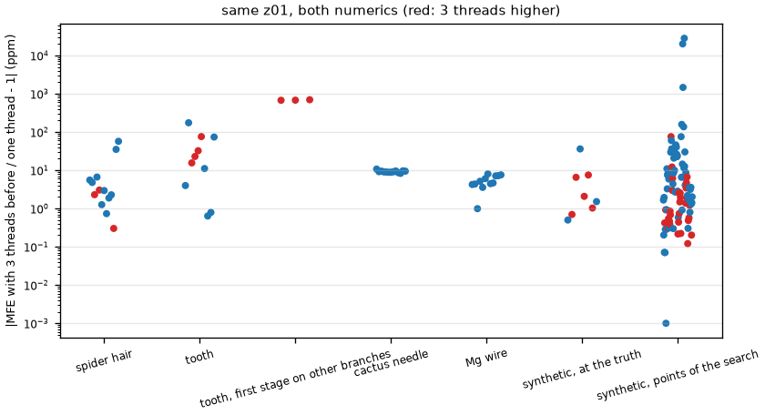
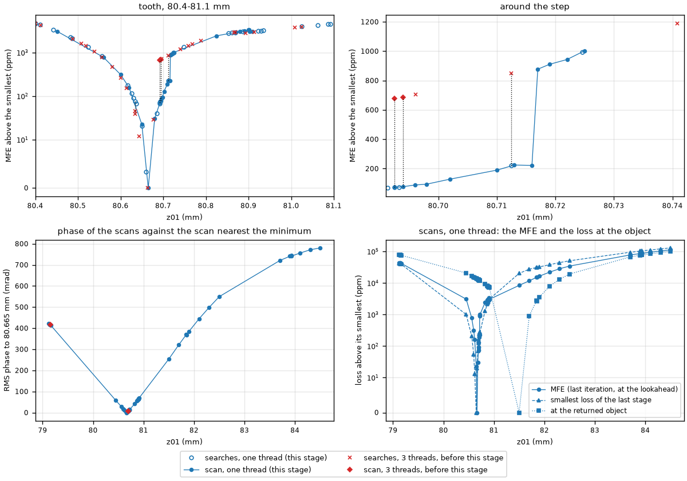
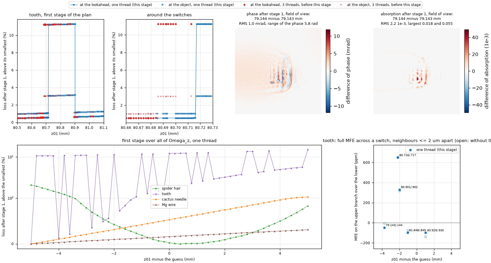
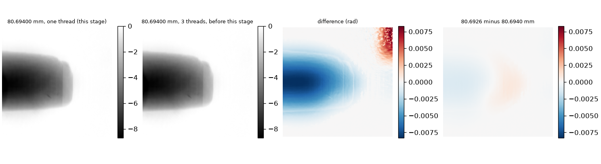
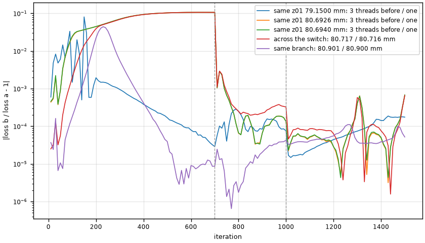
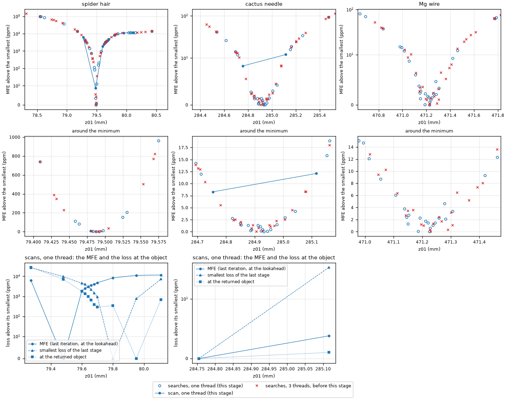
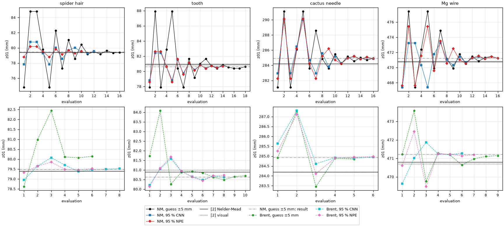
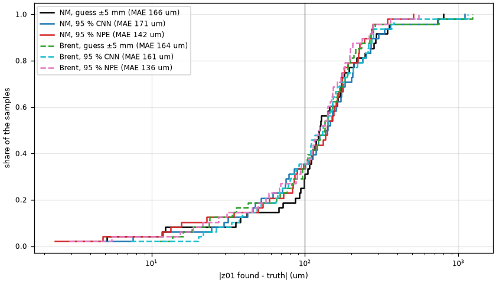
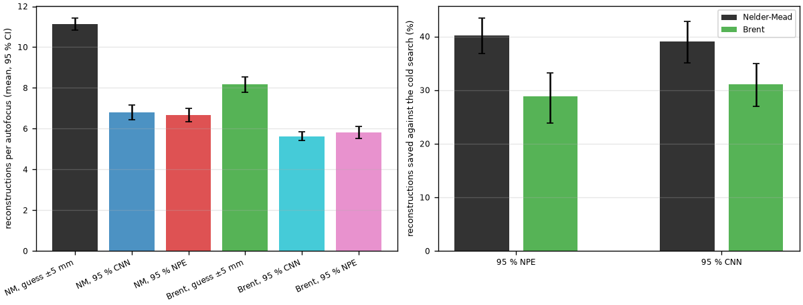
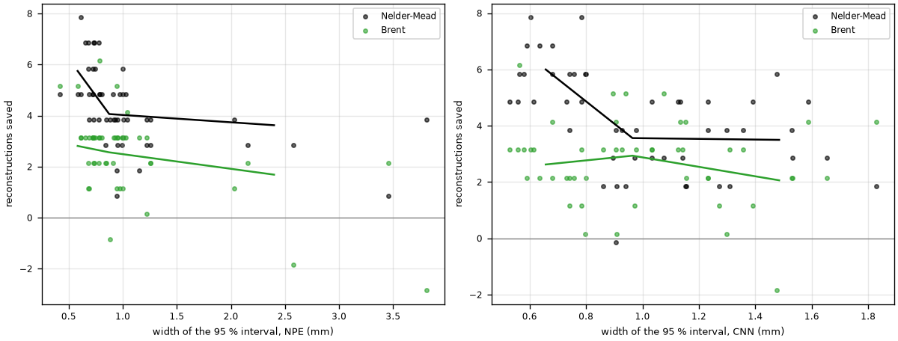

# Laborbuch 09 – Etappe 9: Die Stufen der MFE und Brents Verfahren neben Nelder–Mead

| | |
|---|---|
| Datum | 22.–23.10.2026 |
| Branch | `cursor/stage9-mfe-steps-brent-1091` |
| Code | `one_thread` in `src/holofocus/device.py`, damit in `src/holofocus/asrm.py`, `src/holofocus/propagation.py` und `src/holofocus/autofocus/criteria.py` die Produkte komplexer Felder, die Norm von $\mathrm{Im}\,y$ und der Verlust auf einem Thread laufen; `method="brent"` in `find_focus` und `search_points` (`src/holofocus/autofocus/search.py`), `search.method` in `BaselineConfig`, `Box` und `--box`/`--box-level` für `holofocus-baseline run` (`src/holofocus/baseline/`), `--method` in `scripts/run_stage3_experiments.py measured`; `configs/baseline/paper2-cpu-brent.yaml`, `paper2-cpu-box.yaml`, `ci-brent.yaml`; `scripts/run_stage9_study.py` (`sources`, `queue`, `merge`, `scan`, `steps`, `compare`), `scripts/make_stage9_figures.py`; Erweiterungen von `tests/test_asrm.py`, `tests/test_autofocus.py` und `tests/test_baseline.py` |
| Ergebnisse | `results/stage9/` (Scans, `steps.json`, `mfe-points.csv`, `steps-objects.json`, `compare.json`, `measured.csv`, `synthetic.csv`, `lanes.csv`, Intervalle des CNN), `results/measured/brent-b1-p4/`, `results/measured/brent-box95-{cnn,npe}-loo-ensemble-b1-p4/`, `results/measured/b1-p4-repeat/`, `results/baseline/cpu-4x-test-{brent,brent-box95-npe-ensemble,box95-npe-ensemble,brent-box95-cnn,box95-cnn,repeat}/` |
| Abbildungen | `docs/laborbuch/figures/stage9-*.png`, Zahlen in `stage9-metrics.json` |
| Quellen | [2] Dora et al., Opt. Express 33(4), 6641 (2025); R. P. Brent, *Algorithms for Minimization without Derivatives*, Prentice-Hall (1973), Kap. 5 |

Kurz: ‹TODO›

## 1 Ziel

Zwei Fragen aus Etappe 8, auf den vier Messhologrammen und, für die zweite, auch auf den 48
synthetischen Samples der Baseline von Etappe 3:

1. **Die Stufe der MFE beim Zahn** (Laborbuch 08, 6, Punkt 9). Bei etwa 80,69 mm springt die
   MFE des Zahns um etwa 680 ppm, und ob ein Punkt davor oder dahinter landete, hing an der Zahl
   der Threads (Laborbuch 08, 5.6, Punkt 9). Wechselt die Rekonstruktion dort zwischen zwei
   Lösungen? Haben die anderen Proben solche Stufen? Die MFE soll von der Zahl der Threads
   unabhängig werden, wenn das geht; sonst ist die Threadzahl für jeden Vergleich von
   MFE-Werten festzulegen und zu dokumentieren.
2. **Brents Verfahren in Grenzen als klassische Suche neben Nelder–Mead** (Laborbuch 08, 7,
   Punkt 1). Nelder–Mead bleibt das Verfahren von [2]. Brent läuft kalt in
   $\Omega_z = $ Schätzwert ± 5 mm und begrenzt auf das 95-%-Intervall eines gelernten
   Ensembles: auf den vier Messhologrammen gegen die volle Suche mit Nelder–Mead und die
   Referenzen von [2], mit dem CNN- und dem NPE-Ensemble von Etappe 8; auf den 48 synthetischen
   Samples von Etappe 3, deren Wahrheit bekannt ist, mit den Modellen, die auf diesen Daten
   trainiert sind. Berichtet werden Fehler, Anteil innerhalb 100 µm, Rekonstruktionen und Zeit.
   Die Hauptfrage: Spart ein gelerntes Intervall mit Brent mehr als mit Nelder–Mead?

Alles andere steht als offener Punkt in Abschnitt 6. Keiner der beiden Teile braucht die GPU
(E12).

## 2 Ausgangslage

Etappe 8 ist in `main` gemergt
([PR #16](https://github.com/AliTUHH/master_thesis_autofocus/pull/16), Merge-Commit
`4349d6a`); dieser Branch geht von dort aus.

**Die Stufe.** Mit drei Threads wiederholt, gab eine Rekonstruktion bitgenau dieselbe MFE, mit
einem Thread eine andere: bei Kaktusnadel und Mg-Draht 4–9 ppm, beim Zahn bei 80,6926 mm
675 ppm (Laborbuch 08, 5.6, Punkt 9). Über der kleinsten MFE mit drei Threads, bei 80,663 mm,
lagen 80,678 mm bei 29 ppm, 80,6926 mm bei 677 ppm und 80,696 mm bei 706 ppm; mit einem Thread
lag 80,6926 mm noch in der Senke. Die Suchen auf den Messhologrammen liefen alle mit drei
Threads, bis auf eine:

| Suche (`results/measured/`) | Etappe | Threads |
|---|---|---|
| `b1-p4`, kalt in $\Omega_z$ | 3 (Spinnenhaar, Zahn), 5 (Kaktusnadel, Mg-Draht) | 3 |
| `warm-b1-p4`, Warmstart vom CNN von Etappe 5 | 5 | 3 |
| `warm-{cnn,npe}-loo-ensemble-b1-p4` | 8 | 3 |
| `box95-npe-loo-ensemble-b1-p4` | 8 | 3 |
| `box95-cnn-loo-ensemble-b1-p4` | 8 | 1 |

**Die Suchen auf den Messhologrammen** (Laborbuch 08, 2 und 3.7). Kalt, mit Nelder–Mead in
$\Omega_z$: Spinnenhaar 79,4875 mm (13 Rekonstruktionen), Zahn 80,6344 mm (11), Kaktusnadel
284,9281 mm (13), Mg-Draht 471,2281 mm (12). Die Referenzen von [2] (Nelder–Mead / visuell):
79,4 / 79,4, 80,9 / 81,0, 284,2 / 284,2 und 470,8 / 470,7 mm. Die 95-%-Intervalle der beiden
Ensembles, in mm (Breite):

| Probe | $\Omega_z$ | CNN-Ensemble | NPE-Ensemble |
|---|---|---|---|
| Spinnenhaar | 74,8–84,8 | 77,826–80,772 (2,95) | 78,781–80,184 (1,40) |
| Zahn | 77,9–87,9 | 78,834–82,439 (3,61) | 78,595–82,634 (4,04) |
| Kaktusnadel | 281,1–291,1 | 282,954–289,988 (7,03) | 282,251–290,122 (7,87) |
| Mg-Draht | 467,4–477,4 | 467,400–473,247 (5,85) | 467,636–475,433 (7,80) |

Nelder–Mead darin sparte 14 % (NPE-Ensemble) und 16 % (CNN-Ensemble) der Rekonstruktionen
(Laborbuch 08, 5.6).

**Die synthetische Baseline von Etappe 3** (`results/baseline/cpu-4x-test`, Laborbuch 03): die
ersten 48 Samples des Test-Splits von cpu-4x (512² px, 4× gebinnt), Nelder–Mead nach [2] mit
`configs/baseline/paper2-cpu.yaml`, 3 Threads. MAE 166 µm, Median 124 µm, 31 % innerhalb
100 µm, 11,1 Rekonstruktionen (9–13), 29 s pro Rekonstruktion.

**Die gelernten Modelle auf cpu-4x.** Das NPE-Ensemble von Etappe 7
(`results/npe/npe-nsf-ensemble`, fünf Seeds, Mischung der Dichten) gibt zentrale Intervalle;
auf den 250 Test-Samples deckt sein 95-%-Intervall 96,8 % bei 894 µm Breite im Median
(Laborbuch 07). Vom Gauß-CNN von Etappe 4 (`results/learned/spectrum-cnn-wide`, auf dem
Val-Split nachkalibriertes $\hat\sigma$) gibt es auf cpu-4x nur ein Netz, kein Ensemble (E6).

**Brent auf Modellkurven** (Laborbuch 08, 7, Punkt 1). Von denselben Intervallen aus braucht
Brents Verfahren auf einer Parabel ab 1 mm Breite im Mittel 5,5–6,0 Auswertungen, Nelder–Mead
5,3–11,2; auf den MFE-Kurven der Messhologramme ließ das etwa 6 statt 12–13 Rekonstruktionen
bei Kaktusnadel und Mg-Draht erwarten und 9 statt 11 beim Zahn. Gewarnt war vor der Stufe des
Zahns: An ihr kann eine Parabel durch drei Punkte weit danebenliegen.

## 3 Was gemacht wurde

### 3.1 Die MFE ohne Abhängigkeit von der Threadzahl (`e809b07`)

Welche Operationen von der Threadzahl abhängen, habe ich einzeln geprüft: jede Operation der
ASRM-Schleife auf Feldern von 1024² und 2048² Elementen mit 1, 2, 3 und 4 Threads, Bit für Bit
gegen einen Thread (torch 2.14.1 für die CPU, MKL, AVX-512; nicht versioniert). Zwei Arten
geben andere Bits:

- **Volle Reduktionen** (`mean`, `norm`): Jeder Thread summiert seinen Teil, die Teilsummen
  werden danach addiert; mit einer anderen Threadzahl ist die Reihenfolge der Additionen eine
  andere.
- **Produkte komplexer Felder** (`a * b` mit komplexem `a` und `b`): Jeder Thread rechnet seinen
  Abschnitt mit Vektorbefehlen, die letzten Elemente eines Abschnitts aber skalar mit fused
  multiply-add, also anders gerundet. Mit drei Threads enden die Abschnitte von $2^n$ Elementen
  nicht auf einer Vektorgrenze, und einige Elemente pro Feld wechseln den Pfad.

FFTs, `exp`, `abs`, Wurzel, Division und die reellen elementweisen Operationen geben mit jeder
Threadzahl dieselben Bits. Ein Unterschied im letzten Bit weniger Elemente breitet sich über die
FFTs auf das ganze Feld aus und wächst über 1000 Iterationen bis zu den ppm der MFE.

`one_thread()` (`src/holofocus/device.py`) setzt die Threadzahl von torch für die eingeschlossenen
Operationen auf eins und danach zurück. Darin laufen jetzt die Produkte mit der
Übertragungsfunktion und ihrer Konjugierten und das Produkt mit $-i\,\overline{\psi}$ in
`data_gradient` (an Ort und Stelle, `_times`), die Norm von $\mathrm{Im}\,y$ für den Term mit
$\beta$ und der Verlust jeder Iteration in `asrm_reconstruct`, das Produkt der beiden
Faktoren des Fresnel-Kerns und das Produkt mit ihm in `FresnelPropagator` und der Mittelwert in
`model_fit_error`. Die FFTs bleiben auf allen Threads. Die Operationen in `one_thread()` sind
durch den Speicher begrenzt, nicht durch die Rechnung: Mit einem Thread sind sie kaum langsamer
als mit drei.

Geprüft auf drei Wegen:

1. Synthetisches Sample 0 des Test-Splits von cpu-4x, volle ASRM bei 100 mm (nicht versioniert):
   Der alte Code gibt mit einem Thread die MFE 2,0915255299769342·10⁻⁴, mit drei Threads
   2,0915214554406703·10⁻⁴ (−1,9 ppm). Der neue Code gibt mit 1, 2, 3 und 4 Threads dieselbe MFE
   wie der alte mit einem Thread, dazu dieselbe Verlustkurve und dasselbe Objekt (MD5 über die
   Bytes). Die Rekonstruktion dauert mit drei Threads 30,2 statt 28,5 s (+6 %), mit einem Thread
   76,8 wie vorher.
2. Der Zahn bei 80,69255535982456 mm, dem Punkt von Laborbuch 08, 5.6, Punkt 9, mit dem neuen
   Code und drei Threads: MFE 3,160280757583678·10⁻⁴, bitgleich mit der Rekonstruktion mit einem
   Thread aus Etappe 8 (`box95-cnn-loo-ensemble-b1-p4`). Versioniert noch einmal in
   `results/stage9/threads-3/` gegen den Scan mit einem Thread (`repeats` in `steps.json`, 5.1).
3. `tests/test_asrm.py`: eine kleine volle Rekonstruktion mit 1, 2 und 3 Threads gibt dieselbe
   Verlustkurve, dasselbe Objekt, denselben Kern, dasselbe propagierte Feld und dieselbe MFE nach
   Eq. (15).

Damit ist die MFE seit dieser Etappe die eines Laufs mit einem Thread, mit jeder Threadzahl.
Rekonstruktionen von vorher mit einem Thread gelten bitgenau weiter, die mit drei Threads nicht
(E1, E2).

### 3.2 Brents Verfahren (`e809b07`)

`find_focus` und `search_points` nehmen `method="brent"`: Statt Nelder–Mead sucht
`scipy.optimize.minimize_scalar(method="bounded")` in demselben Intervall ($\Omega_z$ oder
`bounds`) und in denselben Einheiten (Millimeter), mit `xatol` = 100 µm. Das Verfahren wechselt
zwischen Schritten des Goldenen Schnitts und Parabeln durch die drei besten bisherigen Punkte
und beginnt im Intervall, beim 0,382-fachen seiner Breite, nicht an seinen Enden. Es hört auf,
wenn der beste Punkt auf etwa ±⅔ `xatol` eingeschlossen ist, und wertet keinen Punkt näher als
⅓ `xatol` am bisher besten aus. Einen Anfangssimplex gibt es nicht; ein Punkt, der einem früheren bis auf
`revisit_tolerance` gleicht, gibt dessen MFE zurück statt des Strafwerts von Nelder–Mead, weil
Brent die Werte in eine Parabel steckt.

`BaselineConfig` hat `search.method` (Vorgabe `nelder-mead`; in `to_dict` nur, wenn es Brent
ist, damit die Läufe von vorher ihren Schlüssel behalten). `configs/baseline/paper2-cpu-brent.yaml`
ist `paper2-cpu.yaml` mit Brent, `paper2-cpu-box.yaml` Nelder–Mead wie dort; beide ohne die
Rekonstruktion bei der Wahrheit, die nicht von der Suche abhängt und in den Läufen von Etappe 3
steht. `run_stage3_experiments.py measured` nimmt `--method brent`.

### 3.3 Suchintervalle auf den synthetischen Samples (`e809b07`)

`holofocus-baseline run --box CSV --box-level 95` sucht jedes Sample in seinem Intervall
`z01_lower_95`–`z01_upper_95` aus der Tabelle, geschnitten mit $\Omega_z$ (`Box` in
`src/holofocus/baseline/runner.py`); Nelder–Mead beginnt an den Enden dieses Intervalls, Brent
darin. Quelle, SHA-256 und Niveau der Tabelle gehören zum Schlüssel eines Laufs. Die Intervalle:

- **NPE-Ensemble:** `results/npe/npe-nsf-ensemble/test/predictions.csv` hat die zentralen
  Intervalle der Mischung.
- **CNN:** `run_stage9_study.py sources` schreibt $\hat z_{01} \pm 1{,}96\,\hat\sigma$ (und
  $\pm 0{,}99\,\hat\sigma$ für 68 %) des Gauß-CNN nach `results/stage9/intervals-cnn-test.csv`.

### 3.4 Scans und Stufen (`run_stage9_study.py scan`, `steps`)

`scan` rekonstruiert ein Messhologramm an gegebenen $z_{01}$, mit den Einstellungen der Suchen
(ungebinnt, Padding 4, Plan von [2] Table 3), und hält pro Punkt fest: MFE, Verlust jeder
10. Iteration, Verluste am Ende der Stufen des Plans und Kennzahlen des Objekts
(`results/stage9/scan-<probe>.json`). Objekt und ganze Verlustkurve gehen nach
`results/stage9/scan-<probe>/<z01 in mm>.npz` (nicht versioniert, 1,8 MB pro Punkt). Mit `--z01`
in Metern trifft ein Scan bitgenau den Punkt einer früheren Suche. Für die Numerik von vorher
läuft dasselbe Skript in einem Checkout von `4349d6a` mit drei Threads
(`results/stage9/threads-3-4349d6a/`).

Zu jedem Punkt hält `scan` außerdem den **Verlust am zurückgegebenen Objekt** fest
(`object_loss`): den ersten Verlust einer weiteren Iteration der letzten Stufe, gestartet vom
Objekt ohne Impuls. Die MFE ist dagegen der Verlust am Vorgriff der letzten Iteration,
$y = \tilde O - \gamma v$, mit dem Impuls $v$ und $\gamma = 1$ in allen drei Stufen von [2]
Table 3; das zurückgegebene Objekt ist der Schritt danach. Den Rand außerhalb des Sichtfelds
baut jede Iteration aus dem Sichtfeld neu auf (gespiegelt und ausgeblendet), den Impuls nicht.
Dass `object_loss` den Verlust der Schleife trifft, prüft eine Rekonstruktion mit einer
Iteration vom gespeicherten Objekt aus: bitgleich (nicht versioniert).

`scan --stages 1` rekonstruiert nur die **erste Stufe** des Plans (Sichtfeld 16-fach
verkleinert, beim Zahn 118² px in 512² px, 700 Iterationen), mit einem Thread in etwa 15 s
statt 9 min. Ihr Verlust am Ende ist bitgleich mit `stage_losses[0]` der vollen Rekonstruktion
am selben $z_{01}$; das Objekt geht mit dem ganzen Feld samt Rand nach
`results/stage9/first-stage/scan-<probe>/` (nicht versioniert). Gescannt ist die erste Stufe
beim Zahn alle 10 µm in 80,50–80,90 mm und alle 1 µm in 80,700–80,730 mm, mit der Numerik von
vorher alle 2 µm in 80,660–80,700 mm und alle 50 µm in 80,50–80,90 mm, und bei allen vier
Proben in ganz $\Omega_z$ alle 200 µm. Als Wechsel der ersten Stufe zählt `steps` eine
Änderung ihres Verlusts zwischen Nachbarn, die um mehr als 1 % von dem abweicht, was der Median
der Steigungen der bis zu zwei Paare auf jeder Seite erwarten lässt: Eine steile Flanke in
$\Omega_z$ ist so kein Wechsel, und ein einzelner Punkt auf dem anderen Ast gibt zwei.

`steps` sammelt alle Rekonstruktionen der Messhologramme mit Padding 4 (die Suchen der Etappen
3, 5, 8 und 9 und die Scans) als MFE über $z_{01}$, getrennt nach Numerik (E2), und
sucht darin Stufen (E10): einen Sprung zwischen Nachbarn höchstens 50 µm auseinander, um mehr als
50 ppm und mindestens dreimal so steil wie beide benachbarten Sekanten; oder einen Abfall um mehr
als 50 ppm vom Minimum weg (Umkehr). Dazu, wie dicht die Punkte um das Minimum liegen (Anteil von
±250 und ±500 µm, in dem Nachbarn höchstens 50 µm auseinanderliegen), dieselbe Prüfung mit beiden
Numeriken zusammen, die Rekonstruktionen am selben $z_{01}$, wo die Verlustkurven zweier
Scans auseinanderlaufen, und die Objekte der Scans gegeneinander (`results/stage9/steps.json`,
`mfe-points.csv`, `steps-objects.json`).

### 3.5 Die Suchen

Auf den Messhologrammen (`results/measured/`, alle mit 3 Threads in Lane A, ungebinnt, Padding 4):

| Verzeichnis | Verfahren | Intervall |
|---|---|---|
| `brent-b1-p4` | Brent | $\Omega_z$ |
| `brent-box95-cnn-loo-ensemble-b1-p4` | Brent | 95-%-Intervall des CNN-Ensembles ∩ $\Omega_z$ |
| `brent-box95-npe-loo-ensemble-b1-p4` | Brent | 95-%-Intervall des NPE-Ensembles ∩ $\Omega_z$ |
| `b1-p4-repeat` | Nelder–Mead | $\Omega_z$: `b1-p4` noch einmal, mit der Numerik dieser Etappe (E8) |

Die Suchen mit Brent mit `--revisit-tolerance 1e-9` wie die von Etappe 8, `b1-p4-repeat` ohne,
wie `b1-p4`.

Auf den synthetischen Samples (`results/baseline/cpu-4x-test-<Name>`):

| Name | Konfiguration | Intervall | Samples |
|---|---|---|---|
| `brent` | `paper2-cpu-brent` | $\Omega_z$ | 0–47 |
| `brent-box95-npe-ensemble` | `paper2-cpu-brent` | 95 % des NPE-Ensembles | 0–47 |
| `box95-npe-ensemble` | `paper2-cpu-box` | 95 % des NPE-Ensembles | 0–47 |
| `brent-box95-cnn` | `paper2-cpu-brent` | 95 % des CNN | 0–47 |
| `box95-cnn` | `paper2-cpu-box` | 95 % des CNN | 0–47 |
| `repeat` | `paper2-cpu` | $\Omega_z$ | 11, 46, 0–5 (E8) |

Das sind 248 Suchen. `run_stage9_study.py queue` lässt zwei Lanes (A mit 3, B mit einem
Thread) die nächste Suche nehmen, die noch keine genommen hat (eine Datei pro Suche, angelegt
mit `open(..., "x")`); jede schreibt nach `runs/stage9/cpu-4x-test-<Name>/lane-<Lane>`, und
`merge` fügt die Lanes zusammen und schreibt nach `results/stage9/lanes.csv`, welche Lane welche
Suche mit wie vielen Threads rechnete.

### 3.6 Der Vergleich (`run_stage9_study.py compare`)

`compare` stellt pro Messhologramm alle Suchen nebeneinander (Ergebnis, Abstand zu den Referenzen
von [2] und zur kalten Suche, MFE, Rekonstruktionen, Zeit) und fasst die synthetischen Suchen
zusammen: MAE mit Bootstrap-Intervall, Median, 90. Perzentil, Maximum, Anteil innerhalb 50, 100,
250 und 1000 µm, Rekonstruktionen, Zeit mit 3 Threads; dazu, was das Intervall pro Verfahren
spart, gepaart über die Samples (E9; `results/stage9/compare.json`, `measured.csv`,
`synthetic.csv`).

### 3.7 Tests

Neu sind neun Tests, zwei davon mit drei bzw. zwei Fällen (13 Fälle; zusammen 377, in `main`
364):

- `tests/test_asrm.py`: `one_thread()` setzt die Threadzahl danach zurück; eine kleine volle
  Rekonstruktion (320² px) gibt mit 1, 2 und 3 Threads dieselbe Verlustkurve, dasselbe Objekt,
  denselben Kern, dasselbe propagierte Feld und dieselbe MFE, Bit für Bit.
- `tests/test_autofocus.py`: `find_focus` mit Brent fragt bitgenau die Punkte von
  `minimize_scalar` ab (drei Lagen des Minimums), sucht in gegebenen Grenzen und gibt für
  einen wiederholten Punkt dessen MFE zurück; `search_points` mit Brent gibt die Punkte von
  `find_focus`, in $\Omega_z$ und in Grenzen.
- `tests/test_baseline.py`: `Box` schneidet die Intervalle der Tabelle mit $\Omega_z$; eine
  Baseline mit Brent im Intervall, auch über `holofocus-baseline run --box`; `search.method`
  in den drei Konfigurationen.

Der CI-Schritt von Etappe 9 sucht mit Brent auf drei Samples des Demo-Datensatzes in den
95-%-Intervallen des CNN aus dem Schritt von Etappe 4 (`configs/baseline/ci-brent.yaml`) und
rechnet `steps`, `compare` und alle Abbildungen aus den versionierten Ergebnissen.
‹TODO: Ergebnis der Tests, ruff, Zeit des CI-Schritts›

## 4 Entscheidungen und Begründung

**E1 – Die MFE unabhängig von der Threadzahl machen, statt die Threadzahl festzulegen.** Es geht:
Nur zwei Arten von Operationen hängen an der Threadzahl (3.1), beide sind durch den Speicher
begrenzt, und auf einem Thread verlängern sie eine Rekonstruktion mit drei Threads um 6 %.
Eine feste Threadzahl hätte jeden Vergleich an eine Einstellung der Maschine gebunden; die Lane
mit einem Thread neben der mit drei (Regel der VM) hätte nie dieselbe MFE gerechnet. Unabhängig
von der Threadzahl heißt nicht unabhängig von der Numerik: Auf einer anderen CPU, mit einer
anderen Version von torch oder auf der GPU gibt die MFE andere Bits, und beim Zahn kann der
Wechsel der ersten Stufe dann woanders liegen (5.2, Punkt 5; 6, Punkt 5).

**E2 – Die Numerik eines Threads.** Statt die Reduktionen und Produkte auf einem Thread zu
rechnen, ginge auch eine eigene, von der Threadzahl unabhängige Summe (paarweise oder in
doppelter Genauigkeit) und ein komplexes Produkt aus reellen Operationen. Beides gäbe eine dritte
Numerik, verschieden von beiden alten, und das Produkt aus reellen Operationen kostete auf 2048²
Elementen mit drei Threads 18–22 ms, das von torch auf einem Thread 5,9 ms (mit drei Threads
6,1 ms, durch den Speicher begrenzt). Mit einem
Thread gelten alle Rekonstruktionen von vorher mit einem Thread bitgenau weiter: in Etappe 8 die
Suche im Intervall des CNN-Ensembles. Die mit drei Threads (die übrigen Suchen auf den
Messhologrammen und die Baseline von Etappe 3) behalten ihre Numerik und heißen hier
„Numerik 3“, alles mit einem Thread und alles seit dieser Etappe „Numerik 1“. MFE-Werte vergleiche
ich nur innerhalb einer Numerik; Lagen ($z_{01}$ eines Ergebnisses) über beide.

**E3 – Brent aus SciPy.** `minimize_scalar(method="bounded")` ist das Verfahren von Brent (1973,
Kap. 5) in der Fassung von `fminbound`: Goldener Schnitt mit Parabeln, ohne Ableitung, in
gegebenen Grenzen. Eine eigene Fassung brächte nichts, und die von SciPy kann jeder nachrechnen.
`xatol` = 100 µm wie bei Nelder–Mead, in Millimetern wie dort (Laborbuch 08, 3.8). Die beiden
Toleranzen meinen nicht genau dasselbe: Nelder–Mead hört auf, wenn seine zwei Punkte höchstens
100 µm auseinanderliegen; Brent, wenn das Minimum auf etwa ±67 µm um den besten Punkt
eingeschlossen ist.

**E4 – Das Intervall als Grenzen, sonst nichts.** Brent in Grenzen hat keinen Startpunkt; das
gelernte Modell geht nur über das Intervall ein, wie bei der Suche im Intervall von Etappe 8.
Ein Warmstart von der Schätzung, wie in Etappe 8 für Nelder–Mead, ist für Brent nicht
vorgesehen; er bräuchte eine Klammer um das Minimum, die das Verfahren dann selbst nicht prüft.

**E5 – Nelder–Mead im selben Intervall.** Ob ein Intervall mit Brent mehr spart als mit
Nelder–Mead, zeigt nur Nelder–Mead im selben Intervall. Auf den Messhologrammen gibt es das aus
Etappe 8 (`box95-{cnn,npe}-loo-ensemble-b1-p4`), auf den synthetischen Samples rechne ich es
neu (`box95-npe-ensemble`, `box95-cnn`), mit den Enden des Intervalls als Anfangssimplex.

**E6 – Die Modelle auf den synthetischen Samples.** „Die Modelle, die auf diesen Daten trainiert
sind“, sind auf cpu-4x das NPE-Ensemble von Etappe 7 (fünf Seeds) und das Gauß-CNN von Etappe 4.
Ein CNN-Ensemble gibt es auf cpu-4x nicht; es neu zu trainieren lag außerhalb dieser Etappe
(6, Punkt ‹TODO›). Das einzelne CNN steht deshalb für das CNN, mit seinem nachkalibrierten
$\hat\sigma$.

**E7 – Was „sparen“ heißt.** Pro Sample und Verfahren: Rekonstruktionen kalt minus
Rekonstruktionen im Intervall; das Mittel über die Samples mit Bootstrap-Intervall (10 000
Ziehungen) und relativ als 1 − (Summe im Intervall / Summe kalt). Die Hauptfrage beantwortet die
gepaarte Differenz: Ersparnis mit Brent minus Ersparnis mit Nelder–Mead, Sample für Sample.

**E8 – Nelder–Mead noch einmal.** Die kalten Suchen mit Nelder–Mead (`b1-p4`, Baseline von
Etappe 3) liefen mit Numerik 3, alle neuen mit Numerik 1. Ein Unterschied zwischen Brent und
Nelder–Mead könnte deshalb auch an der Numerik liegen: Nelder–Mead vergleicht nur Werte, und
zwei Punkte, deren MFE sich um weniger als die 2–9 ppm der Numerik unterscheidet, können die Plätze
tauschen. Die Wiederholung zeigt, wie viel die Numerik allein an einer Suche ändert: auf allen
vier Messhologrammen und auf 8 synthetischen Samples, darunter die beiden, bei denen in der Suche
von Etappe 3 zwei MFE-Werte weniger als die Numerik auseinanderliegen (11 und 46).

**E9 – Zeit: Rekonstruktionen zählen, Sekunden mit 3 Threads.** Wie in Etappe 8 (E13): Fast die
ganze Zeit einer Suche sind ihre Rekonstruktionen, und ihre Zahl hängt nicht an der Maschine.
Die Zeit gebe ich als Zahl der Rekonstruktionen mal der Rate mit 3 Threads an: auf den
Messhologrammen der Median der Sekunden pro Rekonstruktion der Suchen dieser Etappe mit 3 Threads
derselben Probe, auf den synthetischen Samples der Median der Suchen der Lane mit 3 Threads.

**E10 – Wann ein Sprung eine Stufe ist.** Die Numerik verschiebt die MFE um höchstens 9 ppm,
wo keine Stufe ist; die MFE steigt nahe am Minimum um 1–10 ppm pro µm. Eine Stufe wie die des
Zahns (etwa 700 ppm auf wenigen µm) fällt mit 50 ppm zwischen Nachbarn im Abstand von höchstens
50 µm, dreimal so steil wie die Sekanten daneben, sicher auf; die Krümmung einer glatten Kurve
nicht. Weiter auseinanderliegende Punkte prüft die Regel nicht, deshalb steht die Dichte der
Punkte daneben.

**E11 – Wo gescannt wird.** Beim Zahn dicht um die Stufe (80,56–80,75 mm), an den Punkten von
Etappe 8 bitgenau mit beiden Numeriken und dort, wo die Suchen mit Numerik 3 eine zweite
Unregelmäßigkeit zeigen (80,87–80,91 mm). Beim Spinnenhaar an der Schulter der oberen Flanke und
am lokalen Minimum bei 80,1 mm, das die kalte Suche mit Brent fand. Sonst nur dort, wo die Punkte
aller Suchen innerhalb ±250 µm um das Minimum Lücken über 50 µm lassen. Ein Punkt kostet mit
einem Thread etwa 9 min. Als sich zeigte, dass die Stufe schon nach der ersten Stufe des Plans
angelegt ist (5.2), habe ich diese allein gescannt, mit 15 s pro Punkt 36-mal billiger: beim
Zahn dicht um die Wechsel, mit beiden Numeriken, und bei allen Proben in ganz $\Omega_z$ alle
200 µm als Suche nach Stufen, die die Punkte der Suchen nicht zeigen.

**E12 – Keine GPU.** ‹TODO: Kernstunden›; nichts davon braucht Maxwell. Neu in
`docs/maxwell-gpu.md` ist nur Abschnitt 8.4: Auf der GPU ist die Numerik eine andere, MFE-Werte
von dort sind mit denen der CPU nicht zu vergleichen, und wo beim Zahn der Wechsel der ersten
Stufe liegt, ist dort nicht geprüft (6, Punkt 5).

## 5 Ergebnisse

### 5.1 Die MFE und die Threadzahl

*Abb. 1 – Die MFE an genau demselben $z_{01}$ mit drei Threads und der Bibliothek von vorher
gegen einen Thread, relativ in ppm: auf den Messhologrammen und auf den synthetischen Samples
der Wiederholung (E8).*

1. **Bitgleich mit jeder Threadzahl.** Der Zahn bei 80,69255535982456 mm, mit der Bibliothek
   dieser Etappe und drei Threads gescannt (`results/stage9/threads-3/`), gibt bitgenau die MFE
   der Suche mit einem Thread aus Etappe 8, 3,160280757583678·10⁻⁴ (`repeats` in
   `steps.json`); ebenso das synthetische Sample 0 mit 1–4 Threads (3.1) und die Tests (3.7).
2. **Die Numerik von vorher** liegt am selben $z_{01}$ beim Mg-Draht (467,4 mm) 4,2 ppm unter
   der eines Threads, beim Zahn bei 80,6926 und 80,694 mm 675 und 679 ppm darüber (`same_z01`);
   auf den synthetischen Samples ‹TODO› (Abb. 1).

### 5.2 Die Stufe des Zahns: zwei Lösungen der ersten Stufe

*Abb. 2 – Die MFE des Zahns über $z_{01}$, über der kleinsten MFE derselben Numerik: oben links
alle Rekonstruktionen in 80,4–81,1 mm (Suchen und Scans, beide Numeriken; gepunktet: dasselbe
$z_{01}$ mit beiden), oben rechts um die Stufe; unten links der RMS-Abstand der Phase jedes Scans
zu der des Scans am Minimum; unten rechts für die Scans mit einem Thread die MFE, der kleinste
Verlust der letzten Stufe und der Verlust am zurückgegebenen Objekt, jeder über seinem kleinsten.*

*Abb. 3 – Der Verlust nach der ersten Stufe des Plans (512² px, 700 Iterationen) über $z_{01}$,
über dem kleinsten derselben Numerik, am Vorgriff (Linie) und am zurückgegebenen Objekt
(gepunktet): oben links der Zahn in 80,50–80,90 mm, daneben um die Wechsel, oben rechts die
Differenz der Phase und der Absorption im Sichtfeld über den Wechsel mit einem Thread; unten
alle vier Proben in ganz $\Omega_z$ mit einem Thread, über dem Schätzwert.*

*Abb. 4 – Die Phase des Zahns am selben $z_{01}$ auf beiden Ästen (einem Thread und drei Threads
mit der Bibliothek von vorher), ihre Differenz und die zweier Nachbarn auf demselben Ast, in
denselben Farben.*

1. **Zwei Lösungen schon nach der ersten Stufe.** Nach der ersten Stufe liegt der Verlust des
   Zahns (am Vorgriff) auf einem von zwei Ästen, 1,6487–1,6526·10⁻³ oder 1,8248–1,8261·10⁻³,
   10,4–10,8 % höher (`first_stage` in `steps.json`, Abb. 3). Auf jedem Ast steigt er glatt mit
   $z_{01}$, um 3–4 ppm pro µm. Mit einem Thread liegen alle 37 Punkte von 80,500 bis
   80,716 mm auf dem unteren Ast, alle 32 von 80,717 bis 80,901 mm auf dem oberen und alle 37
   von 80,902 bis 81,100 mm wieder auf dem unteren. Beide Wechsel liegen zwischen zwei Punkten
   1 µm auseinander, und kein Punkt dazwischen springt zurück: Der obere Ast ist ein Fenster
   von 185 µm, das 52 µm über dem Minimum der MFE (80,665 mm) beginnt. Mit der Numerik von
   vorher reicht das Fenster von 80,686 mm bis 80,850–80,900 mm. Am zurückgegebenen Objekt
   unterscheiden sich die Äste um 1,9–2,0 %.
   Vor jedem Wechsel wird der Ast unruhig. Mit einem Thread steigt der Verlust in den letzten
   6 µm vor dem ersten Wechsel in Sprüngen von 12–25 ppm statt um 0–8 ppm pro µm, und bei jedem
   Sprung ändert sich die Phase im Sichtfeld um 0,09–0,39 mrad RMS statt um 0,01–0,04 mrad
   (`to_previous` unter `first_stage`); vor dem zweiten ändert sie sich von 80,890 nach
   80,900 mm um 0,45 mrad und von 80,900 nach 80,901 mm um 0,56 mrad, davor um 0,04–0,05 mrad
   pro 10 µm. Mit der Numerik von vorher liegt der letzte Punkt vor dem ersten Wechsel
   (80,684 mm) 155 ppm und 2,1 mrad neben seinem Vorgänger, die Punkte davor 11–14 ppm und
   höchstens 0,13 mrad auseinander.
2. **Wie sich die Objekte der ersten Stufe unterscheiden.** Vor allem in der Absorption: Auf dem
   unteren Ast hat das Objekt nach der ersten Stufe an einem Bogen des Zahns einen Fleck mit
   Absorption bis 0,060, auf dem oberen fehlt er (größte Absorption im Sichtfeld 0,018). Über
   den Wechsel mit einem Thread (80,717 gegen 80,716 mm) unterscheidet sich die Absorption im
   Sichtfeld um 2,2·10⁻³ RMS, höchstens um 0,055 (`first_stage` in `steps.json`), zwei Nachbarn
   1 µm auseinander auf demselben Ast um höchstens 7·10⁻⁷ RMS. Die Phase unterscheidet sich am
   selben Bogen und an einer Kante um 1,1 mrad RMS, bis ±12 mrad, mit Streifen daneben
   (Abb. 3 oben rechts), und um 0,8 mrad außerhalb des Sichtfelds; das ist nicht viel mehr als
   die 0,39 mrad vor dem Wechsel (Punkt 1), bei 5,8 rad Umfang der Phase. Über den zweiten
   Wechsel mit einem Thread (80,901 → 80,902 mm) kommt der Fleck wieder (Absorption
   2,2·10⁻³ RMS, höchstens 0,056, größte Absorption 0,018 und 0,061; Phase 1,3 mrad RMS), und
   über beide Wechsel mit der Numerik von vorher ist es derselbe Fleck (2,2·10⁻³ RMS, höchstens
   0,055–0,056). Nach der ersten Stufe ist die Absorption im Mittel 7,0·10⁻⁴ (Streuung
   3,2·10⁻³) auf dem unteren Ast und 4,7·10⁻⁴ (1,7·10⁻³) auf dem oberen. Die folgenden Stufen
   löschen den Fleck: Am Ende ist die Absorption auf beiden Ästen fast null (Mittel 3·10⁻⁶,
   Streuung 1,5·10⁻⁴, ohne Sprung über den Wechsel; `object` in `scan-tooth.json`), und über den
   Wechsel unterscheidet sie sich um 2,5·10⁻⁶ RMS, so wenig wie zwischen Nachbarn auf demselben
   Ast (1,9·10⁻⁶).
3. **Die MFE folgt der ersten Stufe.** Jeder volle Scan liegt auf dem Ast, den seine erste
   Stufe trifft: mit einem Thread bis 80,716 mm auf dem unteren, von 80,717 bis 80,900 mm auf
   dem oberen und bei 80,910 mm wieder auf dem unteren. Am ersten Wechsel springt die MFE über
   1 µm von 222 auf 877 ppm über ihrer kleinsten; von 80,900 nach 80,910 mm fällt sie von 3293
   auf 3021 ppm, während sie auf beiden Ästen sonst um 5–10 ppm pro µm steigt, und dahinter
   steigt sie auf dem unteren Ast weiter, an den Punkten der Suchen in 80,923–81,091 mm von
   3086 auf 4520 ppm (Abb. 2). Ein zweites Minimum gibt es hinter dem Fenster nicht. Das Objekt
   springt mit: Seine Phase ändert sich von 80,716 nach 80,717 mm um 3,4 mrad RMS, auf
   demselben Ast über 2–3 µm um 0,5–1,0 mrad, und von 80,900 nach 80,910 mm um 6,0 mrad, auf
   demselben Ast über 10 µm um 2,8 mrad (`steps-objects.json`). Mit der Numerik von vorher ebenso:
   80,678 mm liegt 29 ppm über ihrer kleinsten MFE, 80,6926 mm 677 ppm (Laborbuch 08, 5.6,
   Punkt 9). Bei 80,6926 und 80,694 mm treffen die beiden Numeriken verschiedene Äste, und ihre
   MFE unterscheidet sich um 675 und 679 ppm (5.1). Die Stufe ist also der Wechsel der ersten
   Stufe zwischen zwei Lösungen, und wo er liegt, entscheidet die Rundung (Punkt 5).
4. **Zwei Objekte am selben $z_{01}$.** Am Ende unterscheiden sich die Phasen der beiden Äste bei
   80,694 mm um 3,2 mrad RMS (höchstens 9,0 mrad; die Phase streut um 2,65 rad), zwei Nachbarn
   1,4 µm auseinander auf demselben Ast um 0,39 mrad (Abb. 4). Auf demselben Ast wächst der
   Abstand um etwa 0,31 mrad pro µm; der Unterschied der Äste ist so groß wie der von etwa
   10 µm.
5. **Die Rundung wählt den Ast.** Am selben $z_{01}$ trennen sich die Verlustkurven der beiden
   Numeriken vom ersten gespeicherten Wert an (bei 80,694 mm in der 10. Iteration um
   4,6·10⁻⁴ relativ) und liegen am
   Ende der ersten Stufe 10,6 % auseinander, am Ende der zweiten 134 ppm und am Ende 679 ppm
   (Abb. 5). Zwei Nachbarn 1,4 µm auseinander auf demselben Ast bleiben in allen drei Stufen
   unter 7·10⁻⁵ und enden 6 ppm auseinander. Zwischen etwa 80,686 und 80,716 mm und wieder
   jenseits von 80,85 mm erreichen die beiden Numeriken verschiedene Äste; dort gibt es beide
   Lösungen, und welche eine Rekonstruktion trifft, hängt an Unterschieden im letzten Bit. Bei
   fester Numerik ist die Wahl dagegen eine glatte Funktion von $z_{01}$: ein Wechsel, kein
   Hin und Her auf 1 µm.

### 5.3 Wo die Stufe der MFE entsteht

*Abb. 5 – Der relative Unterschied der Verlustkurven zweier Scans des Zahns über der Iteration
(jede 10. gespeichert; gestrichelt: Ende der Stufen): dasselbe $z_{01}$ mit beiden Numeriken,
die nächsten Nachbarn über den Wechsel der ersten Stufe und auf demselben Ast.*

1. **Die MFE ist nicht der kleinste Verlust.** In der letzten Stufe fällt der Verlust des Zahns
   bis Iteration 1220–1230 und steigt danach bis zur letzten (1500) um 1,55–1,56 % auf dem
   unteren Ast und um 1,62–1,63 % auf dem oberen (`last_stage` in `steps.json`). Der
   Referenzcode tut dasselbe: Auf dem synthetischen Sample 0 ist der Verlust der letzten Stufe
   bei Iteration 1007 am kleinsten und endet 2325 ppm darüber, in holowizard wie hier
   (`results/crosscheck/reconstruct_0.json`, Laborbuch 03).
2. **Die Äste trennen sich am Ende.** Über den ersten Wechsel (80,716 → 80,717 mm) liegt der
   obere Ast nach der ersten Stufe 10,6 % über dem unteren, am Ende der zweiten 324 ppm, am
   kleinsten Verlust der letzten Stufe 34 ppm darunter und am Ende 655 ppm darüber; über den
   zweiten (80,900 → 80,910 mm, 10 µm auseinander) 9,6 % darüber, 161 ppm darunter, 189 ppm
   darunter und 271 ppm darüber (`scans` und `last_stage` in `steps.json`). Am selben $z_{01}$
   (80,694 mm) unterscheiden sich die beiden Numeriken bei Iteration 1230 nur um 4·10⁻⁶
   (Abb. 5). Die Stufe der MFE entsteht also in den letzten knapp 300 Iterationen, in denen der
   Verlust auf dem oberen Ast stärker steigt. Der Unterschied schwingt dabei: bei 80,694 mm
   6,4·10⁻⁴ bei Iteration 1310, 4·10⁻⁶ bei 1430 und 6,8·10⁻⁴ bei der letzten.
3. **Drei Verluste, drei Minima.** Bei den Scans mit einem Thread ist die MFE bei 80,665 mm am
   kleinsten, der kleinste Verlust der letzten Stufe bei 80,650 mm, und der Verlust am
   zurückgegebenen Objekt fällt von 80,451 bis 80,910 mm, dem letzten Scan, um 13 400 ppm, um
   20–34 ppm pro µm, nur über den ersten Wechsel nicht: Von 80,716 nach 80,717 mm steigt er um
   61 ppm, eine Stufe von etwa 90 ppm, ein Siebtel der Stufe der MFE. Über den zweiten fällt er
   um 263 ppm in 10 µm, kaum mehr als davor (203–246 ppm). Sein Minimum liegt jenseits von
   80,910 mm (Abb. 2 unten rechts). Er ist 3,5- bis 3,6-mal so groß wie die MFE, wohl weil am
   Vorgriff auch der Rand außerhalb
   des Sichtfelds den Impuls trägt, am zurückgegebenen Objekt dagegen nur das gespiegelte
   Sichtfeld ist (3.4). Die MFE von [2] ist der Verlust am Vorgriff $y = \tilde O - \gamma v$
   der letzten Iteration, mit dem ganzen Impuls ($\gamma = 1$); was sie misst, ist neben dem
   Objekt auch der Zustand des Impulses, und den bestimmt der Ast.

### 5.4 Stufen bei den anderen Proben

*Abb. 6 – Spinnenhaar, Kaktusnadel und Mg-Draht: die MFE über $z_{01}$, über der kleinsten
derselben Numerik, oben in ±1,2 mm (Spinnenhaar) bzw. ±0,6 mm um das Minimum, in der Mitte in
±0,1 bzw. ±0,25 mm; unten für die Scans mit einem Thread die MFE, der kleinste Verlust der
letzten Stufe und der Verlust am zurückgegebenen Objekt, jeder über seinem kleinsten.*

1. **Keine Stufe in der MFE.** Nach der Regel von E10 hat die MFE von Spinnenhaar, Kaktusnadel
   und Mg-Draht keinen Sprung und keine Umkehr, mit jeder Numerik für sich und mit beiden
   zusammen (`probes` in `steps.json`). Mit beiden zusammen liegen in ±250 µm um das Minimum
   keine zwei Nachbarn mehr als 42 µm auseinander; mit einer Numerik allein sind 54–90 % von
   ±250 µm so dicht, die größte Lücke ist 50–138 µm. Um das Minimum ist die MFE der Kaktusnadel
   am flachsten: 180 µm darunter und darüber (284,755 und 285,116 mm) liegt sie 8 und 12 ppm
   über ihrer kleinsten. Beim Zahn findet die Regel mit Numerik 1 die Stufe bei
   80,716–80,717 mm (+655 ppm) und eine Umkehr von 80,900 nach 80,910 mm (−272 ppm), mit
   Numerik 3 die Stufe bei 80,678–80,6926 mm (+648 ppm) und eine Umkehr von 80,869 nach
   80,893 mm (−138 ppm). Beide Umkehren sind der zweite Wechsel der ersten Stufe, zurück auf den
   unteren Ast (5.2, Punkte 1 und 3) ‹TODO Numerik 3 bei 80,869/80,893 mm›.
2. **Die erste Stufe in ganz $\Omega_z$.** ‹TODO›
3. **Die Schulter des Spinnenhaars.** Über dem Minimum (79,49 mm) steigt die MFE bis 79,95 mm
   glatt auf 11 150 ppm, im Mittel um 24 ppm pro µm, danach bis 80,25 mm nur noch um 2–3 ppm
   pro µm (11 930 ppm). Zwischen 80,035 und 80,147 mm liegen sechs Punkte innerhalb von 32 ppm,
   am tiefsten 80,114 mm, das Ergebnis der kalten Suche mit Brent (5.5): eine flache Mulde in
   der Schulter, keine Stufe. Die Scans in 79,60–80,11 mm, 20–160 µm auseinander, steigen ohne
   Sprung.
4. **Die anderen Verluste beim Spinnenhaar.** Von elf Scans in 79,27–80,11 mm hat der kleinste
   Verlust der letzten Stufe sein Minimum bei 79,80 mm, der Verlust am Objekt bei 79,95 mm,
   0,3 und 0,46 mm über dem der MFE (`last_stage`, `object_loss` in `steps.json`; Abb. 6
   unten). Die MFE trifft die visuelle Referenz von [2] (79,4 mm) auf 90 µm, die beiden anderen
   verfehlen sie um 0,4 und 0,55 mm. Am kleinsten ist der Verlust der letzten Stufe hier bei
   Iteration 1010–1060; bis zur letzten steigt er dann um 1,1 % (79,27 mm), 2,2 % (79,48 mm)
   bis 4,3 % (79,95 mm). Erst dieser Anstieg, der von 79,27 bis 79,95 mm wächst, legt das
   Minimum der MFE unter das des kleinsten Verlusts. Beim Zahn steigt der Verlust nach seinem
   Minimum überall um 1,55–1,63 %, und die Minima von MFE und kleinstem Verlust liegen 15 µm
   auseinander (5.3, Punkt 3). Der Verlust am Objekt ist zwischen 79,70 und 79,95 mm nicht
   monoton: bei 79,80 mm 52 ppm über 79,70 mm, eine Umkehr nach E10 knapp über der Schwelle, an
   Punkten 100–150 µm auseinander; die MFE steigt dort glatt.

### 5.5 Brent auf den Messhologrammen

*Abb. 7 – Die Punkte jeder Suche auf den Messhologrammen in der Reihenfolge ihrer Auswertung:
oben Nelder–Mead (kalt in $\Omega_z$ und in den 95-%-Intervallen der Ensembles), unten Brent;
waagrecht die Referenzen von [2] und das Ergebnis der kalten Suche mit Nelder–Mead.*

Rekonstruktionen jeder Suche, in Klammern ihr Ergebnis minus das der kalten Suche mit
Nelder–Mead in µm (bei dieser selbst das Ergebnis in mm); die Zeit ist die Zahl der
Rekonstruktionen mal der Rate mit 3 Threads (E9; `results/stage9/compare.json`, `measured.csv`):

| Probe | NM kalt | NM, 95 % CNN-Ens. | NM, 95 % NPE-Ens. | Brent kalt | Brent, 95 % CNN-Ens. | Brent, 95 % NPE-Ens. |
|---|---|---|---|---|---|---|
| Spinnenhaar | 13 (79,4875) | 8 (−5) | 8 (−5) | 6 (+626) | 8 (+10) | 6 (+4) |
| Zahn | 11 (80,6344) | 12 (+2) | 12 (+43) | 10 (+26) | 8 (+16) | 8 (+57) |
| Kaktusnadel | 13 (284,9281) | 12 (+4) | 10 (+28) | 5 (−42) | 6 (−6) | 6 (+16) |
| Mg-Draht | 12 (471,2281) | 9 (+9) | 12 (+1) | 9 (−42) | 6 (+17) | 7 (−3) |
| zusammen | 49 | 41 | 42 | 30 | 28 | 27 |
| Zeit, min | 176 | 148 | 151 | 107 | 100 | 97 |

Die Suchen mit Nelder–Mead sind die von Etappe 3, 5 und 8, mit Numerik 3 bis auf die im
Intervall des CNN-Ensembles (Numerik 1, Tabelle in 2); alle mit Brent haben Numerik 1.

1. **Brent findet dasselbe, bis auf das Spinnenhaar kalt.** Jedes andere Ergebnis von Brent
   liegt höchstens 57 µm neben dem der kalten Suche mit Nelder–Mead, kaum weiter als die
   Suchen mit Nelder–Mead im Intervall (höchstens 43 µm). Kalt endet Brent beim Spinnenhaar bei
   80,114 mm, 626 µm über der kalten Suche mit Nelder–Mead und 714 µm über [2], in der flachen
   Mulde der Schulter (5.4, Punkt 3) und 11 680 ppm über der kleinsten MFE.
2. **Wie Brent in die Mulde gerät.** Seine ersten Punkte, 78,620 und 80,980 mm, liegen 0,87 mm
   unter und 1,49 mm über dem Minimum. Weil die MFE unter dem Minimum steil steigt und darüber
   in die Schulter übergeht, ist der obere der bessere (der untere 4,3 % darüber); der dritte,
   82,439 mm, ist schlechter. Die Parabel durch die drei legt ihren Scheitel auf 80,114 mm, die
   beiden Punkte daneben (80,065 und 80,147 mm) liegen 32 und 27 ppm darüber, und damit gilt das
   Minimum als auf 82 µm eingeschlossen. Die 1,4 mm zwischen 78,62 und 80,07 mm, in denen das
   Minimum liegt, wertet Brent nie aus: Es setzt voraus, dass die Funktion zwischen seinen
   Klammerpunkten nur ein Minimum hat, und die Mulde ist ein zweites. Nelder–Mead beginnt an
   den Enden von $\Omega_z$, hat mit dem dritten Punkt (79,8 mm, 8400 ppm über dem Minimum) einen
   besseren als jeden in der Schulter und lässt sie hinter sich. In den
   Intervallen der Ensembles liegen schon die beiden ersten Punkte nahe am Minimum (CNN: 78,951
   und 79,647 mm, NPE: 79,317 und 79,648 mm); Brent findet 79,497 und 79,492 mm, obwohl beide
   Intervalle die Mulde enthalten und die Suche im CNN-Intervall dort einen Punkt rechnet
   (80,076 mm).
3. **Wo Brent beginnt.** Der erste Punkt liegt beim 0,382-Fachen der Breite, kalt also
   1,18 mm unter dem Schätzwert. Bei Kaktusnadel und Mg-Draht liegt der Schätzwert 1,17 mm über
   dem Ergebnis von Nelder–Mead, und der erste Punkt trifft es auf 8 µm (284,920 und
   471,220 mm). Die Kaktusnadel kostet dann 5 Rekonstruktionen. Beim Mg-Draht liegen die drei
   Punkte um das Minimum innerhalb von 2 ppm, Brent verwirft die Parabel durch sie, geht mit
   einem Schritt des Goldenen Schnitts 0,54 mm in den größeren Teil der Klammer (470,642 mm) und
   braucht drei weitere Punkte zurück, zusammen 9. Wie viel Brent kalt braucht, hängt also daran, wo der
   Fokus im Intervall liegt; Nelder–Mead beginnt an den Enden und braucht 11–13, wo er auch
   liegt. Etappe 8 hatte aus Modellkurven etwa 6 Rekonstruktionen bei Kaktusnadel und Mg-Draht
   und 9 beim Zahn erwartet (Laborbuch 08, 7, Punkt 1); gemessen sind 5, 9 und 10. Gewarnt war
   dort vor der Stufe des Zahns. Die Suchen mit Brent rechnen Punkte nahe an ihr, kalt bei
   80,693 mm (unterer Ast), im NPE-Intervall bei 80,725 mm (oberer Ast, 928 ppm über dem
   besten Punkt der Suche), und enden davor; die Falle war die Schulter des Spinnenhaars.
4. **Was das Intervall spart.** Mit Nelder–Mead spart das 95-%-Intervall 8 (CNN-Ensemble) und
   7 (NPE-Ensemble) der 49 Rekonstruktionen der kalten Suche, 16 und 14 %, mit Brent 2 und 3
   von 30, 7 und 10 %. Pro Probe sind es mit Nelder–Mead −1 bis +5, mit Brent −2 bis +3; beim Spinnenhaar kostet
   das CNN-Intervall Brent 2 Rekonstruktionen mehr als kalt, verhindert aber die Mulde. Kalt
   braucht Brent schon 39 % weniger als Nelder–Mead, und das Intervall nimmt ihm nur noch
   wenig. Am wenigsten braucht Brent im NPE-Intervall: 27 Rekonstruktionen, 45 % weniger als
   die kalte Suche mit Nelder–Mead (97 statt 176 min mit 3 Threads), und die meisten spart dabei
   Brent selbst. Mit vier Hologrammen ist das ein Hinweis; die Statistik geben die synthetischen
   Samples (5.6, 5.7).
5. **Gegen [2].** Bis auf die Mulde liegen alle Suchen einer Probe innerhalb von 70 µm, und der
   Abstand zu [2] bleibt der von Etappe 8: Spinnenhaar +82 bis +97 µm, Zahn −209 bis −266 µm,
   Kaktusnadel +686 bis +756 µm, Mg-Draht +386 bis +445 µm (`z01_minus_paper2_nm_um`).
6. **Nelder–Mead noch einmal (E8).** ‹TODO b1-p4-repeat›

### 5.6 Brent auf den synthetischen Samples

*Abb. 8 – Verteilung des Fehlers $|z_{01} - z_{01}^\mathrm{wahr}|$ auf den 48 synthetischen
Samples für jede Suche; senkrecht 100 µm.*

‹TODO›

### 5.7 Spart ein gelerntes Intervall mit Brent mehr als mit Nelder–Mead?

*Abb. 9 – Links die Rekonstruktionen pro Suche auf den synthetischen Samples (Mittel mit
95-%-Intervall), rechts was die Suche im 95-%-Intervall gegen die kalte Suche desselben
Verfahrens spart, relativ.*

*Abb. 10 – Gesparte Rekonstruktionen pro Sample über der Breite des 95-%-Intervalls (Punkte;
Linie: Mittel in Klassen der Breite), mit Nelder–Mead und mit Brent, links für das
NPE-Ensemble, rechts für das CNN.*

‹TODO›

### 5.8 Rechenaufwand

‹TODO›

## 6 Offene Punkte

1. **Ein Fokusmaß ohne Stufe.** Der kleinste Verlust der letzten Stufe hat beim Zahn keine
   Stufe, der Verlust am Objekt nur eine von etwa 90 ppm (5.3). Ob eines davon den Fokus
   besser trifft als die MFE von [2], zeigten die synthetischen Samples mit ihrer Wahrheit; dazu
   müssten die Suchen die Verlustkurven speichern oder die Punkte neu rechnen. Nicht gerechnet;
   das Fokusmaß bleibt die MFE von [2].
2. **Die Iterationen der letzten Stufe.** Die MFE liegt in einem Anstieg der letzten Stufe, und
   dort entsteht die Stufe (5.3). Ob sie mit mehr oder weniger Iterationen oder mit gedämpftem
   Impuls ($\gamma < 1$) verschwindet, ist nicht geprüft (vgl. Laborbuch 04, 9.1, und
   `docs/maxwell-gpu.md`, 8.3).
3. **Welcher Ast ist richtig?** Am selben $z_{01}$ unterscheiden sich die Objekte der beiden Äste
   um 3 mrad RMS (5.2, Punkt 4); welches näher an der Wahrheit liegt, sagt das Messhologramm
   nicht. Ein synthetisches Sample mit einem solchen Wechsel zeigte es; gesucht ist danach nicht.
4. **Wie weit reichen beide Lösungen?** Beide Äste sind zwischen 80,686 und 80,716 mm und
   jenseits von 80,85 mm erreichbar (5.2, Punkt 5). Ob es sie auch außerhalb gibt, zeigte eine
   kleine Störung des Starts an jedem $z_{01}$; nicht gerechnet.
5. **Die Numerik der GPU.** Wo der Wechsel auf der GPU liegt, ist nicht geprüft
   (`docs/maxwell-gpu.md`, 8.4).

‹TODO Teil 2›

## 7 Nächste Schritte

‹TODO›

## 8 Bezug zur Masterarbeit

‹TODO›

Reproduktion: `docs/usage.md`, Abschnitt „Stage 9: steps of the MFE, Brent next to Nelder–Mead“.
